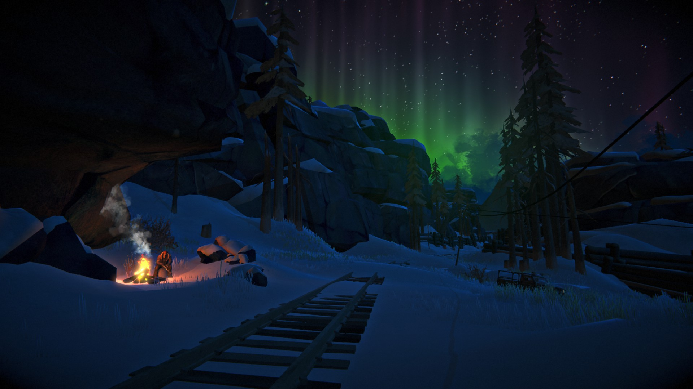

# The Best Defense

**Categories:** Episode 2 · **Source:** [Fandom](https://thelongdark.fandom.com/wiki/The_Best_Defense)

**Contents**

- [Objectives](#objectives)
- [Walkthrough](#walkthrough)
- [Trivia](#trivia)
- [Gallery](#gallery)

**The Best Defense**

[Missions story ep2 The Best Defense](../assets/Missions_story_ep2_The_Best_Defense.png)

**Episode:** [Episode 2](./Episode%202%20-%20Luminance%20Fugue.md)

**Previous:** [The Wounded Trapper](./The%20Wounded%20Trapper.md)

**Current:** The Best Defense

**Next:** [Signal to Noise](./Signal%20to%20Noise.md)

**Region:** [Mystery Lake](./Mystery%20Lake%20%28disambiguation%29.md) [Forlorn Muskeg](./Forlorn%20Muskeg.md) [Broken Railroad](./Broken%20Railroad.md)

**Characters:** [Will Mackenzie](./Will%20Mackenzie.md) [Jeremiah](./Jeremiah.md) [Old Bear](./Old%20Bear.md) [Methuselah](./Methuselah.md)

**Spoiler Warning:****This page may contain spoilers from the [story](./Wintermute.md) of The Long Dark.**

> “**A man-killing bear is on the prowl, risking Mackenzie's mission to find Astrid. But an old Voyageur legend might hold the answer to overcoming the massive predator.**”
>
> — In-game description

**The Best Defense** is the second mission in [Episode 2](./Episode%202%20-%20Luminance%20Fugue.md) of the [story](./Wintermute.md). In this mission, [Mackenzie](./Will%20Mackenzie.md) must obtain the hunting spear mentioned in a legend about the demon bear, repair it, and return to Jeremiah.

## Objectives

- Retrieve the [legendary spear](./Broken%20Bear%20Spear.md) from the [Hunting Lodge](./Hunting%20Lodge.md).
- Repair the broken spear at the [forge](./Forge.md).
- Get back to [Jeremiah](./Jeremiah.md).

## Walkthrough

| Mission details | Mission details |
| --- | --- |
| Start location | [Trapper's Homestead](./Trapper%27s%20Homestead.md) |
| Significant locations | [Maintenance Yard](./Maintenance%20Yard.md) / [Hunting Lodge](./Hunting%20Lodge.md) |

The mission starts at the Trapper's Homestead. Jeremiah tells Mackenzie that he must retrieve the bear spear from the Hunting Lodge because it may be the key to killing the Demon Bear.

Head to the train tracks and go to the right through the [Rail Tunnel](./Rail%20Tunnel.md). The player will end up in the [Forlorn Muskeg](./Forlorn%20Muskeg.md) region. Follow the tracks to the other end of the region and enter into the [Broken Railroad](./Broken%20Railroad.md) region. Before leaving the [Forlorn Muskeg](./Forlorn%20Muskeg.md) region, near the entrance to the [Broken Railroad](./Broken%20Railroad.md) region, look for a corpse leaning against the logs of a crashed log wagon of the log train. Here you will find a note that will lead you to the Ravine Cache in the [Broken Railroad](./Broken%20Railroad.md) region. Continue following the tracks until reaching the [Landslide](./Landslide.md). It is possible to scale the landslide and continue following the tracks on the other side. Otherwise, go down the hill to the right to the small pond and use the fallen tree as a bridge. Following the tracks, the player will pass the [Locomotive Engine](./Locomotive%20Engine.md) and eventually reach a crashed crew speeder. The player can enter the vehicle through the window. Upon attempting to exit the vehicle on the other side, a cutscene will begin and the Demon Bear will appear. The Demon Bear will knock over the speeder, knocking Mackenzie unconscious. When Mackenzie comes to, the [Aurora](./Aurora.md) will be in the sky and the player will be freezing. Following the tracks, the player will come across Methuselah and a campfire that can be used for warming up. Before you go down the path to the Maintenance Yard, you can make a small detour. Follow further the railway tracks until you find a pickup truck next to a yellow train/engine near the collapsed bridge. Inside the truck you will find a note that leads you to the Tree Root Cache. On the back of the pickup you can also find a well-filled [Jerry Can](./Jerry%20Can.md).

Follow the path to the Maintenance Yard. A small annex on the building contains some office space and a bed. On the bench near the door is a Forest Talker note which unlocks the [Lake Gunshots](./Lake%20Gunshots.md) side mission. Inside the main building of the maintenance yard, be careful to avoid walking through the arcing wires, as they will cause [burns](./Burns.md). Leave the Maintenance Yard Building and continue walking in the direction away from the train tracks. There is a hole in the chain-link fence, which leads down a path with streetlights lit by the aurora. Upon reaching a small lake, continue to the right along the bank. The player will come across a gate, which can be opened. Follow the path until reaching the Hunting Lodge.

A copy of _Field Dressing Your Kill, Vol 1._ can be found on the shelving to the right immediately after entering the Hunting Lodge if the book was not found during Episode 1. Picking up the book will unlock part of [The Basics of Survival](./The%20Basics%20of%20Survival.md) side mission. A note on the work bench in the basement will unlock the location of a [Forest Talker supply cache](./Forest%20Talker%20Supply%20Caches.md) in Broken Railroad. Pick up the broken spear off of the mantle.

The player must then make their way back to the Maintenance Yard to repair the spear at the forge. The metal hammer required for forging is on the shelf to the right of the forge. Scrap metal can be found in the tub near the forge, or in various places around the maintenance yard building. After successfully starting a fire in the furnace, the furnace will jump to 170°C and will burn for an "infinite" amount of time. At this point, the player can select the forge and repair the bear spear. Doing so will also unlock building the improvised knife and improvised hatchet.

After repairing the spear, return to the railroad, and follow the tracks back through Forlorn Muskeg to Mystery Lake. Then return to the [Trapper's Homestead](./Trapper%27s%20Homestead.md). Entering the Homestead will start a cutscene and end the mission.

## Trivia

- It is possible to return through the cave system back to [Mountain Town](./Mountain%20Town.md), but the climbing rope leading to [Milton Park](./Milton%20Park.md) is still snapped. [Milton Basin](./Milton%20Basin.md) cannot be accessed in the Muskeg as the path is blocked by a mountain, so it is impossible to return to [Milton](./Milton.md).

## Gallery

