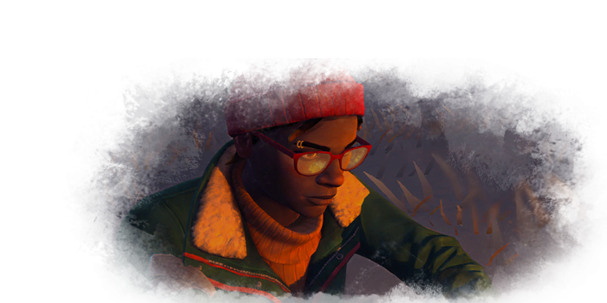

# The Cold, Broken Road

<table class="infobox">
<caption>The Cold, Broken Road</caption>
<colgroup>
<col style="width: 50%" />
<col style="width: 50%" />
</colgroup>
<tbody>
<tr>
<td colspan="2"><figure>

<figcaption>Missions_story_ep5_TheLongBrokenRoad.png</figcaption>
</figure></td>
</tr>
<tr>
<td>
Episode
</td>
<td></td>
</tr>
<tr>
<td colspan="2" class="section">
<strong>Missions</strong>
</td>
</tr>
<tr>
<td>
Previous
</td>
<td>
<a href="./A%20Cry%20For%20Help.md" class="wikilink" title="A Cry For Help">A Cry For Help</a>
</td>
</tr>
<tr>
<td>
Current
</td>
<td>
The Cold, Broken Road
</td>
</tr>
<tr>
<td>
Next
</td>
<td>
<a href="./High%20Energy.md" class="wikilink" title="High Energy">High Energy</a>
</td>
</tr>
<tr>
<td>
Region
</td>
<td>
<a href="./Blackrock%20Foothills.md" class="wikilink" title="Blackrock Foothills">Blackrock Foothills</a> <a href="./Suzuki%20Environs.md" class="wikilink" title="Suzuki Environs">Suzuki Environs</a>
</td>
</tr>
<tr>
<td>
Characters
</td>
<td>
<a href="./Will%20Mackenzie.md" class="wikilink" title="Will Mackenzie">Will Mackenzie</a> 
<a href="./Jace.md" class="wikilink" title="Jace">Jace</a> 
<a href="./Atwood.md" class="wikilink" title="Atwood">Atwood</a>
</td>
</tr>
</tbody>
</table>

|     |                                                     |     |
|-----|-----------------------------------------------------|-----|
| “   | Find Atwood. | ”   |

**The Cold, Broken Road** is the first mission of Part Two: Strange History in <a href="./Episode%205%20-%20The%20Light%20At%20The%20End%20Of%20All%20Things.md" class="wikilink" title="Episode 5: The Light At The End Of All Things">Episode 5: The Light At The End Of All Things</a> of the <a href="./Wintermute.md" class="wikilink" title="Wintermute">Wintermute</a> story of <a href="./The%20Long%20Dark.md" class="wikilink" title="The Long Dark"><em>The Long Dark</em></a>.

## Objectives

- Find a way to the Suzuki Radio Telescope.
  - Explore Logging Camp.
  - Investigate the river.
  - Reach the abandoned mine.
- Get through the unstable mine.
  - Light lamps and clear obstacles for Jace.
- Deliver the "Wintermute" message to Dr Atwood.
  - Visit the kitchen and get some rest.
  - Return to the control room.
  - Get ready for the Geothermal Substations mission.

## Walkthrough

## Trivia

**Lua execution error in Module:Navbox function navbox**

