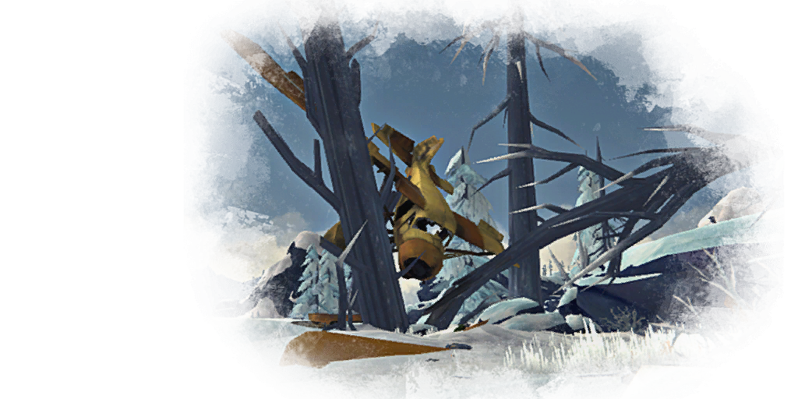

# The Crash/Transcript

**Source:** [Fandom](https://thelongdark.fandom.com/wiki/The_Crash%2FTranscript)

**Contents**

- [Transcript](#transcript)
- [Try to climb out of the ravine](#try-to-climb-out-of-the-ravine)
- [Find shelter from the cold](#find-shelter-from-the-cold)
- [Search for Astrid](#search-for-astrid)
- [Look for clues](#look-for-clues)
- [Investigate the house](#investigate-the-house)

**The Crash/Transcript**

_The\_Crash.png_

**Release:** [17 December 2018](./The%20Long%20Dark%20%E2%80%94%20Changelog.md#1.41)

**Episode:** [Episode 1: Do Not Go Gentle](./Episode%201%20-%20Do%20Not%20Go%20Gentle.md)

**Mission Type:** Primary

**Missions**

**Previous:** [Memories/Transcript](./Memories%20%E2%80%94%20Transcript.md)

**Current:** The Crash/Transcript

**Next:** [The Grey Mother/Transcript](./The%20Grey%20Mother%20%E2%80%94%20Transcript.md)

This is the mission transcript for mission 2 [The Crash](./The%20Crash.md) of [Episode 1: Do Not Go Gentle](./Episode%201%20-%20Do%20Not%20Go%20Gentle.md).

## Transcript

_The mission begins right where it did in [Memories](./Memories.md), with Mackenzie grunting in pain and gasping for air as he slowly blinks back into consciousness at the crash site. The ambient electrical wail of an [Aurora](./Aurora.md) plays overhead as the camera shifts to reveal trees, fire, smoke, and wreckage of a crashed plane. Mackenzie gets up and cries out:_

[Will Mackenzie](./Will%20Mackenzie.md): "...Astrid?"

_The man gets up, and notices a piece of metal lodged in his left hand, hesitating before deciding to pull it out. The process is slow, and is not without consequence, as the man's cries of pain ring out during the pulling. After the [Scrap Metal Shard](./Scrap%20Metal%20Shard.md) is pulled out, the man shouts to the hills around him._

Mackenzie: "Astrid!"

_The man looks at the gaping wound in his hand before the camera shifts and slowly zooms out as if to give control to the player, but instead the camera turns to show the wrecked plane above._

Mackenzie: "...I must have gone right through the windshield. Trees broke my fall...mostly."

_Text appears on the screen:_

CHAPTER TWO

THE CRASH

_Mackenzie uses a [Bandage](./Bandage.md) to stop the bleeding from his hand, then begins to hobble with a [Sprained Ankle](./Sprained%20Ankle.md). Fire and debris scour a ravine that the pilot finds himself in, with various crates from the plane able to be broken down for supplies._

## Try to climb out of the ravine

_If the player attempts to walk up the fallen tree bridge to use the [Rock Climb](./Rock%20Climb.md) out of the gorge, the camera will stop to show the climb and Mackenzie will say:_

Mackenzie: "I could probably climb that."

_A special cutscene plays of Mackenzie failing to climb out and falling down._

Mackenzie: "Damn... arm's too weak. I need to find some shelter from this wind."

## Find shelter from the cold

_Mackenzie makes his way back down the tree bridge and into a nearby cave. A bed is inside, but attempting to sleep gives the message BANDAGE WOUND AND WARM THE CAVE UP FIRST. It is too cold to rest up so he makes a fire._

Mackenzie: "I don't feel so good. I need to rest up."

_Mackenzie falls asleep for the night. Morning breaks and the stranded pilot wakes up in the cave with the campfire having burned out by now and his Sprained Ankle healed._

Mackenzie: "Astrid hasn't come looking for me, which means she can't come looking for me...because she's she's hurt...or worse. I'd better get back up to the crash site."

_The various fires from the night before have all but died down, with only vapors of smoke rising from the wreckage. Mackenzie then makes his way back up the tree bridge and climbs his way out of the ravine. The wound on his hand is properly bandaged when climbing out. After climbing the second Rock Climb:_

Mackenzie: "I think I'm gonna make it."

_After the final climb:_

Mackenzie: "Finally...made it."

_Mackenzie then walks around a bend and up to the wreckage of his floatplane._

Mackenzie: "My plane...not sure which of us looks worse. Poor girl, this isn't how things were supposed to end."

## Search for Astrid

_If the player tries to leave the crash site via the wing serving as a ramp, Mackenzie will hit an invisible wall and say:_

Mackenzie: "There must be signs of Astrid around here somewhere."

_Mackenzie then finds his [Parka](./Mackenzie%27s%20Parka.md) and puts it on._

Mackenzie: "I've been looking for you."

_Walking further under the wreckage, Will finds [Astrid's Backpack](./Astrid%27s%20Backpack.md) and [Astrid's Hardcase](./Astrid%27s%20Hardcase.md)._

Mackenzie: "Astrid's pack."

_The man then picks up the hardcase, eyeing the lock before taking it._

Mackenzie: "Hmm...locked. Whatever's in this case, Astrid was willing to die for it. I hope she hasn't already died for it."

## Look for clues

_Mackenzie then pilfers whatever is left of the crash site before using a piece of his plane's wing as a ramp to leave the area, before noticing something caught on a tree branch fluttering in the wind. A piece of Astrid's scarf._

Mackenzie: "She definitely passed through here, and in a hurry."

_Mackenzie then travels to a nearby pond filled with Rabbits, before finding a burned out Campfire._

Mackenzie: "Someone's been here recently. Could it have been Astrid?"

_He travels further down a nearby path_

Mackenzie: "Astrid...where did you go?"

_He comes across a Wolf feeding on a Deer Carcass_

Mackenzie: "Woah...is that a wolf? I'd better keep my distance."

_Mackenzie goes around the Wolf to not disturb it, before spotting a radio tower._

Mackenzie: "Woah. Looks like some kind of radio tower. I must be closer to civilization than I thought."

_Traveling to the tower, Mackenzie sees Crows circling above something, before seeing a corpse of a man before him._

Mackenzie: "Woah, someone's just...sitting here. Frozen. What the hell?"

_Mackenzie ignores or searches the man's pockets, before he looks over the scenic overlook._

Mackenzie: "Great. A town. Maybe I can find help there."

_Mackenzie makes his way down a path leading to the town before spotting a house with smoke rising from it's chimney._

Mackenzie: "Look. Smoke from that chimney. That means someone's home."

## Investigate the house

_Mackenzie walks into the town, looking for other signs of life and begins shouting:_

Mackenzie: "Hello? Anyone out there?"

_Getting no response, Mackenzie walks up further into town and begins seeing boarded up houses._

Mackenzie: "Hmph...this whole area looks like its been abandoned for awhile."

_He returns his attention to the house with the active fireplace, before seeing the bloody corpse of a man in an orange jumpsuit laying against the wall of the shed in the backyard._

Mackenzie: "What happened here?"

_Mackenzie reluctantly follows the blood in the snow to the nearby porch, then to the front door of the large house, before stepping inside._

Mackenzie: "Hello? Anybody here?

_The house shows signs of a struggle, with bullet holes in the walls. Mackenzie walks to his right and sees an old woman with a blindfold over her eyes and a rifle in her hands, sleeping, and approaches her._

Mackenzie: "Hey...hey, wake up."

_Mackenzie attempts to touch her, before a loud bang erupts from before him, startling him and sending him backwards. The old woman comes to life, and instantly points the rifle at the startled pilot._

Mackenzie: "Holy shi...wait...hold your fire!"

Unknown Woman: "Get back!"

Mackenzie: "Ok, ok...just take it easy."

Unknown Woman: "Why are you here?"

Mackenzie: "I saw the smoke from your chimney."

Unknown Woman: "Outsider?"

Mackenzie: "Uh...What?"

Unknown Woman: "Thought so. Mainlander. Outsider. I don't recognize your voice and you haven't left like the others so...must be a Mainlander. Someone who doesn't know any better."

Mackenzie: "My plane...I crashed in the mountains nearby. I'm looking for someone who crashed with me. A friend. She might be injured."

Unknown Woman: "I haven't seen her."

Mackenzie: "Listen...could you maybe point that gun someplace safe?"

Unknown Woman: "You think because my eyes are covered, I can't see you? Make the wrong move, say the wrong thing...you'll see how good a shot I am."

Mackenzie: "I don't doubt it."

Unknown Woman: "The others, are all gone. If you're here, things must be worse than they thought."

_The woman slowly lowers her rifle, aiming it away from Mackenzie and placing it in her lap._

_At this point, several dialogue options appear on the screen, and can be answered in any order. White text is optional, Blue is mandatory to progress:_

**White Dialogue**

- WHO ARE YOU?

Mackenzie: "Name's Mackenzie, by the way. And you are..."

Unknown Woman: "I had a name...once. But for years the townsfolk have called me "Grey Mother." A name takes on its own life, such that at one point the name becomes the thing it belongs to. Then, the old names fade and can only be remembered by the young and the true."

Mackenzie: "So, I should call you..."

[Grey Mother](./Grey%20Mother.md): "You should call me Grey Mother also."

- TOWN

Mackenzie: "Where are we?"

Grey Mother: "Milton. A forgotten town deep in the mountains. You're far from home."

Mackenzie: "But...where are we on Great Bear? My plane came down in a storm and my compass was acting funny..."

Grey Mother: "I've lived here all my life. Not much use for the outside world. Milton's the last of the old mountain towns. Now, it's almost impossible to get to. Or get out of. Only people left here are either too poor or proud to leave."

Mackenzie: "Which are you?"

Grey Mother: "I have what I need. At least, before the bad men came. Now...I'm not sure I have enough to make it through the winter."

Mackenzie: "I need to find my friend, but...I'll do what I can to help."

Grey Mother: "My mind is...fuzzy. Some things come through so sharp and others...like a dream. Let me think. Let me rest. Maybe I can pull some memories out of the fog. Maybe I can find something that could help you find your friend."

- EMPTY

Mackenzie: "The town seems so quiet. Does anyone still live here?"

Grey Mother: "Not many. After the earthquakes...less. After last night...Even fewer."

Mackenzie: "Where did everyone go?"

Grey Mother: "That...I cannot say. All I know is that I heard screams and could smell smoke...for most of the night."

- SMOKE

Mackenzie: "You mentioned smelling smoke?"

Grey Mother: "Someone came here...one of the townsfolk. Tried to convince me to leave. They said there were houses...burning, in the town. They said people were scared and were leaving for the coast...on foot. Foolish plan. But that's what they said to do, after the quakes -- if there was ever another emergency. "Go to the coast, and help will come." They wanted me to go with them, but I'm not ready to leave Milton."

Mackenzie: "They left you here...alone?"

Grey Mother: "I'm not alone. I have my Lily."

Mackenzie: "Lily?"

Grey Mother: "Nevermind."

- WAY OUT?

Mackenzie: "Ok...well, any idea how I can get out of this town? I need to find help."

Grey Mother: "The old quake closed down most of the roads in and out of town. That was years ago. Blizzard just swept through down. After the power went out. As for help -- you won't find any out there. You're on your own. We both are."

**Blue Dialogue**

- GUN

Mackenzie: "Sitting here with a rifle in your hands...you expecting trouble?"

Grey Mother: "Trouble? Ha! Trouble found me."

Mackenzie: "You mean the storm?"

Grey Mother: "The bad men. The bad men came. Took my things. Tried to take my house. They thought they were safe, because Grey Mother can't see. They were wrong."

- BAD MEN

Mackenzie: "Who are the bad men?"

Grey Mother: "The men...they passed through town. The night of the storm. The night of the lights."

Mackenzie: "I'm looking for my friend. She crashed with me when my plane came down in the mountains. Do you think she could have come through and been caught... by these bad men?"

Grey Mother: "I can't say for sure. Is your friend a survivor?"

Mackenzie: "I...yes. She is."

Grey Mother: "Then there is always hope."

- HURT?

Mackenzie: "The bad men -- did they try to hurt you?"

Grey Mother: "Everyone thinks being old means you're weak. But they underestimated Grey Mother."

Mackenzie: "It seems they did."

- SUPPLIES?

Mackenzie: "I crashed without much food or gear myself. And if these "bad men" cleaned you out, we're gonna need to find some food and fuel, or neither of us are going to make it through the next few days. You have any idea where we can find some supplies?"

Grey Mother: "The "bad men" took everything. The others in town who would have helped me are gone. The ones left are will have their own worries. It's up to you, Outsider."

Mackenzie: "I'll do what I can, but I'll need your help. There must be somewhere in town to get food, fuel. The essentials."

Grey Mother: "What about your friend? Aren't you in a hurry to find her?"

Mackenzie: "Yes, I am. And I'll be looking for signs of her. But there's a lot of ground to cover, and without gear I won't make it. So while I'm looking for supplies, you see what you can remember about the night of the lights, and if she might passed through town. That way, we can both help each other."
