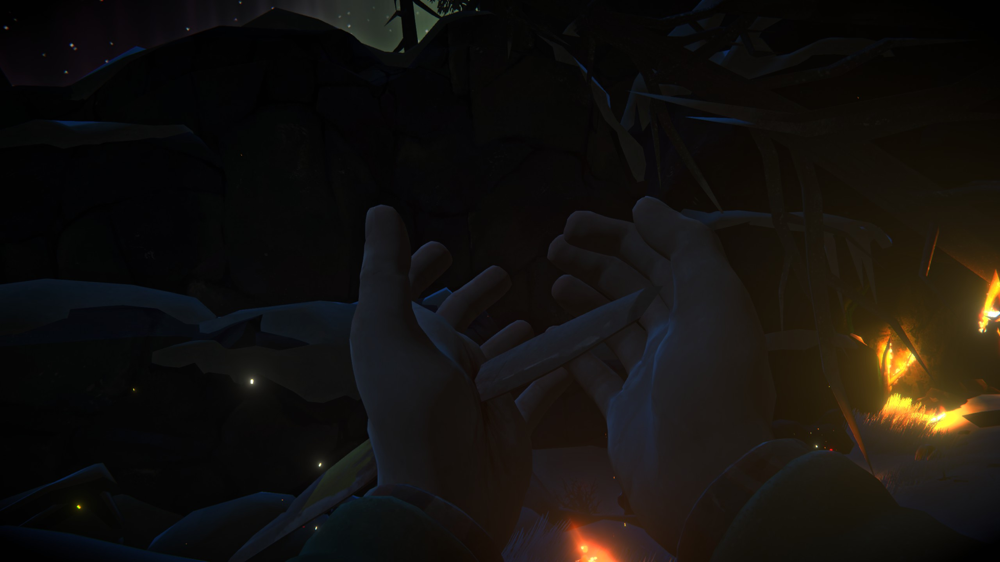
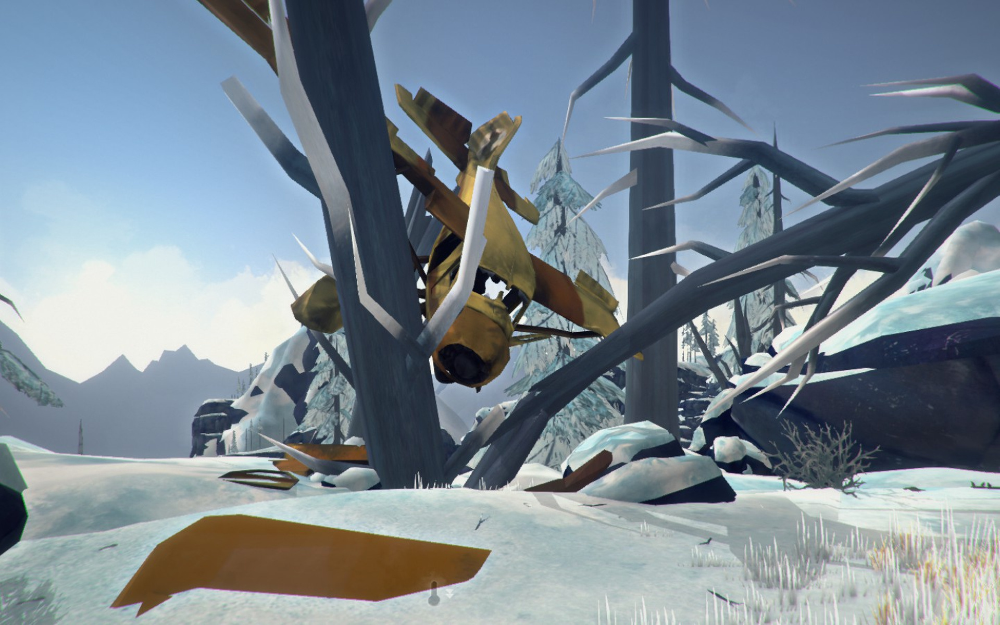

# The Crash

**Categories:** Episode 1, Pages with update history · **Source:** [Fandom](https://thelongdark.fandom.com/wiki/The_Crash)

**Contents**

- [Official description](#official-description)
- [Objectives](#objectives)
- [Survive the night](#survive-the-night-1)
- [Stop the Blood Loss](#stop-the-blood-loss)
- [Survive the night](#survive-the-night-1)
- [Search for Astrid](#search-for-astrid)
- [Climb out of the Ravine](#climb-out-of-the-ravine)
- [Travel to town](#travel-to-town)
- [Transcript](#transcript)
- [Update history](#update-history)

**The Crash**

| Property | Details |
| --- | --- |
| | [The Crash](../assets/The_Crash.png) |
| Episode | [Episode 1](./Episode%201%20-%20Do%20Not%20Go%20Gentle.md) |
| **Missions** | |
| Previous | [Memories](./Memories.md) |
| Current | The Crash |
| Next | [The Grey Mother](./The%20Grey%20Mother.md) |
| Region | [Mountain Town](./Mountain%20Town.md) |
| Characters | [Will Mackenzie](./Will%20Mackenzie.md) [Grey Mother](./Grey%20Mother.md) |

**Memories** is the second mission in [Episode One](./Episode%201%20-%20Do%20Not%20Go%20Gentle.md) of [Wintermute](./Wintermute.md), where [Will Mackenzie](./Will%20Mackenzie.md) must survive through the night after his plane crashes and search for signs of [Astrid](./Astrid%20Greenwood.md).

## Official description

> “**Mackenzie fights to stay alive while searching for signs of Astrid. What happened to her?**”
>
> — In-game description

## Objectives

This section contains a list of the journal entries for the mission:

- Survive the night.
  - Use First Aid to stop the Blood Loss.
  - Try to climb out of the ravine.
  - Find shelter from the cold.
  - Start a Fire.
  - Sleep in the cave.
  - Climb out of the Ravine.

- Search for Astrid
- Look for clues.
- Look for a nearby town.
- Investigate the house.

## Survive the night

### Stop the Blood Loss

After waking up in the ravine, the player must stop the blood loss using the bandage in the inventory. The bandage can be applied by activating the [Radial Menu](./Radial%20Menu.md), navigating to the [first aid](./First%20Aid.md) tab, and then using the bandage on the blood loss [affliction](./Afflictions.md). If the blood loss is not stopped, the player will continue to lose condition.

### Survive the night

The player should then make their way to the cave, collecting some of the materials strewn about on the way. Spending too much time outside will cause the player to become freezing and lose [Condition](./Condition.md). Breaking down items, such as breaking branches into [Sticks](./Stick.md), is a **time accelerated activity**, meaning that time will pass rapidly and therefore the player's Condition may drain quicker.

Once in the cave, the player must start a [Campfire](./Campfire.md). This can be done by activating the radial menu again, navigating to the campcraft tab, and selecting the [fire](./Fire.md) option.

Once a Campfire has been successfully started, the player can select the moss on the cave floor to sleep on. The player has no control over the amount of time slept and the amount of fuel available at the crash site is very limited, so the Campfire is practically guaranteed to go out while sleeping, meaning some Condition loss will unavoidably occur. Drinking a [Cup of Herbal Tea](./Cup%20of%20Herbal%20Tea.md) just before leaving in [Memories](./Memories.md) provides [Warming Up](./Warming%20Up.md) and [Improved Rest](./Improved%20Rest.md); the former helps slow down heat loss, and the latter can help restore Condition when sleeping while the Campfire is still keeping the player warm.

## Search for Astrid

### Climb out of the Ravine

 The next morning, the player can leave the ravine by walking up the fallen tree and then climbing the vines. At the top, the player will pass [Mackenzie's Crashed Plane](./Mackenzie%27s%20Crashed%20Plane.md). Underneath the plane is [Mackenzie's Parka](./Mackenzie%27s%20Parka.md), a [Bedroll](./Bedroll.md), [Astrid's Backpack](./Astrid%27s%20Backpack.md), and [Astrid's Hardcase](./Astrid%27s%20Hardcase.md). Further along the cliff, the extra supplies chosen by the player in [the previous mission](./Memories.md) can be found on the ground. The player then makes their way past the [Radio Tower](./Radio%20Tower.md).

### Travel to town

Mackenzie will notice the [Milton House (Grey Mother's)](./Milton%20House%20%28Grey%20Mother%27s%29.md) with smoke rising from the chimney. Approaching the house, there is a shed with a dead prisoner. A [hatchet](./Hatchet.md) may be on top of the toolbox. Entering the house will start the [next mission](./The%20Grey%20Mother.md).

## Transcript

[The Crash/Transcript](./The%20Crash%20%E2%80%94%20Transcript.md)

## Update history

- UPDATE **17 December 2018 ([Update](./The%20Long%20Dark%20%E2%80%94%20Changelog%20%E2%80%94%20Archive%201.md#1-41-wintermute-redux-update)):**
  - Added to the game.
