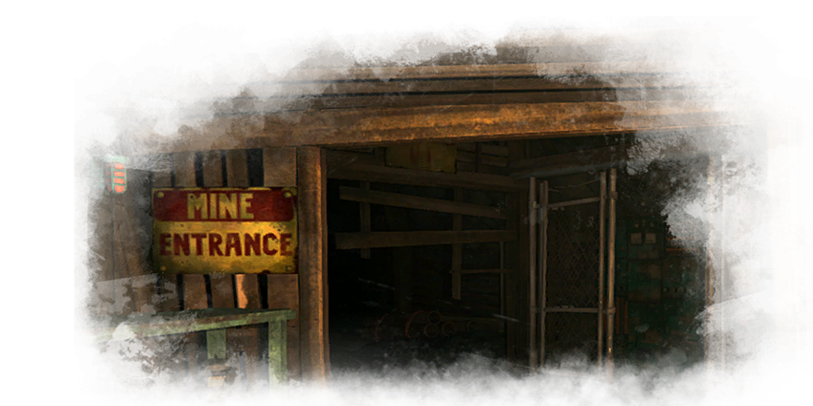

# The Detonators

**Categories:** Episode 4 · **Source:** [Fandom](https://thelongdark.fandom.com/wiki/The_Detonators)

**The Detonators**

Episode

**Missions**

**Previous:** [The Power Plant](./The%20Power%20Plant.md)

**Current:** The Detonators

**Next:** [Donner\_(mission)](./Donner%20%28mission%29.md)

**Region:** [Blackrock Region](./Blackrock.md)

**Characters:** [Will Mackenzie](./Will%20Mackenzie.md) [Mathis](./Mathis.md) [Vachon](./Vachon.md) [Heller](./Heller.md) [Jace](./Jace.md)

**The Detonators** is the fourth mission in [Episode 4](./Episode%204%20-%20Fury%2C%20Then%20Silence.md) of [Wintermute](./Wintermute.md). In this mission, [Mackenzie](./Will%20Mackenzie.md) offers to help [Mathis](./Mathis.md) find [Detonators](./Detonators.md) in the old mine, in order to hopefully appease Mathis sufficiently that he avoids killing [Franklin](./Franklin.md).

## Objectives

- Reach the mine entrance.
- Explore the mine.
  - Find the detonators.
  - Answer the phone.
  - Leave the mine.
- Return to Blackrock.

## Walkthrough

| Mission details | Mission details |
| --- | --- |
| Start location | Blackrock Federal Penitentiary |
| Significant locations | The Mine |
| Items recommended | [rifle](./Hunting%20Rifle.md), [revolver](./Revolver.md), [noisemaker](./Noisemaker.md), [Go! Energy Drink](./Go!%20Energy%20Drink.md), [Storm Lantern](./Storm%20Lantern.md) |

The mission starts back at Blackrock Prison. Gather all the supplies left behind in the guardroom and head down the road. From there, take the first left and follow the signs leading to the mine. Along the way, there are good opportunities to do some of the side quests, such as [Blackrock Rumours](./Blackrock%20Rumours.md) at [Bricklayer's Retreat](./Bricklayer%27s%20Retreat.md) and [No Road Cave](./No%20Road%20Cave.md), and searching for the various supply caches in [Convict Caches](./Convict%20Caches.md).

After walking a considerable distance, the player will arrive at [Mule Bridge](./Mule%20Bridge.md). Be careful not to fall off while crossing, as this will be fatal. Once across, enter the mine.

Inside the mine, pick up the elevator crank, and keep to the right (crawling under some low overhangs) to come to the mine's elevator. Use the crank to descend to Level 3.

Once on Level 3, there will be large pockets of unbreathable air. Get the first handle and install it on the air valve to create a safe space. Once there, sprint down the tunnel to the next safe space. Wait for [stamina](./Stamina.md) to come back, then sprint to the corpse next to an air valve handle (another safe space). Repeat the process of sprinting between safe spaces as much as needed. Use [an energy drink](./Go!%20Energy%20Drink.md) if needed. The corpse will have the [Mine Gate Key](./Mine%20Gate%20Key.md) needed to unlock a wooden door.

When back at the second air valve from the entrance, install the handle and turn it on. Now take the handle from the air valve nearest the entrance and remove it (you need to turn off the air first). Go back to the second air valve, then open the door and sprint to the next air valve. Open this valve to create a safe space. When stamina comes back, head for the elevator and go up to get out of the dangerous gas.

Once up to Level 2, get the Detonators by climbing onto some wooden planks laid over a deep hole. Also pick up the [Bolt Cutters](./Bolt%20Cutters.md) to cut the chain on the gate. Head back to the elevator and go up to Level 1, using the bolt cutters to cut the chain on the second gate. Shortly before leaving [Jace](./Jace.md) will call. Tell her what you're doing, and Jace will mention that she's going to use "the nuclear option" to prevent Donner from escaping. When attempting to escape the mine, the character will be knocked unconscious by falling rocks.

When the character re-awakens, the path to the old entrance is blocked and the [aurora](./Aurora.md) is active. Head up the wooden planks to another entrance, being careful not to step on live wires. From here, it's possible to sleep in the mine entrance and make the walk back to [Blackrock Prison](./Blackrock%20Prison.md) in the morning, or to proceed at night. The route back to Blackrock requires three rope climbs, and so is best done when well rested.

Shortly before the prison, Mackenzie will make a comment when he sees several corpses lying on the ice of the river. These corpses are just decorative and can't be looted. Once in the yard, it may be wise to leave a [Storm Lantern](./Storm%20Lantern.md) in the entrance to the [Steam Tunnels](./Steam%20Tunnels.md), though this is not necessary. The mission is complete when Mackenzie arrives at the prison door.
