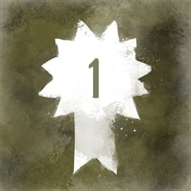

# The First of Many

**The First of Many**

| Property | Details |
| --- | --- |
|  |  / *The\_First\_of\_Many.jpg* |
| Description | You survived for 1 day in a single Survival mode game. |

**The First of Many** is an [Achievement](./The%20Long%20Dark%20%E2%80%94%20Achievements.md) in *[The Long Dark](./The%20Long%20Dark.md)*.

## Guide

This achievement is obtained after surviving for twenty-four hours in a single [Survival Mode](./Survival%20Mode.md) game. It is most easily done on Pilgrim.

## Game history

This achievement was introduced on 1 April 2015 in [version 0.212](./The%20Long%20Dark%20%E2%80%94%20Changelog.md#0.212).

**Lua execution error in Module:Navbox function navbox**[ru:Достижения Steam](ru:%D0%94%D0%BE%D1%81%D1%82%D0%B8%D0%B6%D0%B5%D0%BD%D0%B8%D1%8F_Steam)
