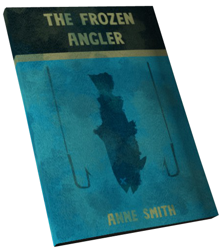
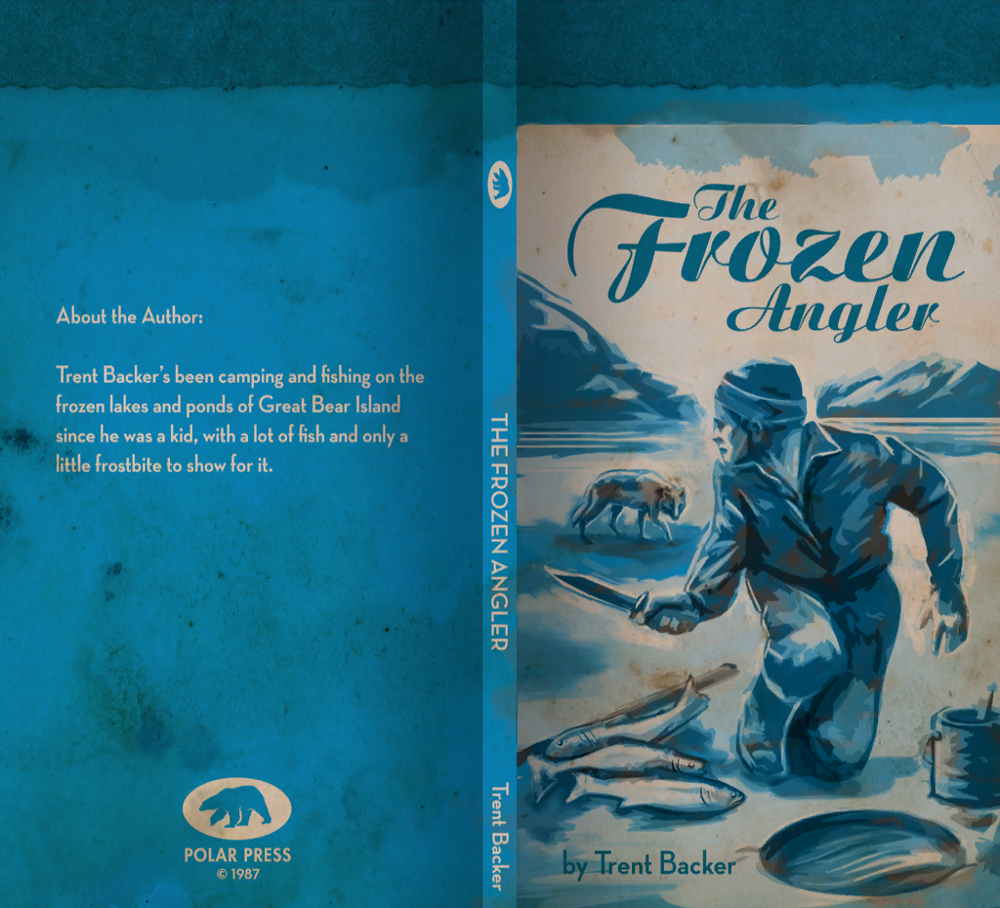

# The Frozen Angler

**Categories:** Fire Starting, Ice Fishing, Pages with update history, Tools · **Source:** [Fandom](https://thelongdark.fandom.com/wiki/The_Frozen_Angler)

**Contents**

- [Research info](#research-info)
- [Fire Starting info](#fire-starting-info)
- [Trivia](#trivia)
- [Gallery](#gallery)
- [Update history](#update-history)

**The Frozen Angler**

| Property | Details |
| --- | --- |
|  | [The Frozen Angler icon](../assets/The_Frozen_Angler_icon.png) |
| Release | [23 June 2016](./The%20Long%20Dark%20%E2%80%94%20Early%20Access%20Changelog.md#0-346) |
| Wintermute | No |
| Renewable | Yes |
| **Properties** |  |
| Item type | [Fire Starting](./Fire%20Starting.md)[Tools](./Tools.md) |
| Equipable | No |
| Stackable | No |
| Examine | An instructional manual on ice fishing. Researching this will improve your Skill. |
| **Values** |  |
| Weight | 0.50 kg (1.1 lbs) |
| **Actions** |  |
| Backpack | Research, Drop |

_For the version encountered in [Wintermute](./Wintermute.md), see [The Frozen Angler (Survival School)](./The%20Frozen%20Angler%20%28Survival%20School%29.md)._

**The Frozen Angler** is a [Research Book](./Research%20Book.md) used to improve the [Ice Fishing](./Ice%20Fishing.md) skill. It can also be used as Fuel when starting a [Fire](./Fire.md).

## Research info

_The Frozen Angler_ can be researched for 5 hours, which can be broken into multiple research sessions. 10 [Ice Fishing skill points](./Ice%20Fishing.md#skill-levels) are awarded on completing the research.

Research can only be performed under the following conditions:

- There is light present to read
- [Warmth](./Warmth.md), [Fatigue](./Fatigue.md), [Thirst](./Thirst.md), and [Hunger](./Hunger.md) exceed 0%
- No negative [Afflictions](./Afflictions.md)

## Fire Starting info

**The Frozen Angler**

| Property | Details |
| --- | --- |
| Type | Fuel |
| **Statistics** |  |
| Duration | [Fire Starting](../assets/Fire_Starting.png) 18 minutes |
| Start Chance | [Firestart mod icon](../assets/Firestart_mod_icon.png) +35% |
| Heat | [Fire heat icon](../assets/Fire_heat_icon.png) +2°C (+3.6°F) |
| Burn Density | 0.6 hr/kg (0.27 hr/lb) |

## Trivia

- Reaching 0% in any Needs while researching will immediately end the research session and negate any progress for that research attempt.
- Attempting to burn a copy of _The Frozen Angler_ when it has not been fully read will give a confirmation warning before it can be burned.
- Once a copy of _The Frozen Angler_ is fully researched, it will no longer appear in the Tools section of the Backpack.

## Gallery

## Update history

- UPDATE **23 June 2016 ([Update](./The%20Long%20Dark%20%E2%80%94%20Early%20Access%20Changelog.md#0-346)):**
  - Added to game.
