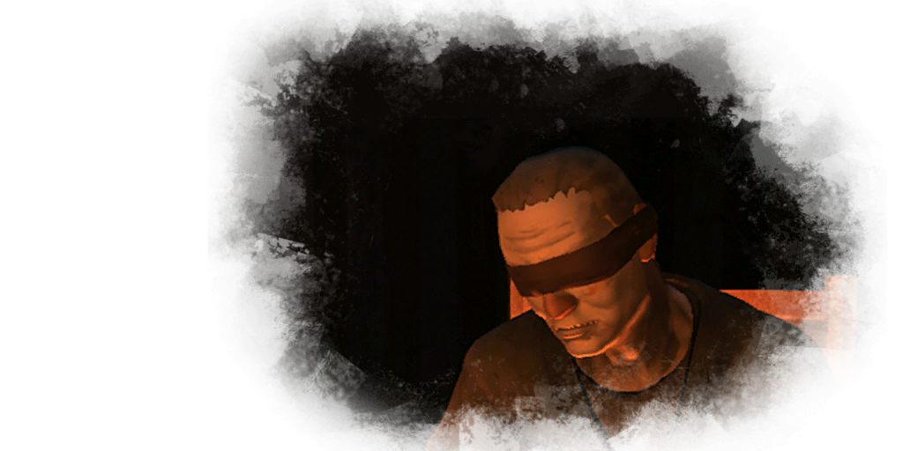

# The Grey Mother/Transcript

**Categories:** Episode 1 · **Source:** [Fandom](https://thelongdark.fandom.com/wiki/The_Grey_Mother%2FTranscript)

**Contents**

- [Transcript](#transcript)
- [Find supplies to help keep Grey Mother alive.](#find-supplies-to-help-keep-grey-mother-alive)
- [Return to Grey Mother](#return-to-grey-mother)
- [Grey Mother thinks something happened at the tunnel leading out from Milton. Investigate.](#grey-mother-thinks-something-happened-at-the-tunnel-leading-out-from-milton-investigate)
- [Something precious was stolen from Grey Mother. Find it, and return it to her.](#something-precious-was-stolen-from-grey-mother-find-it-and-return-it-to-her)
- [Dealing with Hobbs](#dealing-with-hobbs)

**The Grey Mother/Transcript**

_The\_Grey\_Mother.png_

**Episode:** [Episode 1](./Episode%201%20-%20Do%20Not%20Go%20Gentle.md)\|-

**Previous:** [The Crash/Transcript](./The%20Crash%20%E2%80%94%20Transcript.md)

**Current:** The Grey Mother/Transcript

**Next:** [Paradise Lost/Transcript](./Paradise%20Lost%20%E2%80%94%20Transcript.md)

**Region:** [Mountain Town](./Mountain%20Town.md)

**Characters:** [Will Mackenzie](./Will%20Mackenzie.md) [Grey Mother](./Grey%20Mother.md) / [Methuselah](./Methuselah.md) / [Hobbs](./Hobbs.md)

This is the mission transcript for mission 3 [The Grey Mother](./The%20Grey%20Mother.md) of [Episode 1: Do Not Go Gentle](./Episode%201%20-%20Do%20Not%20Go%20Gentle.md).

## Transcript

_The chapter name appears on the screen shortly after speaking with [Grey Mother](./Grey%20Mother.md)._

CHAPTER 3

THE GREY MOTHER

_At this point, new optional dialogue options appear when speaking with Grey Mother._

- Mainlander?

[Will Mackenzie](./Will%20Mackenzie.md): "You keep calling me a Mainlander. Why?"

Grey Mother: "It's what you are, isn't it? From the Mainland? An Outsider? You don't really belong here, do you?"

Will Mackenzie: "Ok, but you sound bitter about it."

Grey Mother: "We lost everything in [the Collapse](./The%20Collapse.md). People didn't realize how dependent we'd become. Some were fine with it. Others didn't want the scraps from your table. It created deep rifts in families, communities. Scars that never healed. The Mainland had become our lifeline. And it was suddenly cut. And so, we suffered."

Will Mackenzie: "I guess I don't know much about that history."

Grey Mother: "I'm not surprised. You Mainlanders have always been focused on your own story. Only interested in Great Bear when it had something to give you. If you can't cut it down or dig it out of the ground, what use is it to you?"

- Power

Will Mackenzie: "The power seems out all over town."

Grey Mother: "The power's always been spotty here, since the quakes. No money to fix the broken stuff left behind. And nobody from the Mainland seemed to care enough to do anything about it."

Will Mackenzie: "I'm sure...someone will come to fix it."

Grey Mother: "Nobody's coming to save Milton."

Will Mackenzie: "How can you be so sure?"

Grey Mother: "I've learned to hear the difference between something quiet, and something abandoned. This goes deeper than just stillness. It feels like the moments before the world goes to sleep. We're just the last ones awake to notice it."

- Others

Will Mackenzie: "What really happened here? Seems like people were here recently. Where did they go? Why didn't they call for help or...just drive out?"

Grey Mother: "The power went out. Who knows the reason. People started to get cold, hungry. They panicked. Started to talk crazy. Others walked here from the highway...some, belonged here. Others, were Outsiders like you."

Will Mackenzie: "Did anyone see a woman? Brown hair, would have had a tan jacket...scarf with...birds on it. Possibly injured."

Grey Mother: "There was an Outsider woman. I heard her pass through. She wasn't alone. There were angry voices, and...but the storm was so loud."

Will Mackenzie: "Voices?"

Grey Mother: "I lost the voices and I couldn't get them back."

- Voices?

Will Mackenzie: "Before, you mentioned hearing voices. Do you remember what you heard?"

Grey Mother: "The memories are grey...misty. I'm trying to remember. It was...windy. The blizzard was already waking up. But I heard yelling. A scream."

Will Mackenzie: "Was it a woman's voice?"

Grey Mother: "I'm not sure. The voices were...thin. Far. The blizzard was waking up. Soon there was only wind and...darkness. I don't know. I don't remember. It's all cloudy now."

### Find supplies to help keep Grey Mother alive.

_Having exhausted all dialogue with Grey Mother, Mackenzie leaves the house and begins searching for food and fuel for the old woman. If the player travels to the [Old Schoolhouse](./Old%20Schoolhouse.md), Mackenzie will say:_

Will Mackenzie: "This is just...terrible."

_A small amount of blood is at the ruined front steps of the remains of the school, along with burned glasses and a burned pair of child sized sneakers. Most of the homes that are still standing in the town have been ransacked, most likely by the "bad men" Grey Mother mentioned. Eventually Mackenzie makes his way to the [Orca Gas Station](./Orca%20Gas%20Station.md), and if the player arrives at night, they will see a glow coming from inside the building, as if the power is still on inside, despite the pumps and outdoor lights not being powered. Stepping inside through the front door, he sees an old man in front of the register, with his walking stick leaning against a pillar to his left, a [Green Birch Sapling](./Green%20Birch%20Sapling.md) and [Cup of Coffee](./Cup%20of%20Coffee.md) to his right, and an active fire in a [Rim Grill](./Rim%20Grill.md) right in front of him. Mackenzie walks up to him and speaks to him._

Unknown: "Well...another stranger. Have you escaped the town?"

Will Mackenzie: "Escaped the town? No...I just arrived."

Unknown: "Not a refugee from the highways then. You look weary, traveler. Come, warm yourself by the fire."

Will Mackenzie: "Who are you?"

Unknown: "I'm nobody. But you can call me [Methuselah](./Methuselah.md). I'm here to witness the passing of an age."

Will Mackenzie: "What do you mean, the passing..."

Methuselah: "Don't you see the signs?"

_Multiple optional dialogue options appear for the player to choose from_

- Strange

Will Mackenzie: "You seem...oddly familiar, old man."

Methuselah: "Is that right?"

Will Mackenzie: "Yeah...and this whole places feels...strange, and empty."

Methuselah: "The quakes changed everything here, years ago. Great Bear's back was broken, and it's been laid low ever since."

Will Mackenzie: "Then what are you still doing here?"

Methuselah: "Aren't we here to witness an apocalypse of an apocalypse, you and I? No one thought the world would end this way. But how could they not have seen it?"

Will Mackenzie: "It's probably just...the storm. Power failure. I'm sure everything will be back to normal in a few days."

Methuselah: "I'm not sure anything will ever be back to normal."

- Town?

Will Mackenzie: "What is this town? I don't recall seeing it on any maps..."

Methuselah: "This is Milton." _Chuckles_ "Paradise Lost. It's a town of the old world. Discarded. Left behind. You won't find much hope."

Will Mackenzie: "I need to find my friend."

Methuselah: "I'm not sure you'll find any friends here."

- Astrid?

Will Mackenzie: "I'm looking for my friend...she was with me when my plane crashed. But it looks like she must have made it out alive. Have you seen anyone pass by here?"

Methuselah: "Many people have passed. All have gone into the town. I haven't seen any come back."

- Cars?

Will Mackenzie: "Any idea why all the cars are stalled and left behind?"

Methuselah: "They all stopped running. People abandoned them. Nothing but metal coffins now."

Will Mackenzie: "You always this cheerful?"

Methuselah: "My heart weeps for you, stranger. My days are nearly finished. But you'll have to live with what remains."

_Once all dialogue options are exhausted or the player leaves early, Methuselah says:_

Methuselah: "Go safely, and good luck to you. I hope you find what you are looking for."

_The Convenience Store is in shambles, but Mackenzie manages to find more than enough food inside to return to Grey Mother. Methuselah sits quietly by his fire, never once objecting to the looting occurring around him. Mackenzie then finds fuel to keep Grey Mother's fire going and places it inside her Firewood Bin._

### Return to Grey Mother

_Mackenzie then speaks with Grey Mother._

**Blue Dialogue**

- Friend?

Will Mackenzie: "Have you been able to remember anything else about that night? Anything that might help me find my friend?"

Grey Mother: "I'm back in that night. The wind howling." _Grey Mother places her Hunting Rifle behind her chair._ "Voices passing through town. I can hear them just outside the window. It's windy but the voices carry. They are yelling. Her voice...it passes through town. She's running. She's alone. Calling for help. But no one comes."

Will Mackenzie: "Why didn't anyone help [her](./Astrid%20Greenwood.md)?"

Grey Mother: "Yes, why didn't they? They should have! [They should have found her](./Lilith%20Barker.md) before it was too late."

Will Mackenzie: "Anything else you can remember might help."

Grey Mother: "They said...men came from the tunnel."

Will Mackenzie: "What about the tunnel?"

Grey Mother: "The only way out of Milton. The only way through the mountains. Its the only way she could have gone."

**White Dialogue**

- Old Man

Will Mackenzie: "On the way into town...there was an old man. Glasses, big beard, walking stick...he seemed... a little odd."

Grey Mother: "Doesn't sound like anyone from Milton. Most of the elderly have gone or died. I'm the only one left...the only one from the old days."

- Visitors?

Will Mackenzie: "The old man outside of town...Methuselah. He said he'd seen other people...walking towards Milton."

Grey Mother: "Other outsiders? It's possible."

Will Mackenzie: "Where would they be? Maybe my friend was with them."

Grey Mother: "If they were outsiders, they might have stayed in the old schoolhouse. In the months after the quakes...people used to huddle there for the warmth of the school's old coal burner. Rare outsider coming through Milton might stay there the night. If your friend came through Milton, chances are she ended up there."

### Grey Mother thinks something happened at the tunnel leading out from Milton. Investigate.

_Mackenzie then heads to the tunnel just outside of town, and happens upon a [Crashed Prison Transport Bus](./Crashed%20Prison%20Transport%20Bus.md)._

Will Mackenzie: "What happened here?"

_He walks up to the back of the bus and wipes the frost off the back window and peers inside only to see that the tunnel has collapsed and filled the bus with snow. Before leaving, Mackenzie finds a message written in red inside the bus: PERSERVERANCE. He returns to Grey Mother and tells her his findings. A wolf is found in the road feasting on a deer carcass near Grey Mother's home, further adding to the ruined state of the town. Walking inside, a pot of [Home-made Soup](./Home-made%20Soup.md) is sitting next to the fireplace._

**White Dialogue**

- Soup

Will Mackenzie: "I must be losing my mind. Smells like food cooking in here."

Grey Mother: "It's been a while since Grey Mother had anyone to make meals for. Please...take some soup before you go..."

Will Mackenzie: "Uhh...thank you. That's really very...kind."

**Blue Dialogue**

- Tunnel

Grey Mother: "Did you find it?"

Will Mackenzie: "It was there, like you said."

Grey Mother: "And your friend?"

Will Mackenzie: "No sign of her. The tunnel's blocked. Looks like maybe...an avalanche. But I think she got through before that happened."

Grey Mother: "If the tunnel is blocked, that's the end for Grey Mother."

Will Mackenzie: "So the tunnel is the only way through the mountains?"

Grey Mother: "No, not the only way through. But...my only way through."

- Perseverance

Will Mackenzie: "She was there at the tunnel, at the bus. I'm sure of it."

Grey Mother: "You think she passed through the tunnel?"

Will Mackenzie: "I'm not sure, but she was there. She left me a sign. A word: Perseverance."

Grey Mother: "A word from the old days. Why would she write that?"

Will Mackenzie: "She's telling she won't give up."

Grey Mother: "Or maybe reminding you not to?"

Will Mackenzie: "Why write such a long name, though. It has to mean something more."

Grey Mother: "Why? Because you mean so much to her?"

Will Mackenzie: "Because she wrote it in blood."

Grey Mother: "I seem to recall...a town somewhere up north. Far. What was it called... That's it - - Perseverance Mills. Old logging and mill town. Used to be an important place. Now it's mostly dead, like Milton. Maybe she's pointing you there?"

Will Mackenzie: "Perseverance Mills. How do I get there?"

Grey Mother: "By car, before the quakes, when the roads were clear."

Will Mackenzie: "Looks like I'm on foot."

Grey Mother: "That will be a long road."

- Astrid!!!

Will Mackenzie: "I'm starting to get pretty worried about my friend."

Grey Mother: "There's only one thing left to be done. You need to [put her to rest](./Lilith%20Barker.md)."

Will Mackenzie: "Put her to...I'm not giving up yet!"

Grey Mother: "I remember something...a farmhouse. On the other side of town. That night...the memories are confused. But...somehow I remember the farmhouse. You'll find a key, to a safety deposit box somewhere in there. Go to the bank, and bring me the box that matches the key. Then you'll understand what [happened to her](./Lilith%20Barker.md)."

Will Mackenzie: "Wait...farm? Bank? What's this have to do with my friend?"

Grey Mother: "[They left her](./Lilith%20Barker.md), didn't they? She needed help and [they let her go](./Martin%20Barker.md). This is how we make it right."

Will Mackenzie: "I don't understand..."

Grey Mother: "In the bank. You'll find the answers. Now go."

### Something precious was stolen from Grey Mother. Find it, and return it to her.

_Mackenzie heads to [Paradise Meadows Farm](./Paradise%20Meadows%20Farm.md) down the road. Along the way, a piece of orange fabric can be seen swaying in the wind, stuck to the barb wire fence. Walking past the Mailbox, fresh blood can be seen in the snow leading to the Farmhouse. Taking a detour to the nearby shed close to the farmhouse, Mackenzie finds the [body of a dead man](./Martin%20Barker.md) being eaten by a wolf._

Will Mackenzie: "Holy shit!!"

_Scaring the wolf off, Mackenzie either loots the corpse or continues exploring the area. Entering the [Tractor](./Tractor.md) and [Truck](./Truck.md) on the farm generates unique dialogue depending on which order they are entered._

- Tractor entered first: "Hmm...maybe a dead battery?"
- Truck entered second: "Just like the Tractor."

- Truck entered first: "Truck seems to be dead. Engine won't even turn."
- Tractor entered second: "Damn...just like the Truck."

_Eventually Mackenzie makes his way to the front porch of the farmhouse, seeing a bloody red palm print on the front door._

Will Mackenzie: "That's a bad sign."

_He enters, seeing a dying convict in an bloody orange jumpsuit on the sofa to the right. He is clutching his abdomen, with a knife poking out of it. To his right, a lockbox broken open with a [Prybar](./Prybar.md) containing a key and several wades of Cash lie on the couch. A blue scarf with birds can be seen wrapped around his right arm, and Mackenzie sees it and points at it as he approaches the dying man._

Will Mackenzie: "That scarf wrapped around your arm. Where'd you get it?"

[Hobbs](./Hobbs.md): _Chuckles_ "You're never gonna find her."

Will Mackenzie: _pointing at the man_ "What did you do to my friend?"

Hobbs: _Smiling_ "We burned them all, you know. In the old school. It was so easy. Just shoved them in there and locked the door."

Will Mackenzie: "You...monsters."

Hobbs: "It just happened. All the lights went out, damn bus lost control and crashed into the tunnel. Brought the roof down on us. Barely crawled out of there alive. Hell, some didn't. People all hanging around...trying to get warm after the power went out. All huddled together. Scared and freezing." _Coughs before chuckling "_Man, I would have liked to have seen that. But we sure warmed them up!" _Smiles and coughs again_

Will Mackenzie: "You're a bastard!"

Hobbs: "That's about right." _Begins laughing uncomfortably_ "We put them all in the old school house so we could keep an eye on them. And then something happened to the lights...the power...it was like sparks everywhere and then fire. Your scarf lady found us while the school was burning. She tried to help get them out. But it was already too late. Smoke already did em' in." _Coughs and clears his mouth by running his left fist across his mouth_ "She fought like hell trying to get them out. She stuck a knife or...screwdriver...not sure...into one of our guys. Cut me too. Then ran out into the blizzard." _Begins laughing then coughing, covering his mouth_

Will Mackenzie: "Where did you see her after that?"

Hobbs: "You wanna know about your lady? Help me first."

_Mackenzie throws his hands up in frustration_

Will Mackenzie: "Damn it. Tell me where she is!"

Hobbs: "We caught up but...she's a fiery one. Still had the knife. Got me real good. You can see. We tried to stop her but she ended up on the bus...somehow, she was small enough to crawl through the crushed part. She got away, whatever good it's gonna do her."

Will Mackenzie: "If you so much as hurt..."

Hobbs: "Ahh we barely clipped her wings. She wasn't hurt too bad."

Will Mackenzie: "Not hurt too bad?"

Hobbs: "Alright she was bleeding...a bit."

_The convict then begins covering his mouth as a coughing fit ensues, with Mackenzie looking around the farmhouse_

Hobbs: "No way out of here now. Roads are all blocked. You'll never find her."

_Hobbs begins laughing and coughing again_

Will Mackenzie: "You have no idea how stubborn I am."

_The convict begins coughing badly again, before spitting up blood_

Hobbs: "I told you what I know. Are you going to help me or what? Pull this knife out of me...It's stuck in deep and I can't feel anything below my waist. I need it out."

Will Mackenzie: "You go after the old lady in the house too? As well as letting those people in the school burn to death?"

Hobbs: "Hey...you think they put me on that bus for my good behaviour? That's the bus to Blackrock."

Will Mackenzie: "Black rock?"

Hobbs: "Yeah, you know. Blackrock Federal Pen. Where they put the worst of the bad people...the bad people, bad people. People too bad for the Mainland. Its like an old penal colony or some damn thing." _Hobbs winces in pain for a moment_ "You know there's no easy way for us to get back."

Will Mackenzie: "Imagine...how lucky you are. All those people in Milton...scared, and dying, and you get to live.

### Dealing with Hobbs

_Mackenzie moves closer to the Convict's chest and grabs the knife. From this point on, a choice is made with a different outcome:_

- Pull Knife

Will Mackenzie: "You don't deserve help...but here."

_Hobbs winces in pain as the knife comes cleanly out, keeling over as he clutches his belly from the pain before righting himself and breathing a sigh of relief._

Hobbs: "Hoo! That's better...now...I'll just sit here for a while. I think I'm warming up..."

_Mackenzie looks over the knife before lowering it and the cutscene ends. Hobbs is shown resting on the couch, and the player is free to take the key and loot the farmhouse_

- Push Knife

Will Mackenzie: "You hurt my friend. Maybe even killed her for all I know. You scared an old lady half to death. You let all those people die. A knife in the gut is the best it's ever going to get for you."

_Mackenzie pushes the knife in hard._

Hobbs: "Noooooo...you sonofa..."

_The convict struggles to breath, drawing what little strength he has left to reach for the knife in order to pull it out before breathing his last and dying on the couch and closing his eyes. Mackenzie raises his hands, in shock of what he has just done, before lowering them._

_Regardless of the choice made, Mackenzie takes the key, then heads to the [Milton Credit Union](./Milton%20Credit%20Union.md), but finds the vault inside the bank locked._

Will Mackenzie: "Locked. Can't get in here yet."

_He then searches the office closest to the door for a way to open it, but instead finds a key in the table drawer._

Will Mackenzie: "This must be the key to the bank manager's house."

_Mackenzie finds the [Bank Manager's House](./Bank%20Manager%27s%20House.md), and finds the [Bank Vault Code](./Bank%20Vault%20Code.md) inside, then heads back to the bank to open the vault. After doing so, he opens vault 15 and finds a lockbox inside, then returns to Grey Mother._

**Blue Dialogue**

- Box

Will Mackenzie: "I managed to get into the bank and..."

Grey Mother: "Did you find it?"

Will Mackenzie: "Here's the safety deposit box you asked for. I still don't-"

Grey Mother: "Shh. Please...give me the box."

_Mackenzie hands the woman the box and she opens it, producing a string of pearls_

Will Mackenzie: "Jewelry? I...don't understand. You said this would help me find her."

Grey Mother: "It will, Outsider. It will."

Will Mackenzie: "I need to find my friend. Do you think you'll be ok here all by yourself?"

Grey Mother: "You've done more for me than you can know, Mackenzie. These pearls, were my Lily's."

Will Mackenzie: "I didn't come across anyone in the farmhouse or bank that seemed like a Lily."

Grey Mother: "Lily was...it doesn't matter."

Will Mackenzie: "Did you...get confused? In your...foggy grey memories? Maybe you though Lily and my friend were the same?"

Grey Mother: "I'm sorry, Mackenzie. I thought I was helping you..."

Will Mackenzie: "It's ok. I don't think you're in any danger anymore. You should have enough supplies to last a while now...I'm sure help is on the way."

Grey Mother: "Now that I have her pearls..." _Grey Mother comes to a realization_ "Lily's things!"

Will Mackenzie: "What...sorry, I don't understand."

Grey Mother: "I needed the pearls to remember her. But now you can take her things...upstairs." _points up to the ceiling_ "In her old room. Her climbing gear. Her maps. They can help you get out of Milton...the path through the mountains."

Will Mackenzie: "You mean, there's another way out?"

Grey Mother: "Yes, my Lily was a climber. That's what happened. She...nevermind that. Take the rope. The map. Follow her path. It'll lead you out of Milton and deeper into the mountains. North. Towards Perseverance Mills."

Will Mackenzie: "Ok...if you're sure. Thank you."

Grey Mother: "Now...leave me to my memories, outsider. Go out there, and find your friend. And don't stop to think about Milton, or Grey Mother, again. We're of the old world. This new world is for the strong to survive."

Chapter 4 [Paradise Lost](./Paradise%20Lost%20%E2%80%94%20Transcript.md) begins.
