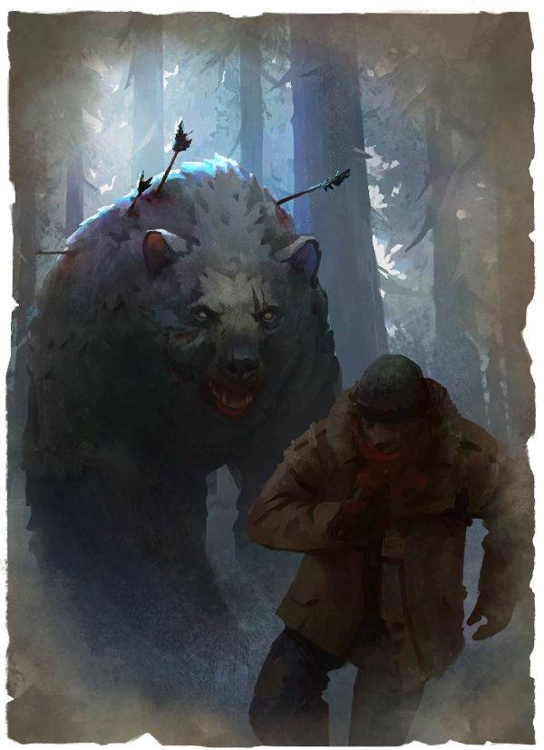
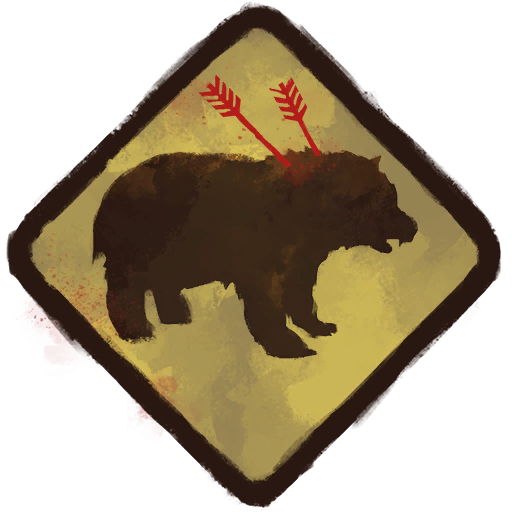
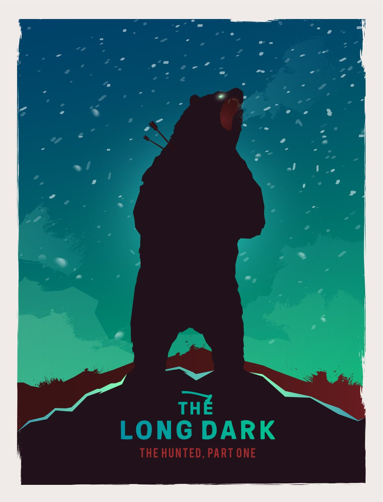

# The Hunted, Part One

**Contents**

- [Overview](#Overview)
- [Story](#Story)
- [The Old Bear](#The_Old_Bear)
- [Pursuit](#Pursuit)
- [Safety Zones](#Safety_Zones)
- [Ending](#Ending)
- [Gallery](#Gallery)
- [Game history](#Game_history)

<table class="infobox">
<caption>The Hunted, Part One</caption>
<colgroup>
<col style="width: 50%" />
<col style="width: 50%" />
</colgroup>
<tbody>
<tr>
<td colspan="2"><figure>

<figcaption>Challenge_Hunted.png</figcaption>
</figure></td>
</tr>
<tr>
<td colspan="2" class="section">
<strong>Details</strong>
</td>
</tr>
<tr>
<td>
Regions
</td>
<td>
<a href="./Pleasant%20Valley.md" class="wikilink" title="Pleasant Valley">Pleasant Valley</a>, <a href="./Coastal%20Highway.md" class="wikilink" title="Coastal Highway">Coastal Highway</a>, <a href="./Mystery%20Lake%20%28region%29.md" class="wikilink" title="Mystery Lake">Mystery Lake</a>
</td>
</tr>
<tr>
<td>
Difficulty
</td>
<td>
5
</td>
</tr>
<tr>
<td>
Date Added
</td>
<td>
April 2016
</td>
</tr>
</tbody>
</table>

<table>
<colgroup>
<col style="width: 33%" />
<col style="width: 33%" />
<col style="width: 33%" />
</colgroup>
<tbody>
<tr>
<td style="vertical-align: top; font-size: 3em; color: #5d5980; padding-right: 10px">
“
</td>
<td>
The old bear is after you. Nothing can kill him but the Trapper's old Bearkiller Rifle. Get to Trapper's Cabin before the Bear gets you.

&#10;

Main Menu description

</td>
<td style="vertical-align: bottom; font-size: 3em; color: #5d5980; padding-left: 10px">
”
</td>
</tr>
</tbody>
</table>

{\| style="margin:auto" \| style="vertical-align:top; font-size:3em; color:#5d5980; padding-right:10px" \|“ \| The Old Bear is after you. Get to Trapper's Cabin in Mystery Lake, before it gets you.

Opening description

\| style="vertical-align:bottom; font-size:3em; color:#5d5980; padding-left:10px" \|” \|}

**The Hunted, Part One** is one of eight <a href="./Challenge.md" class="wikilink" title="challenge">challenges</a> in *<a href="./The%20Long%20Dark.md" class="wikilink" title="The Long Dark">The Long Dark</a>*. Completing this Challenge unlocks <a href="./The%20Hunted%2C%20Part%20Two.md" class="wikilink" title="The Hunted, Part Two">The Hunted, Part Two</a>.

## Overview

<table>
<colgroup>
<col style="width: 33%" />
<col style="width: 33%" />
<col style="width: 33%" />
</colgroup>
<tbody>
<tr>
<td style="vertical-align: top; font-size: 3em; color: #5d5980; padding-right: 10px">
“
</td>
<td>
Travel to Trapper's Cabin in Mystery Lake.

&#10;

Journal Objective

</td>
<td style="vertical-align: bottom; font-size: 3em; color: #5d5980; padding-left: 10px">
”
</td>
</tr>
</tbody>
</table>

The Hunted, Part One challenge requires the player to avoid the <a href="./Old%20Bear.md" class="wikilink" title="Old Bear">Old Bear</a> that follows the player as they try to hike from <a href="./Skeeter%27s%20Ridge.md" class="wikilink" title="Skeeter&#39;s Ridge">Skeeter's Ridge</a> in <a href="./Pleasant%20Valley.md" class="wikilink" title="Pleasant Valley">Pleasant Valley</a> to <a href="./Trapper%27s%20Homestead.md" class="wikilink" title="Trapper&#39;s Homestead">Trapper's Homestead</a> in <a href="./Mystery%20Lake%20%28region%29.md" class="wikilink" title="Mystery Lake">Mystery Lake</a>.

## Story

\[Missing image: Skeeters_ridge.jpg\] Skeeter's Ridge, with the bulkhead door leading to the basement visible The Challenge begins with the Old Bear mauling the player, leaving them with 10% <a href="./Condition.md" class="wikilink" title="Condition">Condition</a>, <a href="./Blood%20Loss.md" class="wikilink" title="Blood Loss">Blood Loss</a>, and zero <a href="./Fatigue.md" class="wikilink" title="Fatigue">Fatigue</a>. The player's inventory contains a <a href="./Bandage.md" class="wikilink" title="Bandage">Bandage</a> and an <a href="./Old%20Man%27s%20Beard%20Wound%20Dressing.md" class="wikilink" title="Old Man&#39;s Beard Wound Dressing">Old Man's Beard Wound Dressing</a>, with a cellar door close-by for immediate shelter. Several supplies can be found in the basement, including an <a href="./Emergency%20Kit.md" class="wikilink" title="Emergency Kit">Emergency Kit</a> with a Distress Pistol.

- Except for a few additions (The Old Bear, additional Distress Pistol case, the special spawn point), the game is a normal Sandbox and weather and loot distribution will be randomized as usual. Difficulty is set to Stalker.
- Other than the Distress Pistol, no ranged weapons exist in this challenge, nor will you find materials to craft any. A <a href="./Hunting%20Rifle.md" class="wikilink" title="Hunting Rifle">Hunting Rifle</a> may be found, but there is no ammunition.

Arriving inside the Trapper's Homestead will generate the message "To Be Continued..." and the Challenge will end.

## The Old Bear

The Old Bear is a special bear and cannot be killed. He is, however, scared off by fires and by rounds shot from the <a href="./Distress%20Pistol.md" class="wikilink" title="Distress Pistol">Distress Pistol</a>. This is critical to your survival, as the bear will continue to hunt you for the entire challenge and can suddenly appear nearby, regardless of his last known location.

### Pursuit

After mauling you the first time, the Old Bear wanders away a short distance where he waits. After a little while, he will begin stalking you again. Scaring him off is the best way to get him off your trail long enough to make forward progress on your journey, but he will always comes back, often running to catch up to your location but walking once in detection range. After a few minutes of the Old Bear not being around, he will always spawns somewhere nearby and begin stalking the player, and must be avoided or driven off.

The Old Bear will appear in new regions if the player enters them, and often stalks around the vicinity of any buildings the player rests in. Upon entering Mystery Lake, the bear may be directly in front of the player (in which case, the player will need to use the distress pistol, flares, or fire to ward it off).

### Safety Zones

The Old Bear will not enter buildings, vehicles, or mines. He will enter non-explorable caves. He will also not spawn in the <a href="./Winding%20River.md" class="wikilink" title="Winding River">Winding River</a> or <a href="./The%20Ravine.md" class="wikilink" title="The Ravine">The Ravine</a> maps. Just like most <a href="./Wildlife.md" class="wikilink" title="Wildlife">Wildlife</a>, it is possible to (temporarily) escape the Old Bear by entering locations only accessible by squatting, <a href="./Rope%20Climbing.md" class="wikilink" title="Rope Climbing">Rope Climbing</a>, or by jumping down an embankment.

## Ending

The Challenge is completed when the player enters the door to <a href="./Trapper%27s%20Homestead.md" class="wikilink" title="Trapper&#39;s Homestead">Trapper's Homestead</a>. The story can be continued once the player selects <a href="./The%20Hunted%2C%20Part%20Two.md" class="wikilink" title="The Hunted, Part Two">The Hunted, Part Two</a> Challenge.

## Gallery

<table class="gallery">
<colgroup>
<col style="width: 50%" />
<col style="width: 50%" />
</colgroup>
<tbody>
<tr>
<td><figure>

<figcaption>The badge awarded upon completing the challenge</figcaption>
</figure></td>
<td><figure>

<figcaption>Fan art</figcaption>
</figure></td>
</tr>
</tbody>
</table>

## Game history

The Hunted, Part One and <a href="./Hopeless%20Rescue.md" class="wikilink" title="Hopeless Rescue">Hopeless Rescue</a> were introduced on 21 April 2016 in <a href="./The%20Long%20Dark%20%E2%80%94%20Changelog.md#0.321" class="wikilink" title="version 0.321">version 0.321</a>, also known as the Tireless Menace update.

**Lua execution error in Module:Navbox function navbox**<a href="ru:%D0%94%D0%BE%D0%B1%D1%8B%D1%87%D0%B0:_%D0%A7%D0%B0%D1%81%D1%82%D1%8C_1" class="wikilink" title="ru:Добыча: Часть 1">ru:Добыча: Часть 1</a> <a href="es:La_presa,_Parte_uno" class="wikilink" title="es:La presa, Parte uno">es:La presa, Parte uno</a>

