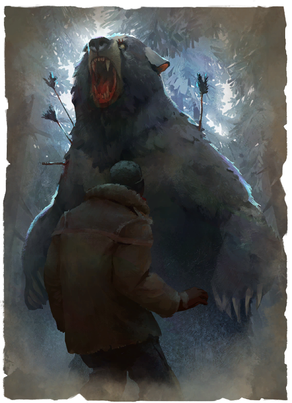
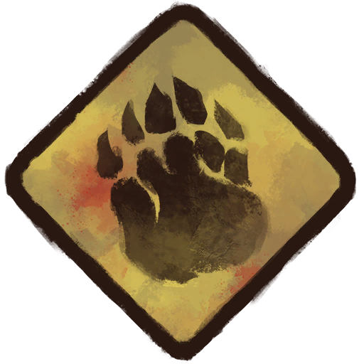

# The Hunted, Part Two

**Contents**

- [Overview](#Overview)
- [Challenge start](#Challenge_start)
- [Guide](#Guide)
- [Locations](#Locations)
- [Ending](#Ending)
- [Tips](#Tips)
- [Trivia](#Trivia)
- [Gallery](#Gallery)

<table class="infobox">
<caption>The Hunted, Part Two</caption>
<colgroup>
<col style="width: 50%" />
<col style="width: 50%" />
</colgroup>
<tbody>
<tr>
<td colspan="2"><figure>

<figcaption>Challenge_Hunted2.png</figcaption>
</figure></td>
</tr>
<tr>
<td colspan="2" class="section">
<strong>Details</strong>
</td>
</tr>
<tr>
<td>
Regions
</td>
<td>
<a href="./Mystery%20Lake%20%28disambiguation%29.md" class="wikilink" title="Mystery Lake">Mystery Lake</a>
</td>
</tr>
<tr>
<td>
Difficulty
</td>
<td>
5
</td>
</tr>
<tr>
<td>
Date Added
</td>
<td>
September 2016
</td>
</tr>
</tbody>
</table>

<table>
<colgroup>
<col style="width: 33%" />
<col style="width: 33%" />
<col style="width: 33%" />
</colgroup>
<tbody>
<tr>
<td style="vertical-align: top; font-size: 3em; color: #5d5980; padding-right: 10px">
“
</td>
<td>
Now you're the Hunter. With the Bearkiller Rifle in hand, track the Old Bear to its Den.

&#10;

Main Menu description

</td>
<td style="vertical-align: bottom; font-size: 3em; color: #5d5980; padding-left: 10px">
”
</td>
</tr>
</tbody>
</table>

<table>
<colgroup>
<col style="width: 33%" />
<col style="width: 33%" />
<col style="width: 33%" />
</colgroup>
<tbody>
<tr>
<td style="vertical-align: top; font-size: 3em; color: #5d5980; padding-right: 10px">
“
</td>
<td>
Now you're the Hunter. With the Bearkiller Rifle in hand, track the Old Bear to its Den. 
Take the rifle and go face the Old Bear.

&#10;

Opening description

</td>
<td style="vertical-align: bottom; font-size: 3em; color: #5d5980; padding-left: 10px">
”
</td>
</tr>
</tbody>
</table>

**The Hunted, Part Two** is one of eight <a href="./Challenge.md" class="wikilink" title="challenge">challenges</a> in <a href="./The%20Long%20Dark.md" class="wikilink" title="The Long Dark"><em>The Long Dark</em></a>, and is the sequel to <a href="./The%20Hunted%2C%20Part%20One.md" class="wikilink" title="The Hunted, Part One">The Hunted, Part One</a> and can only be played when finishing the first challenge. Completing Part Two unlocks <a href="./The%20Hunted%2C%20Part%20Three.md" class="wikilink" title="The Hunted, Part Three">The Hunted, Part Three</a>.

## Overview

<table>
<colgroup>
<col style="width: 33%" />
<col style="width: 33%" />
<col style="width: 33%" />
</colgroup>
<tbody>
<tr>
<td style="vertical-align: top; font-size: 3em; color: #5d5980; padding-right: 10px">
“
</td>
<td>
Track the Old Bear and kill it.

&#10;

Journal Objective

</td>
<td style="vertical-align: bottom; font-size: 3em; color: #5d5980; padding-left: 10px">
”
</td>
</tr>
</tbody>
</table>

The Hunted, Part One must be completed to unlock this challenge. During the challenge, the player chases the <a href="./Old%20Bear.md" class="wikilink" title="Old Bear">Old Bear</a> throughout <a href="./Mystery%20Lake%20%28region%29.md" class="wikilink" title="Mystery Lake">Mystery Lake</a>. The bear will stop at numerous locations and wait until the player is close enough to attack, where they must shoot the bear with the rifle so it will continue driving it of to its den. The Challenge ends when the player confronts the bear at the den.

## Challenge start

The Challenge begins right where Part One left off, with the player having entered the <a href="./Trapper%27s%20Homestead.md" class="wikilink" title="Trapper&#39;s Homestead">Trapper's Homestead</a> but now having taken up arms.

The Challenge begins with the player already having a <a href="./Hunting%20Rifle.md" class="wikilink" title="Hunting Rifle">Hunting Rifle</a> in their hands and the Old Bear can be heard outside banging on the door. It will eventually tear it down partially once the player approaches the door, and the player can leave the Homestead once the door is damaged. The player begins with a Hunting Rifle and 10 rounds of ammunition and exits the Homestead to confront the monster.

- The <a href="./Trapper%27s%20Homestead.md" class="wikilink" title="Trapper&#39;s Homestead">Trapper's Homestead</a> will always contain one <a href="./Firearm%20Cleaning%20Kit.md" class="wikilink" title="Firearm Cleaning Kit">Firearm Cleaning Kit</a> inside, along with several supplies to loot.

## Guide

The Old Bear will be directly outside the homestead and must be shot with the rifle immediately or else it will attack the player. The bear cannot be killed so it is best to only shoot the bear when it has stopped at the designated locations. The bear will follow a path and must be shot to force it to continue retreating to the bear den.

The easiest way to track the bear is to follow the bear prints in the snow and the drops of fresh blood. If the player stops for an extended period, or if it snows heavily, the tracks will disappear. Ammunition can be found all over the region, and is best looted along the way as the player tracks the Old Bear.

### Locations

The following list is the locations that the bear will stop at in order from the Trapper's Homestead to the den.

1.  Max's Last Stand
2.  Rail Tunnel
3.  Camp Office
4.  Frozen Creek
5.  Cabin
6.  Clear Cut
7.  Logging Camp
8.  River (Northern Access)
9.  River (Southern Access)
10. Ice Fishing Huts
11. Bear Den

## Ending

**Warning: \***Do not read if you do not want to be spoiled on the ending of the challenge.\*

Once the player has finally reached the cave where the bear is hiding and gets close enough to the entrance to finish it off, the Old Bear will charge out and pounce on the player. Shooting the bear will not stop it from attacking. The bear will slowly drag the character back into the cave. As the screen fades to black while the sounds of growling and chewing can be heard, the words "To Be Continued..." appear again.

The story is concluded in <a href="./The%20Hunted%2C%20Part%20Three.md" class="wikilink" title="The Hunted, Part Three">The Hunted, Part Three</a>.

## Tips

- <a href="./Wolf.md" class="wikilink" title="Wolves">Wolves</a> can be found roaming near the trail the bear takes. It is recommended to use flares or alternative ways of making wolves flee instead of shooting them. Ammunition is extremely limited and the rifle is the only weapon that can make the bear retreat.
- The <a href="./Camp%20Office.md" class="wikilink" title="Camp Office">Camp Office</a> will always have three rifle cartridges on top of the filing cabinets. Make sure to grab these in case you run out of bullets while hunting the bear.
- Unlike normal bears, the old bear will always run if you shoot it anywhere on its body, even if it's charging.
- The Dam may have a couple single bullets scattered around. There is also sometimes a box of five bullets in the room on the right. This should eliminate any ammo concerns.
- The Trapper's Homestead door is slightly damaged at the start of the game. However, this is only visual and won't affect Warmth or any other gameplay feature. 
- There's no time limit to the challenge.
- curiously, you can visit any region outside Mystery Lake. The Old Bear won't follow and will remain in its last scripted location. 

## Trivia

This Challenge is quite similar to the mission <a href="./Jeremiah%27s%20Folly.md" class="wikilink" title="Jeremiah&#39;s Folly">Jeremiah's Folly</a>, which was eventually cut from <a href="./Episode%202%20-%20Luminance%20Fugue.md" class="wikilink" title="Episode 2: Luminance Fugue">Episode 2: Luminance Fugue</a> (removed in the Redux version). Both the Challenge and mission involve the Old Bear being right outside the Trapper's Homestead at the start, following the bear from location to location, wounding it with the Hunting Rifle, and chasing it to a new location to hopefully kill it.

## Gallery

<table class="gallery">
<colgroup>
<col style="width: 50%" />
<col style="width: 50%" />
</colgroup>
<tbody>
<tr>
<td><figure>

<figcaption>The badge awarded upon completing the challenge</figcaption>
</figure></td>
<td><figure>
[Missing image: Hunted_2.jpg]
<figcaption>Fan art</figcaption>
</figure></td>
</tr>
</tbody>
</table>

**Lua execution error in Module:Navbox function navbox**<a href="ru:%D0%94%D0%BE%D0%B1%D1%8B%D1%87%D0%B0:_%D0%A7%D0%B0%D1%81%D1%82%D1%8C_2" class="wikilink" title="ru:Добыча: Часть 2">ru:Добыча: Часть 2</a> <a href="es:La_presa,_Parte_dos" class="wikilink" title="es:La presa, Parte dos">es:La presa, Parte dos</a>

