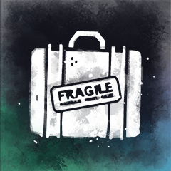

# The Last Light

**Categories:** Achievements, Pages with update history · **Source:** [Fandom](https://thelongdark.fandom.com/wiki/The_Last_Light)

**The Last Light**

_The\_Last\_Light\_icon.png_

**Description:** Reunite with Astrid and deliver the Hardcase.

**The Last Light** is a hidden [achievement](./The%20Long%20Dark%20%E2%80%94%20Achievements.md) in _[Wintermute](./Wintermute.md)_ [Episode 5: The Light At The End Of All Things](./Episode%205%20-%20The%20Light%20At%20The%20End%20Of%20All%20Things.md) of _[The Long Dark](./The%20Long%20Dark.md)_.

## Guide

This is an unmissable hidden achievement granted during the main story mission [Conflagration](./Conflagration.md). It is unlocked after leaving [Jane Yang's](./Jane%20Yang.md) home after a cutscene ends.

## Game History

\* UPDATE **31 March 2026 ([Update](./The%20Long%20Dark%20%E2%80%94%20Changelog.md#2.52)):**

- 
  - Added to game.
