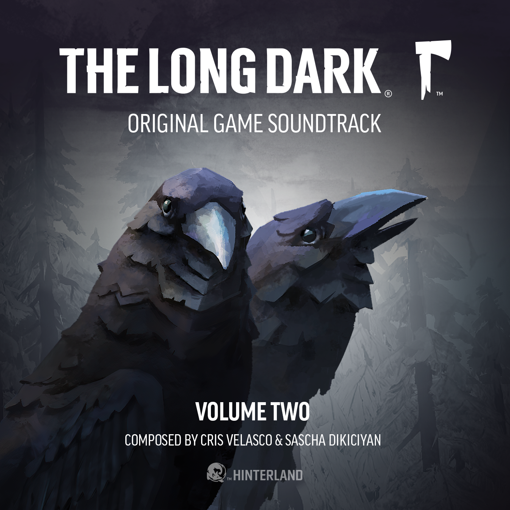
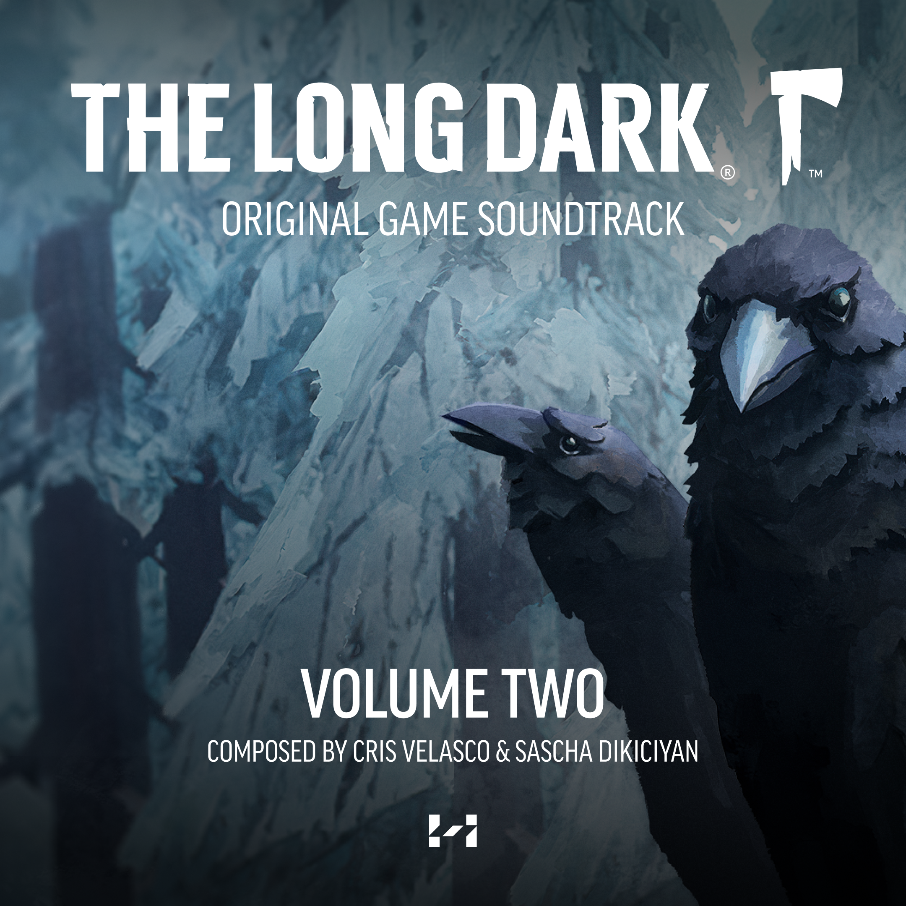
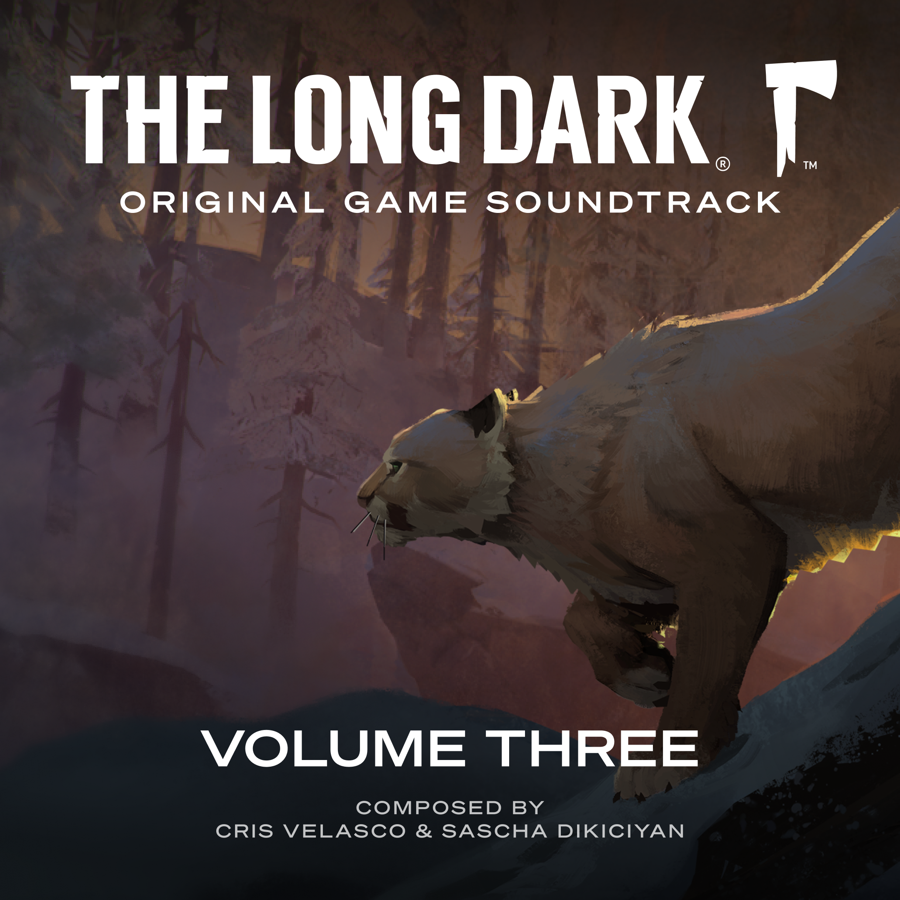

# The Long Dark Original Soundtrack

**Contents**

- [Tracklist](#Tracklist)
- [Volume One](#Volume_One)
- [Volume Two](#Volume_Two)
- [Volume Three](#Volume_Three)
- [Other](#Other)
- [Licensed Tracks](#Licensed_Tracks)
- [Removed/Unreleased Tracks](#Removed%2FUnreleased_Tracks)
- [Footnotes](#Footnotes)
- [Notes](#Notes)
- [External Links](#External_Links)

**The Long Dark Original Soundtrack** is the soundtrack to *<a href="./The%20Long%20Dark.md" class="wikilink" title="The Long Dark">The Long Dark</a>*, composed by Cris Velasco (Story Mode) and Sascha Dikiciyan (Survival Mode), and published by <a href="./Hinterland%20Studio%20Inc..md" class="wikilink" title="Hinterland Studio Inc.">Hinterland Studio Inc.</a>. Three volumes have been released with a total of 176 tracks and over 288 minutes (4 hours, 48 minutes) of music.

Volume One was released on Steam as DLC on August 28, 2017 and later on Bandcamp on June 22, 2018. Volume Two was released on Steam on May 19, 2020 and on Bandcamp in mid-June 2020. Volume Three was released on Steam and Bandcamp on May 5, 2026.

The soundtrack includes music from <a href="./Wintermute.md" class="wikilink" title="Wintermute">Wintermute</a>, <a href="./Survival%20Mode.md" class="wikilink" title="Survival Mode">Survival Mode</a>, and <a href="./Tales%20from%20the%20Far%20Territory.md" class="wikilink" title="Tales from the Far Territory">Tales from the Far Territory</a>.

## Tracklist

### Volume One

<figure class="thumb">

</figure>

<table>
<thead>
<tr>
<th>
No.
</th>
<th>
Title
</th>
<th>
Length
</th>
<th>
Appearance
</th>
</tr>
</thead>
<tbody>
<tr>
<td colspan="4">
Disc 1 — WINTERMUTE, Episode One: "Do Not Go Gentle"
</td>
</tr>
<tr>
<td>
1
</td>
<td>
Theme for The Long Dark
</td>
<td>
2:57
</td>
<td>
—
</td>
</tr>
<tr>
<td>
2
</td>
<td>
The New World
</td>
<td>
3:52
</td>
<td>
—
</td>
</tr>
<tr>
<td>
3
</td>
<td>
There's Something I Have to Say
</td>
<td>
2:39
</td>
<td>
—
</td>
</tr>
<tr>
<td>
4
</td>
<td>
Grey Mother
</td>
<td>
1:35
</td>
<td>
—
</td>
</tr>
<tr>
<td>
5
</td>
<td>
The Only One
</td>
<td>
0:36
</td>
<td>
—
</td>
</tr>
<tr>
<td>
6
</td>
<td>
Some Were Outsiders
</td>
<td>
1:23
</td>
<td>
—
</td>
</tr>
<tr>
<td>
7
</td>
<td>
What Happened
</td>
<td>
0:48
</td>
<td>
—
</td>
</tr>
<tr>
<td>
8
</td>
<td>
Angry Voices
</td>
<td>
0:54
</td>
<td>
—
</td>
</tr>
<tr>
<td>
9
</td>
<td>
Perseverance
</td>
<td>
0:41
</td>
<td>
—
</td>
</tr>
<tr>
<td>
10
</td>
<td>
My Only Way Through
</td>
<td>
0:51
</td>
<td>
—
</td>
</tr>
<tr>
<td>
11
</td>
<td>
Put Her to Rest
</td>
<td>
1:10
</td>
<td>
—
</td>
</tr>
<tr>
<td>
12
</td>
<td>
Man Who Fell From the Sky
</td>
<td>
0:59
</td>
<td>
—
</td>
</tr>
<tr>
<td>
13
</td>
<td>
One Last Thing
</td>
<td>
0:20
</td>
<td>
—
</td>
</tr>
<tr>
<td>
14
</td>
<td>
Pay Respects
</td>
<td>
0:30
</td>
<td>
—
</td>
</tr>
<tr>
<td>
15
</td>
<td>
You See Things Others Would Miss
</td>
<td>
3:40
</td>
<td>
—
</td>
</tr>
<tr>
<td colspan="4">
Disc 2 — WINTERMUTE, Episode Two: "Luminance Fugue"
</td>
</tr>
<tr>
<td>
1
</td>
<td>
Not The Way You Shoot
</td>
<td>
2:59
</td>
<td>
—
</td>
</tr>
<tr>
<td>
2
</td>
<td>
What Happened Here
</td>
<td>
0:46
</td>
<td>
—
</td>
</tr>
<tr>
<td>
3
</td>
<td>
Call Me Jeremiah
</td>
<td>
2:39
</td>
<td>
—
</td>
</tr>
<tr>
<td>
4
</td>
<td>
Fix My Rifle
</td>
<td>
3:31
</td>
<td>
—
</td>
</tr>
<tr>
<td>
5
</td>
<td>
Forest Talkers
</td>
<td>
0:48
</td>
<td>
—
</td>
</tr>
<tr>
<td>
6
</td>
<td>
Dreamtime
</td>
<td>
0:18
</td>
<td>
—
</td>
</tr>
<tr>
<td>
7
</td>
<td>
They Hate the Lights
</td>
<td>
0:21
</td>
<td>
—
</td>
</tr>
<tr>
<td>
8
</td>
<td>
Tool for Killing
</td>
<td>
0:20
</td>
<td>
—
</td>
</tr>
<tr>
<td>
9
</td>
<td>
Old World Tech
</td>
<td>
0:12
</td>
<td>
—
</td>
</tr>
<tr>
<td>
10
</td>
<td>
Keep You Alive
</td>
<td>
1:13
</td>
<td>
—
</td>
</tr>
<tr>
<td>
11
</td>
<td>
Graduation Day
</td>
<td>
0:31
</td>
<td>
—
</td>
</tr>
<tr>
<td>
12
</td>
<td>
Suicide Mission
</td>
<td>
4:07
</td>
<td>
—
</td>
</tr>
<tr>
<td>
13
</td>
<td>
Wintermute
</td>
<td>
5:38
</td>
<td>
—
</td>
</tr>
<tr>
<td>
14
</td>
<td>
Passing of an Age
</td>
<td>
2:17
</td>
<td>
—
</td>
</tr>
<tr>
<td>
15
</td>
<td>
Things of the Old World
</td>
<td>
2:05
</td>
<td>
—
</td>
</tr>
<tr>
<td colspan="4">
Disc 3 — WINTERMUTE, Ambient &amp; Exploration
</td>
</tr>
<tr>
<td>
1
</td>
<td>
Abandoned
</td>
<td>
1:32
</td>
<td>
—
</td>
</tr>
<tr>
<td>
2
</td>
<td>
Arrival
</td>
<td>
0:24
</td>
<td>
—
</td>
</tr>
<tr>
<td>
3
</td>
<td>
Aurora
</td>
<td>
1:32
</td>
<td>
—
</td>
</tr>
<tr>
<td>
4
</td>
<td>
Bad News
</td>
<td>
0:15
</td>
<td>
—
</td>
</tr>
<tr>
<td>
5
</td>
<td>
Come At Me
</td>
<td>
0:25
</td>
<td>
—
</td>
</tr>
<tr>
<td>
6
</td>
<td>
Echoes
</td>
<td>
1:38
</td>
<td>
—
</td>
</tr>
<tr>
<td>
7
</td>
<td>
Falling
</td>
<td>
0:19
</td>
<td>
—
</td>
</tr>
<tr>
<td>
8
</td>
<td>
Hunted
</td>
<td>
1:31
</td>
<td>
—
</td>
</tr>
<tr>
<td>
9
</td>
<td>
Into the Dark
</td>
<td>
1:29
</td>
<td>
—
</td>
</tr>
<tr>
<td>
10
</td>
<td>
It's Done
</td>
<td>
0:18
</td>
<td>
—
</td>
</tr>
<tr>
<td>
11
</td>
<td>
Meds
</td>
<td>
0:19
</td>
<td>
—
</td>
</tr>
<tr>
<td>
12
</td>
<td>
Memories
</td>
<td>
1:28
</td>
<td>
—
</td>
</tr>
<tr>
<td>
13
</td>
<td>
Milton
</td>
<td>
1:35
</td>
<td>
—
</td>
</tr>
<tr>
<td>
14
</td>
<td>
Old Ways
</td>
<td>
0:18
</td>
<td>
—
</td>
</tr>
<tr>
<td>
15
</td>
<td>
Paradise Lost
</td>
<td>
0:31
</td>
<td>
—
</td>
</tr>
<tr>
<td>
16
</td>
<td>
Sanctity
</td>
<td>
0:14
</td>
<td>
—
</td>
</tr>
<tr>
<td>
17
</td>
<td>
Shelter
</td>
<td>
0:17
</td>
<td>
—
</td>
</tr>
<tr>
<td>
18
</td>
<td>
Silence
</td>
<td>
0:21
</td>
<td>
—
</td>
</tr>
<tr>
<td>
19
</td>
<td>
Survival
</td>
<td>
0:23
</td>
<td>
—
</td>
</tr>
<tr>
<td>
20
</td>
<td>
The Lights are Alive
</td>
<td>
0:21
</td>
<td>
—
</td>
</tr>
<tr>
<td>
21
</td>
<td>
The Past
</td>
<td>
1:21
</td>
<td>
—
</td>
</tr>
<tr>
<td>
22
</td>
<td>
Triumph
</td>
<td>
0:10
</td>
<td>
—
</td>
</tr>
<tr>
<td>
23
</td>
<td>
Voice
</td>
<td>
0:19
</td>
<td>
—
</td>
</tr>
<tr>
<td>
24
</td>
<td>
Wolfbridge
</td>
<td>
0:17
</td>
<td>
—
</td>
</tr>
<tr>
<td colspan="4">
Disc 4 — SURVIVAL Mode, Ambient &amp; Exploration
</td>
</tr>
<tr>
<td>
1
</td>
<td>
Beginnings
</td>
<td>
0:40
</td>
<td>
—
</td>
</tr>
<tr>
<td>
2
</td>
<td>
Clearing
</td>
<td>
0:44
</td>
<td>
—
</td>
</tr>
<tr>
<td>
3
</td>
<td>
Danger
</td>
<td>
0:33
</td>
<td>
—
</td>
</tr>
<tr>
<td>
4
</td>
<td>
Darkness Falls
</td>
<td>
4:40
</td>
<td>
—
</td>
</tr>
<tr>
<td>
5
</td>
<td>
Desolation
</td>
<td>
2:42
</td>
<td>
—
</td>
</tr>
<tr>
<td>
6
</td>
<td>
Despair
</td>
<td>
0:46
</td>
<td>
—
</td>
</tr>
<tr>
<td>
7
</td>
<td>
Doubt
</td>
<td>
0:48
</td>
<td>
—
</td>
</tr>
<tr>
<td>
8
</td>
<td>
Entropy
</td>
<td>
1:57
</td>
<td>
—
</td>
</tr>
<tr>
<td>
9
</td>
<td>
Finder
</td>
<td>
0:20
</td>
<td>
—
</td>
</tr>
<tr>
<td>
10
</td>
<td>
Fog
</td>
<td>
0:44
</td>
<td>
—
</td>
</tr>
<tr>
<td>
11
</td>
<td>
Heaven
</td>
<td>
1:03
</td>
<td>
—
</td>
</tr>
<tr>
<td>
12
</td>
<td>
Hope
</td>
<td>
3:03
</td>
<td>
—
</td>
</tr>
<tr>
<td>
13
</td>
<td>
Illuminate
</td>
<td>
1:59
</td>
<td>
—
</td>
</tr>
<tr>
<td>
14
</td>
<td>
Majestic
</td>
<td>
1:14
</td>
<td>
—
</td>
</tr>
<tr>
<td>
15
</td>
<td>
Memories
</td>
<td>
0:43
</td>
<td>
—
</td>
</tr>
<tr>
<td>
16
</td>
<td>
Nightfall
</td>
<td>
0:48
</td>
<td>
—
</td>
</tr>
<tr>
<td>
17
</td>
<td>
Nihilist
</td>
<td>
0:44
</td>
<td>
—
</td>
</tr>
<tr>
<td>
18
</td>
<td>
Prepare
</td>
<td>
3:03
</td>
<td>
—
</td>
</tr>
<tr>
<td>
19
</td>
<td>
Shelter
</td>
<td>
0:20
</td>
<td>
—
</td>
</tr>
<tr>
<td>
20
</td>
<td>
Shelter, Two
</td>
<td>
0:20
</td>
<td>
—
</td>
</tr>
<tr>
<td>
21
</td>
<td>
Sorrow
</td>
<td>
0:36
</td>
<td>
—
</td>
</tr>
<tr>
<td>
22
</td>
<td>
Storm
</td>
<td>
0:40
</td>
<td>
—
</td>
</tr>
<tr>
<td>
23
</td>
<td>
Tomorrow
</td>
<td>
0:56
</td>
<td>
—
</td>
</tr>
<tr>
<td>
24
</td>
<td>
Travel
</td>
<td>
0:32
</td>
<td>
—
</td>
</tr>
<tr>
<td>
25
</td>
<td>
Trepidation
</td>
<td>
0:39
</td>
<td>
—
</td>
</tr>
<tr>
<td>
26
</td>
<td>
Void
</td>
<td>
0:18
</td>
<td>
—
</td>
</tr>
</tbody>
</table>

### Volume Two

Original 2020 cover Updated 2026 cover

<table>
<thead>
<tr>
<th>
No.
</th>
<th>
Title
</th>
<th>
Length
</th>
<th>
Appearance
</th>
</tr>
</thead>
<tbody>
<tr>
<td colspan="4">
Disc 1 — WINTERMUTE, Episode Three: "Crossroads Elegy"
</td>
</tr>
<tr>
<td>
1
</td>
<td>
From Other Eyes
</td>
<td>
1:11
</td>
<td>
—
</td>
</tr>
<tr>
<td>
2
</td>
<td>
Surprise
</td>
<td>
0:26
</td>
<td>
—
</td>
</tr>
<tr>
<td>
3
</td>
<td>
Molly's Kitchen
</td>
<td>
1:48
</td>
<td>
—
</td>
</tr>
<tr>
<td>
4
</td>
<td>
Can You Help Us
</td>
<td>
0:32
</td>
<td>
—
</td>
</tr>
<tr>
<td>
5
</td>
<td>
Soliloquy &amp; End
</td>
<td>
2:45
</td>
<td>
—
</td>
</tr>
<tr>
<td>
6
</td>
<td>
Community Hall
</td>
<td>
1:20
</td>
<td>
—
</td>
</tr>
<tr>
<td>
7
</td>
<td>
Diagnosis
</td>
<td>
4:38
</td>
<td>
—
</td>
</tr>
<tr>
<td>
8
</td>
<td>
Let Me Go
</td>
<td>
1:00
</td>
<td>
—
</td>
</tr>
<tr>
<td>
9
</td>
<td>
Coda
</td>
<td>
0:15
</td>
<td>
—
</td>
</tr>
<tr>
<td>
10
</td>
<td>
Father Thomas
</td>
<td>
1:02
</td>
<td>
—
</td>
</tr>
<tr>
<td>
11
</td>
<td>
Seraphim
</td>
<td>
1:52
</td>
<td>
—
</td>
</tr>
<tr>
<td>
12
</td>
<td>
Bad Feelings
</td>
<td>
0:42
</td>
<td>
—
</td>
</tr>
<tr>
<td>
13
</td>
<td>
Molly Returns
</td>
<td>
1:12
</td>
<td>
—
</td>
</tr>
<tr>
<td>
14
</td>
<td>
Keep Them Alive
</td>
<td>
3:00
</td>
<td>
—
</td>
</tr>
<tr>
<td>
15
</td>
<td>
There May Be Another Way
</td>
<td>
0:44
</td>
<td>
—
</td>
</tr>
<tr>
<td>
16
</td>
<td>
Crossroads Elegy (Main Theme)
</td>
<td>
2:47
</td>
<td>
—
</td>
</tr>
<tr>
<td>
17
</td>
<td>
Walk Alone
</td>
<td>
2:16
</td>
<td>
—
</td>
</tr>
<tr>
<td>
18
</td>
<td>
The Pleasant Valley
</td>
<td>
2:14
</td>
<td>
—
</td>
</tr>
<tr>
<td>
19
</td>
<td>
Two Fires
</td>
<td>
3:12
</td>
<td>
—
</td>
</tr>
<tr>
<td>
20
</td>
<td>
Winter Searching
</td>
<td>
2:20
</td>
<td>
—
</td>
</tr>
<tr>
<td>
21
</td>
<td>
Frontier Story
</td>
<td>
1:50
</td>
<td>
—
</td>
</tr>
<tr>
<td>
22
</td>
<td>
Lament for the Lost
</td>
<td>
1:30
</td>
<td>
—
</td>
</tr>
<tr>
<td>
23
</td>
<td>
Shoulder Your Burden
</td>
<td>
1:15
</td>
<td>
—
</td>
</tr>
<tr>
<td>
24
</td>
<td>
There is Always Hope
</td>
<td>
1:45
</td>
<td>
—
</td>
</tr>
<tr>
<td>
25
</td>
<td>
A Light in the Sky
</td>
<td>
1:38
</td>
<td>
—
</td>
</tr>
<tr>
<td>
26
</td>
<td>
A Dark Place
</td>
<td>
1:41
</td>
<td>
—
</td>
</tr>
<tr>
<td>
27
</td>
<td>
Night My Quiet Companion
</td>
<td>
1:34
</td>
<td>
—
</td>
</tr>
<tr>
<td colspan="4">
Disc 2 — SURVIVAL Mode
</td>
</tr>
<tr>
<td>
1
</td>
<td>
Heavy [m]
</td>
<td>
2:29
</td>
<td>
—
</td>
</tr>
<tr>
<td>
2
</td>
<td>
Stellar [n]
</td>
<td>
2:45
</td>
<td>
—
</td>
</tr>
<tr>
<td>
3
</td>
<td>
Patience [o]
</td>
<td>
2:38
</td>
<td>
—
</td>
</tr>
<tr>
<td>
4
</td>
<td>
Terminal [p]
</td>
<td>
2:44
</td>
<td>
—
</td>
</tr>
<tr>
<td>
5
</td>
<td>
Discordance
</td>
<td>
2:23
</td>
<td>
—
</td>
</tr>
<tr>
<td>
6
</td>
<td>
Wind
</td>
<td>
2:38
</td>
<td>
—
</td>
</tr>
<tr>
<td>
7
</td>
<td>
Unknown
</td>
<td>
2:32
</td>
<td>
—
</td>
</tr>
<tr>
<td>
8
</td>
<td>
Firmament
</td>
<td>
1:07
</td>
<td>
—
</td>
</tr>
<tr>
<td>
9
</td>
<td>
Stride
</td>
<td>
1:19
</td>
<td>
—
</td>
</tr>
<tr>
<td>
10
</td>
<td>
Nocturnal
</td>
<td>
1:07
</td>
<td>
—
</td>
</tr>
<tr>
<td>
11
</td>
<td>
Ash Canyon
</td>
<td>
2:45
</td>
<td>
—
</td>
</tr>
<tr>
<td>
12
</td>
<td>
Blackrock [a]
</td>
<td>
3:08
</td>
<td>
—
</td>
</tr>
</tbody>
</table>

### Volume Three

<figure class="thumb">

</figure>

<table>
<thead>
<tr>
<th>
No.
</th>
<th>
Title
</th>
<th>
Length
</th>
<th>
Appearance
</th>
</tr>
</thead>
<tbody>
<tr>
<td colspan="4">
Disc 1 — WINTERMUTE, Episode Four: "Fury, Then Silence"
</td>
</tr>
<tr>
<td>
1
</td>
<td>
Disquiet
</td>
<td>
2:01
</td>
<td>
—
</td>
</tr>
<tr>
<td>
2
</td>
<td>
Apocalypse Strings
</td>
<td>
2:13
</td>
<td>
—
</td>
</tr>
<tr>
<td>
3
</td>
<td>
The Walls at the Foot of the Mountain
</td>
<td>
2:54
</td>
<td>
—
</td>
</tr>
<tr>
<td>
4
</td>
<td>
Warden
</td>
<td>
4:34
</td>
<td>
—
</td>
</tr>
<tr>
<td>
5
</td>
<td>
Infirm
</td>
<td>
2:29
</td>
<td>
—
</td>
</tr>
<tr>
<td>
6
</td>
<td>
Stalemate
</td>
<td>
1:38
</td>
<td>
—
</td>
</tr>
<tr>
<td>
7
</td>
<td>
Bad People
</td>
<td>
0:53
</td>
<td>
—
</td>
</tr>
<tr>
<td>
8
</td>
<td>
The Most Uncomfortable of Times
</td>
<td>
1:53
</td>
<td>
—
</td>
</tr>
<tr>
<td>
9
</td>
<td>
Volatile
</td>
<td>
1:16
</td>
<td>
—
</td>
</tr>
<tr>
<td>
10
</td>
<td>
Fury, Then Silence [b]
</td>
<td>
4:04
</td>
<td>
—
</td>
</tr>
<tr>
<td>
11
</td>
<td>
To Fight Another Day [c]
</td>
<td>
1:26
</td>
<td>
—
</td>
</tr>
<tr>
<td>
12
</td>
<td>
Music for When You Have Nothing Left to Lose
</td>
<td>
2:50
</td>
<td>
—
</td>
</tr>
<tr>
<td>
13
</td>
<td>
I Tell You You Must Never Give Up [d]
</td>
<td>
2:56
</td>
<td>
—
</td>
</tr>
<tr>
<td>
14
</td>
<td>
Bad Things Happen in Mines
</td>
<td>
2:10
</td>
<td>
—
</td>
</tr>
<tr>
<td>
15
</td>
<td>
Steam's Alright I Guess
</td>
<td>
2:33
</td>
<td>
—
</td>
</tr>
<tr>
<td>
16
</td>
<td>
A Sad Story Ends [e]
</td>
<td>
2:33
</td>
<td>
—
</td>
</tr>
<tr>
<td colspan="4">
Disc 2 — WINTERMUTE, Episode Five: "The Light at the End of All Things"
</td>
</tr>
<tr>
<td>
1
</td>
<td>
A Town, A Quarantine, and a Missing Doctor
</td>
<td>
4:51
</td>
<td>
—
</td>
</tr>
<tr>
<td>
2
</td>
<td>
The Cold Truth
</td>
<td>
1:18
</td>
<td>
—
</td>
</tr>
<tr>
<td>
3
</td>
<td>
Terry's Story
</td>
<td>
0:56
</td>
<td>
—
</td>
</tr>
<tr>
<td>
4
</td>
<td>
The Horror
</td>
<td>
0:39
</td>
<td>
—
</td>
</tr>
<tr>
<td>
5
</td>
<td>
That's A Good Question
</td>
<td>
2:12
</td>
<td>
—
</td>
</tr>
<tr>
<td>
6
</td>
<td>
Jace's Dream
</td>
<td>
1:59
</td>
<td>
—
</td>
</tr>
<tr>
<td>
7
</td>
<td>
Disagreement Over a River
</td>
<td>
0:40
</td>
<td>
—
</td>
</tr>
<tr>
<td>
8
</td>
<td>
Unless We Find Another Way
</td>
<td>
0:43
</td>
<td>
—
</td>
</tr>
<tr>
<td>
9
</td>
<td>
Rumbling
</td>
<td>
0:39
</td>
<td>
—
</td>
</tr>
<tr>
<td>
10
</td>
<td>
Atwood [q]
</td>
<td>
1:11
</td>
<td>
—
</td>
</tr>
<tr>
<td>
11
</td>
<td>
But What Does It All Mean?
</td>
<td>
3:06
</td>
<td>
—
</td>
</tr>
<tr>
<td>
12
</td>
<td>
It Has To Be Perfect
</td>
<td>
1:35
</td>
<td>
—
</td>
</tr>
<tr>
<td>
13
</td>
<td>
Tuning Space
</td>
<td>
0:43
</td>
<td>
—
</td>
</tr>
<tr>
<td>
14
</td>
<td>
Prelude to the Truth
</td>
<td>
0:39
</td>
<td>
—
</td>
</tr>
<tr>
<td>
15
</td>
<td>
Strange History
</td>
<td>
1:54
</td>
<td>
—
</td>
</tr>
<tr>
<td>
16
</td>
<td>
It Has All Come to This
</td>
<td>
3:06
</td>
<td>
—
</td>
</tr>
<tr>
<td>
17
</td>
<td>
Stars and Black Water
</td>
<td>
1:17
</td>
<td>
—
</td>
</tr>
<tr>
<td>
18
</td>
<td>
An Unlikely Rescue
</td>
<td>
1:51
</td>
<td>
—
</td>
</tr>
<tr>
<td>
19
</td>
<td>
I Must Find Her
</td>
<td>
0:38
</td>
<td>
—
</td>
</tr>
<tr>
<td>
20
</td>
<td>
Heart In Throat
</td>
<td>
0:41
</td>
<td>
—
</td>
</tr>
<tr>
<td>
21
</td>
<td>
A Friend Returns a Favour
</td>
<td>
0:32
</td>
<td>
—
</td>
</tr>
<tr>
<td>
22
</td>
<td>
Back to Where You Belong
</td>
<td>
0:40
</td>
<td>
—
</td>
</tr>
<tr>
<td>
23
</td>
<td>
Is That Really You?
</td>
<td>
2:04
</td>
<td>
—
</td>
</tr>
<tr>
<td>
24
</td>
<td>
There's One More Thing I Gotta Do [r]
</td>
<td>
4:33
</td>
<td>
—
</td>
</tr>
<tr>
<td>
25
</td>
<td>
I Never Stopped Loving You
</td>
<td>
6:05
</td>
<td>
—
</td>
</tr>
<tr>
<td colspan="4">
Disc 3 — SURVIVAL EXPANSION, Tales from the Far Territory
</td>
</tr>
<tr>
<td>
1
</td>
<td>
Theme for the Far Territory [f]
</td>
<td>
3:55
</td>
<td>
—
</td>
</tr>
<tr>
<td>
2
</td>
<td>
The Call to Survive [g]
</td>
<td>
2:10
</td>
<td>
—
</td>
</tr>
<tr>
<td>
3
</td>
<td>
The Transfer Hub
</td>
<td>
1:01
</td>
<td>
—
</td>
</tr>
<tr>
<td>
4
</td>
<td>
The Forsaken Airfield [h]
</td>
<td>
3:36
</td>
<td>
—
</td>
</tr>
<tr>
<td>
5
</td>
<td>
The Zone of Contamination [i]
</td>
<td>
3:26
</td>
<td>
—
</td>
</tr>
<tr>
<td>
6
</td>
<td>
The Sundered Pass [j]
</td>
<td>
3:33
</td>
<td>
—
</td>
</tr>
<tr>
<td>
7
</td>
<td>
Are You Truly Ready?
</td>
<td>
0:44
</td>
<td>
—
</td>
</tr>
<tr>
<td>
8
</td>
<td>
Dust and Memory [k]
</td>
<td>
2:35
</td>
<td>
—
</td>
</tr>
<tr>
<td>
9
</td>
<td>
Echo
</td>
<td>
0:22
</td>
<td>
—
</td>
</tr>
<tr>
<td>
10
</td>
<td>
Into the Dark Earth [l]
</td>
<td>
3:00
</td>
<td>
—
</td>
</tr>
<tr>
<td>
11
</td>
<td>
Rudiger's Dream
</td>
<td>
1:05
</td>
<td>
—
</td>
</tr>
<tr>
<td>
12
</td>
<td>
Resolve
</td>
<td>
0:39
</td>
<td>
—
</td>
</tr>
<tr>
<td>
13
</td>
<td>
The Silent Hunter
</td>
<td>
0:18
</td>
<td>
—
</td>
</tr>
<tr>
<td>
14
</td>
<td>
Anxiety Made Manifest
</td>
<td>
3:09
</td>
<td>
—
</td>
</tr>
<tr>
<td>
15
</td>
<td>
You Should Not Be Here
</td>
<td>
2:21
</td>
<td>
—
</td>
</tr>
<tr>
<td>
16
</td>
<td>
Life After Death
</td>
<td>
1:15
</td>
<td>
—
</td>
</tr>
</tbody>
</table>

## Other

### Licensed Tracks

| No. | Title | Artist | Length | Appearance |
|----|----|----|----|----|
| 1 | The Lion's Roar | <a href="./First%20Aid%20Kit.md" class="wikilink" title="First Aid Kit">First Aid Kit</a> | 2:00 | Intro cinematic for Story Mode. |

### Removed/Unreleased Tracks

<table>
<thead>
<tr>
<th>
No.
</th>
<th>
Title
</th>
<th>
Length
</th>
<th>
Notes
</th>
</tr>
</thead>
<tbody>
<tr>
<td colspan="4">
Removed
</td>
</tr>
<tr>
<td>
—
</td>
<td>
Onward
</td>
<td>
3:03
</td>
<td>
Removed from Volume 2, Disc 2 — duplicate of "Hope" (V1D4 #12)
</td>
</tr>
<tr>
<td>
—
</td>
<td>
The Timberwolf
</td>
<td>
1:16
</td>
<td>
Cut from Episode Three; never officially released
</td>
</tr>
<tr>
<td colspan="4">
Unreleased
</td>
</tr>
<tr>
<td>
—
</td>
<td>
Stalked by Wolves
</td>
<td>
1:01
</td>
<td>
No confirmed match on the released Volume Two soundtrack
</td>
</tr>
<tr>
<td>
—
</td>
<td>
The Medical Clinic
</td>
<td>
3:03
</td>
<td>
No confirmed match on the released Volume Three soundtrack
</td>
</tr>
<tr>
<td>
—
</td>
<td>
Darkwalker theme
</td>
<td>
?
</td>
<td>
Not found in any official release
</td>
</tr>
<tr>
<td>
—
</td>
<td>
Cougar theme
</td>
<td>
?
</td>
<td>
Not found in any official release
</td>
</tr>
</tbody>
</table>

## Footnotes

Working titles sourced from the composers' websites and SoundCloud: \[b\]–\[e\], \[q\]–\[r\] from [Cris Velasco's website](http://crisvelasco.com/); \[a\], \[f\]–\[p\] from [Sascha Dikiciyan's website](https://www.sonicmayhem.com/) and SoundCloud playlist.

- \[a\] Renamed from "Heart of the Mountain" to "Blackrock".
- \[b\] Renamed from "Confrontation with Mathis" to "Fury, Then Silence".
- \[c\] Renamed from "Riverside" to "To Fight Another Day".
- \[d\] Renamed from "Fury, Then Silence" (3:01 web version) to "I Tell You You Must Never Give Up".
- \[e\] Renamed from "Epilogue" to "A Sad Story Ends".
- \[f\] Renamed from "Forsaken Airfield" to "Theme for the Far Territory".
- \[g\] Renamed from "Deadly Nebula" to "The Call to Survive".
- \[h\] Renamed from "The Glimmer Effect" to "The Forsaken Airfield".
- \[i\] Renamed from "Buried Echoes" to "The Zone of Contamination".
- \[j\] Renamed from "Last Horizon" to "The Sundered Pass".
- \[k\] Renamed from "Signal Void" to "Dust and Memory".
- \[l\] Renamed from "Zone of Contamination" to "Into the Dark Earth".
- \[m\] Renamed from "Into Darkness" to "Heavy".
- \[n\] Renamed from "Solace" to "Stellar".
- \[o\] Renamed from "The Calm Storm" to "Patience".
- \[p\] Renamed from "The Traveler" to "Terminal".
- \[q\] Renamed from "The Facility" to "Atwood".
- \[r\] Renamed from "Mackenzie's Radio Message" to "There's One More Thing I Gotta Do".

## Notes

**May 5, 2026 Update:** With the release of Volume Three, Hinterland made several changes to the soundtracks:

- **Volume Two, Disc 2:** Removed "Onward" (was a duplicate of "Hope" from Volume One). Added two never-before-released Survival Mode tracks: "Ash Canyon" and "Blackrock". The Volume Two cover image was also updated to a new version.
- **Volume One & Two:** Now include lossless FLAC versions on Steam (previously mp3 only).
- **Volume Three:** Released May 5, 2026 (delayed from original April 22 date). On Steam, discs are numbered Episode Four (Disc 1), Episode Five (Disc 2), Tales from the Far Territory (Disc 3) — the reverse order from how they are presented on the promotional material.
- **Volume Three, Disc 1:** "Music for When You Have Nothing Left to Lose" is a piano-only reprise, not a standalone original track.
- **Minor title variations:** The promotional artwork for Volume Three lists the track as "Rüdiger's Dream" (with umlaut), while the Steam release uses "Rudiger's Dream".
- **The Silent Hunter** (V3D3 \#13) shares its name with the May 2015 update "Silent Hunter" which introduced bow hunting and other mechanics.

## External Links

- [Soundtrack on Steam](https://store.steampowered.com/dlc/305620/)
- [Soundtrack on Bandcamp](https://hinterlandstudio.bandcamp.com/)
- [Cris Velasco's website](http://crisvelasco.com/)
- [Sascha Dikiciyan's website](https://www.sonicmayhem.com/)

**Lua execution error in Module:Navbox function navbox**

