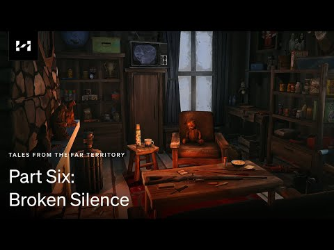
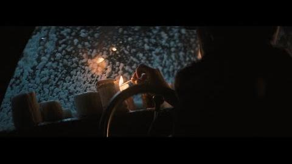
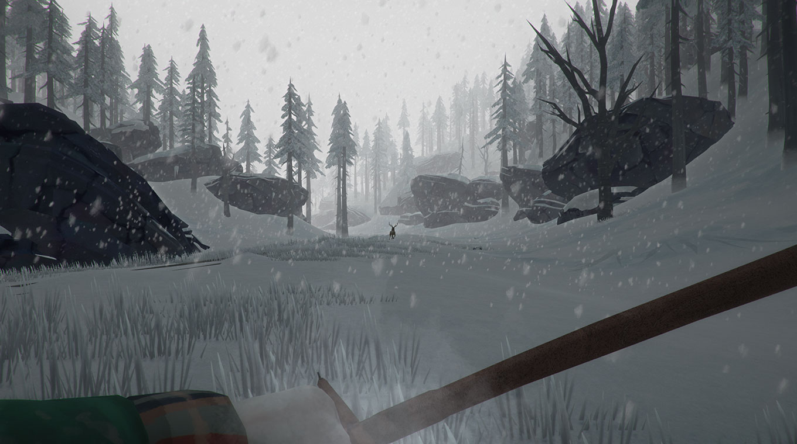
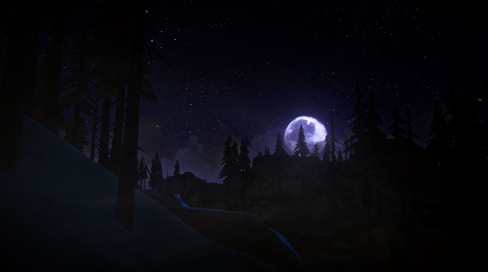
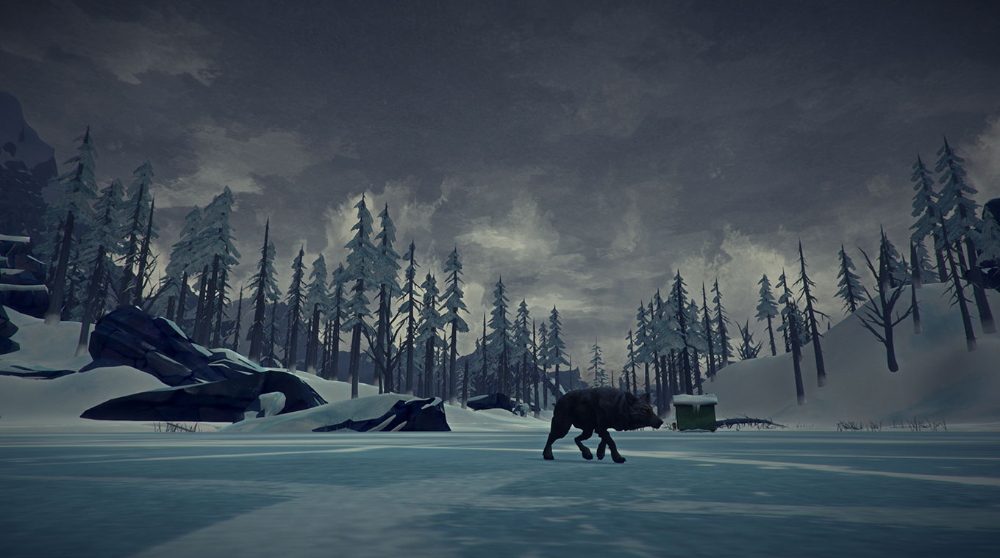

# The Long Dark Wiki

**Source:** [Fandom](https://thelongdark.fandom.com/wiki/The_Long_Dark_Wiki)

**Welcome to _The Long Dark_ Wiki**_[The Long Dark](./The%20Long%20Dark.md)_ is a thoughtful, first-person survival simulation that emphasizes quiet exploration in a stark, yet hauntingly beautiful post-disaster setting. The breathtakingly picturesque Northern Canadian wilderness frames the backdrop for the drama of _The Long Dark_.

{| style="border: 2px solid #0A0B11;" align="center" width="100%" ! colspan="3" align="center" style="background-color: #252434; padding:2px; font-size:16px;" |Content Portals 

[Regions](../assets/Regions.png)

[Locations](../assets/Locations.png)

[Afflictions](../assets/Afflictions.png)

[New characters](../assets/New_characters.png)

[New wildlife](../assets/New_wildlife.png)

[Regions](./Region.md)

[Locations](./Locations.md)

[Afflictions](./Afflictions.md)

[Characters](./Characters.md)

[Wildlife](./Wildlife.md)

[Food](../assets/Food.png)

[Clothing](../assets/Clothing.png)

[First Aid](../assets/First_Aid.png)

[Tools](../assets/Tools.png)

[Materials2](../assets/Materials2.png)

[Food and Drink](./Food%20And%20Drink.md)

[Clothing](./Clothing.md)

[First Aid](./First%20Aid.md)

[Tools](./Tools.md)

[Materials](./Materials.md)

{| style="border: 2px solid #0A0B11;" align="center" width="100%" ! colspan="3" align="center" style="background-color: #252434; padding:2px; font-size:16px;" |Featured Videos 

_Designing\_the\_Powerful\_Loneliness\_of\_The\_Long\_Dark_

_The\_Long\_Dark\_--\_Episode\_Four-\_FURY,\_THEN\_SILENCE\_--\_Launch\_Trailer_

_The\_Long\_Dark\_--\_"Make\_It\_Right"\_--\_WINTERMUTE\_LAUNCH\_TRAILER_

Gallery

