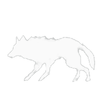
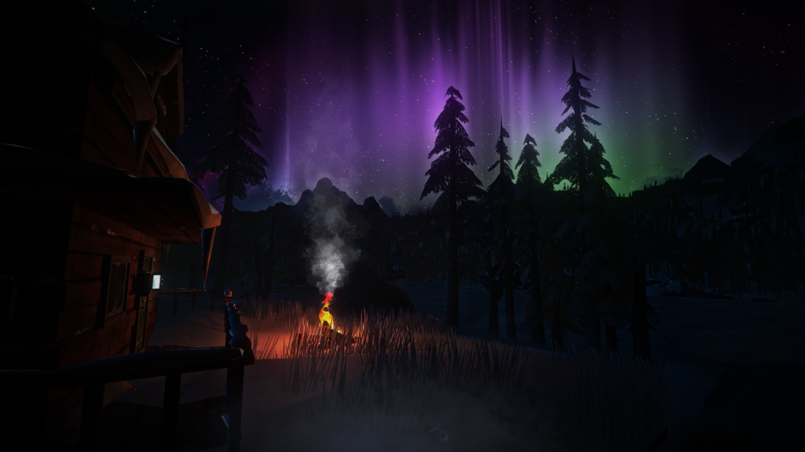

# The Long Dark Wiki

\<mainpage-leftcolumn-start /\>

**Welcome to *The Long Dark* Wiki\**
*<a href="./The%20Long%20Dark.md" class="wikilink" title="The Long Dark">The Long Dark</a>* is a thoughtful, first-person survival simulation that emphasizes quiet exploration in a stark, yet hauntingly beautiful post-disaster setting. The breathtakingly picturesque Northern Canadian wilderness frames the backdrop for the drama of *The Long Dark*.

<table class="gallery">
<colgroup>
<col style="width: 25%" />
<col style="width: 25%" />
<col style="width: 25%" />
<col style="width: 25%" />
</colgroup>
<tbody>
<tr>
<td><figure>
[Missing image: Bf-wishlist.jpg]
<figcaption>BLACKFROST: The Long Dark II|link=BLACKFROST:_The_Long_Dark_II|linktext=Upcoming sequel to The Long Dark.</figcaption>
</figure></td>
<td><figure>
[Missing image: tales_from_the_far_territory_title.jpg]
<figcaption>linktext=Tales from the Far Territory was released 5 December 2022.</figcaption>
</figure></td>
<td><figure>
[Missing image: Part6Launch.jpg]
<figcaption>Part 6: Broken Silence|link=The_Long_Dark/Changelog#Version_2.33_(Tales_from_the_Far_Territory_Part_6:_Broken_Silence)|linktext=Broken Silence was released 2 December 2024.</figcaption>
</figure></td>
<td><figure>

<figcaption>Fury, then Silence|link=Episode_4:_Fury,_then_Silence|linktext=Fury, then Silence was released 6 October 2021.</figcaption>
</figure></td>
</tr>
</tbody>
</table>

\
{\| style="border: 2px solid \#0A0B11;" align="center" width="100%" ! colspan="3" align="center" style="background-color: \#252434; padding:2px; font-size:16px;" \|Content Portals \|}

<table>
<colgroup>
<col style="width: 20%" />
<col style="width: 20%" />
<col style="width: 20%" />
<col style="width: 20%" />
<col style="width: 20%" />
</colgroup>
<tbody>
<tr>
<td><figure>

<figcaption>Regions.png</figcaption>
</figure></td>
<td><figure>

<figcaption>Locations.png</figcaption>
</figure></td>
<td><figure>

<figcaption>Afflictions.png</figcaption>
</figure></td>
<td><figure>

<figcaption>New_characters.png</figcaption>
</figure></td>
<td><figure>

<figcaption>New_wildlife.png</figcaption>
</figure></td>
</tr>
<tr>
<td>
<a href="./Region.md" class="wikilink" title="Regions">Regions</a>
</td>
<td>
<a href="./Locations.md" class="wikilink" title="Locations">Locations</a>
</td>
<td>
<a href="./Afflictions.md" class="wikilink" title="Afflictions">Afflictions</a>
</td>
<td>
<a href="./Characters.md" class="wikilink" title="Characters">Characters</a>
</td>
<td>
<a href="./Wildlife.md" class="wikilink" title="Wildlife">Wildlife</a>
</td>
</tr>
<tr>
<td><figure>

<figcaption>Food.png</figcaption>
</figure></td>
<td><figure>

<figcaption>Clothing.png</figcaption>
</figure></td>
<td><figure>

<figcaption>First_Aid.png</figcaption>
</figure></td>
<td><figure>

<figcaption>Tools.png</figcaption>
</figure></td>
<td><figure>

<figcaption>Materials2.png</figcaption>
</figure></td>
</tr>
<tr>
<td>
<a href="./Food%20And%20Drink.md" class="wikilink" title="Food and Drink">Food and Drink</a>
</td>
<td>
<a href="./Clothing.md" class="wikilink" title="Clothing">Clothing</a>
</td>
<td>
<a href="./First%20Aid.md" class="wikilink" title="First Aid">First Aid</a>
</td>
<td>
<a href="./Tools.md" class="wikilink" title="Tools">Tools</a>
</td>
<td>
<a href="./Materials.md" class="wikilink" title="Materials">Materials</a>
</td>
</tr>
</tbody>
</table>

\
{\| style="border: 2px solid \#0A0B11;" align="center" width="100%" ! colspan="3" align="center" style="background-color: \#252434; padding:2px; font-size:16px;" \|Featured Videos \|}

<figure>
[Missing image: The_Long_Dark_--_TALES_FROM_THE_FAR_TERRITORY_--_Part_Six_Update_Video]
<figcaption>700 px|Part Four Update Video</figcaption>
</figure>

<table class="gallery">
<colgroup>
<col style="width: 25%" />
<col style="width: 25%" />
<col style="width: 25%" />
<col style="width: 25%" />
</colgroup>
<tbody>
<tr>
<td><figure>
[Missing image: Designing_the_Powerful_Loneliness_of_The_Long_Dark]
<figcaption>Designing_the_Powerful_Loneliness_of_The_Long_Dark</figcaption>
</figure></td>
<td><figure>
[Missing image: The_Long_Dark_--_Episode_Four-_FURY,_THEN_SILENCE_--_Launch_Trailer]
<figcaption>The_Long_Dark_--_Episode_Four-_FURY,_THEN_SILENCE_--_Launch_Trailer</figcaption>
</figure></td>
<td><figure>
[Missing image: The_Long_Dark_--_&amp;quot;Make_It_Right&amp;quot;_--_WINTERMUTE_LAUNCH_TRAILER]
<figcaption>The_Long_Dark_--_&amp;quot;Make_It_Right&amp;quot;_--_WINTERMUTE_LAUNCH_TRAILER</figcaption>
</figure></td>
<td><figure>

<figcaption>A Visual Poem</figcaption>
</figure></td>
</tr>
</tbody>
</table>

\<mainpage-endcolumn /\>

\<mainpage-rightcolumn-start /\>

<table>
<thead>
<tr>
<th colspan="3" style="text-align: center; background-color: #252434; padding: 2px; font-size: 16px;">
Gallery
</th>
</tr>
</thead>
<tbody>
</tbody>
</table>

<table class="gallery">
<colgroup>
<col style="width: 25%" />
<col style="width: 25%" />
<col style="width: 25%" />
<col style="width: 25%" />
</colgroup>
<tbody>
<tr>
<td><figure>
[Missing image: Release_Image_Slide-01-large.jpg]
<figcaption>Release_Image_Slide-01-large.jpg</figcaption>
</figure></td>
<td><figure>
[Missing image: Release_Image_Slide-02-large.jpg]
<figcaption>Release_Image_Slide-02-large.jpg</figcaption>
</figure></td>
<td><figure>
[Missing image: Release_Image_Slide-03-large.jpg]
<figcaption>Release_Image_Slide-03-large.jpg</figcaption>
</figure></td>
<td><figure>
[Missing image: Release_Image_Slide-04-large.jpg]
<figcaption>Release_Image_Slide-04-large.jpg</figcaption>
</figure></td>
</tr>
<tr>
<td><figure>
[Missing image: Release_Image_Slide-05-large.jpg]
<figcaption>Release_Image_Slide-05-large.jpg</figcaption>
</figure></td>
<td><figure>
[Missing image: Release_Image_Slide-06-large.jpg]
<figcaption>Release_Image_Slide-06-large.jpg</figcaption>
</figure></td>
<td><figure>
[Missing image: Release_Image_Slide-07-large.jpg]
<figcaption>Release_Image_Slide-07-large.jpg</figcaption>
</figure></td>
<td><figure>
[Missing image: Release_Image_Slide-08-large.jpg]
<figcaption>Release_Image_Slide-08-large.jpg</figcaption>
</figure></td>
</tr>
<tr>
<td><figure>
[Missing image: Release_Image_Slide-09-large.jpg]
<figcaption>Release_Image_Slide-09-large.jpg</figcaption>
</figure></td>
<td><figure>
[Missing image: Release_Image_Slide-10-large.jpg]
<figcaption>Release_Image_Slide-10-large.jpg</figcaption>
</figure></td>
<td><figure>

<figcaption>screen_96a6af19-1ae5-46cb-b510-9bfb13dac171_hi.png</figcaption>
</figure></td>
<td><figure>

<figcaption>screen_0c9be33c-5478-48fa-8fad-7daf2868ec88_hi.png</figcaption>
</figure></td>
</tr>
<tr>
<td><figure>

<figcaption>screen_933e8360-de4c-4510-aba9-c2ee35ecd37f_hi.png</figcaption>
</figure></td>
<td></td>
<td></td>
<td></td>
</tr>
</tbody>
</table>

\<mainpage-endcolumn /\>

<a href="ru:" class="wikilink" title="ru:">ru:</a> <a href="fr:" class="wikilink" title="fr:">fr:</a> <a href="es:" class="wikilink" title="es:">es:</a>

