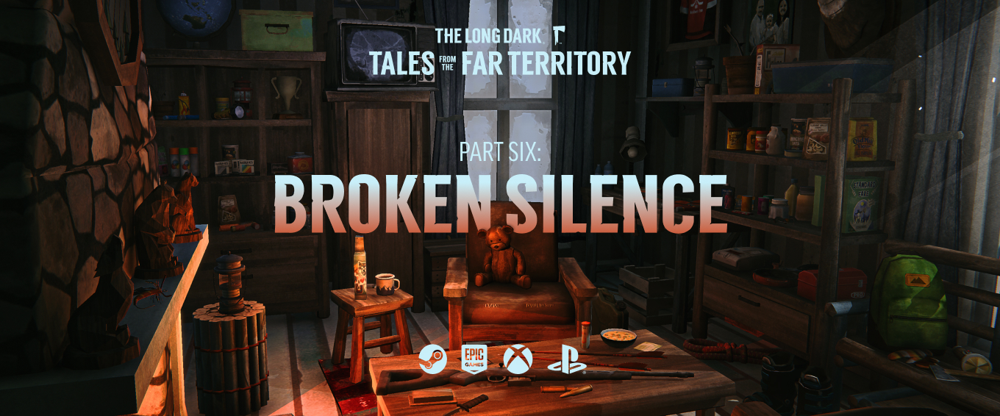
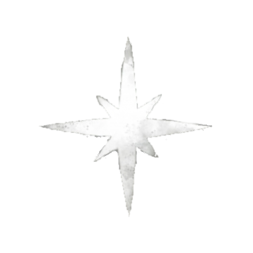
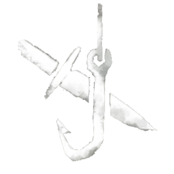
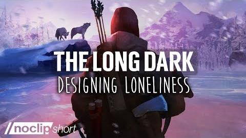
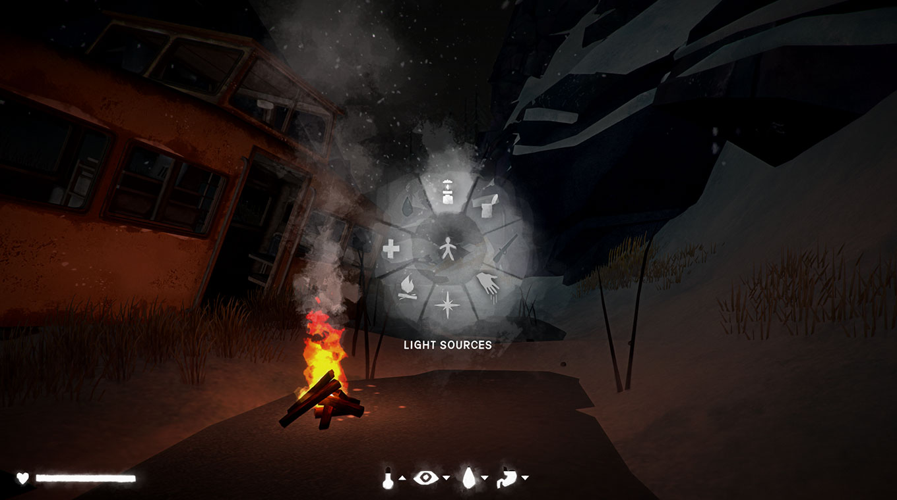
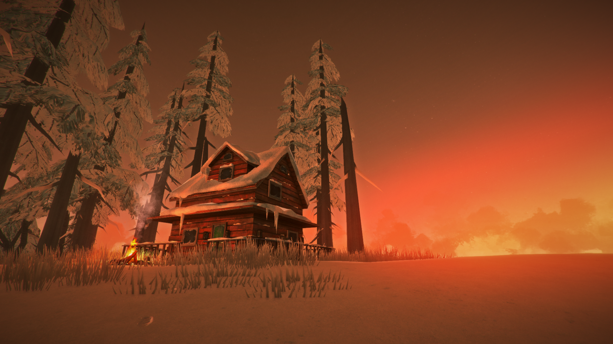
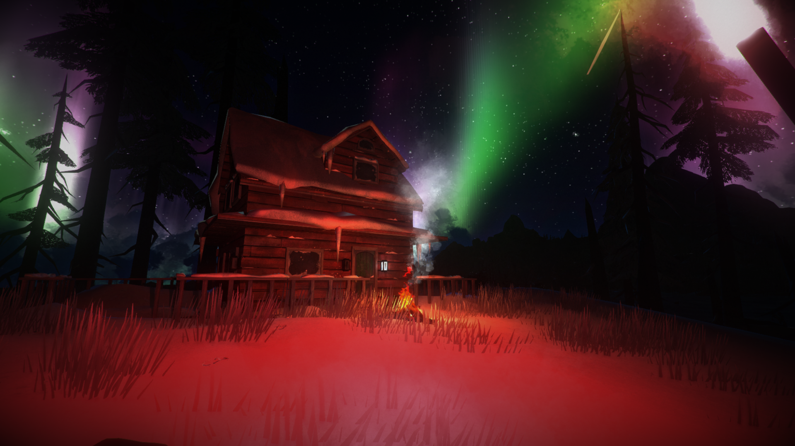

# The Long Dark Wiki

**Source:** [Fandom](https://thelongdark.fandom.com/wiki/The_Long_Dark_Wiki)

&lt;mainpage-leftcolumn-start /&gt;

**Welcome to _The Long Dark_ Wiki  
 **_[The Long Dark](./The%20Long%20Dark.md)_ is a thoughtful, first-person survival simulation that emphasizes quiet exploration in a stark, yet hauntingly beautiful post-disaster setting. The breathtakingly picturesque Northern Canadian wilderness frames the backdrop for the drama of _The Long Dark_.

_BLACKFROST: The Long Dark II\|link=BLACKFROST:\_The\_Long\_Dark\_II\|linktext=Upcoming sequel to The Long Dark._

_linktext=Tales from the Far Territory was released 5 December 2022._

_Part 6: Broken Silence\|link=The\_Long\_Dark/Changelog#Version\_2.33\_(Tales\_from\_the\_Far\_Territory\_Part\_6:\_Broken\_Silence)\|linktext=Broken Silence was released 2 December 2024._

_Fury, then Silence\|link=Episode\_4:\_Fury,\_then\_Silence\|linktext=Fury, then Silence was released 6 October 2021._

{| style="border: 2px solid #0A0B11;" align="center" width="100%" ! colspan="3" align="center" style="background-color: #252434; padding:2px; font-size:16px;" |Content Portals |}

| Column 1 | Column 2 | Column 3 | Column 4 | Column 5 |
| --- | --- | --- | --- | --- |
|  / _Regions.png_ |  / _Locations.png_ |  / _Afflictions.png_ |  / _New\_characters.png_ |  / _New\_wildlife.png_ |
| [Regions](./Region.md) | [Locations](./Locations.md) | [Afflictions](./Afflictions.md) | [Characters](./Characters.md) | [Wildlife](./Wildlife.md) |
|  / _Food.png_ |  / _Clothing.png_ |  / _First\_Aid.png_ |  / _Tools.png_ |  / _Materials2.png_ |
| [Food and Drink](./Food%20And%20Drink.md) | [Clothing](./Clothing.md) | [First Aid](./First%20Aid.md) | [Tools](./Tools.md) | [Materials](./Materials.md) |

{| style="border: 2px solid #0A0B11;" align="center" width="100%" ! colspan="3" align="center" style="background-color: #252434; padding:2px; font-size:16px;" |Featured Videos |}

_700 px|Part Four Update Video_

_Designing\_the\_Powerful\_Loneliness\_of\_The\_Long\_Dark_

_The\_Long\_Dark\_--\_Episode\_Four-\_FURY,\_THEN\_SILENCE\_--\_Launch\_Trailer_

\[Missing image: The\_Long\_Dark\_--\_&amp;quot;Make\_It\_Right&amp;quot;\_--\_WINTERMUTE\_LAUNCH\_TRAILER\]

_The\_Long\_Dark\_--\_&amp;quot;Make\_It\_Right&amp;quot;\_--\_WINTERMUTE\_LAUNCH\_TRAILER_

_A Visual Poem_

&lt;mainpage-endcolumn /&gt;

&lt;mainpage-rightcolumn-start /&gt;

| Gallery |
| --- |

_Release\_Image\_Slide-01-large.jpg_

_Release\_Image\_Slide-02-large.jpg_

_Release\_Image\_Slide-03-large.jpg_

_Release\_Image\_Slide-04-large.jpg_

_Release\_Image\_Slide-05-large.jpg_

_Release\_Image\_Slide-06-large.jpg_

_Release\_Image\_Slide-07-large.jpg_

_Release\_Image\_Slide-08-large.jpg_

_Release\_Image\_Slide-09-large.jpg_

_Release\_Image\_Slide-10-large.jpg_

_screen\_96a6af19-1ae5-46cb-b510-9bfb13dac171\_hi.png_

_screen\_0c9be33c-5478-48fa-8fad-7daf2868ec88\_hi.png_

_screen\_933e8360-de4c-4510-aba9-c2ee35ecd37f\_hi.png_

&lt;mainpage-endcolumn /&gt;

[ru:](ru:) [fr:](fr:) [es:](es:)
