# The Long Dark/Achievements

**Categories:** Achievements · **Source:** [Fandom](https://thelongdark.fandom.com/wiki/The_Long_Dark%2FAchievements)

**Contents**

- [General Achievements](#general-achievements)
- [Tales from the Far Territory Achievements](#tales-from-the-far-territory-achievements)
- [Hidden Achievements](#hidden-achievements)
- [Game History](#game-history)

This is a list of the 88 obtainable achievements for _[The Long Dark](./The%20Long%20Dark.md)_.

- 42 of the achievements are secret achievements unlocked in [Wintermute](./Wintermute.md), and will only display after they are unlocked.
  - 2 achievements can only be unlocked by completing side missions in both Episode 1 and Episode 2 (requires playing Episode 1 first, then moving to Episode 2).
- 1 achievement is unlocked by completing [Challenges](./Challenge.md).
- Some achievements require owning the [Tales from the Far Territory](./Tales%20from%20the%20Far%20Territory.md) expansion to unlock.
- Some achievements in Survival Mode can have their progress reset if the player [Cheats Death](./Cheat%20Death.md), (these achievements are listed as "single game").
- The achievement [Survive the Quiet Apocalypse](./Survive%20the%20Quiet%20Apocalypse.md) is a PlayStation 4/5 exclusive achievement.

## General Achievements

Most of these Achievements can be unlocked in [Survival Mode](./Survival%20Mode.md), [Wintermute](./Wintermute.md), or in [Challenges](./Challenge.md). Most general Achievements, however, can only be unlocked in Survival Mode.

| Column 1 | Column 2 | Column 3 |
| --- | --- | --- |
| **Image** | **Name** | **Description** |
|  / _Survive\_the\_Quiet\_Apocalypse\_icon.png_ | [**Survive the Quiet Apocalypse**](./Survive%20the%20Quiet%20Apocalypse.md) | Whatever the future brings, you will be ready. [¹](#fn1) |
|  / _The\_First\_of\_Many\_icon.png_ | **[The First of Many](./The%20First%20of%20Many.md)** | Survive 1 day in a single Survival Mode game. |
|  / _You\_Made\_It!\_icon.png_ | **[You Made It!](./You%20Made%20It!.md)** | Survive 10 days in a single Survival Mode game. |
|  / _Ready\_for\_when\_the\_SHTF!\_icon.png_ | **[Ready for when the SHTF!](./Ready%20for%20when%20the%20SHTF!.md)** | Survive 50 days in a single Survival Mode game. |
|  / _Centurion\_icon.png_ | **[Centurion](./Centurion.md)** | Survive for 100 days in a single Survival Mode game. |
|  / _The\_Will\_to\_Live\_icon.png_ | **[The Will to Live](./The%20Will%20to%20Live.md)** | Survive 500 days in a single Survival Mode game. |
| 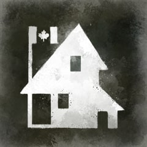 / _Exploration\_Game\_icon.png_ | **[Exploration Game](./Exploration%20Game.md)** | Visit every interior location in both [Mystery Lake](./Mystery%20Lake%20%28region%29.md) and [Coastal Highway](./Coastal%20Highway.md) (single game). |
|  / _Waste\_Not,\_Want\_Not\_icon.png_ | **[Waste Not, Want Not](./Waste%20Not%2C%20Want%20Not.md)** | Harvest 10 Complete [Deer Carcasses](./Deer%20Carcass.md) (single game). |
|  / _Night\_Walker\_icon.png_ | **[Night Walker](./Night%20Walker.md)** | Survive an entire Night outside (single game). |
|  / _Beneath\_a\_Starry\_Sky\_icon.png_ | **[Beneath a Starry Sky](./Beneath%20a%20Starry%20Sky.md)** | Survive 3 consecutive Nights outside (single game). |
|  / _Silent\_Hunter\_icon.png_ | **[Silent Hunter](./Silent%20Hunter.md)** | Survive the first 50 days without firing any firearms (single game). |
|  / _Pacifist\_icon.png_ | **[Pacifist](./Pacifist.md)** | Survive the first 25 days without killing anything (single game). |
|  / _Wrapped\_in\_Furs\_icon.png_ | **[Wrapped in Furs](./Wrapped%20in%20Furs.md)** | Sleep in a [Bear Skin Bedroll](./Bear%20Skin%20Bedroll.md) while wearing a [Wolfskin Coat](./Wolfskin%20Coat.md), [Deerskin Boots](./Deerskin%20Boots.md), and [Rabbitskin Mittens](./Rabbitskin%20Mitts.md). |
|  / _It\_was\_THIS\_Big!\_icon.png_ | **[It was THIS Big!](./It%20was%20THIS%20Big!.md)** | [Catch](./Ice%20Fishing.md) a fish weighing over 5kg (11 lbs). |
|  / _Living\_Off\_the\_Land\_icon.png_ | **[Living Off the Land](./Living%20Off%20the%20Land.md)** | Survive 25 consecutive full days only consuming calories harvested from wild plants and animals (single game). |
|  / _Natural\_Healer\_icon.png_ | **[Natural Healer](./Natural%20Healer.md)** | Heal yourself using all types of natural [medicines](./First%20Aid.md) (single game). |
|  / _Happy\_Harvester\_icon.png_ | **[Happy Harvester](./Happy%20Harvester.md)** | Harvest 25 of each kind of plant (single game). |
|  / _Stone-Age\_Sniper\_icon.png_ | **[Stone-Age Sniper](./Stone-Age%20Sniper.md)** | Stun a [rabbit](./Rabbit.md) with a [rock](./Stone.md) from over 25 meters (80 feet) away. |
|  / _Skilled\_Survivor\_icon.png_ | **[Skilled Survivor](./Skilled%20Survivor.md)** | Get all [skills](./Skills.md) to level 5 in a single Survival Mode game. |
|  / _Face\_the\_Impossible\_icon.png_ | **[Face the Impossible](./Face%20the%20Impossible.md)** | Survive one day on [Interloper](./Interloper.md) difficulty. |
|  / _Don't\_Starve\_icon.png_ | **[Don't Starve](./Don%27t%20Starve.md)** | Keep [calorie store](./Hunger.md) above zero for 10 days. |
|  / _Faithful\_Cartographer\_icon.png_ | **[Faithful Cartographer](./Faithful%20Cartographer.md)** | [Map](./Map.md) all named locations in Survival Mode. |
|  / _Resolute\_Outfitter\_icon.png_ | **[Resolute Outfitter](./Resolute%20Outfitter.md)** | Fill all [clothing](./Clothing.md) slots with 100% condition gear. |
|  / _Penitent\_Scholar\_icon.png_ | **[Penitent Scholar](./Penitent%20Scholar.md)** | Complete all [Research books](./Research%20Book.md). |
|  / _Timberwolf\_Mountain\_(Achievement)\_icon.png_ | **[Timberwolf Mountain](./Timberwolf%20Mountain%20%28Achievement%29.md)** | Climb to the top of [Timberwolf Mountain](./Timberwolf%20Mountain.md). |
|  / _Desolation\_Point\_(Achievement)\_icon.png_ | **[Desolation Point](./Desolation%20Point%20%28Achievement%29.md)** | Craft a full set of improvised Tools. |
|  / _Deep\_Forest\_icon.png_ | **[Deep Forest](./Deep%20Forest.md)** | Keep a [campfire](./Fire.md) burning for 3 days. |
|  / _Challenge\_Mastery\_icon.png_ | **[Challenge Mastery](./Challenge%20Mastery.md)** | Complete every [Challenge](./Challenge.md). [²](#fn2) |
|  / _Something\_Wicked\_icon.png_ | **[Something Wicked](./Something%20Wicked.md)** | Survive 1000 days in a single Survival Mode game without [Cheating Death](./Cheat%20Death.md). |
|  / _Expert\_Angler\_icon.png_ | **[Expert Angler](./Expert%20Angler.md)** | Catch 4 different Rare Fish – [Burbot](./Burbot%20%28Raw%29.md), [Goldeye](./Goldeye%20%28Raw%29.md), [Red Irish Lord](./Red%20Irish%20Lord%20%28Raw%29.md), and [Rockfish](./Rockfish%20%28Raw%29.md) (single game). |
|  / _Broken\_Body\_(Achievement)\_icon.png_ | [**Broken Body**](./Broken%20Body%20%28Achievement%29.md) | Survive long enough to receive the final Affliction in [Misery](./Misery.md) Mode. |
|  / _Tackle\_Box\_icon.png_ | **[Tackle Box](./Tackle%20Box.md)** | Craft a full set of 3 [Fishing Lures](./Fishing%20Lure%20%28disambiguation%29.md) (single game). |
|  / _Thanks\_for\_the\_Memories\_icon.png_ | **[Thanks for the Memories](./Thanks%20for%20the%20Memories.md)** | Collect 12 [Mementos](./Mementos.md) – one from each Lower Great Bear Island Region (single game). |
|  / _Hot\_Shot\_icon.png_ | **[Hot Shot](./Hot%20Shot.md)** | Kill 25 Rabbits with [Fire Hardened Arrows](./Fire%20Hardened%20Arrow.md) (single game). |
|  / _Down\_Below\_icon.png_ | **[Down Below](./Down%20Below.md)** | Enter all 9 [Prepper Cache](./Prepper%20Cache.md) locations (single game). |

## Tales from the Far Territory Achievements

These Achievements require owning [Tales from the Far Territory](./Tales%20from%20the%20Far%20Territory.md). They are only unlocked in Survival Mode.

| Column 1 | Column 2 | Column 3 |
| --- | --- | --- |
| **Image** | **Name** | **Description** |
|  / _Too\_Greedily,\_too\_Deep\_icon.png_ | **[Too Greedily, too Deep](./Too%20Greedily%2C%20too%20Deep.md)** | Survive 25 consecutive days inside the [Langston Mine](./Langston%20Mine.md). |
|  / _To\_the\_Teeth\_icon.png_ | [**To the Teeth**](./To%20the%20Teeth.md) | Collect 7 Expansion Firearm variants (single game). |
|  / _Tasting\_Menu\_icon.png_ | **[Tasting Menu](./Tasting%20Menu.md)** | Find and Cook 9 [Unique Recipes](./Recipe%20Cards.md). |
|  / _Rüdiger's\_Dream\_icon.png_ | [**Rüdiger's Dream**](./R%C3%BCdiger%27s%20Dream.md) | Complete all 3 [Tales](./Tales.md) (single game) |
| 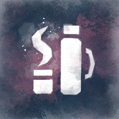 / _Something\_Warm\_to\_Drink\_icon.png_ | **[Something Warm to Drink](./Something%20Warm%20to%20Drink.md)** | Collect 7 [Insulated Flask](./Insulated%20Flask.md) Variants (single game). |
|  / _Quick\_Draw\_icon.png_ | **[Quick Draw](./Quick%20Draw.md)** | Kill 10 [Ptarmigans](./Ptarmigan.md) with Arrows (single game). |
|  / _Exposure\_icon.png_ | **[Exposure](./Exposure.md)** | Take a photo in each Great Bear Island Region for a total of 16 (single game). |
|  / _Shutterbug\_icon.png_ | **[Shutterbug](./Shutterbug.md)** | Take 10 photos with each film type – Colour, B&amp;W, and Sepia (single game). |
|  / _On\_the\_Lookout\_icon.png_ | **[On the Lookout](./On%20the%20Lookout.md)** | Reach all 6 [Vista](./Polaroids.md) locations in the Far Territory (single game). |
|  / _Ends\_of\_the\_Earth\_icon.png_ | **[Ends of the Earth](./Ends%20of%20the%20Earth.md)** | Travel from [Desolation Point](./Desolation%20Point.md) to [Sundered Pass](./Sundered%20Pass.md) (single game). |
|  / _Goods\_and\_Services\_icon.png_ | **[Goods and Services](./Goods%20and%20Services.md)** | Achieve the highest Trust level with the [Trader](./Trader.md). |
|  / _Tough\_Enough\_icon.png_ | [**Tough Enough**](./Tough%20Enough.md) | Survive 25 [Cougar](./Cougar.md) Struggles. |

## Hidden Achievements

These Achievements require owning [Wintermute](./Wintermute.md) to unlock and are all secret Achievements.**Template:spoiler**

| Column 1 | Column 2 | Column 3 | Column 4 |
| --- | --- | --- | --- |
| **Image** | **Name** | **Description** | Episode |
|  / _Your\_Journey\_Begins\_icon.png_ | **[Your Journey Begins](./Your%20Journey%20Begins.md)** | Escape the ravine after your crash. | [Episode 1](./Episode%201%20-%20Do%20Not%20Go%20Gentle.md) |
|  / _Paradise\_Lost\_(Achievement)\_icon.png_ | **[Paradise Lost](./Paradise%20Lost%20%28Achievement%29.md)** | Make your way to [Milton](./Milton.md). | [Episode 1](./Episode%201%20-%20Do%20Not%20Go%20Gentle.md) |
|  / _The\_Long\_Winter\_icon.png_ | **[The Long Winter](./The%20Long%20Winter.md)** | Prepare [Grey Mother](./Grey%20Mother.md) for Winter. | [Episode 1](./Episode%201%20-%20Do%20Not%20Go%20Gentle.md) |
|  / _Losing\_a\_Child\_is\_Like...\_icon.png_ | **[Losing a Child is Like...](./Losing%20a%20Child%20is%20Like....md)** | Complete Lily's Story. | [Episode 1](./Episode%201%20-%20Do%20Not%20Go%20Gentle.md) |
|  / _Leaving\_the\_Old\_World\_Behind\_icon.png_ | **[Leaving the Old World Behind](./Leaving%20the%20Old%20World%20Behind.md)** | Leave Milton. Complete [Episode One](./Episode%201%20-%20Do%20Not%20Go%20Gentle.md). | [Episode 1](./Episode%201%20-%20Do%20Not%20Go%20Gentle.md) |
| 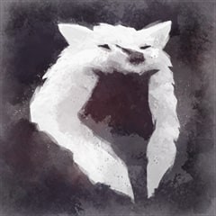 / _The\_Old\_Trapper\_icon.png_ | **[The Old Trapper](./The%20Old%20Trapper.md)** | Bring [Jeremiah](./Jeremiah.md) back from near death. | [Episode 2](./Episode%202%20-%20Luminance%20Fugue.md) |
|  / _Lights\_in\_the\_Sky\_icon.png_ | **[Lights in the Sky](./Lights%20in%20the%20Sky.md)** | Survive the first [Aurora](./Aurora.md) event. | [Episode 2](./Episode%202%20-%20Luminance%20Fugue.md) |
|  / _Graduation\_Day\_icon.png_ | **[Graduation Day](./Graduation%20Day.md)** | Complete all six Survival School objectives across Episodes One and Two. | [Episode 1](./Episode%201%20-%20Do%20Not%20Go%20Gentle.md) &amp; [2](./Episode%202%20-%20Luminance%20Fugue.md) |
|  / _Freight-Train\_of\_Hate\_&amp;\_Hunger\_icon.png_ | **[Freight-Train of Hate &amp; Hunger](./Freight-Train%20of%20Hate%20%26%20Hunger.md)** | Kill the [Old Bear](./Old%20Bear.md). | [Episode 2](./Episode%202%20-%20Luminance%20Fugue.md) |
|  / _You'll\_Be\_With\_Her\_Soon\_icon.png_ | **[You'll Be With Her Soon](./You%27ll%20Be%20With%20Her%20Soon.md)** | Leave Mystery Lake. Complete [Episode Two](./Episode%202%20-%20Luminance%20Fugue.md). | [Episode 2](./Episode%202%20-%20Luminance%20Fugue.md) |
|  / _Too\_Big\_to\_Fail\_icon.png_ | **[Too Big to Fail](./Too%20Big%20to%20Fail.md)** | Open all Safety Deposit boxes in Milton. | [Episode 1](./Episode%201%20-%20Do%20Not%20Go%20Gentle.md) |
|  / _Sounds\_Like\_Some\_Kind\_of\_Indie\_Band\_icon.png_ | **[Sounds Like Some Kind of Indie Band](./Sounds%20Like%20Some%20Kind%20of%20Indie%20Band.md)** | Find all [Forest Talker](./Forest%20Talkers.md) caches. | [Episode 2](./Episode%202%20-%20Luminance%20Fugue.md) |
|  / _Cache\_Mastery\_icon.png_ | **[Cache Mastery](./Cache%20Mastery.md)** | Find all hidden caches in Episode One and Episode Two. | [Episode 1](./Episode%201%20-%20Do%20Not%20Go%20Gentle.md) &amp; [2](./Episode%202%20-%20Luminance%20Fugue.md) |
|  / _Community\_Service\_icon.png_ | **[Community Service](./Community%20Service.md)** | Get to Thomson's Crossing. | [Episode 3](./Episode%203%20-%20Crossroads%20Elegy.md) |
|  / _Save\_Our\_Souls\_icon.png_ | **[Save Our Souls](./Save%20Our%20Souls.md)** | Enter the Crash Site. | [Episode 3](./Episode%203%20-%20Crossroads%20Elegy.md) |
|  / _Hippocratic\_Oath\_icon.png_ | **[Hippocratic Oath](./Hippocratic%20Oath.md)** | Rescue all three lost Survivors and stock the Hall with supplies. | [Episode 3](./Episode%203%20-%20Crossroads%20Elegy.md) |
|  / _He\_Lives\_icon.png_ | **[He Lives](./He%20Lives.md)** | Intercept the Radio transmission. | [Episode 3](./Episode%203%20-%20Crossroads%20Elegy.md) |
|  / _The\_Crossroads\_Elegy\_icon.png_ | **[The Crossroads Elegy](./The%20Crossroads%20Elegy.md)** | Leave Pleasant Valley behind. Complete [Episode Three](./Episode%203%20-%20Crossroads%20Elegy.md). | [Episode 3](./Episode%203%20-%20Crossroads%20Elegy.md) |
|  / _Tall\_Tales\_(Achievement)\_icon.png_ | **[Tall Tales](./Tall%20Tales%20%28Achievement%29.md)** | Investigate all of the local mysteries. | [Episode 3](./Episode%203%20-%20Crossroads%20Elegy.md) |
|  / _Every\_Last\_One\_icon.png_ | **[Every Last One](./Every%20Last%20One.md)** | Find all of the [Forest Talker](./Forest%20Talkers.md) notes. | [Episode 3](./Episode%203%20-%20Crossroads%20Elegy.md) |
| 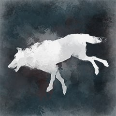 / _There\_Will\_Be\_Blood\_icon.png_ | **[There Will Be Blood](./There%20Will%20Be%20Blood.md)** | Defeat your first Timberwolf pack. | [Episode 3](./Episode%203%20-%20Crossroads%20Elegy.md) |
|  / _Welcome\_to\_the\_S\*\*t\_Show\_icon.png_ | **[Welcome to the S\*\*t Show](./Welcome%20to%20the%20S%2A%2At%20Show.md)** | Find Medicine for the Warden. | [Episode 4](./Episode%204%20-%20Fury%2C%20Then%20Silence.md) |
| 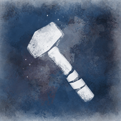 / _Just\_Like\_New\_icon.png_ | **[Just Like New](./Just%20Like%20New.md)** | Sabotage the Locking Mechanism. | [Episode 4](./Episode%204%20-%20Fury%2C%20Then%20Silence.md) |
| 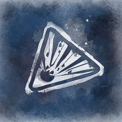 / _Something\_Stinks\_icon.png_ | **[Something Stinks](./Something%20Stinks.md)** | Locate the Detonators. | [Episode 4](./Episode%204%20-%20Fury%2C%20Then%20Silence.md) |
|  / _Enemy\_For\_Life\_icon.png_ | **[Enemy For Life](./Enemy%20For%20Life.md)** | Turn the tables on [Mathis](./Mathis.md). | [Episode 4](./Episode%204%20-%20Fury%2C%20Then%20Silence.md) |
|  / _Leap\_of\_Faith\_icon.png_ | **[Leap of Faith](./Leap%20of%20Faith.md)** | Escape [Blackrock](./Blackrock%20Prison.md) and Complete [Episode Four](./Episode%204%20-%20Fury%2C%20Then%20Silence.md). | [Episode 4](./Episode%204%20-%20Fury%2C%20Then%20Silence.md) |
|  / _Black\_Black\_Heart\_icon.png_ | **[Black Black Heart](./Black%20Black%20Heart.md)** | Collect all four bloody pages from the [Blackrock](./Blackrock%20Prison.md) Archives. | [Episode 4](./Episode%204%20-%20Fury%2C%20Then%20Silence.md) |
|  / _Hard\_Times\_icon.png_ | **[Hard Times](./Hard%20Times.md)** | Learn the truth behind all three [Blackrock](./Blackrock%20Prison.md) rumours. | [Episode 4](./Episode%204%20-%20Fury%2C%20Then%20Silence.md) |
|  / _No\_Half-Measures\_icon.png_ | **[No Half-Measures](./No%20Half-Measures.md)** | Uncover the latest [Forest Talker](./Forest%20Talkers.md) Plans. | [Episode 4](./Episode%204%20-%20Fury%2C%20Then%20Silence.md) |
| 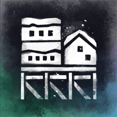 / _Quarantine\_icon.png_ | **[Quarantine](./Quarantine.md)** | Explore Perseverance Mills. | [Episode 5](./Episode%205%20-%20The%20Light%20At%20The%20End%20Of%20All%20Things.md) |
|  / _Search\_Party\_icon.png_ | **[Search Party](./Search%20Party.md)** | Find all three missing townspeople within 40 real time minutes. | [Episode 5](./Episode%205%20-%20The%20Light%20At%20The%20End%20Of%20All%20Things.md) |
|  / _To\_The\_Bone\_icon.png_ | **[To The Bone](./To%20The%20Bone.md)** | Complete the autopsy of a missing Perseverance Mills townsperson. | [Episode 5](./Episode%205%20-%20The%20Light%20At%20The%20End%20Of%20All%20Things.md) |
|  / _Adrift\_icon.png_ | **[Adrift](./Adrift.md)** | Discover the truth behind the mysterious signal in Desperation Bay. | [Episode 5](./Episode%205%20-%20The%20Light%20At%20The%20End%20Of%20All%20Things.md) |
|  / _Dead\_Wake\_icon.png_ | **[Dead Wake](./Dead%20Wake.md)** | Collect all the writings and personal effects left behind by the ship's crew. | [Episode 5](./Episode%205%20-%20The%20Light%20At%20The%20End%20Of%20All%20Things.md) |
|  / _The\_Hard\_Sciences\_icon.png_ | **[The Hard Sciences](./The%20Hard%20Sciences.md)** | Reach the Suzuki Radio Telescope and deliver Jeremiah's "Wintermute" message to Dr. Atwood. | [Episode 5](./Episode%205%20-%20The%20Light%20At%20The%20End%20Of%20All%20Things.md) |
|  / _Song\_of\_the\_Earth\_icon.png_ | **[Song of the Earth](./Song%20of%20the%20Earth.md)** | Reactivate the Geothermal Plant and power up the telescope. | [Episode 5](./Episode%205%20-%20The%20Light%20At%20The%20End%20Of%20All%20Things.md) |
|  / _Wild\_At\_Heart\_icon.png_ | **[Wild At Heart](./Wild%20At%20Heart.md)** | Defeat and kill the Cougar stalking the Geothermal Region. | [Episode 5](./Episode%205%20-%20The%20Light%20At%20The%20End%20Of%20All%20Things.md) |
| 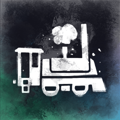 / _Finely\_Tuned\_icon.png_ | **[Finely Tuned](./Finely%20Tuned.md)** | Complete “To SAR and Back” without using more than 50 pieces of coal. | [Episode 5](./Episode%205%20-%20The%20Light%20At%20The%20End%20Of%20All%20Things.md) |
|  / _Bending\_The\_Rail\_icon.png_ | **[Bending The Rail](./Bending%20The%20Rail.md)** | Retrieve the Trauma Kit. | [Episode 5](./Episode%205%20-%20The%20Light%20At%20The%20End%20Of%20All%20Things.md) |
|  / _The\_Last\_Light\_icon.png_ | **[The Last Light](./The%20Last%20Light.md)** | Reunite with Astrid and deliver the Hardcase. | [Episode 5](./Episode%205%20-%20The%20Light%20At%20The%20End%20Of%20All%20Things.md) |
|  / _The\_New\_World\_icon.png_ | **[The New World](./The%20New%20World.md)** | Complete Episode Five. | [Episode 5](./Episode%205%20-%20The%20Light%20At%20The%20End%20Of%20All%20Things.md) |

## Game History

At the release of Wintermute (v1.00), the following Achievements were removed from the game and no longer display on Steam:

| Column 1 | Column 2 | Column 3 |
| --- | --- | --- |
| **Image** | **Name** | **Description** |
|  / _Two\_for\_Two.jpg_ | **[Two for Two](./Two%20for%20Two.md)** | Survive for 2 days in a single Survival Mode game. |
|  / _Wolfbait.jpg_ | **[Wolfbait](./Wolfbait.md)** | Survive 5 days in a single Survival Mode game. |
|  / _It's\_Getting\_Cold\_Out\_There.jpg_ | **[It's Getting Cold Out There](./It%27s%20Getting%20Cold%20Out%20There.md)** | Survive 15 days in a single Survival Mode game. |
| 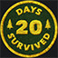 / _Tough\_as\_Nails.jpg_ | **[Tough as Nails](./Tough%20as%20Nails.md)** | Survive 20 days in a single Survival Mode game. |
|  / _You\_Prep\_the\_Preppers.jpg_ | **[You Prep the Preppers](./You%20Prep%20the%20Preppers.md)** | Survive 30 days in a single Survival Mode game. |
|  / _Master\_Survivor.jpg_ | **[Master Survivor](./Master%20Survivor.md)** | Survive 40 days in a single Survival Mode game. |
|  / _One\_With\_Nature.jpg_ | **[One With Nature](./One%20With%20Nature.md)** | Survive for 200 days in a single Survival Mode game. |

The following achievements were kept but received a new achievement icon:

| Column 1 | Column 2 | Column 3 |
| --- | --- | --- |
| **Image** | **Name** | **Description** |
|  / _The\_First\_of\_Many\_old\_icon.webp_ | **First of Many** | Survive for 1 day in a single Survival Mode game. |
|  / _You\_Made\_It!\_old\_icon.webp_ | **You Made It!** | Survive 10 days in a single Survival Mode game. |
|  / _Ready\_for\_when\_the\_SHTF!\_old\_icon.webp_ | **Ready for when the SHTF!** | Survive for 50 days in a single Survival Mode game. |
|  / _Centurion\_old\_icon.webp_ | **Centurion** | Survive for 100 days in a single Survival Mode game. |
|  / _Exploration\_Game\_old\_icon.webp_ | **Exploration Game** | Visit every interior location in both [Mystery Lake](./Mystery%20Lake%20%28region%29.md) and [Coastal Highway](./Coastal%20Highway.md) (single game) |
|  / _Waste\_Not,\_Want\_Not\_old\_icon.webp_ | **Waste Not, Want Not** | Harvest 10 Complete [Deer Carcasses](./Deer%20Carcass.md) (single game) |
|  / _Night\_Walker\_old\_icon.webp_ | **Night Walker** | Survive an entire Night outside (single game) |
|  / _Beneath\_a\_Starry\_Sky\_old\_icon.webp_ | **Beneath a Stary Sky** | Survive 3 consecutive Nights outside (single game) |
|  / _Silent\_Hunter\_old\_icon.webp_ | **Silent Hunter** | Survive the first 50 days without firing the [hunting rifle](./Hunting%20Rifle.md), [revolver](./Revolver.md) or the [distress pistol](./Distress%20Pistol.md) (single game) |
|  / _Pacifist\_old\_icon.webp_ | **Pacifist** | Survive the first 25 days without killing anything (single game) |
|  / _It\_was\_THIS\_Big!\_old\_icon.webp_ | **It was THIS Big!** | [Catch](./Ice%20Fishing.md) a fish weighing over 5kg (11 lbs). |
| 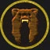 / _Wrapped\_in\_Furs\_old\_icon.webp_ | **Wrapped in Furs** | Sleep in a [Bear Skin Bedroll](./Bear%20Skin%20Bedroll.md) while wearing a [Wolfskin Coat](./Wolfskin%20Coat.md), [Deerskin Boots](./Deerskin%20Boots.md), and [Rabbitskin Mittens](./Rabbitskin%20Mitts.md). |
|  / _Living\_Off\_the\_Land\_old\_icon.webp_ | **Living Off the Land** | Survive 25 consecutive full days only consuming calories harvested from wild plants and animals (single game) |
|  / _Natural\_Healer\_old\_icon.webp_ | **Natural Healer** | Heal yourself using all types of natural [medicines](./First%20Aid.md) (single game) |
| 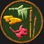 / _Happy\_Harvester\_old\_icon.webp_ | **Happy Harvester** | Harvest 25 of each kind of plant (single game) |

_All 22 achievement icons, pre V1.15._

## Notes

---

1. PlayStation 4 only Platinum Trophy[↩︎](#fnref1)
2. Completion of [As the Dead Sleep](./As%20the%20Dead%20Sleep.md) and [Escape the Darkwalker](./Escape%20the%20Darkwalker.md) is not required to unlock this Achievement.[↩︎](#fnref2)
