# The Long Dark/Achievements

**Contents**

- [General Achievements](#General_Achievements)
- [Tales from the Far Territory Achievements](#Tales_from_the_Far_Territory_Achievements)
- [Hidden Achievements](#Hidden_Achievements)
- [Game History](#Game_History)

This is a list of the 88 obtainable achievements for *<a href="./The%20Long%20Dark.md" class="wikilink" title="The Long Dark">The Long Dark</a>*.

- 42 of the achievements are secret achievements unlocked in <a href="./Wintermute.md" class="wikilink" title="Wintermute">Wintermute</a>, and will only display after they are unlocked.
  - 2 achievements can only be unlocked by completing side missions in both Episode 1 and Episode 2 (requires playing Episode 1 first, then moving to Episode 2).
- 1 achievement is unlocked by completing <a href="./Challenge.md" class="wikilink" title="Challenges">Challenges</a>.
- Some achievements require owning the <a href="./Tales%20from%20the%20Far%20Territory.md" class="wikilink" title="Tales from the Far Territory">Tales from the Far Territory</a> expansion to unlock.
- Some achievements in Survival Mode can have their progress reset if the player <a href="./Cheat%20Death.md" class="wikilink" title="Cheats Death">Cheats Death</a>, (these achievements are listed as "single game").
- The achievement <a href="./Survive%20the%20Quiet%20Apocalypse.md" class="wikilink" title="Survive the Quiet Apocalypse">Survive the Quiet Apocalypse</a> is a PlayStation 4/5 exclusive achievement.

## General Achievements

Most of these Achievements can be unlocked in <a href="./Survival%20Mode.md" class="wikilink" title="Survival Mode">Survival Mode</a>, <a href="./Wintermute.md" class="wikilink" title="Wintermute">Wintermute</a>, or in <a href="./Challenge.md" class="wikilink" title="Challenges">Challenges</a>. Most general Achievements, however, can only be unlocked in Survival Mode.

<table>
<colgroup>
<col style="width: 33%" />
<col style="width: 33%" />
<col style="width: 33%" />
</colgroup>
<tbody>
<tr>
<td>
<strong>Image</strong>
</td>
<td>
<strong>Name</strong>
</td>
<td>
<strong>Description</strong>
</td>
</tr>
<tr>
<td><figure>

<figcaption>Survive_the_Quiet_Apocalypse_icon.png</figcaption>
</figure></td>
<td>
<a href="./Survive%20the%20Quiet%20Apocalypse.md" class="wikilink" title="Survive the Quiet Apocalypse"><strong>Survive the Quiet Apocalypse</strong></a>
</td>
<td>
Whatever the future brings, you will be ready. <a href="#fn1" class="footnote-ref" id="fnref1" role="doc-noteref">1</a>
</td>
</tr>
<tr>
<td><figure>

<figcaption>The_First_of_Many_icon.png</figcaption>
</figure></td>
<td>
<strong><a href="./The%20First%20of%20Many.md" class="wikilink" title="The First of Many">The First of Many</a></strong>
</td>
<td>
Survive 1 day in a single Survival Mode game.
</td>
</tr>
<tr>
<td><figure>
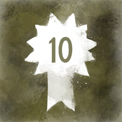
<figcaption>You_Made_It!_icon.png</figcaption>
</figure></td>
<td>
<strong><a href="./You%20Made%20It!.md" class="wikilink" title="You Made It!">You Made It!</a></strong>
</td>
<td>
Survive 10 days in a single Survival Mode game.
</td>
</tr>
<tr>
<td><figure>
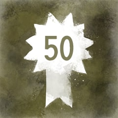
<figcaption>Ready_for_when_the_SHTF!_icon.png</figcaption>
</figure></td>
<td>
<strong><a href="./Ready%20for%20when%20the%20SHTF!.md" class="wikilink" title="Ready for when the SHTF!">Ready for when the SHTF!</a></strong>
</td>
<td>
Survive 50 days in a single Survival Mode game.
</td>
</tr>
<tr>
<td><figure>
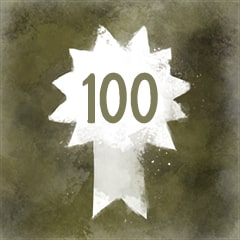
<figcaption>Centurion_icon.png</figcaption>
</figure></td>
<td>
<strong><a href="./Centurion.md" class="wikilink" title="Centurion">Centurion</a></strong>
</td>
<td>
Survive for 100 days in a single Survival Mode game.
</td>
</tr>
<tr>
<td><figure>
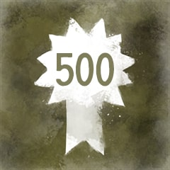
<figcaption>The_Will_to_Live_icon.png</figcaption>
</figure></td>
<td>
<strong><a href="./The%20Will%20to%20Live.md" class="wikilink" title="The Will to Live">The Will to Live</a></strong>
</td>
<td>
Survive 500 days in a single Survival Mode game.
</td>
</tr>
<tr>
<td><figure>

<figcaption>Exploration_Game_icon.png</figcaption>
</figure></td>
<td>
<strong><a href="./Exploration%20Game.md" class="wikilink" title="Exploration Game">Exploration Game</a></strong>
</td>
<td>
Visit every interior location in both <a href="./Mystery%20Lake%20%28region%29.md" class="wikilink" title="Mystery Lake">Mystery Lake</a> and <a href="./Coastal%20Highway.md" class="wikilink" title="Coastal Highway">Coastal Highway</a> (single game).
</td>
</tr>
<tr>
<td><figure>

<figcaption>Waste_Not,_Want_Not_icon.png</figcaption>
</figure></td>
<td>
<strong><a href="./Waste%20Not%2C%20Want%20Not.md" class="wikilink" title="Waste Not, Want Not">Waste Not, Want Not</a></strong>
</td>
<td>
Harvest 10 Complete <a href="./Deer%20Carcass.md" class="wikilink" title="Deer Carcasses">Deer Carcasses</a> (single game).
</td>
</tr>
<tr>
<td><figure>

<figcaption>Night_Walker_icon.png</figcaption>
</figure></td>
<td>
<strong><a href="./Night%20Walker.md" class="wikilink" title="Night Walker">Night Walker</a></strong>
</td>
<td>
Survive an entire Night outside (single game).
</td>
</tr>
<tr>
<td><figure>
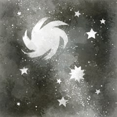
<figcaption>Beneath_a_Starry_Sky_icon.png</figcaption>
</figure></td>
<td>
<strong><a href="./Beneath%20a%20Starry%20Sky.md" class="wikilink" title="Beneath a Starry Sky">Beneath a Starry Sky</a></strong>
</td>
<td>
Survive 3 consecutive Nights outside (single game).
</td>
</tr>
<tr>
<td><figure>

<figcaption>Silent_Hunter_icon.png</figcaption>
</figure></td>
<td>
<strong><a href="./Silent%20Hunter.md" class="wikilink" title="Silent Hunter">Silent Hunter</a></strong>
</td>
<td>
Survive the first 50 days without firing any firearms (single game).
</td>
</tr>
<tr>
<td><figure>

<figcaption>Pacifist_icon.png</figcaption>
</figure></td>
<td>
<strong><a href="./Pacifist.md" class="wikilink" title="Pacifist">Pacifist</a></strong>
</td>
<td>
Survive the first 25 days without killing anything (single game).
</td>
</tr>
<tr>
<td><figure>
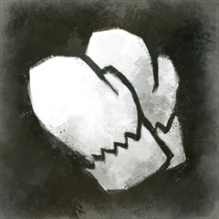
<figcaption>Wrapped_in_Furs_icon.png</figcaption>
</figure></td>
<td>
<strong><a href="./Wrapped%20in%20Furs.md" class="wikilink" title="Wrapped in Furs">Wrapped in Furs</a></strong>
</td>
<td>
Sleep in a <a href="./Bear%20Skin%20Bedroll.md" class="wikilink" title="Bear Skin Bedroll">Bear Skin Bedroll</a> while wearing a <a href="./Wolfskin%20Coat.md" class="wikilink" title="Wolfskin Coat">Wolfskin Coat</a>, <a href="./Deerskin%20Boots.md" class="wikilink" title="Deerskin Boots">Deerskin Boots</a>, and <a href="./Rabbitskin%20Mitts.md" class="wikilink" title="Rabbitskin Mittens">Rabbitskin Mittens</a>.
</td>
</tr>
<tr>
<td><figure>

<figcaption>It_was_THIS_Big!_icon.png</figcaption>
</figure></td>
<td>
<strong><a href="./It%20was%20THIS%20Big!.md" class="wikilink" title="It was THIS Big!">It was THIS Big!</a></strong>
</td>
<td>
<a href="./Ice%20Fishing.md" class="wikilink" title="Catch">Catch</a> a fish weighing over 5kg (11 lbs).
</td>
</tr>
<tr>
<td><figure>
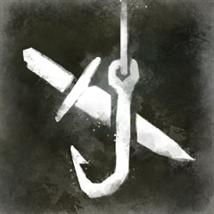
<figcaption>Living_Off_the_Land_icon.png</figcaption>
</figure></td>
<td>
<strong><a href="./Living%20Off%20the%20Land.md" class="wikilink" title="Living Off the Land">Living Off the Land</a></strong>
</td>
<td>
Survive 25 consecutive full days only consuming calories harvested from wild plants and animals (single game).
</td>
</tr>
<tr>
<td><figure>
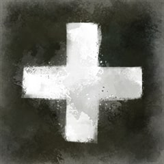
<figcaption>Natural_Healer_icon.png</figcaption>
</figure></td>
<td>
<strong><a href="./Natural%20Healer.md" class="wikilink" title="Natural Healer">Natural Healer</a></strong>
</td>
<td>
Heal yourself using all types of natural <a href="./First%20Aid.md" class="wikilink" title="medicines">medicines</a> (single game).
</td>
</tr>
<tr>
<td><figure>
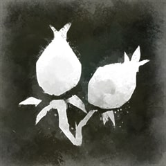
<figcaption>Happy_Harvester_icon.png</figcaption>
</figure></td>
<td>
<strong><a href="./Happy%20Harvester.md" class="wikilink" title="Happy Harvester">Happy Harvester</a></strong>
</td>
<td>
Harvest 25 of each kind of plant (single game).
</td>
</tr>
<tr>
<td><figure>

<figcaption>Stone-Age_Sniper_icon.png</figcaption>
</figure></td>
<td>
<strong><a href="./Stone-Age%20Sniper.md" class="wikilink" title="Stone-Age Sniper">Stone-Age Sniper</a></strong>
</td>
<td>
Stun a <a href="./Rabbit.md" class="wikilink" title="rabbit">rabbit</a> with a <a href="./Stone.md" class="wikilink" title="rock">rock</a> from over 25 meters (80 feet) away.
</td>
</tr>
<tr>
<td><figure>
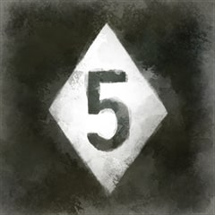
<figcaption>Skilled_Survivor_icon.png</figcaption>
</figure></td>
<td>
<strong><a href="./Skilled%20Survivor.md" class="wikilink" title="Skilled Survivor">Skilled Survivor</a></strong>
</td>
<td>
Get all <a href="./Skills.md" class="wikilink" title="skills">skills</a> to level 5 in a single Survival Mode game.
</td>
</tr>
<tr>
<td><figure>
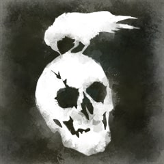
<figcaption>Face_the_Impossible_icon.png</figcaption>
</figure></td>
<td>
<strong><a href="./Face%20the%20Impossible.md" class="wikilink" title="Face the Impossible">Face the Impossible</a></strong>
</td>
<td>
Survive one day on <a href="./Interloper.md" class="wikilink" title="Interloper">Interloper</a> difficulty.
</td>
</tr>
<tr>
<td><figure>

<figcaption>Don't_Starve_icon.png</figcaption>
</figure></td>
<td>
<strong><a href="./Don%27t%20Starve.md" class="wikilink" title="Don&#39;t Starve">Don't Starve</a></strong>
</td>
<td>
Keep <a href="./Hunger.md" class="wikilink" title="calorie store">calorie store</a> above zero for 10 days.
</td>
</tr>
<tr>
<td><figure>
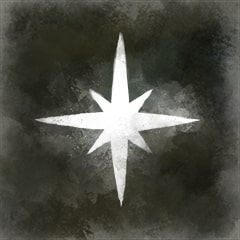
<figcaption>Faithful_Cartographer_icon.png</figcaption>
</figure></td>
<td>
<strong><a href="./Faithful%20Cartographer.md" class="wikilink" title="Faithful Cartographer">Faithful Cartographer</a></strong>
</td>
<td>
<a href="./Map.md" class="wikilink" title="Map">Map</a> all named locations in Survival Mode.
</td>
</tr>
<tr>
<td><figure>

<figcaption>Resolute_Outfitter_icon.png</figcaption>
</figure></td>
<td>
<strong><a href="./Resolute%20Outfitter.md" class="wikilink" title="Resolute Outfitter">Resolute Outfitter</a></strong>
</td>
<td>
Fill all <a href="./Clothing.md" class="wikilink" title="clothing">clothing</a> slots with 100% condition gear.
</td>
</tr>
<tr>
<td><figure>

<figcaption>Penitent_Scholar_icon.png</figcaption>
</figure></td>
<td>
<strong><a href="./Penitent%20Scholar.md" class="wikilink" title="Penitent Scholar">Penitent Scholar</a></strong>
</td>
<td>
Complete all <a href="./Research%20Book.md" class="wikilink" title="Research books">Research books</a>.
</td>
</tr>
<tr>
<td><figure>

<figcaption>Timberwolf_Mountain_(Achievement)_icon.png</figcaption>
</figure></td>
<td>
<strong><a href="./Timberwolf%20Mountain%20%28Achievement%29.md" class="wikilink" title="Timberwolf Mountain">Timberwolf Mountain</a></strong>
</td>
<td>
Climb to the top of <a href="./Timberwolf%20Mountain.md" class="wikilink" title="Timberwolf Mountain">Timberwolf Mountain</a>.
</td>
</tr>
<tr>
<td><figure>

<figcaption>Desolation_Point_(Achievement)_icon.png</figcaption>
</figure></td>
<td>
<strong><a href="./Desolation%20Point%20%28Achievement%29.md" class="wikilink" title="Desolation Point">Desolation Point</a></strong>
</td>
<td>
Craft a full set of improvised Tools.
</td>
</tr>
<tr>
<td><figure>

<figcaption>Deep_Forest_icon.png</figcaption>
</figure></td>
<td>
<strong><a href="./Deep%20Forest.md" class="wikilink" title="Deep Forest">Deep Forest</a></strong>
</td>
<td>
Keep a <a href="./Fire.md" class="wikilink" title="campfire">campfire</a> burning for 3 days.
</td>
</tr>
<tr>
<td><figure>

<figcaption>Challenge_Mastery_icon.png</figcaption>
</figure></td>
<td>
<strong><a href="./Challenge%20Mastery.md" class="wikilink" title="Challenge Mastery">Challenge Mastery</a></strong>
</td>
<td>
Complete every <a href="./Challenge.md" class="wikilink" title="Challenge">Challenge</a>. <a href="#fn2" class="footnote-ref" id="fnref2" role="doc-noteref">2</a>
</td>
</tr>
<tr>
<td><figure>
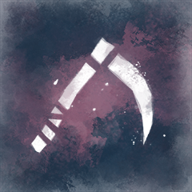
<figcaption>Something_Wicked_icon.png</figcaption>
</figure></td>
<td>
<strong><a href="./Something%20Wicked.md" class="wikilink" title="Something Wicked">Something Wicked</a></strong>
</td>
<td>
Survive 1000 days in a single Survival Mode game without <a href="./Cheat%20Death.md" class="wikilink" title="Cheating Death">Cheating Death</a>.
</td>
</tr>
<tr>
<td><figure>

<figcaption>Expert_Angler_icon.png</figcaption>
</figure></td>
<td>
<strong><a href="./Expert%20Angler.md" class="wikilink" title="Expert Angler">Expert Angler</a></strong>
</td>
<td>
Catch 4 different Rare Fish – <a href="./Burbot%20%28Raw%29.md" class="wikilink" title="Burbot">Burbot</a>, <a href="./Goldeye%20%28Raw%29.md" class="wikilink" title="Goldeye">Goldeye</a>, <a href="./Red%20Irish%20Lord%20%28Raw%29.md" class="wikilink" title="Red Irish Lord">Red Irish Lord</a>, and <a href="./Rockfish%20%28Raw%29.md" class="wikilink" title="Rockfish">Rockfish</a> (single game).
</td>
</tr>
<tr>
<td><figure>

<figcaption>Broken_Body_(Achievement)_icon.png</figcaption>
</figure></td>
<td>
<a href="./Broken%20Body%20%28Achievement%29.md" class="wikilink" title="Broken Body"><strong>Broken Body</strong></a>
</td>
<td>
Survive long enough to receive the final Affliction in <a href="./Misery.md" class="wikilink" title="Misery">Misery</a> Mode.
</td>
</tr>
<tr>
<td><figure>
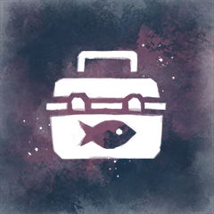
<figcaption>Tackle_Box_icon.png</figcaption>
</figure></td>
<td>
<strong><a href="./Tackle%20Box.md" class="wikilink" title="Tackle Box">Tackle Box</a></strong>
</td>
<td>
Craft a full set of 3 <a href="./Fishing%20Lure%20%28disambiguation%29.md" class="wikilink" title="Fishing Lures">Fishing Lures</a> (single game).
</td>
</tr>
<tr>
<td><figure>
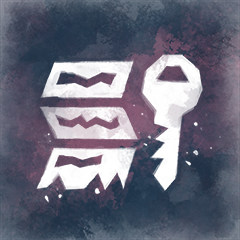
<figcaption>Thanks_for_the_Memories_icon.png</figcaption>
</figure></td>
<td>
<strong><a href="./Thanks%20for%20the%20Memories.md" class="wikilink" title="Thanks for the Memories">Thanks for the Memories</a></strong>
</td>
<td>
Collect 12 <a href="./Mementos.md" class="wikilink" title="Mementos">Mementos</a> – one from each Lower Great Bear Island Region (single game).
</td>
</tr>
<tr>
<td><figure>
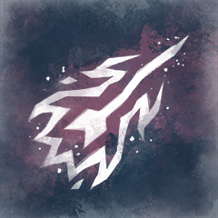
<figcaption>Hot_Shot_icon.png</figcaption>
</figure></td>
<td>
<strong><a href="./Hot%20Shot.md" class="wikilink" title="Hot Shot">Hot Shot</a></strong>
</td>
<td>
Kill 25 Rabbits with <a href="./Fire%20Hardened%20Arrow.md" class="wikilink" title="Fire Hardened Arrows">Fire Hardened Arrows</a> (single game).
</td>
</tr>
<tr>
<td><figure>
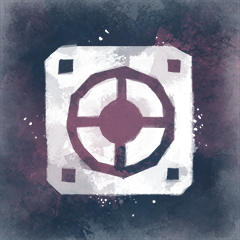
<figcaption>Down_Below_icon.png</figcaption>
</figure></td>
<td>
<strong><a href="./Down%20Below.md" class="wikilink" title="Down Below">Down Below</a></strong>
</td>
<td>
Enter all 9 <a href="./Prepper%20Cache.md" class="wikilink" title="Prepper Cache">Prepper Cache</a> locations (single game).
</td>
</tr>
</tbody>
</table>
<section id="footnotes" class="footnotes footnotes-end-of-document" role="doc-endnotes">

<ol>
<li id="fn1">PlayStation 4 only Platinum Trophy<a href="#fnref1" class="footnote-back" role="doc-backlink">↩︎</a></li>
<li id="fn2">Completion of <a href="./As%20the%20Dead%20Sleep.md" class="wikilink" title="As the Dead Sleep">As the Dead Sleep</a> and <a href="./Escape%20the%20Darkwalker.md" class="wikilink" title="Escape the Darkwalker">Escape the Darkwalker</a> is not required to unlock this Achievement.<a href="#fnref2" class="footnote-back" role="doc-backlink">↩︎</a></li>
</ol>
</section>

## Tales from the Far Territory Achievements

These Achievements require owning <a href="./Tales%20from%20the%20Far%20Territory.md" class="wikilink" title="Tales from the Far Territory">Tales from the Far Territory</a>. They are only unlocked in Survival Mode.

<table>
<colgroup>
<col style="width: 33%" />
<col style="width: 33%" />
<col style="width: 33%" />
</colgroup>
<tbody>
<tr>
<td>
<strong>Image</strong>
</td>
<td>
<strong>Name</strong>
</td>
<td>
<strong>Description</strong>
</td>
</tr>
<tr>
<td><figure>

<figcaption>Too_Greedily,_too_Deep_icon.png</figcaption>
</figure></td>
<td>
<strong><a href="./Too%20Greedily%2C%20too%20Deep.md" class="wikilink" title="Too Greedily, too Deep">Too Greedily, too Deep</a></strong>
</td>
<td>
Survive 25 consecutive days inside the <a href="./Langston%20Mine.md" class="wikilink" title="Langston Mine">Langston Mine</a>.
</td>
</tr>
<tr>
<td><figure>
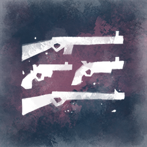
<figcaption>To_the_Teeth_icon.png</figcaption>
</figure></td>
<td>
<a href="./To%20the%20Teeth.md" class="wikilink" title="To the Teeth"><strong>To the Teeth</strong></a>
</td>
<td>
Collect 7 Expansion Firearm variants (single game).
</td>
</tr>
<tr>
<td><figure>
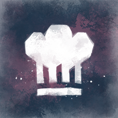
<figcaption>Tasting_Menu_icon.png</figcaption>
</figure></td>
<td>
<strong><a href="./Tasting%20Menu.md" class="wikilink" title="Tasting Menu">Tasting Menu</a></strong>
</td>
<td>
Find and Cook 9 <a href="./Recipe%20Cards.md" class="wikilink" title="Unique Recipes">Unique Recipes</a>.
</td>
</tr>
<tr>
<td><figure>

<figcaption>Rüdiger's_Dream_icon.png</figcaption>
</figure></td>
<td>
<a href="./R%C3%BCdiger%27s%20Dream.md" class="wikilink" title="Rüdiger&#39;s Dream"><strong>Rüdiger's Dream</strong></a>
</td>
<td>
Complete all 3 <a href="./Tales.md" class="wikilink" title="Tales">Tales</a> (single game)
</td>
</tr>
<tr>
<td><figure>

<figcaption>Something_Warm_to_Drink_icon.png</figcaption>
</figure></td>
<td>
<strong><a href="./Something%20Warm%20to%20Drink.md" class="wikilink" title="Something Warm to Drink">Something Warm to Drink</a></strong>
</td>
<td>
Collect 7 <a href="./Insulated%20Flask.md" class="wikilink" title="Insulated Flask">Insulated Flask</a> Variants (single game).
</td>
</tr>
<tr>
<td><figure>
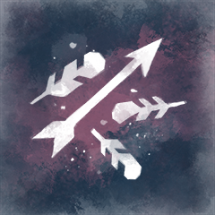
<figcaption>Quick_Draw_icon.png</figcaption>
</figure></td>
<td>
<strong><a href="./Quick%20Draw.md" class="wikilink" title="Quick Draw">Quick Draw</a></strong>
</td>
<td>
Kill 10 <a href="./Ptarmigan.md" class="wikilink" title="Ptarmigans">Ptarmigans</a> with Arrows (single game).
</td>
</tr>
<tr>
<td><figure>
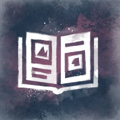
<figcaption>Exposure_icon.png</figcaption>
</figure></td>
<td>
<strong><a href="./Exposure.md" class="wikilink" title="Exposure">Exposure</a></strong>
</td>
<td>
Take a photo in each Great Bear Island Region for a total of 16 (single game).
</td>
</tr>
<tr>
<td><figure>
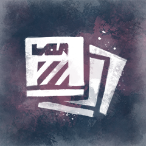
<figcaption>Shutterbug_icon.png</figcaption>
</figure></td>
<td>
<strong><a href="./Shutterbug.md" class="wikilink" title="Shutterbug">Shutterbug</a></strong>
</td>
<td>
Take 10 photos with each film type – Colour, B&amp;W, and Sepia (single game).
</td>
</tr>
<tr>
<td><figure>

<figcaption>On_the_Lookout_icon.png</figcaption>
</figure></td>
<td>
<strong><a href="./On%20the%20Lookout.md" class="wikilink" title="On the Lookout">On the Lookout</a></strong>
</td>
<td>
Reach all 6 <a href="./Polaroids.md" class="wikilink" title="Vista">Vista</a> locations in the Far Territory (single game).
</td>
</tr>
<tr>
<td><figure>
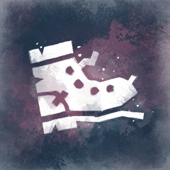
<figcaption>Ends_of_the_Earth_icon.png</figcaption>
</figure></td>
<td>
<strong><a href="./Ends%20of%20the%20Earth.md" class="wikilink" title="Ends of the Earth">Ends of the Earth</a></strong>
</td>
<td>
Travel from <a href="./Desolation%20Point.md" class="wikilink" title="Desolation Point">Desolation Point</a> to <a href="./Sundered%20Pass.md" class="wikilink" title="Sundered Pass">Sundered Pass</a> (single game).
</td>
</tr>
<tr>
<td><figure>

<figcaption>Goods_and_Services_icon.png</figcaption>
</figure></td>
<td>
<strong><a href="./Goods%20and%20Services.md" class="wikilink" title="Goods and Services">Goods and Services</a></strong>
</td>
<td>
Achieve the highest Trust level with the <a href="./Trader.md" class="wikilink" title="Trader">Trader</a>.
</td>
</tr>
<tr>
<td><figure>

<figcaption>Tough_Enough_icon.png</figcaption>
</figure></td>
<td>
<a href="./Tough%20Enough.md" class="wikilink" title="Tough Enough"><strong>Tough Enough</strong></a>
</td>
<td>
Survive 25 <a href="./Cougar.md" class="wikilink" title="Cougar">Cougar</a> Struggles.
</td>
</tr>
</tbody>
</table>

## Hidden Achievements

These Achievements require owning <a href="./Wintermute.md" class="wikilink" title="Wintermute">Wintermute</a> to unlock and are all secret Achievements.**Template:spoiler**

<table>
<colgroup>
<col style="width: 25%" />
<col style="width: 25%" />
<col style="width: 25%" />
<col style="width: 25%" />
</colgroup>
<tbody>
<tr>
<td>
<strong>Image</strong>
</td>
<td>
<strong>Name</strong>
</td>
<td>
<strong>Description</strong>
</td>
<td>
Episode
</td>
</tr>
<tr>
<td><figure>
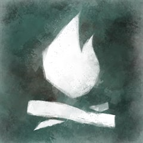
<figcaption>Your_Journey_Begins_icon.png</figcaption>
</figure></td>
<td>
<strong><a href="./Your%20Journey%20Begins.md" class="wikilink" title="Your Journey Begins">Your Journey Begins</a></strong>
</td>
<td>
Escape the ravine after your crash.
</td>
<td>
<a href="./Episode%201%20-%20Do%20Not%20Go%20Gentle.md" class="wikilink" title="Episode 1">Episode 1</a>
</td>
</tr>
<tr>
<td><figure>

<figcaption>Paradise_Lost_(Achievement)_icon.png</figcaption>
</figure></td>
<td>
<strong><a href="./Paradise%20Lost%20%28Achievement%29.md" class="wikilink" title="Paradise Lost">Paradise Lost</a></strong>
</td>
<td>
Make your way to <a href="./Milton.md" class="wikilink" title="Milton">Milton</a>.
</td>
<td>
<a href="./Episode%201%20-%20Do%20Not%20Go%20Gentle.md" class="wikilink" title="Episode 1">Episode 1</a>
</td>
</tr>
<tr>
<td><figure>
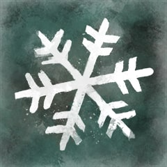
<figcaption>The_Long_Winter_icon.png</figcaption>
</figure></td>
<td>
<strong><a href="./The%20Long%20Winter.md" class="wikilink" title="The Long Winter">The Long Winter</a></strong>
</td>
<td>
Prepare <a href="./Grey%20Mother.md" class="wikilink" title="Grey Mother">Grey Mother</a> for Winter.
</td>
<td>
<a href="./Episode%201%20-%20Do%20Not%20Go%20Gentle.md" class="wikilink" title="Episode 1">Episode 1</a>
</td>
</tr>
<tr>
<td><figure>
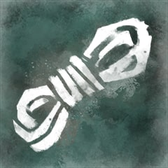
<figcaption>Losing_a_Child_is_Like..._icon.png</figcaption>
</figure></td>
<td>
<strong><a href="./Losing%20a%20Child%20is%20Like....md" class="wikilink" title="Losing a Child is Like...">Losing a Child is Like...</a></strong>
</td>
<td>
Complete Lily's Story.
</td>
<td>
<a href="./Episode%201%20-%20Do%20Not%20Go%20Gentle.md" class="wikilink" title="Episode 1">Episode 1</a>
</td>
</tr>
<tr>
<td><figure>
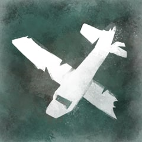
<figcaption>Leaving_the_Old_World_Behind_icon.png</figcaption>
</figure></td>
<td>
<strong><a href="./Leaving%20the%20Old%20World%20Behind.md" class="wikilink" title="Leaving the Old World Behind">Leaving the Old World Behind</a></strong>
</td>
<td>
Leave Milton. Complete <a href="./Episode%201%20-%20Do%20Not%20Go%20Gentle.md" class="wikilink" title="Episode One">Episode One</a>.
</td>
<td>
<a href="./Episode%201%20-%20Do%20Not%20Go%20Gentle.md" class="wikilink" title="Episode 1">Episode 1</a>
</td>
</tr>
<tr>
<td><figure>

<figcaption>The_Old_Trapper_icon.png</figcaption>
</figure></td>
<td>
<strong><a href="./The%20Old%20Trapper.md" class="wikilink" title="The Old Trapper">The Old Trapper</a></strong>
</td>
<td>
Bring <a href="./Jeremiah.md" class="wikilink" title="Jeremiah">Jeremiah</a> back from near death.
</td>
<td>
<a href="./Episode%202%20-%20Luminance%20Fugue.md" class="wikilink" title="Episode 2">Episode 2</a>
</td>
</tr>
<tr>
<td><figure>
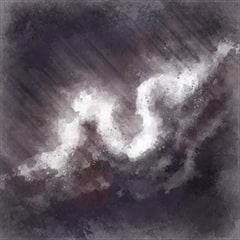
<figcaption>Lights_in_the_Sky_icon.png</figcaption>
</figure></td>
<td>
<strong><a href="./Lights%20in%20the%20Sky.md" class="wikilink" title="Lights in the Sky">Lights in the Sky</a></strong>
</td>
<td>
Survive the first <a href="./Aurora.md" class="wikilink" title="Aurora">Aurora</a> event.
</td>
<td>
<a href="./Episode%202%20-%20Luminance%20Fugue.md" class="wikilink" title="Episode 2">Episode 2</a>
</td>
</tr>
<tr>
<td><figure>
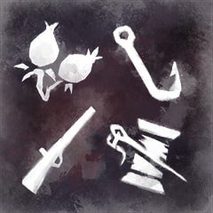
<figcaption>Graduation_Day_icon.png</figcaption>
</figure></td>
<td>
<strong><a href="./Graduation%20Day.md" class="wikilink" title="Graduation Day">Graduation Day</a></strong>
</td>
<td>
Complete all six Survival School objectives across Episodes One and Two.
</td>
<td>
<a href="./Episode%201%20-%20Do%20Not%20Go%20Gentle.md" class="wikilink" title="Episode 1">Episode 1</a> &amp; <a href="./Episode%202%20-%20Luminance%20Fugue.md" class="wikilink" title="2">2</a>
</td>
</tr>
<tr>
<td><figure>

<figcaption>Freight-Train_of_Hate_&amp;_Hunger_icon.png</figcaption>
</figure></td>
<td>
<strong><a href="./Freight-Train%20of%20Hate%20%26%20Hunger.md" class="wikilink" title="Freight-Train of Hate &amp; Hunger">Freight-Train of Hate &amp; Hunger</a></strong>
</td>
<td>
Kill the <a href="./Old%20Bear.md" class="wikilink" title="Old Bear">Old Bear</a>.
</td>
<td>
<a href="./Episode%202%20-%20Luminance%20Fugue.md" class="wikilink" title="Episode 2">Episode 2</a>
</td>
</tr>
<tr>
<td><figure>

<figcaption>You'll_Be_With_Her_Soon_icon.png</figcaption>
</figure></td>
<td>
<strong><a href="./You%27ll%20Be%20With%20Her%20Soon.md" class="wikilink" title="You&#39;ll Be With Her Soon">You'll Be With Her Soon</a></strong>
</td>
<td>
Leave Mystery Lake. Complete <a href="./Episode%202%20-%20Luminance%20Fugue.md" class="wikilink" title="Episode Two">Episode Two</a>.
</td>
<td>
<a href="./Episode%202%20-%20Luminance%20Fugue.md" class="wikilink" title="Episode 2">Episode 2</a>
</td>
</tr>
<tr>
<td><figure>
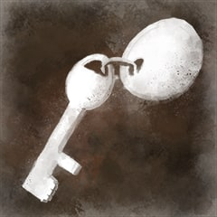
<figcaption>Too_Big_to_Fail_icon.png</figcaption>
</figure></td>
<td>
<strong><a href="./Too%20Big%20to%20Fail.md" class="wikilink" title="Too Big to Fail">Too Big to Fail</a></strong>
</td>
<td>
Open all Safety Deposit boxes in Milton.
</td>
<td>
<a href="./Episode%201%20-%20Do%20Not%20Go%20Gentle.md" class="wikilink" title="Episode 1">Episode 1</a>
</td>
</tr>
<tr>
<td><figure>
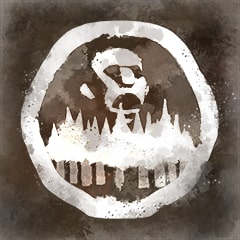
<figcaption>Sounds_Like_Some_Kind_of_Indie_Band_icon.png</figcaption>
</figure></td>
<td>
<strong><a href="./Sounds%20Like%20Some%20Kind%20of%20Indie%20Band.md" class="wikilink" title="Sounds Like Some Kind of Indie Band">Sounds Like Some Kind of Indie Band</a></strong>
</td>
<td>
Find all <a href="./Forest%20Talkers.md" class="wikilink" title="Forest Talker">Forest Talker</a> caches.
</td>
<td>
<a href="./Episode%202%20-%20Luminance%20Fugue.md" class="wikilink" title="Episode 2">Episode 2</a>
</td>
</tr>
<tr>
<td><figure>

<figcaption>Cache_Mastery_icon.png</figcaption>
</figure></td>
<td>
<strong><a href="./Cache%20Mastery.md" class="wikilink" title="Cache Mastery">Cache Mastery</a></strong>
</td>
<td>
Find all hidden caches in Episode One and Episode Two.
</td>
<td>
<a href="./Episode%201%20-%20Do%20Not%20Go%20Gentle.md" class="wikilink" title="Episode 1">Episode 1</a> &amp; <a href="./Episode%202%20-%20Luminance%20Fugue.md" class="wikilink" title="2">2</a>
</td>
</tr>
<tr>
<td><figure>
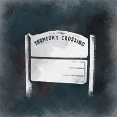
<figcaption>Community_Service_icon.png</figcaption>
</figure></td>
<td>
<strong><a href="./Community%20Service.md" class="wikilink" title="Community Service">Community Service</a></strong>
</td>
<td>
Get to Thomson's Crossing.
</td>
<td>
<a href="./Episode%203%20-%20Crossroads%20Elegy.md" class="wikilink" title="Episode 3">Episode 3</a>
</td>
</tr>
<tr>
<td><figure>

<figcaption>Save_Our_Souls_icon.png</figcaption>
</figure></td>
<td>
<strong><a href="./Save%20Our%20Souls.md" class="wikilink" title="Save Our Souls">Save Our Souls</a></strong>
</td>
<td>
Enter the Crash Site.
</td>
<td>
<a href="./Episode%203%20-%20Crossroads%20Elegy.md" class="wikilink" title="Episode 3">Episode 3</a>
</td>
</tr>
<tr>
<td><figure>

<figcaption>Hippocratic_Oath_icon.png</figcaption>
</figure></td>
<td>
<strong><a href="./Hippocratic%20Oath.md" class="wikilink" title="Hippocratic Oath">Hippocratic Oath</a></strong>
</td>
<td>
Rescue all three lost Survivors and stock the Hall with supplies.
</td>
<td>
<a href="./Episode%203%20-%20Crossroads%20Elegy.md" class="wikilink" title="Episode 3">Episode 3</a>
</td>
</tr>
<tr>
<td><figure>
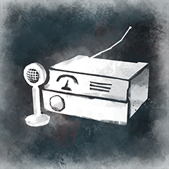
<figcaption>He_Lives_icon.png</figcaption>
</figure></td>
<td>
<strong><a href="./He%20Lives.md" class="wikilink" title="He Lives">He Lives</a></strong>
</td>
<td>
Intercept the Radio transmission.
</td>
<td>
<a href="./Episode%203%20-%20Crossroads%20Elegy.md" class="wikilink" title="Episode 3">Episode 3</a>
</td>
</tr>
<tr>
<td><figure>
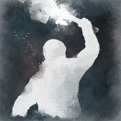
<figcaption>The_Crossroads_Elegy_icon.png</figcaption>
</figure></td>
<td>
<strong><a href="./The%20Crossroads%20Elegy.md" class="wikilink" title="The Crossroads Elegy">The Crossroads Elegy</a></strong>
</td>
<td>
Leave Pleasant Valley behind. Complete <a href="./Episode%203%20-%20Crossroads%20Elegy.md" class="wikilink" title="Episode Three">Episode Three</a>.
</td>
<td>
<a href="./Episode%203%20-%20Crossroads%20Elegy.md" class="wikilink" title="Episode 3">Episode 3</a>
</td>
</tr>
<tr>
<td><figure>

<figcaption>Tall_Tales_(Achievement)_icon.png</figcaption>
</figure></td>
<td>
<strong><a href="./Tall%20Tales%20%28Achievement%29.md" class="wikilink" title="Tall Tales">Tall Tales</a></strong>
</td>
<td>
Investigate all of the local mysteries.
</td>
<td>
<a href="./Episode%203%20-%20Crossroads%20Elegy.md" class="wikilink" title="Episode 3">Episode 3</a>
</td>
</tr>
<tr>
<td><figure>
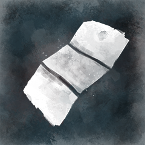
<figcaption>Every_Last_One_icon.png</figcaption>
</figure></td>
<td>
<strong><a href="./Every%20Last%20One.md" class="wikilink" title="Every Last One">Every Last One</a></strong>
</td>
<td>
Find all of the <a href="./Forest%20Talkers.md" class="wikilink" title="Forest Talker">Forest Talker</a> notes.
</td>
<td>
<a href="./Episode%203%20-%20Crossroads%20Elegy.md" class="wikilink" title="Episode 3">Episode 3</a>
</td>
</tr>
<tr>
<td><figure>

<figcaption>There_Will_Be_Blood_icon.png</figcaption>
</figure></td>
<td>
<strong><a href="./There%20Will%20Be%20Blood.md" class="wikilink" title="There Will Be Blood">There Will Be Blood</a></strong>
</td>
<td>
Defeat your first Timberwolf pack.
</td>
<td>
<a href="./Episode%203%20-%20Crossroads%20Elegy.md" class="wikilink" title="Episode 3">Episode 3</a>
</td>
</tr>
<tr>
<td><figure>

<figcaption>Welcome_to_the_S**t_Show_icon.png</figcaption>
</figure></td>
<td>
<strong><a href="./Welcome%20to%20the%20S%2A%2At%20Show.md" class="wikilink" title="Welcome to the S**t Show">Welcome to the S**t Show</a></strong>
</td>
<td>
Find Medicine for the Warden.
</td>
<td>
<a href="./Episode%204%20-%20Fury%2C%20Then%20Silence.md" class="wikilink" title="Episode 4">Episode 4</a>
</td>
</tr>
<tr>
<td><figure>

<figcaption>Just_Like_New_icon.png</figcaption>
</figure></td>
<td>
<strong><a href="./Just%20Like%20New.md" class="wikilink" title="Just Like New">Just Like New</a></strong>
</td>
<td>
Sabotage the Locking Mechanism.
</td>
<td>
<a href="./Episode%204%20-%20Fury%2C%20Then%20Silence.md" class="wikilink" title="Episode 4">Episode 4</a>
</td>
</tr>
<tr>
<td><figure>

<figcaption>Something_Stinks_icon.png</figcaption>
</figure></td>
<td>
<strong><a href="./Something%20Stinks.md" class="wikilink" title="Something Stinks">Something Stinks</a></strong>
</td>
<td>
Locate the Detonators.
</td>
<td>
<a href="./Episode%204%20-%20Fury%2C%20Then%20Silence.md" class="wikilink" title="Episode 4">Episode 4</a>
</td>
</tr>
<tr>
<td><figure>
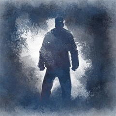
<figcaption>Enemy_For_Life_icon.png</figcaption>
</figure></td>
<td>
<strong><a href="./Enemy%20For%20Life.md" class="wikilink" title="Enemy For Life">Enemy For Life</a></strong>
</td>
<td>
Turn the tables on <a href="./Mathis.md" class="wikilink" title="Mathis">Mathis</a>.
</td>
<td>
<a href="./Episode%204%20-%20Fury%2C%20Then%20Silence.md" class="wikilink" title="Episode 4">Episode 4</a>
</td>
</tr>
<tr>
<td><figure>
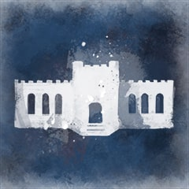
<figcaption>Leap_of_Faith_icon.png</figcaption>
</figure></td>
<td>
<strong><a href="./Leap%20of%20Faith.md" class="wikilink" title="Leap of Faith">Leap of Faith</a></strong>
</td>
<td>
Escape <a href="./Blackrock%20Prison.md" class="wikilink" title="Blackrock">Blackrock</a> and Complete <a href="./Episode%204%20-%20Fury%2C%20Then%20Silence.md" class="wikilink" title="Episode Four">Episode Four</a>.
</td>
<td>
<a href="./Episode%204%20-%20Fury%2C%20Then%20Silence.md" class="wikilink" title="Episode 4">Episode 4</a>
</td>
</tr>
<tr>
<td><figure>

<figcaption>Black_Black_Heart_icon.png</figcaption>
</figure></td>
<td>
<strong><a href="./Black%20Black%20Heart.md" class="wikilink" title="Black Black Heart">Black Black Heart</a></strong>
</td>
<td>
Collect all four bloody pages from the <a href="./Blackrock%20Prison.md" class="wikilink" title="Blackrock">Blackrock</a> Archives.
</td>
<td>
<a href="./Episode%204%20-%20Fury%2C%20Then%20Silence.md" class="wikilink" title="Episode 4">Episode 4</a>
</td>
</tr>
<tr>
<td><figure>
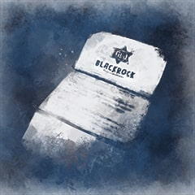
<figcaption>Hard_Times_icon.png</figcaption>
</figure></td>
<td>
<strong><a href="./Hard%20Times.md" class="wikilink" title="Hard Times">Hard Times</a></strong>
</td>
<td>
Learn the truth behind all three <a href="./Blackrock%20Prison.md" class="wikilink" title="Blackrock">Blackrock</a> rumours.
</td>
<td>
<a href="./Episode%204%20-%20Fury%2C%20Then%20Silence.md" class="wikilink" title="Episode 4">Episode 4</a>
</td>
</tr>
<tr>
<td><figure>
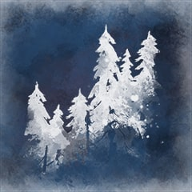
<figcaption>No_Half-Measures_icon.png</figcaption>
</figure></td>
<td>
<strong><a href="./No%20Half-Measures.md" class="wikilink" title="No Half-Measures">No Half-Measures</a></strong>
</td>
<td>
Uncover the latest <a href="./Forest%20Talkers.md" class="wikilink" title="Forest Talker">Forest Talker</a> Plans.
</td>
<td>
<a href="./Episode%204%20-%20Fury%2C%20Then%20Silence.md" class="wikilink" title="Episode 4">Episode 4</a>
</td>
</tr>
<tr>
<td><figure>
[Missing image: Quarantine_icon.png]
<figcaption>Quarantine_icon.png</figcaption>
</figure></td>
<td>
<strong><a href="./Quarantine.md" class="wikilink" title="Quarantine">Quarantine</a></strong>
</td>
<td>
Explore Perseverance Mills.
</td>
<td>
<a href="./Episode%205%20-%20The%20Light%20At%20The%20End%20Of%20All%20Things.md" class="wikilink" title="Episode 5">Episode 5</a>
</td>
</tr>
<tr>
<td><figure>
[Missing image: Search_Party_icon.png]
<figcaption>Search_Party_icon.png</figcaption>
</figure></td>
<td>
<strong><a href="./Search%20Party.md" class="wikilink" title="Search Party">Search Party</a></strong>
</td>
<td>
Find all three missing townspeople within 40 real time minutes.
</td>
<td>
<a href="./Episode%205%20-%20The%20Light%20At%20The%20End%20Of%20All%20Things.md" class="wikilink" title="Episode 5">Episode 5</a>
</td>
</tr>
<tr>
<td><figure>
[Missing image: To_The_Bone_icon.png]
<figcaption>To_The_Bone_icon.png</figcaption>
</figure></td>
<td>
<strong><a href="./To%20The%20Bone.md" class="wikilink" title="To The Bone">To The Bone</a></strong>
</td>
<td>
Complete the autopsy of a missing Perseverance Mills townsperson.
</td>
<td>
<a href="./Episode%205%20-%20The%20Light%20At%20The%20End%20Of%20All%20Things.md" class="wikilink" title="Episode 5">Episode 5</a>
</td>
</tr>
<tr>
<td><figure>
[Missing image: Adrift_icon.png]
<figcaption>Adrift_icon.png</figcaption>
</figure></td>
<td>
<strong><a href="./Adrift.md" class="wikilink" title="Adrift">Adrift</a></strong>
</td>
<td>
Discover the truth behind the mysterious signal in Desperation Bay.
</td>
<td>
<a href="./Episode%205%20-%20The%20Light%20At%20The%20End%20Of%20All%20Things.md" class="wikilink" title="Episode 5">Episode 5</a>
</td>
</tr>
<tr>
<td><figure>
[Missing image: Dead_Wake_icon.png]
<figcaption>Dead_Wake_icon.png</figcaption>
</figure></td>
<td>
<strong><a href="./Dead%20Wake.md" class="wikilink" title="Dead Wake">Dead Wake</a></strong>
</td>
<td>
Collect all the writings and personal effects left behind by the ship's crew.
</td>
<td>
<a href="./Episode%205%20-%20The%20Light%20At%20The%20End%20Of%20All%20Things.md" class="wikilink" title="Episode 5">Episode 5</a>
</td>
</tr>
<tr>
<td><figure>
[Missing image: The_Hard_Sciences_icon.png]
<figcaption>The_Hard_Sciences_icon.png</figcaption>
</figure></td>
<td>
<strong><a href="./The%20Hard%20Sciences.md" class="wikilink" title="The Hard Sciences">The Hard Sciences</a></strong>
</td>
<td>
Reach the Suzuki Radio Telescope and deliver Jeremiah's "Wintermute" message to Dr. Atwood.
</td>
<td>
<a href="./Episode%205%20-%20The%20Light%20At%20The%20End%20Of%20All%20Things.md" class="wikilink" title="Episode 5">Episode 5</a>
</td>
</tr>
<tr>
<td><figure>
[Missing image: Song_of_the_Earth_icon.png]
<figcaption>Song_of_the_Earth_icon.png</figcaption>
</figure></td>
<td>
<strong><a href="./Song%20of%20the%20Earth.md" class="wikilink" title="Song of the Earth">Song of the Earth</a></strong>
</td>
<td>
Reactivate the Geothermal Plant and power up the telescope.
</td>
<td>
<a href="./Episode%205%20-%20The%20Light%20At%20The%20End%20Of%20All%20Things.md" class="wikilink" title="Episode 5">Episode 5</a>
</td>
</tr>
<tr>
<td><figure>
[Missing image: Wild_At_Heart_icon.png]
<figcaption>Wild_At_Heart_icon.png</figcaption>
</figure></td>
<td>
<strong><a href="./Wild%20At%20Heart.md" class="wikilink" title="Wild At Heart">Wild At Heart</a></strong>
</td>
<td>
Defeat and kill the Cougar stalking the Geothermal Region.
</td>
<td>
<a href="./Episode%205%20-%20The%20Light%20At%20The%20End%20Of%20All%20Things.md" class="wikilink" title="Episode 5">Episode 5</a>
</td>
</tr>
<tr>
<td><figure>
[Missing image: Finely_Tuned_icon.png]
<figcaption>Finely_Tuned_icon.png</figcaption>
</figure></td>
<td>
<strong><a href="./Finely%20Tuned.md" class="wikilink" title="Finely Tuned">Finely Tuned</a></strong>
</td>
<td>
Complete “To SAR and Back” without using more than 50 pieces of coal.
</td>
<td>
<a href="./Episode%205%20-%20The%20Light%20At%20The%20End%20Of%20All%20Things.md" class="wikilink" title="Episode 5">Episode 5</a>
</td>
</tr>
<tr>
<td><figure>
[Missing image: Bending_The_Rail_icon.png]
<figcaption>Bending_The_Rail_icon.png</figcaption>
</figure></td>
<td>
<strong><a href="./Bending%20The%20Rail.md" class="wikilink" title="Bending The Rail">Bending The Rail</a></strong>
</td>
<td>
Retrieve the Trauma Kit.
</td>
<td>
<a href="./Episode%205%20-%20The%20Light%20At%20The%20End%20Of%20All%20Things.md" class="wikilink" title="Episode 5">Episode 5</a>
</td>
</tr>
<tr>
<td><figure>
[Missing image: The_Last_Light_icon.png]
<figcaption>The_Last_Light_icon.png</figcaption>
</figure></td>
<td>
<strong><a href="./The%20Last%20Light.md" class="wikilink" title="The Last Light">The Last Light</a></strong>
</td>
<td>
Reunite with Astrid and deliver the Hardcase.
</td>
<td>
<a href="./Episode%205%20-%20The%20Light%20At%20The%20End%20Of%20All%20Things.md" class="wikilink" title="Episode 5">Episode 5</a>
</td>
</tr>
<tr>
<td><figure>
[Missing image: The_New_World_icon.png]
<figcaption>The_New_World_icon.png</figcaption>
</figure></td>
<td>
<strong><a href="./The%20New%20World.md" class="wikilink" title="The New World">The New World</a></strong>
</td>
<td>
Complete Episode Five.
</td>
<td>
<a href="./Episode%205%20-%20The%20Light%20At%20The%20End%20Of%20All%20Things.md" class="wikilink" title="Episode 5">Episode 5</a>
</td>
</tr>
</tbody>
</table>

## Game History

At the release of Wintermute (v1.00), the following Achievements were removed from the game and no longer display on Steam:

<table>
<colgroup>
<col style="width: 33%" />
<col style="width: 33%" />
<col style="width: 33%" />
</colgroup>
<tbody>
<tr>
<td>
<strong>Image</strong>
</td>
<td>
<strong>Name</strong>
</td>
<td>
<strong>Description</strong>
</td>
</tr>
<tr>
<td><figure>
[Missing image: Two_for_Two.jpg]
<figcaption>Two_for_Two.jpg</figcaption>
</figure></td>
<td>
<strong><a href="./Two%20for%20Two.md" class="wikilink" title="Two for Two">Two for Two</a></strong>
</td>
<td>
Survive for 2 days in a single Survival Mode game.
</td>
</tr>
<tr>
<td><figure>
[Missing image: Wolfbait.jpg]
<figcaption>Wolfbait.jpg</figcaption>
</figure></td>
<td>
<strong><a href="./Wolfbait.md" class="wikilink" title="Wolfbait">Wolfbait</a></strong>
</td>
<td>
Survive 5 days in a single Survival Mode game.
</td>
</tr>
<tr>
<td><figure>
[Missing image: It's_Getting_Cold_Out_There.jpg]
<figcaption>It's_Getting_Cold_Out_There.jpg</figcaption>
</figure></td>
<td>
<strong><a href="./It%27s%20Getting%20Cold%20Out%20There.md" class="wikilink" title="It&#39;s Getting Cold Out There">It's Getting Cold Out There</a></strong>
</td>
<td>
Survive 15 days in a single Survival Mode game.
</td>
</tr>
<tr>
<td><figure>
[Missing image: Tough_as_Nails.jpg]
<figcaption>Tough_as_Nails.jpg</figcaption>
</figure></td>
<td>
<strong><a href="./Tough%20as%20Nails.md" class="wikilink" title="Tough as Nails">Tough as Nails</a></strong>
</td>
<td>
Survive 20 days in a single Survival Mode game.
</td>
</tr>
<tr>
<td><figure>
[Missing image: You_Prep_the_Preppers.jpg]
<figcaption>You_Prep_the_Preppers.jpg</figcaption>
</figure></td>
<td>
<strong><a href="./You%20Prep%20the%20Preppers.md" class="wikilink" title="You Prep the Preppers">You Prep the Preppers</a></strong>
</td>
<td>
Survive 30 days in a single Survival Mode game.
</td>
</tr>
<tr>
<td><figure>
[Missing image: Master_Survivor.jpg]
<figcaption>Master_Survivor.jpg</figcaption>
</figure></td>
<td>
<strong><a href="./Master%20Survivor.md" class="wikilink" title="Master Survivor">Master Survivor</a></strong>
</td>
<td>
Survive 40 days in a single Survival Mode game.
</td>
</tr>
<tr>
<td><figure>
[Missing image: One_With_Nature.jpg]
<figcaption>One_With_Nature.jpg</figcaption>
</figure></td>
<td>
<strong><a href="./One%20With%20Nature.md" class="wikilink" title="One With Nature">One With Nature</a></strong>
</td>
<td>
Survive for 200 days in a single Survival Mode game.
</td>
</tr>
</tbody>
</table>

The following achievements were kept but received a new achievement icon:

<table>
<colgroup>
<col style="width: 33%" />
<col style="width: 33%" />
<col style="width: 33%" />
</colgroup>
<tbody>
<tr>
<td>
<strong>Image</strong>
</td>
<td>
<strong>Name</strong>
</td>
<td>
<strong>Description</strong>
</td>
</tr>
<tr>
<td><figure>
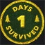
<figcaption>The_First_of_Many_old_icon.webp</figcaption>
</figure></td>
<td>
<strong>First of Many</strong>
</td>
<td>
Survive for 1 day in a single Survival Mode game.
</td>
</tr>
<tr>
<td><figure>
[Missing image: You_Made_It!_old_icon.webp]
<figcaption>You_Made_It!_old_icon.webp</figcaption>
</figure></td>
<td>
<strong>You Made It!</strong>
</td>
<td>
Survive 10 days in a single Survival Mode game.
</td>
</tr>
<tr>
<td><figure>
[Missing image: Ready_for_when_the_SHTF!_old_icon.webp]
<figcaption>Ready_for_when_the_SHTF!_old_icon.webp</figcaption>
</figure></td>
<td>
<strong>Ready for when the SHTF!</strong>
</td>
<td>
Survive for 50 days in a single Survival Mode game.
</td>
</tr>
<tr>
<td><figure>
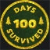
<figcaption>Centurion_old_icon.webp</figcaption>
</figure></td>
<td>
<strong>Centurion</strong>
</td>
<td>
Survive for 100 days in a single Survival Mode game.
</td>
</tr>
<tr>
<td><figure>
[Missing image: Exploration_Game_old_icon.webp]
<figcaption>Exploration_Game_old_icon.webp</figcaption>
</figure></td>
<td>
<strong>Exploration Game</strong>
</td>
<td>
Visit every interior location in both <a href="./Mystery%20Lake%20%28region%29.md" class="wikilink" title="Mystery Lake">Mystery Lake</a> and <a href="./Coastal%20Highway.md" class="wikilink" title="Coastal Highway">Coastal Highway</a> (single game)
</td>
</tr>
<tr>
<td><figure>
[Missing image: Waste_Not,_Want_Not_old_icon.webp]
<figcaption>Waste_Not,_Want_Not_old_icon.webp</figcaption>
</figure></td>
<td>
<strong>Waste Not, Want Not</strong>
</td>
<td>
Harvest 10 Complete <a href="./Deer%20Carcass.md" class="wikilink" title="Deer Carcasses">Deer Carcasses</a> (single game)
</td>
</tr>
<tr>
<td><figure>
[Missing image: Night_Walker_old_icon.webp]
<figcaption>Night_Walker_old_icon.webp</figcaption>
</figure></td>
<td>
<strong>Night Walker</strong>
</td>
<td>
Survive an entire Night outside (single game)
</td>
</tr>
<tr>
<td><figure>
[Missing image: Beneath_a_Starry_Sky_old_icon.webp]
<figcaption>Beneath_a_Starry_Sky_old_icon.webp</figcaption>
</figure></td>
<td>
<strong>Beneath a Stary Sky</strong>
</td>
<td>
Survive 3 consecutive Nights outside (single game)
</td>
</tr>
<tr>
<td><figure>
[Missing image: Silent_Hunter_old_icon.webp]
<figcaption>Silent_Hunter_old_icon.webp</figcaption>
</figure></td>
<td>
<strong>Silent Hunter</strong>
</td>
<td>
Survive the first 50 days without firing the <a href="./Hunting%20Rifle.md" class="wikilink" title="hunting rifle">hunting rifle</a>, <a href="./Revolver.md" class="wikilink" title="revolver">revolver</a> or the <a href="./Distress%20Pistol.md" class="wikilink" title="distress pistol">distress pistol</a> (single game)
</td>
</tr>
<tr>
<td><figure>
[Missing image: Pacifist_old_icon.webp]
<figcaption>Pacifist_old_icon.webp</figcaption>
</figure></td>
<td>
<strong>Pacifist</strong>
</td>
<td>
Survive the first 25 days without killing anything (single game)
</td>
</tr>
<tr>
<td><figure>
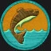
<figcaption>It_was_THIS_Big!_old_icon.webp</figcaption>
</figure></td>
<td>
<strong>It was THIS Big!</strong>
</td>
<td>
<a href="./Ice%20Fishing.md" class="wikilink" title="Catch">Catch</a> a fish weighing over 5kg (11 lbs).
</td>
</tr>
<tr>
<td><figure>

<figcaption>Wrapped_in_Furs_old_icon.webp</figcaption>
</figure></td>
<td>
<strong>Wrapped in Furs</strong>
</td>
<td>
Sleep in a <a href="./Bear%20Skin%20Bedroll.md" class="wikilink" title="Bear Skin Bedroll">Bear Skin Bedroll</a> while wearing a <a href="./Wolfskin%20Coat.md" class="wikilink" title="Wolfskin Coat">Wolfskin Coat</a>, <a href="./Deerskin%20Boots.md" class="wikilink" title="Deerskin Boots">Deerskin Boots</a>, and <a href="./Rabbitskin%20Mitts.md" class="wikilink" title="Rabbitskin Mittens">Rabbitskin Mittens</a>.
</td>
</tr>
<tr>
<td><figure>
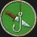
<figcaption>Living_Off_the_Land_old_icon.webp</figcaption>
</figure></td>
<td>
<strong>Living Off the Land</strong>
</td>
<td>
Survive 25 consecutive full days only consuming calories harvested from wild plants and animals (single game)
</td>
</tr>
<tr>
<td><figure>

<figcaption>Natural_Healer_old_icon.webp</figcaption>
</figure></td>
<td>
<strong>Natural Healer</strong>
</td>
<td>
Heal yourself using all types of natural <a href="./First%20Aid.md" class="wikilink" title="medicines">medicines</a> (single game)
</td>
</tr>
<tr>
<td><figure>

<figcaption>Happy_Harvester_old_icon.webp</figcaption>
</figure></td>
<td>
<strong>Happy Harvester</strong>
</td>
<td>
Harvest 25 of each kind of plant (single game)
</td>
</tr>
</tbody>
</table>

<table class="gallery">
<colgroup>
<col style="width: 100%" />
</colgroup>
<tbody>
<tr>
<td><figure>
[Missing image: Achievements_collage_22.png]
<figcaption>All 22 achievement icons, pre V1.15.</figcaption>
</figure></td>
</tr>
</tbody>
</table>

**Lua execution error in Module:Navbox function navbox**<a href="fr:Succ%C3%A8s_Steam" class="wikilink" title="fr:Succès_Steam">fr:Succès_Steam</a> <a href="ru:%D0%94%D0%BE%D1%81%D1%82%D0%B8%D0%B6%D0%B5%D0%BD%D0%B8%D1%8F_Steam" class="wikilink" title="ru:Достижения Steam">ru:Достижения Steam</a> <a href="de:Errungenschaften" class="wikilink" title="de:Errungenschaften">de:Errungenschaften</a>

## Notes

