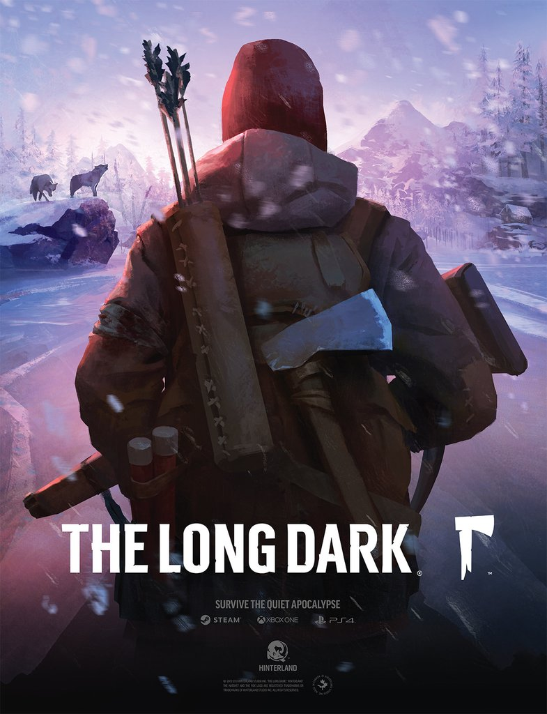
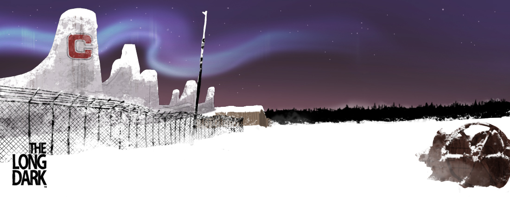
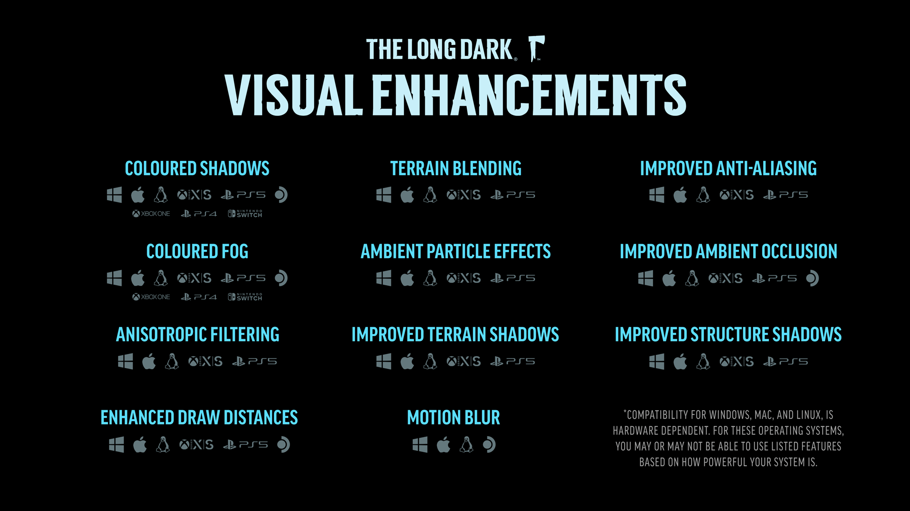
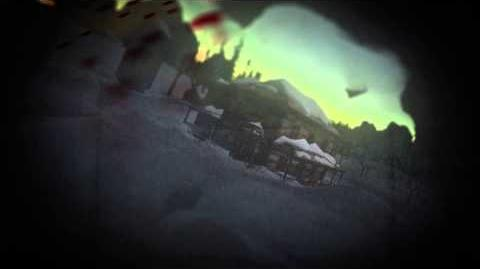
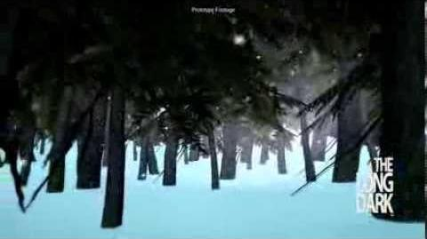
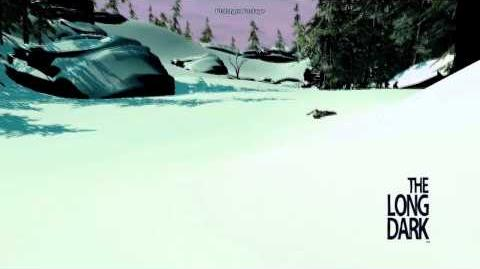
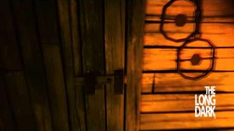
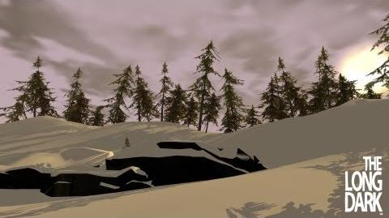
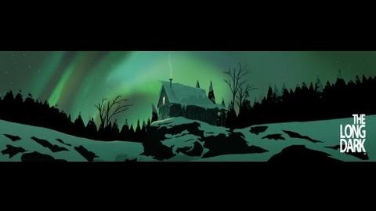

# The Long Dark

**Categories:** The Long Dark · **Source:** [Fandom](https://thelongdark.fandom.com/wiki/The_Long_Dark)

**Contents**

- [Summary](#summary)
- [Game Modes](#game-modes)
- [Wintermute](#wintermute)
- [Survival Mode](#survival-mode)
- [Challenge](#challenge)
- [Game Versions](#game-versions)
- [The Long Dark](#the-long-dark)
- [The Long Dark: Survival Edition](#the-long-dark-survival-edition)
- [The Long Dark: Quiet Apocalypse Bundle](#the-long-dark-quiet-apocalypse-bundle)
- [Downloadable Addon Content](#downloadable-addon-content)
- [The Long Dark: Tales from the Far Territory](#the-long-dark-tales-from-the-far-territory)
- [The Long Dark: Iron Road](#the-long-dark-iron-road)
- [The Long Dark: Wintermute](#the-long-dark-wintermute)
- [Music for The Long Dark -- Volume One](#music-for-the-long-dark----volume-one)
- [Music for The Long Dark -- Volume Two](#music-for-the-long-dark----volume-two)
- [Visual Enhancements](#visual-enhancements)
- [Gameplay](#gameplay)
- [Realism](#realism)
- [Wintermute Plot](#wintermute-plot)
- [Reception](#reception)
- [Other Game Features](#other-game-features)
- [Time Capsule](#time-capsule)
- [Modding](#modding)
- [Achievements](#achievements)
- [Changelog](#changelog)
- [Gallery](#gallery)
- [Videos](#videos)
- [External links](#external-links)

**The Long Dark**

**Developer(s):** [Hinterland Games](./Hinterland%20Studio%20Inc..md)

**Director(s):** Raphael Van Lierop David Chan Hokyo Lim Alan Lawrance

**Writer(s):** Marianne Krawczyk

**Composer(s):** Cris Velasco Sascha Dikiciyan

**Platform:** PC/Mac/Linux Xbox One/Series S/X PlayStation 4/5 Nintendo Switch

**Released:** - 1st August 2017 (PC, PS4, XO) - September 17, 2020 (Switch)

**Genre(s):** First Person, Open-World, Sandbox, Survival

**_The Long Dark_** is a first-person open-world survival game developed by [Hinterland Games](./Hinterland%20Studio%20Inc..md) for Microsoft Windows, OS X, Linux, Xbox One, PlayStation 4, and Nintendo Switch.

It has since been ported to the PlayStation 5, Xbox Series S, Xbox Series X, WeGame, GOG, and Epic Games Store.

A sequel, _[BLACKFROST: The Long Dark II](./BLACKFROST%20-%20The%20Long%20Dark%20II.md)_, is set to release in 2027.

## Summary

_The Long Dark_ begins with a [massive geomagnetic anomaly](./First%20Flare.md) that affects all electronic equipment. Cars, radios, computers and most other modern technology have been rendered useless. The world is quiet now, and, with no lights, the nights are long and dark.  A front seat to the end of the world. Immersive first-person exploration game-play featuring a stunning, original art style. Navigate the savage beauty of the Northern wilderness while facing the hazards of a new post-digital frontier.

Survive by your wits alone. Be on the lookout for potential supply caches, all the while ameliorating and improving your survival skills to overcome the dangers of harsh weather, aggressive wildlife, lack of food and water, and the mysterious [Aurora](./Aurora.md) that adds more uncertainty to an already uncertain survival situation.

Survival of the fittest. Deep survival simulation game-play whence every decision matters. Explore a large, open world in search of resources while balancing unpredictable conditions against the needs of your daily and, hopefully, long-term survival.

## Game Modes

### Wintermute

- Play the [Story](./Wintermute.md) of [Will Mackenzie](./Will%20Mackenzie.md) &amp; Dr. [Astrid Greenwood](./Astrid%20Greenwood.md) as they struggle to survive, crashed in the wilderness in the aftermath of a mysterious geomagnetic disaster.

### Survival Mode

- Experience potentially hundreds of hours of free-form sandbox game-play in [Survival Mode](./Survival%20Mode.md). Push yourself and your skills to last as long as possible without the Story elements.

### Challenge

- Test your skills with scenarios designed to [Challenge](./Challenge.md) seasoned players. How fast can you complete these challenges?

## Game Versions

 As of December 5th, 2022, _The Long Dark_ can be purchased in several different forms from Steam or Epic Games:

### _The Long Dark_

This version of the game includes _all_ the content in _The Long Dark: Survival Edition_, along with the dedicated campaign of the [Wintermute](./Wintermute.md) Story Mode. For players who know they'll be interested in playing both Survival and Wintermute, or who wish to play only Wintermute.

### _The Long Dark: Survival Edition_

This version of _The Long Dark_ includes [Survival Mode](./Survival%20Mode.md) and the [Challenges](./Challenge.md), but _not_ Story Mode. It is meant to be an "entry-level" version of the game, designed for players who interested in the core gameplay experience. This is the cheapest option.

### _The Long Dark: Quiet Apocalypse Bundle_

This bundle includes _The Long Dark_ as well as all downloadable addon content for the game. Only available on Steam.

## Downloadable Addon Content

### _[The Long Dark: Tales from the Far Territory](./Tales%20from%20the%20Far%20Territory.md)_

This is downloadable content for _The Long Dark: Survival Edition_ for _The Long Dark._ Discover five new regions as you venture into the Far Territory, explore the world as you uncover the secrets of three new [Tales](./Tales.md), hunt new animals, and interact with even more content exclusive to this addon.

### _[The Long Dark: Iron Road](./Iron%20Road.md)_

This is downloadable content for _The Long Dark: Survival Edition_ for _The Long Dark._ Discover an island forgotten to time, with new regions, a steam locomotive, an autopilot boat, and several new hazards related to the Aurora.

### _[The Long Dark: Wintermute](./Wintermute.md)_

This is downloadable content for _The Long Dark: Survival Edition_, and adds the content of the Wintermute Story Mode to the game. It is primarily targeted towards players who purchased _The Long Dark: Survival Edition_ and have decided that they want to experience Wintermute.

### _Music for The Long Dark -- Volume One_

[The Long Dark Original Soundtrack](./The%20Long%20Dark%20Original%20Soundtrack.md)

Includes Volume One of the Original Soundtrack to The Long Dark, as composed by Cris Velasco and Sascha Dikiciyan. Features of 100 minutes of music composed across 4 discs for [Episode 1: Do Not Go Gentle](./Episode%201%20-%20Do%20Not%20Go%20Gentle.md) and [Episode 2: Luminance Fugue](./Episode%202%20-%20Luminance%20Fugue.md), as well as ambient exploration music from Survival Mode.

### _Music for The Long Dark -- Volume Two_

Includes Volume Two of the Original Soundtrack to The Long Dark, as composed by Cris Velasco and Sascha Dikiciyan. Features of 60 minutes of music across 2 disks composed for [Episode 3: Crossroads Elegy](./Episode%203%20-%20Crossroads%20Elegy.md), as well as additional ambient exploration music from Survival Mode.

_Music for The Long Dark -- Volume Three_

Includes Volume Three of the Original Soundtrack to The Long Dark, as composed by Cris Velasco and Sascha Dikiciyan. Features of 60 minutes of music across 2 disks composed for [Episode 4: Fury, Then Silence](./Episode%204%20-%20Fury%2C%20Then%20Silence.md), [Episode 5: The Light At The End Of All Things](./Episode%205%20-%20The%20Light%20At%20The%20End%20Of%20All%20Things.md), as well as additional ambient exploration music from Survival Mode's [Tales from the Far Territory](./Tales%20from%20the%20Far%20Territory.md).

## Visual Enhancements

 A Visual Enhancement update is available for the game when playing on PlayStation 5, Xbox Series S/X, and PC. It is mainly for higher end hardware and is not available for game versions running on older game platforms (PlayStation 4/Xbox One, Nintendo Switch, Lower end PC, etc.).

## Gameplay

No electricity: Only you and the brutal, brumal weather. To stay alive you will need to provide for yourself from what you can find amongst the landscapes. Nearby structures may still stand, and, perhaps they are all abandoned; perhaps they still contain useful equipment. They definitely can provide shelter. And the woods—the woods are everywhere. You grew up with woods like these, you have fished waters like these. There is much that nature can provide and much it can take away.

Most important now is your health. It is only you, no one else to rely on. You must meet your basic needs. Where is food? Water? Where to sleep? What can be done to push back the constant, insidious cold? All must be answered by you.

With luck and determination, you may find relief — even comfort — here in the new wilds. But there are other places to be; there must be ways to get there.

Your only objective: Stay healthy, stay alive.

- [Condition](./Condition.md)

Mitigate the needs of survival.

- [Warmth](./Warmth.md)
- [Fatigue](./Fatigue.md)
- [Thirst](./Thirst.md)
- [Hunger](./Hunger.md)

Navigate a threatening region.

- [Time of Day](./Survival%20Overlay.md#Time_of_Day)
- [Weather](./Weather.md)
- [Wildlife](./Wildlife.md)
- [Maps](./Region.md)

Eventually establish yourself after a while...

- [Safe House](./Safehouse.md)

And find your way in the new world.

"How far will you go to survive?" — **The Long Dark**

## Realism

_Main article: [Realism](./Realism.md)_

The game is created whilst striving for realism in many areas and as such borrows many [afflictions](./Afflictions.md) and core [survival mechanics](./Needs.md) from real life. It gives players an interesting set of choices to play with safely. The creators do not, however, as a general rule, tune the gameplay for realism or to conform to real-world expectations. Therefore, new players may find some things intuitive from the beginning and may need to learn how some other aspects work during play or from other, more knowledgeable, players.

## Wintermute Plot

Will Mackenzie works as a pilot for [Jackrabbit Remote Transport](https://thelongdark.fandom.com/wiki/Jackrabbit_Remote_Transport) prior to the First Flare event. [Astrid Greenwood](./Astrid%20Greenwood.md), his ex-wife, comes to Will after years of being apart to ask him if he can fly her to an isolated town in the Northern area of Great Bear Island to treat a patient of hers. She also brings a mysterious case with her and does not want to reveal the content to Will. While the two separated some time ago, both still wear their wedding rings. It is implied that they had a child together who had passed away. Mackenzie also used to have an alcohol problem that he claims is under control now.

After hesitantly accepting to fly Astrid to Great Bear Island, Will's airplane crashes into the Northern Canadian wilderness of Great Bear Island when a mysterious geomagnetic storm cuts all power to his instruments. After the crash, in [Episode 1](./Episode%201%20-%20Do%20Not%20Go%20Gentle.md), Will finds Astrid's case but not his ex-wife. Thus, he begins a journey to search for her across the remote wilderness of Great Bear Island.

## Reception

The Long Dark received "critical acclaim" from Steam users, according to Steam reviews. On release, it received mostly mixed to positive reviews from critics, praising its sandbox nature, the content and the atmosphere while criticizing the story. Fan base alike also criticized the story mode calling it a "fetch quest" rather than a story.

## Other Game Features

### Time Capsule

The [Time Capsule](./Time%20Capsule.md) is a playable archive of previous builds of _The Long Dark_ released for free by Hinterland, and allows users to play builds of the game as far back as the pre alpha builds. This functionality is currently only available to Steam users due to Steam's infrastructure allowing access to beta builds of _The Long Dark_.

### Modding

_The Long Dark_ currently does not have any official modding support aside from the [Steam Workshop](https://steamcommunity.com/workshop/browse/?appid=305620&browsesort=trend&section=readytouseitems&days=90&actualsort=trend&p=2) providing support for other languages for the Steam version of the game. Despite this, individuals have taken to creating unofficial mods that add unsupported content to the game. Hinterland has so far not shown much support regarding modding, aside from a single [dev post](https://www.thelongdark.com/news/dev-diary-perilous-constraint-update/) in 2022 discussing their acknowledgment regarding _The Long Dark_ Mods, and it is currently unknown how modding will affect the future of _The Long Dark_.

At this time, this wiki only acknowledges the legitimacy of [The Long Development](./The%20Long%20Development.md) project; an unofficial project that adds new regions to Great Bear Island.

### Achievements

_Main article: [The Long Dark/Achievements](./The%20Long%20Dark%20%E2%80%94%20Achievements.md)_

### Changelog

A list of every update the game has received over its life.

_Main article: [The Long Dark/Changelog](./The%20Long%20Dark%20%E2%80%94%20Changelog.md)_

### Gallery

_Main article: [The Long Dark/Gallery](./The%20Long%20Dark%20%E2%80%94%20Gallery.md)_

## Videos

_The\_Long\_Dark\_-\_One\_Year\_Anniversary\_on\_Steam\_2015\_(Official\_Trailer)_

_[Desolation Point update](./The%20Long%20Dark%20%E2%80%94%20Changelog.md#0.264)_

_[Deep Forest update](./The%20Long%20Dark%20%E2%80%94%20Changelog.md#0.256)_

_The\_Long\_Dark\_-\_Echoes\_(Steam\_Early\_Access\_Official\_Trailer)_

_Survival - [Deer](./Deer.md)_

## External links

- [Official game site](http://www.intothelongdark.com/)
