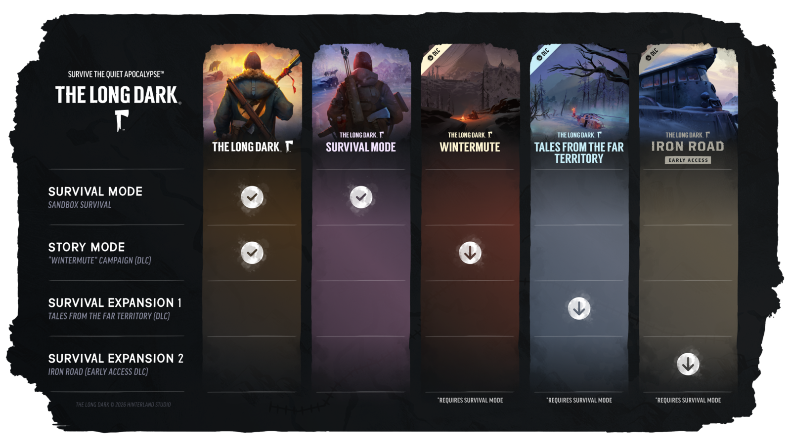

# The Long Dark

**Contents**

- [Summary](#Summary)
- [Game Modes](#Game_Modes)
- [Wintermute](#Wintermute)
- [Survival Mode](#Survival_Mode)
- [Challenge](#Challenge)
- [Game Versions](#Game_Versions)
- [The Long Dark](#The_Long_Dark)
- [The Long Dark: Survival Edition](#The_Long_Dark%3A_Survival_Edition)
- [The Long Dark: Quiet Apocalypse Bundle](#The_Long_Dark%3A_Quiet_Apocalypse_Bundle)
- [Downloadable Addon Content](#Downloadable_Addon_Content)
- [The Long Dark: Tales from the Far Territory](#The_Long_Dark%3A_Tales_from_the_Far_Territory)
- [The Long Dark: Iron Road](#The_Long_Dark%3A_Iron_Road)
- [The Long Dark: Wintermute](#The_Long_Dark%3A_Wintermute)
- [Music for The Long Dark -- Volume One](#Music_for_The_Long_Dark_--_Volume_One)
- [Music for The Long Dark -- Volume Two](#Music_for_The_Long_Dark_--_Volume_Two)
- [Visual Enhancements](#Visual_Enhancements)
- [Gameplay](#Gameplay)
- [Realism](#Realism)
- [Wintermute Plot](#Wintermute_Plot)
- [Reception](#Reception)
- [Other Game Features](#Other_Game_Features)
- [Time Capsule](#Time_Capsule)
- [Modding](#Modding)
- [Achievements](#Achievements)
- [Changelog](#Changelog)
- [Gallery](#Gallery)
- [Videos](#Videos)
- [External links](#External_links)

<table class="infobox">
<caption>The Long Dark</caption>
<colgroup>
<col style="width: 50%" />
<col style="width: 50%" />
</colgroup>
<tbody>
<tr>
<td colspan="2"><figure>
[Missing image: The_Long_Dark_Poster.jpg]
<figcaption>The_Long_Dark_Poster.jpg</figcaption>
</figure></td>
</tr>
<tr>
<td>
<strong>Developer(s)</strong>
</td>
<td>
<a href="./Hinterland%20Studio%20Inc..md" class="wikilink" title="Hinterland Games">Hinterland Games</a>
</td>
</tr>
<tr>
<td>
<strong>Director(s)</strong>
</td>
<td>
Raphael Van Lierop 
David Chan 
Hokyo Lim 
Alan Lawrance
</td>
</tr>
<tr>
<td>
<strong>Writer(s)</strong>
</td>
<td>
Marianne Krawczyk
</td>
</tr>
<tr>
<td>
<strong>Composer(s)</strong>
</td>
<td>
Cris Velasco 
Sascha Dikiciyan
</td>
</tr>
<tr>
<td>
Platform
</td>
<td>
PC/Mac/Linux 
Xbox One/Series S/X 
PlayStation 4/5 
Nintendo Switch
</td>
</tr>
<tr>
<td>
Released
</td>
<td><ul>
<li>1st August 2017 (PC, PS4, XO)</li>
<li>September 17, 2020 (Switch)</li>
</ul></td>
</tr>
<tr>
<td>
<strong>Genre(s)</strong>
</td>
<td>
First Person, Open-World, Sandbox, Survival
</td>
</tr>
</tbody>
</table>

***The Long Dark*** is a first-person open-world survival game developed by <a href="./Hinterland%20Studio%20Inc..md" class="wikilink" title="Hinterland Games">Hinterland Games</a> for Microsoft Windows, OS X, Linux, Xbox One, PlayStation 4, and Nintendo Switch.

It has since been ported to the PlayStation 5, Xbox Series S, Xbox Series X, WeGame, GOG, and Epic Games Store.

A sequel, *<a href="./BLACKFROST%20-%20The%20Long%20Dark%20II.md" class="wikilink" title="BLACKFROST: The Long Dark II">BLACKFROST: The Long Dark II</a>*, is set to release in 2027.

## Summary

*The Long Dark* begins with a <a href="./First%20Flare.md" class="wikilink" title="massive geomagnetic anomaly">massive geomagnetic anomaly</a> that affects all electronic equipment. Cars, radios, computers and most other modern technology have been rendered useless. The world is quiet now, and, with no lights, the nights are long and dark. \[Missing image: Ld_airplane.jpg\] A front seat to the end of the world. Immersive first-person exploration game-play featuring a stunning, original art style. Navigate the savage beauty of the Northern wilderness while facing the hazards of a new post-digital frontier.

Survive by your wits alone. Be on the lookout for potential supply caches, all the while ameliorating and improving your survival skills to overcome the dangers of harsh weather, aggressive wildlife, lack of food and water, and the mysterious <a href="./Aurora.md" class="wikilink" title="Aurora">Aurora</a> that adds more uncertainty to an already uncertain survival situation.

Survival of the fittest. Deep survival simulation game-play whence every decision matters. Explore a large, open world in search of resources while balancing unpredictable conditions against the needs of your daily and, hopefully, long-term survival.

## Game Modes

### Wintermute

- Play the <a href="./Wintermute.md" class="wikilink" title="Story">Story</a> of <a href="./Will%20Mackenzie.md" class="wikilink" title="Will Mackenzie">Will Mackenzie</a> & Dr. <a href="./Astrid%20Greenwood.md" class="wikilink" title="Astrid Greenwood">Astrid Greenwood</a> as they struggle to survive, crashed in the wilderness in the aftermath of a mysterious geomagnetic disaster.

### Survival Mode

- Experience potentially hundreds of hours of free-form sandbox game-play in <a href="./Survival%20Mode.md" class="wikilink" title="Survival Mode">Survival Mode</a>. Push yourself and your skills to last as long as possible without the Story elements.

### Challenge

- Test your skills with scenarios designed to <a href="./Challenge.md" class="wikilink" title="Challenge">Challenge</a> seasoned players. How fast can you complete these challenges?

## Game Versions

 As of December 5th, 2022, *The Long Dark* can be purchased in several different forms from Steam or Epic Games:

### *The Long Dark*

This version of the game includes *all* the content in *The Long Dark: Survival Edition*, along with the dedicated campaign of the <a href="./Wintermute.md" class="wikilink" title="Wintermute">Wintermute</a> Story Mode. For players who know they'll be interested in playing both Survival and Wintermute, or who wish to play only Wintermute.

### *The Long Dark: Survival Edition*

This version of *The Long Dark* includes <a href="./Survival%20Mode.md" class="wikilink" title="Survival Mode">Survival Mode</a> and the <a href="./Challenge.md" class="wikilink" title="Challenges">Challenges</a>, but *not* Story Mode. It is meant to be an "entry-level" version of the game, designed for players who interested in the core gameplay experience. This is the cheapest option.

### *The Long Dark: Quiet Apocalypse Bundle*

This bundle includes *The Long Dark* as well as all downloadable addon content for the game. Only available on Steam.

## Downloadable Addon Content

### *<a href="./Tales%20from%20the%20Far%20Territory.md" class="wikilink" title="The Long Dark: Tales from the Far Territory">The Long Dark: Tales from the Far Territory</a>*

This is downloadable content for *The Long Dark: Survival Edition* for *The Long Dark.* Discover five new regions as you venture into the Far Territory, explore the world as you uncover the secrets of three new <a href="./Tales.md" class="wikilink" title="Tales">Tales</a>, hunt new animals, and interact with even more content exclusive to this addon.

### *<a href="./Iron%20Road.md" class="wikilink" title="The Long Dark: Iron Road">The Long Dark: Iron Road</a>*

This is downloadable content for *The Long Dark: Survival Edition* for *The Long Dark.* Discover an island forgotten to time, with new regions, a steam locomotive, an autopilot boat, and several new hazards related to the Aurora.

### *<a href="./Wintermute.md" class="wikilink" title="The Long Dark: Wintermute">The Long Dark: Wintermute</a>*

This is downloadable content for *The Long Dark: Survival Edition*, and adds the content of the Wintermute Story Mode to the game. It is primarily targeted towards players who purchased *The Long Dark: Survival Edition* and have decided that they want to experience Wintermute.

### *Music for The Long Dark -- Volume One*

<a href="./The%20Long%20Dark%20Original%20Soundtrack.md" class="wikilink" title="The Long Dark Original Soundtrack">The Long Dark Original Soundtrack</a>

Includes Volume One of the Original Soundtrack to The Long Dark, as composed by Cris Velasco and Sascha Dikiciyan. Features of 100 minutes of music composed across 4 discs for <a href="./Episode%201%20-%20Do%20Not%20Go%20Gentle.md" class="wikilink" title="Episode 1: Do Not Go Gentle">Episode 1: Do Not Go Gentle</a> and <a href="./Episode%202%20-%20Luminance%20Fugue.md" class="wikilink" title="Episode 2: Luminance Fugue">Episode 2: Luminance Fugue</a>, as well as ambient exploration music from Survival Mode.

### *Music for The Long Dark -- Volume Two*

Includes Volume Two of the Original Soundtrack to The Long Dark, as composed by Cris Velasco and Sascha Dikiciyan. Features of 60 minutes of music across 2 disks composed for <a href="./Episode%203%20-%20Crossroads%20Elegy.md" class="wikilink" title="Episode 3: Crossroads Elegy">Episode 3: Crossroads Elegy</a>, as well as additional ambient exploration music from Survival Mode.

*Music for The Long Dark -- Volume Three*

Includes Volume Three of the Original Soundtrack to The Long Dark, as composed by Cris Velasco and Sascha Dikiciyan. Features of 60 minutes of music across 2 disks composed for <a href="./Episode%204%20-%20Fury%2C%20Then%20Silence.md" class="wikilink" title="Episode 4: Fury, Then Silence">Episode 4: Fury, Then Silence</a>, <a href="./Episode%205%20-%20The%20Light%20At%20The%20End%20Of%20All%20Things.md" class="wikilink" title="Episode 5: The Light At The End Of All Things">Episode 5: The Light At The End Of All Things</a>, as well as additional ambient exploration music from Survival Mode's <a href="./Tales%20from%20the%20Far%20Territory.md" class="wikilink" title="Tales from the Far Territory">Tales from the Far Territory</a>.

## Visual Enhancements

 A Visual Enhancement update is available for the game when playing on PlayStation 5, Xbox Series S/X, and PC. It is mainly for higher end hardware and is not available for game versions running on older game platforms (PlayStation 4/Xbox One, Nintendo Switch, Lower end PC, etc.).

## Gameplay

<figure>
[Missing image: Wolf.jpg]
<figcaption>Wolf.jpg</figcaption>
</figure>

No electricity: Only you and the brutal, brumal weather. To stay alive you will need to provide for yourself from what you can find amongst the landscapes. Nearby structures may still stand, and, perhaps they are all abandoned; perhaps they still contain useful equipment. They definitely can provide shelter. And the woods—the woods are everywhere. You grew up with woods like these, you have fished waters like these. There is much that nature can provide and much it can take away.

Most important now is your health. It is only you, no one else to rely on. You must meet your basic needs. Where is food? Water? Where to sleep? What can be done to push back the constant, insidious cold? All must be answered by you.

With luck and determination, you may find relief — even comfort — here in the new wilds. But there are other places to be; there must be ways to get there.

Your only objective: Stay healthy, stay alive.

- <a href="./Condition.md" class="wikilink" title="Condition">Condition</a>

Mitigate the needs of survival.

- <a href="./Warmth.md" class="wikilink" title="Warmth">Warmth</a>
- <a href="./Fatigue.md" class="wikilink" title="Fatigue">Fatigue</a>
- <a href="./Thirst.md" class="wikilink" title="Thirst">Thirst</a>
- <a href="./Hunger.md" class="wikilink" title="Hunger">Hunger</a>

Navigate a threatening region.

- <a href="./Survival%20Overlay.md#Time_of_Day" class="wikilink" title="Time of Day">Time of Day</a>
- <a href="./Weather.md" class="wikilink" title="Weather">Weather</a>
- <a href="./Wildlife.md" class="wikilink" title="Wildlife">Wildlife</a>
- <a href="./Region.md" class="wikilink" title="Maps">Maps</a>

Eventually establish yourself after a while...

- <a href="./Safehouse.md" class="wikilink" title="Safe House">Safe House</a>

And find your way in the new world.

"How far will you go to survive?" — **The Long Dark**

## Realism

  
*Main article: <a href="./Realism.md" class="wikilink" title="Realism">Realism</a>*

The game is created whilst striving for realism in many areas and as such borrows many <a href="./Afflictions.md" class="wikilink" title="afflictions">afflictions</a> and core <a href="./Needs.md" class="wikilink" title="survival mechanics">survival mechanics</a> from real life. It gives players an interesting set of choices to play with safely. The creators do not, however, as a general rule, tune the gameplay for realism or to conform to real-world expectations. Therefore, new players may find some things intuitive from the beginning and may need to learn how some other aspects work during play or from other, more knowledgeable, players.

## Wintermute Plot

Will Mackenzie works as a pilot for [Jackrabbit Remote Transport](https://thelongdark.fandom.com/wiki/Jackrabbit_Remote_Transport) prior to the First Flare event. <a href="./Astrid%20Greenwood.md" class="wikilink" title="Astrid Greenwood">Astrid Greenwood</a>, his ex-wife, comes to Will after years of being apart to ask him if he can fly her to an isolated town in the Northern area of Great Bear Island to treat a patient of hers. She also brings a mysterious case with her and does not want to reveal the content to Will. While the two separated some time ago, both still wear their wedding rings. It is implied that they had a child together who had passed away. Mackenzie also used to have an alcohol problem that he claims is under control now.

After hesitantly accepting to fly Astrid to Great Bear Island, Will's airplane crashes into the Northern Canadian wilderness of Great Bear Island when a mysterious geomagnetic storm cuts all power to his instruments. After the crash, in <a href="./Episode%201%20-%20Do%20Not%20Go%20Gentle.md" class="wikilink" title="Episode 1">Episode 1</a>, Will finds Astrid's case but not his ex-wife. Thus, he begins a journey to search for her across the remote wilderness of Great Bear Island.

## Reception

The Long Dark received "critical acclaim" from Steam users, according to Steam reviews. On release, it received mostly mixed to positive reviews from critics, praising its sandbox nature, the content and the atmosphere while criticizing the story. Fan base alike also criticized the story mode calling it a "fetch quest" rather than a story.

## Other Game Features

### Time Capsule

The <a href="./Time%20Capsule.md" class="wikilink" title="Time Capsule">Time Capsule</a> is a playable archive of previous builds of *The Long Dark* released for free by Hinterland, and allows users to play builds of the game as far back as the pre alpha builds. This functionality is currently only available to Steam users due to Steam's infrastructure allowing access to beta builds of *The Long Dark*.

### Modding

*The Long Dark* currently does not have any official modding support aside from the [Steam Workshop](https://steamcommunity.com/workshop/browse/?appid=305620&browsesort=trend&section=readytouseitems&days=90&actualsort=trend&p=2) providing support for other languages for the Steam version of the game. Despite this, individuals have taken to creating unofficial mods that add unsupported content to the game. Hinterland has so far not shown much support regarding modding, aside from a single [dev post](https://www.thelongdark.com/news/dev-diary-perilous-constraint-update/) in 2022 discussing their acknowledgment regarding *The Long Dark* Mods, and it is currently unknown how modding will affect the future of *The Long Dark*.

At this time, this wiki only acknowledges the legitimacy of <a href="./The%20Long%20Development.md" class="wikilink" title="The Long Development">The Long Development</a> project; an unofficial project that adds new regions to Great Bear Island.

### Achievements

  
*Main article: <a href="./The%20Long%20Dark%20%E2%80%94%20Achievements.md" class="wikilink" title="The Long Dark/Achievements">The Long Dark/Achievements</a>*

### Changelog

A list of every update the game has received over its life.

  
*Main article: <a href="./The%20Long%20Dark%20%E2%80%94%20Changelog.md" class="wikilink" title="The Long Dark/Changelog">The Long Dark/Changelog</a>*

### Gallery

  
*Main article: <a href="./The%20Long%20Dark%20%E2%80%94%20Gallery.md" class="wikilink" title="The Long Dark/Gallery">The Long Dark/Gallery</a>*

## Videos

<table class="gallery">
<colgroup>
<col style="width: 25%" />
<col style="width: 25%" />
<col style="width: 25%" />
<col style="width: 25%" />
</colgroup>
<tbody>
<tr>
<td><figure>

<figcaption>The_Long_Dark_-_One_Year_Anniversary_on_Steam_2015_(Official_Trailer)</figcaption>
</figure></td>
<td><figure>

<figcaption><a href="./The%20Long%20Dark%20%E2%80%94%20Changelog.md#0.264" class="wikilink" title="Desolation Point update">Desolation Point update</a></figcaption>
</figure></td>
<td><figure>

<figcaption><a href="./The%20Long%20Dark%20%E2%80%94%20Changelog.md#0.256" class="wikilink" title="Deep Forest update">Deep Forest update</a></figcaption>
</figure></td>
<td><figure>

<figcaption>Xbox One reveal trailer</figcaption>
</figure></td>
</tr>
<tr>
<td><figure>

<figcaption>The_Long_Dark_-_Silent_Hunter_(Alpha_Sandbox_Update)_44_to_v.233</figcaption>
</figure></td>
<td><figure>

<figcaption>Sandbox launch trailer</figcaption>
</figure></td>
<td><figure>

<figcaption>The_Long_Dark_-_Echoes_(Steam_Early_Access_Official_Trailer)</figcaption>
</figure></td>
<td><figure>

<figcaption>Survival Vignettes</figcaption>
</figure></td>
</tr>
<tr>
<td><figure>

<figcaption>Survival - The Tent</figcaption>
</figure></td>
<td><figure>

<figcaption>Survival - <a href="./Deer.md" class="wikilink" title="Deer">Deer</a></figcaption>
</figure></td>
<td><figure>

<figcaption>Survival - The Cabin</figcaption>
</figure></td>
<td><figure>

<figcaption>Gameplay</figcaption>
</figure></td>
</tr>
<tr>
<td><figure>

<figcaption>Project pitch</figcaption>
</figure></td>
<td></td>
<td></td>
<td></td>
</tr>
</tbody>
</table>

## External links

- [Official game site](http://www.intothelongdark.com/)

**Lua execution error in Module:Navbox function navboxTemplate:w:UnityWikis**

<a href="ru:The_Long_Dark" class="wikilink" title="ru:The Long Dark">ru:The Long Dark</a> <a href="fr:Accueil" class="wikilink" title="fr:Accueil">fr:Accueil</a> <a href="de:The_Long_Dark" class="wikilink" title="de:The Long Dark">de:The Long Dark</a>

