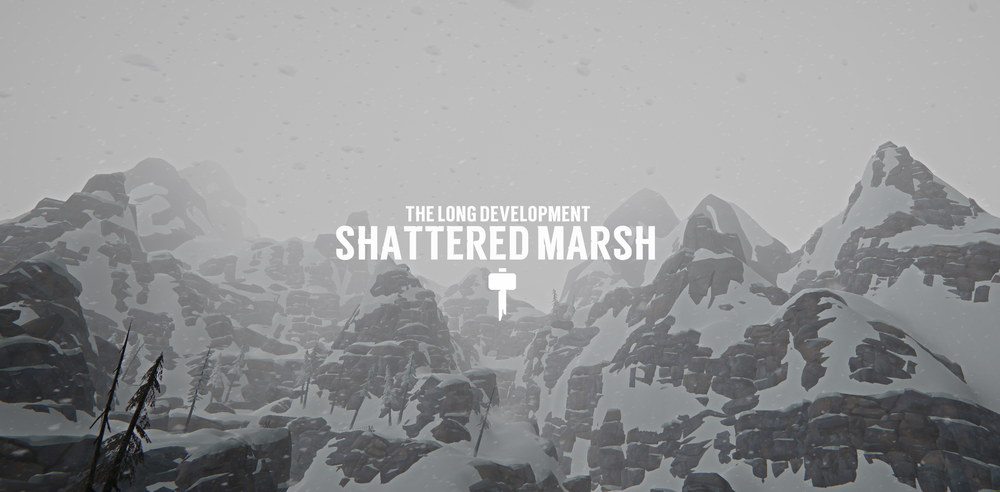
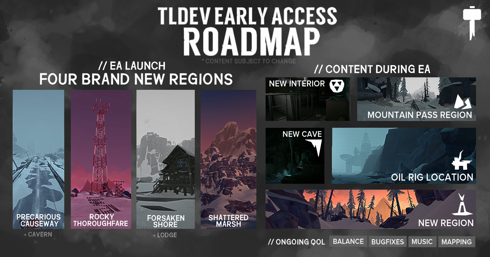

# The Long Development

**Contents**

- [Overview](#Overview)
- [Regions](#Regions)
- [Vehicle](#Vehicle)
- [Gallery](#Gallery)

<table>
<colgroup>
<col style="width: 33%" />
<col style="width: 33%" />
<col style="width: 33%" />
</colgroup>
<tbody>
<tr>
<td width="40px"><figure>

<figcaption>The_Long_Development_White_Logo.png</figcaption>
</figure></td>
<td>
<strong>Modded Content.</strong> 

This page is about content that was not officially created by <a href="./Hinterland%20Studio%20Inc..md" class="wikilink" title="Hinterland Studio Inc.">Hinterland Studio Inc.</a> It is not canon to the world of <a href="./The%20Long%20Dark.md" class="wikilink" title="The Long Dark">The Long Dark</a>.

</td>
<td>
|} 

<table>
<colgroup>
<col style="width: 33%" />
<col style="width: 33%" />
<col style="width: 33%" />
</colgroup>
<tbody>
<tr>
<td style="vertical-align: top; font-size: 3em; color: #5d5980; padding-right: 10px">
“
</td>
<td>
The Long Development is a small team project and a collaborative community effort to expand 'THE LONG DARK's' Great Bear Island in both a beautiful and balanced way. Our team is focused on creating as 'Hinterland-like' regions as possible to ensure that they fit within the world of the vanilla game. Consisting of a handful of core members, our 'TLDev' team brings a variety of work that allows this mod to be as expansive as it is. Our mod contains hand-crafted regions that seamlessly connect to the larger world of Great Bear, featuring custom 3D-modelled structure and an additional 20 minutes of brand-new music that make these regions' identities feel unique. We take our time creating our content, and as every member contributes to this project with our own free time; we apply the infamous ‘no crunch’ rules. Our work releases whenever we feel it is ready, and it will always be completely free for anyone who owns THE LONG DARK and TFTFT

&#10;

Official Discord Description

</td>
<td style="vertical-align: bottom; font-size: 3em; color: #5d5980; padding-left: 10px">
”
</td>
</tr>
</tbody>
</table>

<strong>The Long Development</strong> is an unofficial mod created by a dedicated group of community members for <em><a href="./The%20Long%20Dark.md" class="wikilink" title="The Long Dark">The Long Dark</a></em>. It was not created by <a href="./Hinterland%20Studio%20Inc..md" class="wikilink" title="Hinterland Studio Inc.">Hinterland Studio Inc.</a> and is thus not canon to the world or story of <em>The Long Dark</em>.

The YouTube channel for this project can be found <a href="https://www.youtube.com/@Kaiusername">here</a>. This mod will be free to download for any player and is only compatible to users that own both <a href="./Survival%20Mode.md" class="wikilink" title="Survival Mode">Survival Mode</a> and <a href="./Tales%20from%20the%20Far%20Territory.md" class="wikilink" title="Tales from the Far Territory">Tales from the Far Territory</a>.

<h2 id="Overview">Overview</h2>

The Long Development creates several new regions to explore, departing from Lower Great Bear and The Far Territory of <a href="./Great%20Bear%20Island.md" class="wikilink" title="Great Bear Island">Great Bear Island</a> and giving the player the option to follow the coastline of <a href="./Desolation%20Point.md" class="wikilink" title="Desolation Point">Desolation Point</a> to "Eastern Great Bear".

The project aims to create never before seen content that preserves the overall feel and atmosphere of the game, while also serving as an extension of the base game's world. The project will include brand new original soundtracks to accompany the new regions, brand new maps, and brand new assets.

<h2 id="Regions">Regions</h2>

The following regions are currently planned for the mod:

<ul>
<li><a href="./Precarious%20Causeway.md" class="wikilink" title="Precarious Causeway">Precarious Causeway</a></li>
<li><a href="./Rocky%20Thoroughfare.md" class="wikilink" title="Rocky Thoroughfare">Rocky Thoroughfare</a></li>
<li><a href="./Shattered%20Marsh.md" class="wikilink" title="Shattered Marsh">Shattered Marsh</a></li>
<li><a href="./Forsaken%20Shore.md" class="wikilink" title="Forsaken Shore">Forsaken Shore</a></li>
<li><a href="./Mountain%20Pass.md" class="wikilink" title="Mountain Pass">Mountain Pass</a></li>
</ul>
<h2 id="Vehicle">Vehicle</h2>

In addition to the vehicles found in the base game, The Long Development adds a few unique vehicles:

<ul>
<li>Camper Trailer</li>
<li>Snowmobile</li>
<li>Brown <a href="./Truck.md" class="wikilink" title="trucks">trucks</a></li>
</ul>
<h2 id="Gallery">Gallery</h2>
<table class="gallery">
<colgroup>
<col style="width: 25%" />
<col style="width: 25%" />
<col style="width: 25%" />
<col style="width: 25%" />
</colgroup>
<tbody>
<tr>
<td><figure>

<figcaption>Precarious_Causeway.png</figcaption>
</figure></td>
<td><figure>

<figcaption>Shattered_Marsh.png</figcaption>
</figure></td>
<td><figure>

<figcaption>Mountain_Pass.png</figcaption>
</figure></td>
<td><figure>

<figcaption>Forsaken_Shore.png</figcaption>
</figure></td>
</tr>
<tr>
<td><figure>

<figcaption>Rocky_Thoroughfare.png</figcaption>
</figure></td>
<td><figure>

<figcaption>TLDevEAroadmapPNG.png</figcaption>
</figure></td>
<td></td>
<td></td>
</tr>
</tbody>
</table></td>
</tr>
</tbody>
</table>

