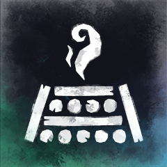

# The New World

**The New World**

| Property | Details |
| --- | --- |
|  |  / *The\_New\_World\_icon.png* |
| Description | Complete Episode Five. |

**The New World** is a hidden [achievement](./The%20Long%20Dark%20%E2%80%94%20Achievements.md) in *[Wintermute](./Wintermute.md)* [Episode 5: The Light At The End Of All Things](./Episode%205%20-%20The%20Light%20At%20The%20End%20Of%20All%20Things.md) of *[The Long Dark](./The%20Long%20Dark.md)*.

## Guide

This is an unmissable hidden achievement granted during the main story mission [Conflagration](./Conflagration.md). It is unlocked after entering Terry's radio shack and a cutscene ends. Once the credits roll, the Episode will complete and the achievement will unlock.

## Game History

\* UPDATE **31 March 2026 ([Update](./The%20Long%20Dark%20%E2%80%94%20Changelog.md#2.52)):**

- 
  - Added to game.

**Lua execution error in Module:Navbox function navbox**
