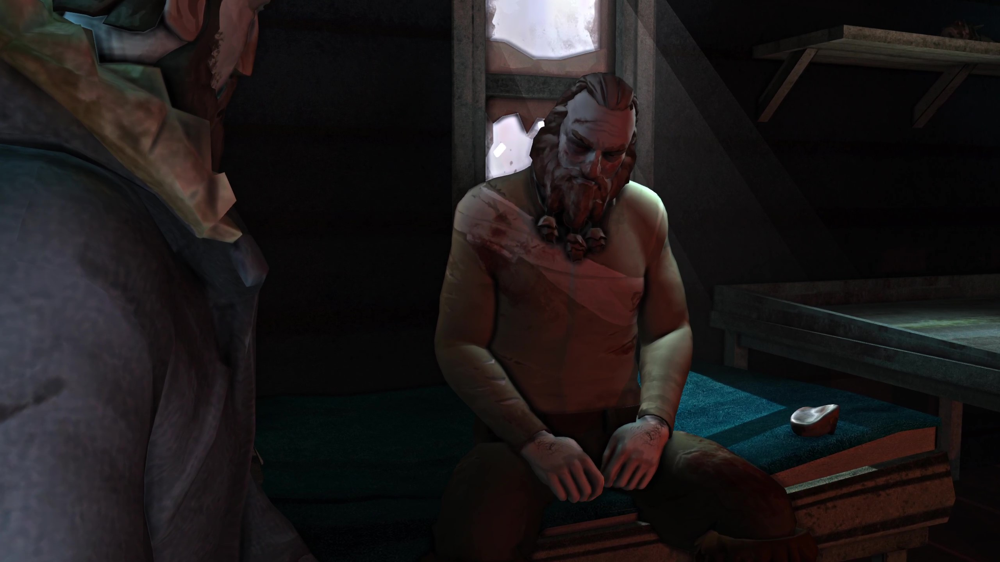

# The Old Bear's Ear

**Categories:** Collectibles, Pages with update history · **Source:** [Fandom](https://thelongdark.fandom.com/wiki/The_Old_Bear's_Ear)

**The Old Bear's Ear**

[The Old Bear's Ear icon](../assets/The_Old_Bear%27s_Ear_icon.png)

**Release:** [1 August 2017](./The%20Long%20Dark%20%E2%80%94%20Changelog%20%E2%80%94%20Archive%201.md#1.00)

**Wintermute:** [Episode 2](./Episode%202%20-%20Luminance%20Fugue.md) - [Jeremiah's Folly](./Jeremiah%27s%20Folly.md)

**Properties**

**Item type:** [Collectibles](./Collectibles.md)

**Stackable:** No

**Examine:** A bloody ear from a bear.

**Values**

**Weight:** 0.00 kg (0 lbs)

**Actions**

**Backpack:** Examine

**On ground:** Take It, Leave It

> “**You bring me the Old Bear's ear, and I'll get you out of here. I will give you everything you need to find your friend.**”
>
> — [Jeremiah](./Jeremiah.md)

**The Old Bear's Ear** was a [Collectible](./Collectibles.md) item found in [Episode 2: Luminance Fugue](./Episode%202%20-%20Luminance%20Fugue.md) of the [Wintermute](./Wintermute.md) story mode as part of the mission [Jeremiah's Folly](./Jeremiah%27s%20Folly.md). It is considered [Cut/Discontinued Content](./Cut%20%E2%80%94%20Discontinued%20Content.md), as it did not survive the transition from Predux Episode 2 to Redux Episode 2, as Jeremiah's Folly was instead replaced with the mission [What One Man Can Do](./What%20One%20Man%20Can%20Do.md).

<!-- #Overview -->
​

<!-- #overview -->
## Overview

It was obtained after successfully tracking and shooting the [Old Bear](./Old%20Bear.md) multiple times in [Mystery Lake](./Mystery%20Lake%20%28region%29.md), and finally killing the bear. After interacting with the carcass of The Old Bear, the bear's ear would instantly appear and could be taken. It would later be taken to [Jeremiah](./Jeremiah.md) as proof that [Will Mackenzie](./Will%20Mackenzie.md) managed to kill the Old Bear.

<!-- #update_history -->
​

<!-- #Update_history -->
​

<!-- #Update_History -->
​

<!-- #update-history -->
## Update history

- UPDATE **1 August 2017 ([Update](./The%20Long%20Dark%20%E2%80%94%20Changelog%20%E2%80%94%20Archive%201.md#1.00)):**
  - Added to game.
- UPDATE **17 December 2018 ([Update](./The%20Long%20Dark%20%E2%80%94%20Changelog%20%E2%80%94%20Archive%201.md#1.41)):**
  - Removed from the game as part of the Redux edition.
