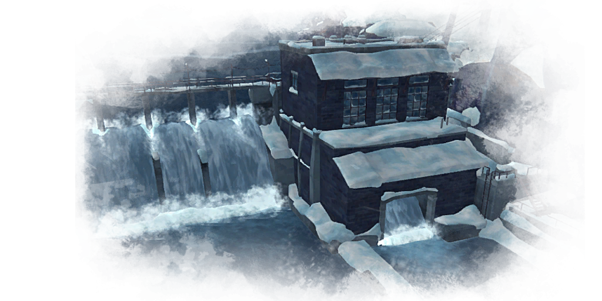

# The Power Plant/Transcript

**Contents**

- [Transcript](#Transcript)
- [Head to the Power Plant.](#Head_to_the_Power_Plant.)
- [Sabotage the locking mechanisms.](#Sabotage_the_locking_mechanisms.)
- [Check on the Warden.](#Check_on_the_Warden.)

<table class="infobox">
<caption>The Power Plant/Transcript</caption>
<colgroup>
<col style="width: 50%" />
<col style="width: 50%" />
</colgroup>
<tbody>
<tr>
<td colspan="2"><figure>

<figcaption>The_Power_Plant.png</figcaption>
</figure></td>
</tr>
<tr>
<td>
Episode
</td>
<td></td>
</tr>
<tr>
<td colspan="2" class="section">
<strong>Missions</strong>
</td>
</tr>
<tr>
<td>
Previous
</td>
<td>
<a href="./Blackrock%20Blues%20%E2%80%94%20Transcript.md" class="wikilink" title="Blackrock Blues/Transcript">Blackrock Blues/Transcript</a>
</td>
</tr>
<tr>
<td>
Current
</td>
<td>
The Power Plant/Transcript
</td>
</tr>
<tr>
<td>
Next
</td>
<td>
<a href="./The%20Detonators%20%E2%80%94%20Transcript.md" class="wikilink" title="The Detonators/Transcript">The Detonators/Transcript</a>
</td>
</tr>
<tr>
<td>
Region
</td>
<td>
<a href="./Blackrock.md" class="wikilink" title="Blackrock Region">Blackrock Region</a>
</td>
</tr>
<tr>
<td>
Characters
</td>
<td>
<a href="./Will%20Mackenzie.md" class="wikilink" title="Will Mackenzie">Will Mackenzie</a> 
<a href="./Franklin.md" class="wikilink" title="Franklin">Franklin</a> 
<a href="./Mathis.md" class="wikilink" title="Mathis">Mathis</a> 
<a href="./Vachon.md" class="wikilink" title="Vachon">Vachon</a> 
<a href="./Heller.md" class="wikilink" title="Heller">Heller</a> 
<a href="./Jace.md" class="wikilink" title="Jace">Jace</a>
</td>
</tr>
</tbody>
</table>

This is the transcript for Chapter 2 <a href="./The%20Power%20Plant.md" class="wikilink" title="The Power Plant">The Power Plant</a> for <a href="./Episode%204%20-%20Fury%2C%20Then%20Silence.md" class="wikilink" title="Episode 4: Fury, Then Silence">Episode 4: Fury, Then Silence</a>.

## Transcript

CHAPTER TWO

THE POWER PLANT

*Mackenzie is injecting the Warden with medicine from a syringe. The man is tied to a chair, hands bound behind his back, as draws a sharp breath and wakes up.*

<a href="./Franklin.md" class="wikilink" title="Franklin">Franklin</a>: "Who the hell are you?"

<a href="./Will%20Mackenzie.md" class="wikilink" title="Will Mackenzie">Will Mackenzie</a>: "Relax. I'm your neighbour in cell fifteen."

Franklin: "Ah...yeah, Mathis' pilot."

Mackenzie: "I cleaned you up the best I could. You might have a broken rib...maybe more. Mathis opened up a couple of bad cuts on you, so I stitched them up. Gave you a shot of antibiotics...hopefully that'll prevent serious infection."

Franklin: "Thanks. You...you seem to know a fair bit of first aid."

Mackenzie: "Well...I'm marr...I, uh...know a doctor. And...I get hurt a lot."

Franklin: "With friends like Mathis, I'm not surprised."

Mackenzie: "Oh, Mathis is no friend of mine."

Franklin: "We'd better hurry before the guards come back. There's something I need to tell you about the prison."

Mackenzie: "I'm listening."

Franklin: "Solitary. It's...it's on its own locking circuits. Separate from the rest of the prison. Mathis and his guys...they haven't figured that out yet."

Mackenzie: "But when they do..."

Franklin: "When they do, they'll get Donner out and there will be hell to pay."

Mackenzie: "They blame you for Donner?"

Franklin: "Mathis thinks I used some kind of override to keep Donner locked in there...even when the rest of the cells went haywire."

Mackenzie: "Well, did you?"

Franklin: "Nah...it's...I can't figure it out, but someone is out there, messing with the system. Messing with Mathis. And keeping Donner inside."

Mackenzie: "I might have an idea of who it is."

Franklin: "You see someone out there?"

Mackenzie: "Not saw. But I talked to someone on the phone.

Franklin: "Right! The old rotary phone system would still work. Redundancy for when the sat phone goes down."

Mackenzie: "Right."

*Mackenzie turns around and hears banging*

Franklin: "Shit, they're coming back. Get back in your cell!"

Mackenzie: "You gonna be ok?"

Franklin: "Just don't let them find you here. If you get to talk to whoever it was on the phone again, do whatever they ask. 'Cause right now, they are the only thing keeping us all alive."

Mackenzie: "Think we can trust them?"

Franklin: "The enemy of my enemy is my friend."

*Mackenzie runs back to his cell and closes both Franklin's cell door and his own, even though they do not lock, and sits in his bunk. Mathis walks by and grab's Mackenzie's cell door, and pushes it open*

<a href="./Vachon.md" class="wikilink" title="Vachon">Vachon</a>: "He...hey, how'd that happen?"

<a href="./Heller.md" class="wikilink" title="Heller">Heller</a>: "Wow yeah...must be glitchy."

*Mathis walks into the cell chuckling and shaking his head*

<a href="./Mathis.md" class="wikilink" title="Mathis">Mathis</a>: "Ha ha...these idiots think I'm a fool. They don't think I can figure out what happened here. But they were too chicken-shit to take care of the Warden themselves...and sent you out into the cold to do their dirty work. And you...risking your life to save a guy you don't even know. What a fucking boy scout."

Mackenzie: "That's me."

Mathis: "You still don't get it. Don't you see that in this new world, Mackenzie, boy scouts will be the first to die?"

Mackenzie: "And yet...here I am."

Mathis: "Well smart-ass. If you're going to make yourself useful...you're going to make yourself useful to me."

Mackenzie: "Am I?"

Mathis: "Yes, you are."

Mackenzie: "And why am I going to do that?"

Mathis: "Well, because..."

*Simultaneously*

- Mathis: "Hardcase."
- Mackenzie: "Hardcase."

Mackenzie: "Right."

Mathis: "Get back out there, pilot. Go find out what's wrong with this place."

Mackenzie: "What do you have in mind?"

Mathis: "Well, obviously there's something wrong with the power. Though he's been no help, map in the Warden's office shows this place has its own power plant. So, go check it out. Get me some power so I can open the gates to solitary."

Mackenzie: "Right. Power. Solitary. Got it."

Mathis: "And Mackenzie?"

Mackenzie: "Yes?"

Mathis: "Don't dawdle, or...the Warden gets it for real this time."

*Scene fades to black and comes back to the front of the Prison again at night, with an active Fire Barrel nearby. Heller holds a map*

Heller: "Mathis said to give you this."

*Heller throws it on the ground in front of Mackenzie, who shivers*

Mackenzie: "That doesn't look like a coat."

Heller: "That's cause it isn't. It's a bit of a map. Shows the way to the dam. Looks like you can just...follow the power lines or something."

Mackenzie: "It's...cold out here. I won't find the dam if I freeze before I get there."

Heller: "Do I look like a guy who gives a shit? You don't want to freeze out here? Then get moving!"

*Heller slams the door shut and Mackenzie picks up the map fragment*

Mackenzie: "Bastards. At least this map looks real enough."

## Head to the Power Plant.

*Mackenzie walks down the mountain road and enters an <a href="./Old%20Substation.md" class="wikilink" title="Old Substation">Old Substation</a>*

Mackenzie: "Abandoned...some kind of substation control. And shelter, for me anyways."

*Mackenzie eventually makes it to the almost destroyed <a href="./Narrow%20Bridge.md" class="wikilink" title="Narrow Bridge">Narrow Bridge</a>*

Mackenzie: "Woah...easy does it."

*Crossing the other side, the map points to the Power Plant through a road, but Mackenzie has to pass over several landslides and through the mountain before getting to the Plant. He walks inside*

Mackenzie: "Now let's see about that power."

*A phone rings, and Mackenzie answers it*

Mackenzie: "Hello?"

<a href="./Jace.md" class="wikilink" title="???">???</a>: "Me again. So, they sent you to check on the power plant."

Mackenzie: "Y...yeah. I mean, that's what they asked me to do."

???: "You always do what hardened criminals ask you to do?"

Mackenzie: "Only when they ask nicely."

???: "You know you won't be able to get the power back on, right? The issues with the power...have nothing to do with the power plant."

Mackenzie: "Yes, I know. I mean...how are you so sure?"

???: "Trust me, I know."

Mackenzie: "Trust you? Ok. Trust goes both ways. What's your name?"

???: "You can call me Jace."

Mackenzie: "Ok. Nice to meet you, Jace. So what are we doing here, exactly?"

Jace: "Well I don't know about you, but I'm not here to work on my tan."

Mackenzie: "How do you fit into all of this, Jace? Are you in trouble?"

Jace: "That psycho Donner makes it out of solitary and we're all in trouble, Mack."

Mackenzie: "Well...it's better than "Mister Mackenzie" I guess."

Jace: "Listen. You want to know what's going on with the power, and all that, I can tell you. But first, prove yourself to me. I need your help."

*Dialogue options appear*

**Blue Dialogue**

- WHERE?

Mackenzie: "Where are you right now?"

Jace: "That's not important."

Mackenzie: "How did you end up in Blackrock?"

Jace: "Car broke down when the aurora first appeared. Well, not so much "broke down" as just stopped working. Like most things. It was freezing so I got out and started walking down the road, to see if I might find someone else. Or maybe some shelter. Got turned around in the darkness and snow...everything looked pretty much the same. Wandered for hours. Nearly froze to death. Then I found a fence. Followed it, and found a guard tower. Next thing I knew, I heard gunshots."

- GUNSHOTS

Jace: "It was...horrible. The shots were...there were so many. I waited...half an hour? Longer? Crept up and I could see them, slumped against the wall. Blood everywhere. It was guards. Prison workers. Civilians. Innocents. They had executed them. I had to get out, but, I know the area a bit. There's nowhere to go, really. Not on foot. I don't know if anyone's coming to help, but I figure...I gotta do what I can to keep those fuckers locked up. Donner...he is evil. If he gets out, nobody within a hundred klicks of this place will be safe. And if this thing lasts as long as I think it will...that would be very, very bad for all of us."

- DONNER

Mackenzie: "What's the situation with Donner?"

Jace: "I guess you don't follow the news much, huh? Donner's a psychopath. They have a law about something, this guy's broken it. I hear his old man Mathis isn't much better. But Donner...Donner is a once-in-a-generation criminal."

Mackenzie: "Yeah, I can confirm that Mathis is not "Father of the Year" material."

Jace: "Wait, you know him?"

Mackenzie: "He's how I ended up here. It's a long story. But yeah...he's here to break Donner out."

Jace: "Shit, shit, shit. This is worse than I thought."

Mackenzie: "What's the worse that could happen if he gets out? He gets stuck out in the wilderness and...freezes to death or gets eaten by something."

Jace: "Wrong. Donner gets out...he will make it his personal mission to find and hurt every living human he can get his hands on...between Blackrock and the Mainland. Just for shits and giggles."

Mackenzie: "You worried about anyone in particular?"

Jace: "Nevermind that. We gotta keep him in lockdown. That's the only thing that matters right now."

Mackenzie: "Ok, so...how are we going to make sure he stays in solitary?"

Jace: "Trust. That's how we are gonna keep him in."

- LASTS?

Mackenzie: "What do you mean if this lasts as long as you think it will? Do you know something about what's going on?"

Jace: "Nevermind. I just know stuff, ok? Or suspect it."

Mackenzie: "Sounds like you think there's more than just...the lights in the sky."

Jace: "It's not more than just lights in the sky. And yet, it is."

Mackenzie: "That's pretty cryptic."

Jace: "Let's stay focused on Blackrock, ok?"

- TRUST

Jace: "You wanna prove you're trustworthy?"

Mackenzie: "I mean...I want to help, yeah."

Jace: "What's in it for you?"

Mackenzie: "I don't much like Mathis. And he's got something I need."

Jace: "What is it?"

Mackenzie: "A metal case."

Jace: "What's in it?"

Mackenzie: "I'm not really sure."

Jace: "Hey...trust goes both ways, right?"

Mackenzie: "I'm not hiding anything from you. I really don't know."

Jace: "So then...just leave. Get out of here. Leave Blackrock and let the chips fall where they may."

Mackenzie: "I can't. I need it."

Jace: "If you don't know what's inside the case, how do you know you need it?"

Mackenzie: "It's important to someone who's important to me, and they were ready to die for it. So I need to get it back."

Jace: "Right. Well, maybe we can help each other. You do something for me, and I'll find a way to help you with your little problem. Deal?"

Mackenzie: "I feel like I'm going to regret this, but...yeah. Deal."

Jace: "Ok, listen up. Even with the power out, there are physical mechanisms that the convicts can manipulate to get Donner out. I mean, they are morons, but even morons get lucky sometimes. We need to fix things so they can't accidently break him out."

Mackenzie: "And how do we do that?"

Jace: "Well, it just so happens, I have the plans to this ancient thing. I mean, a lot of the original structure and prison systems are...probably Victorian era. Solitary is newer. But the stuff under solitary...still old as shit."

Mackenzie: "Alright. How does that help us?"

Jace: "We get underneath, and we bust up the systems that manage the locking and unlocking mechanisms, and we basically...well, we turn the gates into walls. We seize up the system, and it's so old, so heavy...it'd take a goddamn nuclear bomb to break them out."

Mackenzie: "Let's hope...you don't have a nuclear bomb do you?"

Jace: "Steam tunnels."

Mackenzie: "Steam tunnels. Right. What about steam tunnels."

Jace: "You get into the old steam tunnels. You'll find an access door in the rock face just outside the power plant. Other side of the spillway. According to these blueprints, they lead you -- more or less -- right to the old locking mechanisms under solitary."

Mackenzie: "More or less?"

Jace: "Well, there are some stains on the map. And a few areas that are fuzzy, engineering-wise. I mean it's old! But yeah, eventually you will get to the locking mechanisms."

Mackenzie: "Ok, and then what?"

Jace: "You tear out or smash anything that looks remotely like a switch, fuse, panel, cable, wire, vacuum tube...you get it?"

Mackenzie: "Yeah, I get it. Sabotage the thing."

Jace: "Exactly. You do that, and Donner is locked in for good. Probably."

Mackenzie: "Probably?"

Jace: "Hey...I'm not a prison designer, ok? But yeah, as I read these blueprints...probably."

Mackenzie: "Ok. Wish me luck."

Jace: "I mean, it'll definitely buy us some time. I think."

Mackenzie: "I'm going now, Jace."

Jace: "Hang on!"

Mackenzie: "What?"

Jace: "Good luck."

*Mackenzie hangs up the phone*

Mackenzie: "Well, ok. Let's find those steam tunnels."

## Sabotage the locking mechanisms.

*Mackenzie leaves the Power Plant and finds the doorway in the mountain leading to the Steam Tunnels, and steps inside*

Mackenzie: "Remember what Jace said -- locking mechanisms."

*Mackenzie uses a light source to lighten the tunnels up, and eventually comes to a door covered in ice*

Mackenzie: "Have to thaw things out."

*He spots a nearby valve handle and opens up the steam pipes. The door thaws out from the intense warmth*

Mackenzie: "Steam is moving..."

*He walks into the next room and sees another set of blocked doors*

Mackenzie: "Everything's frozen."

*The valve handles are frozen, so Mackenzie follows the warm pipes and begins opening them, thawing the frozen pipes and doors.* *Mackenzie* *turns left and* *finds the doors to the locking mechanisms room, but blocked with ice*

Mackenzie: "Have to get in there."

*Mackenzie turns around and finds a large room with a large boiler, and manages to unfreeze it by opening more valves and opening one of the valves on the large boiler*

Mackenzie: "That got it going."

*Mackenzie then heads back to the central area, now with hot steam leaking out of some of the pipes, and clears another path for steam to reach the second valve on the large boiler, then he opens that one*

Mackenzie: "Now it's moving."

*Going back to the main room, a valve handle is now unfrozen and can thaw the ice around one set of doors.*

Mackenzie: "That seemed to work."

*Mackenzie goes through the doors and follows the frozen pipes, opening more valves and redirecting the flow of steam.*

Mackenzie: "Making progress..."

*He opens 2 more valves and finds a <a href="./Heavy%20Hammer.md" class="wikilink" title="Heavy Hammer">Heavy Hammer</a> along the way, then returns to finally thaw out the doors of the locking mechanisms room*

Mackenzie: "It worked."

*Mackenzie finds the locking mechanism machine and savagely smashes everything important on it with the Hammer, even making a valve handle fall off, eventually logging the Hammer inside the metal of the machine and destroying it. He returns topside, finding a tunnel leading to the Prison Yard, and then finds Vachon at the front doors to the Prison, warming himself by a Fire Barrel*

Vachon: "You're still alive! Shit, looks like I lost that bet."

*Mackenzie joins the convict by the fire, warming his hands*

Vachon: "Any luck with the job Mathis gave you?"

Mackenzie: "I made it to the power plant. The whole place is dead. Nothing obvious to be done to get it running again."

Vachon: "Too bad. Mathis will be disappointed. Oh well...back in your cage, dog."

*Vachon searches Mackenzie as the screen goes black.*

## Check on the Warden.

HOURS LATER...

*Mackenzie awakens in his cell*

Franklin: "Psst. Hey! You awake yet?"

*Mackenzie gets up on the toilet to see Franklin through the barred window. His chair facing the window as he looks at Mackenzie*

Mackenzie: "Yep. I'm here."

Franklin: "Any luck at the power plant?"

Mackenzie: "If by "luck" you mean I managed to not get the power back up and running again... Then yeah...you could say I had some luck."

Franklin: "You found them, didn't you? Whoever's out there messing up Mathis' plans?"

Mackenzie: "Not really. But I spoke to them again. Whoever they are, they really don't like Donner."

Franklin: "Well, then we have to do whatever we can to help them."

Mackenzie: "Ok, but how?"

Franklin: "Just...keep doing what you're doing. We have to find a way to slow Mathis down..."

Mackenzie: "A little hard to do that from inside a cell."

*Noise begins rattling from down the hall*

Franklin: "Maybe not. Quick, get back."

*Mackenzie tries to go to his bunk as Mathis, Vachon, and Heller appear. Mathis is holding a valve hand, presumable the one from the destroyed locking mechanism machine*

Mathis: "Well, well. Look what my guys found while investigating the old parts of the prison. Someone is seriously fucking with me. Someone who clearly knows more about this prison than they should. Knew exactly what to sabotage to keep us from getting into solitary."

*Mackenzie looks at the wall away from Mathis, who clangs the valve handle onto the cell bars to get his attention again*

Mathis: "You know anything about this, pilot?"

*Mathis hands the valve handle to Vachon*

Mackenzie: "I have no idea what that is."

Mathis: "Sure. I figured as much... Whoever did this took a big risk, and went through a lot of effort. For nothing. We found another way in. A big-ass key that will unlock the door to solitary. Or any other door we want. It's called...dynamite."

Franklin: "Damn it, Mathis. Haven't you done enough to my prison?"

Mathis: "SHUT YOUR MOUTH. I'll deal with you later. Listen, pilot. It's time to get back to work."

Mackenzie: "What now?"

Mathis: "Detonators. Can't do shit with this dynamite, unless we find detonators. Since we found the dynamite in one of the old machine sheds, the detonators should be around here somewhere. Of course, we can't find them. So...I'll probably have to go a few rounds with my friend the Warden here, to find out where they are. You just sit tight and I'll tell you when I'm done. You may want to plug your ears."

*Mathis walks over to and opens Franklin's cell.*

Franklin: "Now...listen, Mathis. There's no need for that."

Mathis: "Come on, Warden. Don't ruin my fun."

Franklin: "The...detonators. That dynamite is old. We kept it in storage because we didn't have a safe way to get it back to the mainland."

Mathis: "That's a nice story."

Franklin: "Wait wait...b...but I know where you can find some."

Mathis: "I'm listening."

Franklin: "Old mine...in the hills just above the prison. It was shut down suddenly for safety reasons after the quakes, but most of the gear was left up there. I...I bet there are some detonator caps up there."

Mathis: "Interesting. You heard the man. Get going."

Heller: "Yeah, dog. Time to get back out there."

*Mathis begins beating Franklin, Mackenzie springs out of his bed and to the corner of his cell by the bars*

Mackenzie: "W...wait. Mathis...just...leave him alone. I'll do it. I'll be quick."

*Mathis stops*

Heller: "You'd better hurry up, pilot. I think Mathis wants to let off some steam."

Franklin: "Wait...Mathis..."

*The screen goes black*

The story continues in <a href="./The%20Detonators%20%E2%80%94%20Transcript.md" class="wikilink" title="The Detonators/Transcript">The Detonators/Transcript</a>. **Lua execution error in Module:Navbox function navbox**

