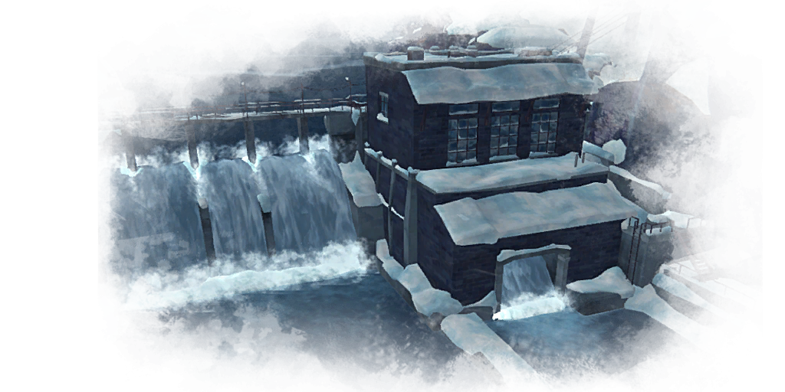

# The Power Plant

**Categories:** Episode 4 · **Source:** [Fandom](https://thelongdark.fandom.com/wiki/The_Power_Plant)

**The Power Plant**

Episode

**Missions**

**Previous:** [Blackrock Blues](./Blackrock%20Blues.md)

**Current:** The Power Plant

**Next:** [The Detonators](./The%20Detonators.md)

**Region:** [Blackrock Region](./Blackrock.md)

**Characters:** [Will Mackenzie](./Will%20Mackenzie.md) [Franklin](./Franklin.md) [Mathis](./Mathis.md) [Vachon](./Vachon.md) [Heller](./Heller.md) [Jace](./Jace.md)

> “**Mathis orders you to find the old Power Plant and look for a way to restore power to solitary.**”
>
> — In-game description

**The Power Plant** is the third mission in [Episode 4](./Episode%204%20-%20Fury%2C%20Then%20Silence.md) of [Wintermute](./Wintermute.md). In this mission, [Mackenzie](./Will%20Mackenzie.md) is ordered by [Mathis](./Mathis.md) to travel to the Power Plant and find a way to restore power to solitary.

## Objectives

- Head to the Power Plant.
  - Follow the high-voltage power lines.
- Sabotage the locking mechanisms.
  - Redirect steam throughout the complex to defrost the control room door.
  - Destroy the locking mechanism.
  - Find a hammer to smash the machine.
  - Return to Blackrock.
- Check on the Warden.

## Walkthrough

| Mission details — Start location | Mission details — Blackrock Federal Penitentiary |
| --- | --- |
| Significant locations | [Power Plant](./Power%20Plant.md) |
| Items recommended | rifle, revolver, noisemaker |

The episode starts at the door of [Blackrock Federal Penitentiary](./Blackrock%20Prison.md), where [Heller](./Heller.md) hands Will a map of the area showing where to go. Once outside, it's recommended to gather all the gear previously left behind in the locker, as it will be required for the trip to the power plant.

To get to the power plant, follow the powerlines from the jail. If freezing becomes a problem along the way, a good stopping point, which offers good loot, is the [Old Substation](./Old%20Substation.md). There's also a bed there if sleep is needed. The river in Blackrock is not frozen, and must be crossed at [Narrow Bridge](./Narrow%20Bridge.md), being careful not to fall in the water along the way. Following the road is the most direct path, however it may be safer to head northward via the narrow mountain paths to avoid predators.

If following the road, about halfway from Narrow Bridge to the power plant is a trailer, which can be used to warm up if needed.

In a clearing just before the power plant there will be a pack of [timberwolves](./Timberwolf.md). These can be shot or dispersed with [noisemakers](./Noisemaker.md). Once inside the power plant, [Jace](./Jace.md) will call, instructing Will to enter the steam tunnels to access the control room below solitary to sabotage the locks keeping [Donner](./Donner.md) in, so that [Mathis](./Mathis.md) doesn't learn how the locks work.

## Steam Puzzle

Getting to the control room requires the use of steam to thaw away icicles blocking doors. Initially, all but one steam valve will be frozen. Opening this valve will enable the next valve to be turned. To thaw a steam valve the pressure leading to it must be in the green zone (check the gauges); in at least two cases, re-opening/closing valves that the player opened/closed will be necessary in order to get the next valve to thaw. Be careful not to walk into the jets of hot steam leaking from the pipes, as that will cause rapid [condition](./Condition.md) loss.
