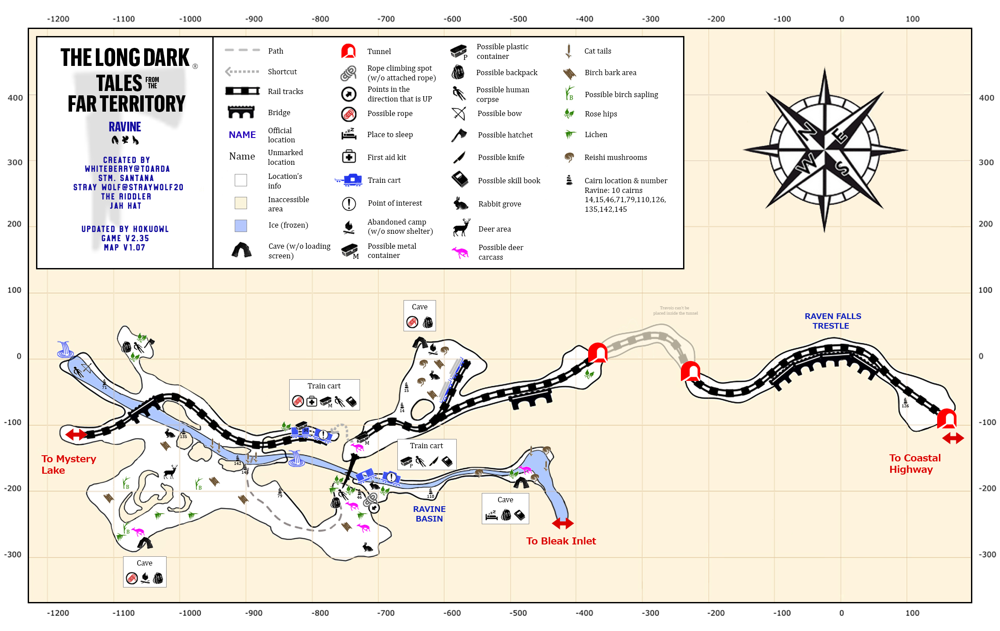
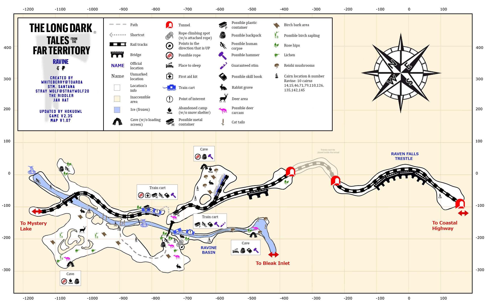
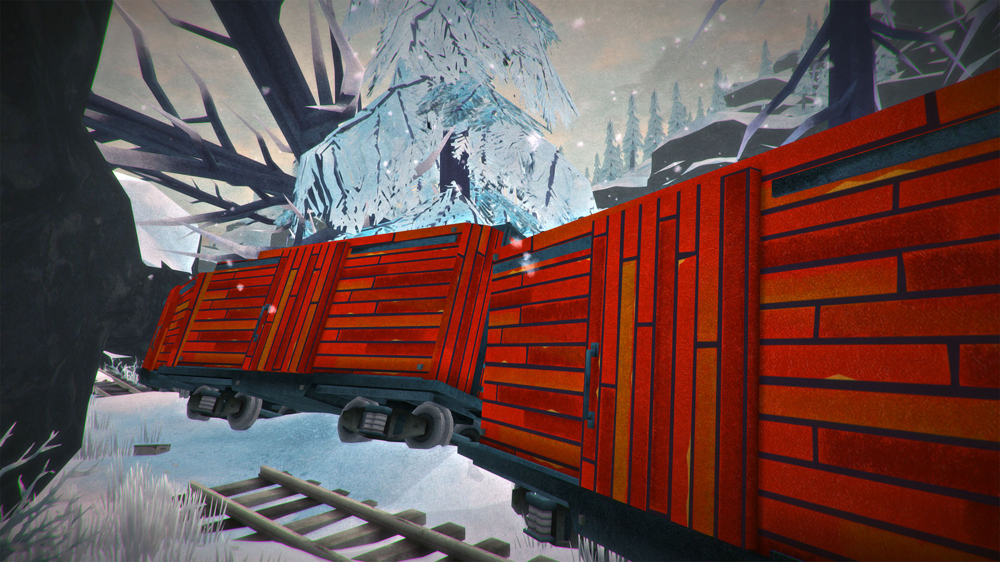
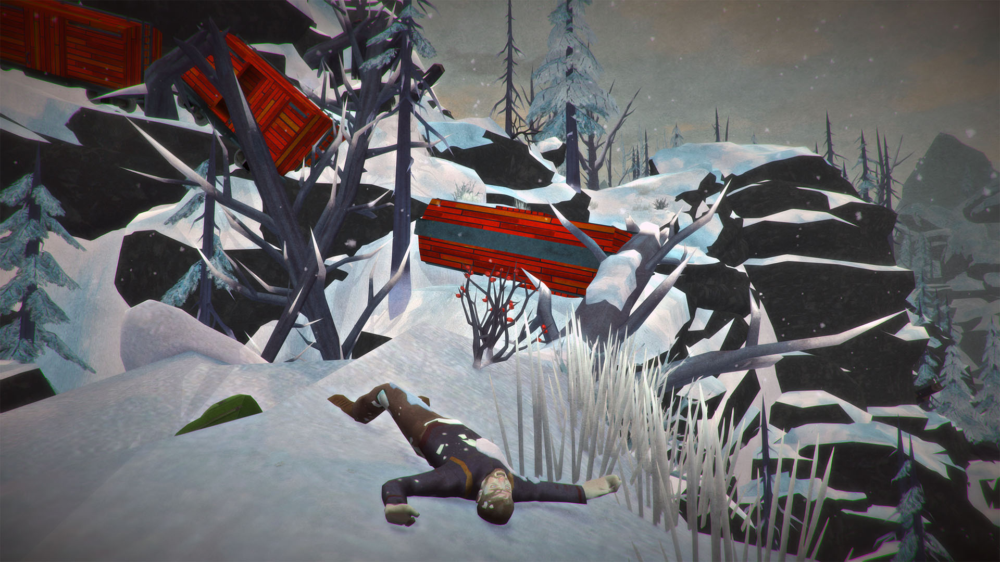
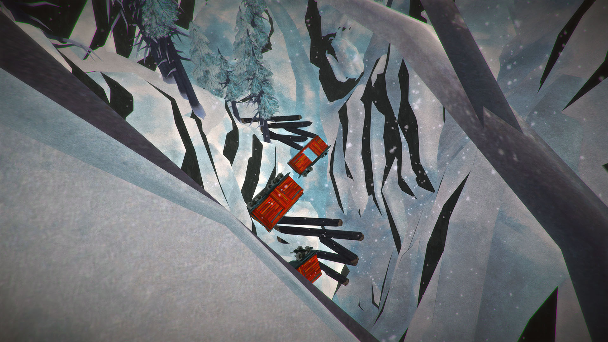
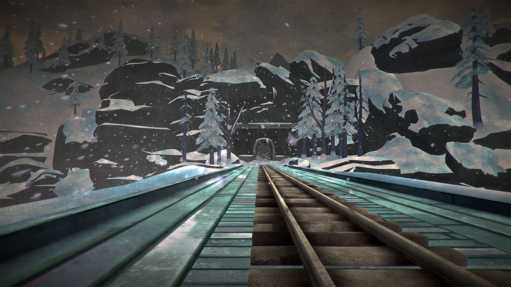

# The Ravine

**Categories:** Transition zones · **Source:** [Fandom](https://thelongdark.fandom.com/wiki/The_Ravine)

**Contents**

- [Overview](#overview)
- [Instant Death Barrier](#instant-death-barrier)
- [Wildlife Availability](#wildlife-availability)
- [Locations](#locations)
- [Raven Falls Trestle](#raven-falls-trestle)
- [Ravine Basin](#ravine-basin)
- [Maps](#maps)
- [Outdated Gallery](#outdated-gallery)

**Raven Falls Railway Line**

| Property | Details |
| --- | --- |
| | [RegionAtlas resources.assets 562 (1)](../assets/RegionAtlas-resources.assets-562_%281%29.png) |
| **Location on [Great Bear Island](./Great%20Bear%20Island.md)** | |
| | [The Ravine Location](../assets/The_Ravine_Location.png) |
| | [The Ravine map](../assets/The_Ravine_map.png) |
| **Details** | |
| Description | A small valley containing a railway trestle passing through the mountains. |
| Connecting Regions | [Mystery Lake](./Mystery%20Lake%20%28region%29.md), / [Coastal Highway](./Coastal%20Highway.md), [Bleak Inlet](./Bleak%20Inlet.md) |
| Difficulty | Beginner |
| Locations | 5 |

**The Ravine**, also known as **The Raven Falls Railway Line** or **Raven Falls,** is a Transition Zone [Region](./Region.md) connecting [Mystery Lake](./Mystery%20Lake%20%28region%29.md), [Coastal Highway](./Coastal%20Highway.md), and [Bleak Inlet](./Bleak%20Inlet.md). It was the 1st Transition Zone released in _[The Long Dark](./The%20Long%20Dark.md)_.

## Overview

The Ravine is a long and winding narrow region with sparse [Wildlife](./Wildlife.md). No artificial structures are present to shelter in, but three caves provide shelter: one near Mystery Lake, another near the region's center, and the last at the Ravine's basin near Bleak Inlet. The [Trans-Island Railway Line](./Trans-Island%20Railway%20Line.md) in the region suffers from heavy damage, and requires frequent detours to get back on the tracks.

The Ravine is trickier to navigate than other regions. Depending on which route is taken, a fallen tree trunk must be crossed, a broken railway line over a lethal fall must be traversed, or a long rope must be climbed. The region as a whole is very long and quite cold with little shelter, making its travel time consuming and vulnerable to [exposure](./Weather.md).

## Instant Death Barrier

**WARNING,** attempting to [Mountain Goat](./Mountain%20Goating.md) down the sides of the Ravine into [Ravine Basin](./Ravine%20Basin.md) will result in passing through an invisible **DEATH BARRIER** that will instantly wipe your save after death (or force you to [Cheat Death](./Cheat%20Death.md) to continue). It was added when the zone was first put into the game to prevent people from accidentally mountain goating down into lower areas of the valley, causing the player to get stuck and slowly die since they could not escape. These death barriers still haven't been removed since the as of the recent version of Survival Mode. This should be treated as an [Environmental Hazard](./Environmental%20Hazard.md). Always use the [Rope Climbing](./Rope%20Climbing.md) section to go down into the basin.

Falling off the tree bridge onto the small patch of land underneath it near the Rope Climbing section of Ravine Basin will also result in instant death.

## Wildlife Availability

The Ravine is one of 2 unique regions that contains no [predators](./Wolf.md) of any type (the second being [Transfer Pass](./Transfer%20Pass.md)). Only 2 animals are found in this region.

- [Rabbit](./Rabbit.md) can occasionally be found in the section of the map containing the Ravine's Basin, above and below it.
- [Deer](./Deer.md) can be found to the west section of the map, along with the occasional [Deer Carcass](./Deer%20Carcass.md).

## Locations

The Ravine only has 2 named locations due to its small size.

- [Raven Falls Trestle](./Raven%20Falls%20Trestle.md)
- [Ravine Basin](./Ravine%20Basin.md)
- To Bleak Inlet (Transition to [Bleak Inlet](./Bleak%20Inlet.md))
- To Coastal Highway (Transition to [Coastal Highway](./Coastal%20Highway.md))
- To Mystery Lake (Transition to [Mystery Lake](./Mystery%20Lake%20%28region%29.md))

There are also 2 [Warm Caves](./Warm%20Cave.md) located on the east section of the map, northeast and southwest of Ravine Basin respectively.

## Raven Falls Trestle

Near The Ravine's exit to Coastal Highway is a narrow railway line atop a bridge. Part of the trestle is destroyed and the railway line damaged, requiring careful navigation to not plummet to one's death below.

Attempting to climb down the trestle or the slopes in the Raven Falls area is lethal, due to a kill-box put in place to prevent players from trapping themselves at the bottom of the Ravine. This was put in place before Bleak Inlet was added to the map, but still remains to end runs for the unwary.

## Ravine Basin

Near the hanging train by the Mystery Lake side of The Ravine is an anchor point (with no climbing rope); affixing a [climbing rope](./Rope%20Climbing.md) here allows descent to the Ravine Basin and Bleak Inlet.

At the Ravine Basin inside a rail-car is a [distress pistol case](./Distress%20Pistol.md) with multiple [flare shells](./Flare%20Shell.md), a [frozen corpse](./Frozen%20Corpse.md), a deer carcass, rabbits, [cattails](./Cat%20Tail%20Stalk.md), and potentially other loot. Near the entrance to Bleak Inlet at the Ravine Basin is a [cave](./Cave%20%28disambiguation%29.md) with a leaf [bed](./Bed.md) inside.

- This rope climb to the basin is very long, and is challenging to climb up: requiring high [Fatigue](./Fatigue.md), [Crampons](./Crampons.md), and/or stopping at the ledge mid-climb to rest. Using [coffee](./Cup%20of%20Coffee.md) or sleeping in [Bedroll](./Bedroll.md) or the basin's cave will help prevent becoming stranded from [exhaustion](./Fatigue.md).
- A [Go! Energy Drink](./Go!%20Energy%20Drink.md) or [Emergency Stim](./Emergency%20Stim.md) can be used to complete the climb up, but will result in becoming exhausted afterward.
- Since version [0.321](./The%20Long%20Dark%20%E2%80%94%20Early%20Access%20Changelog.md) there is the chance a climbing rope will spawn (with other loot) in one of the train wagons. A rope may also spawn at the lip of either cave.

## Maps

## Outdated Gallery

© Please note that all contributions to the The Long Dark Wiki are considered to be released under the CC-BY-SA Unwatch My Tools Customize Admin Reported Shortcuts
