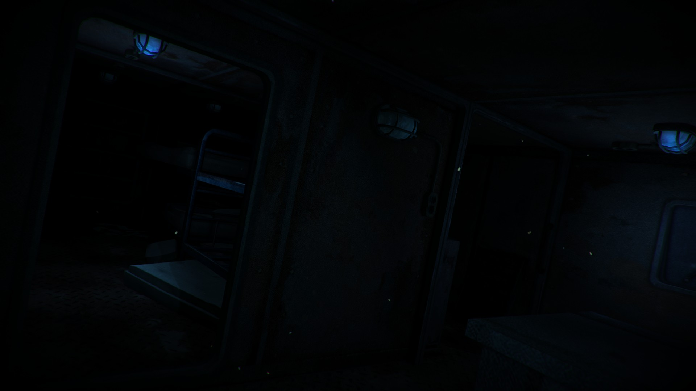
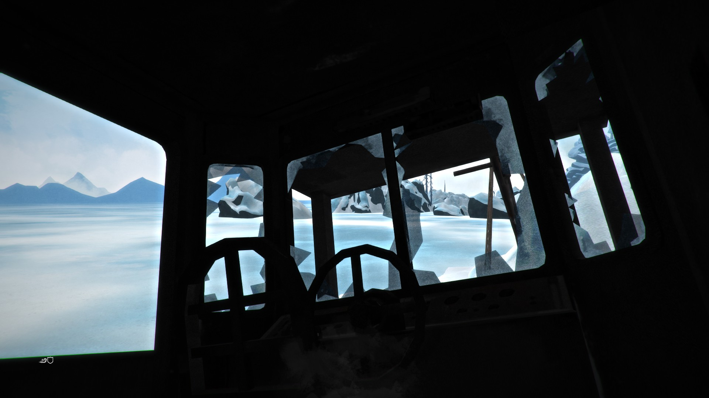
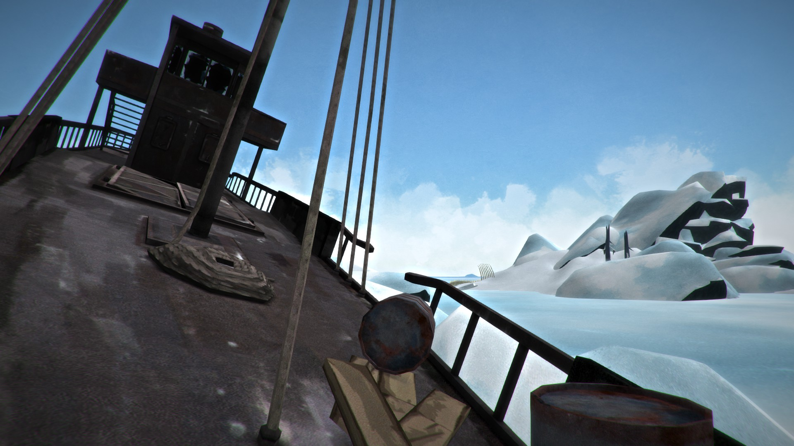
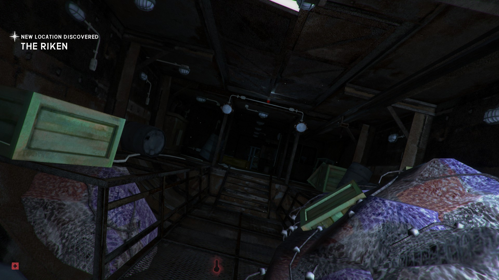
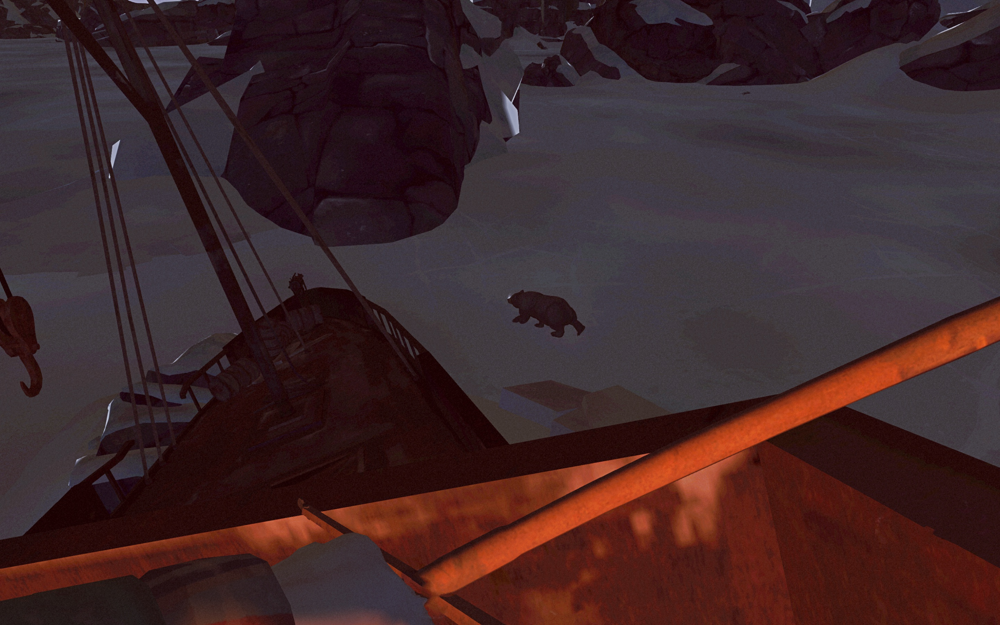
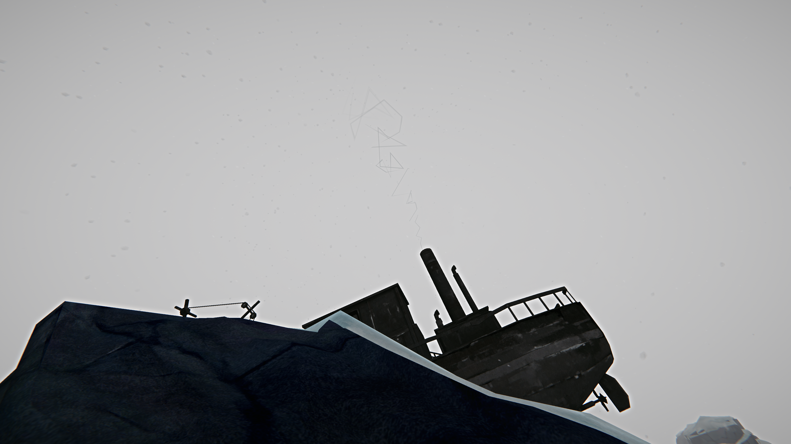

# The Riken

**Categories:** Indoor locations, Industrial locations, Locations, Locations in Desolation Point, Locations with a forge · **Source:** [Fandom](https://thelongdark.fandom.com/wiki/The_Riken)

**Contents**

- [Overview](#overview)
- [Interior](#interior)
- [Notable loot](#notable-loot)
- [Gallery](#gallery)

**The Riken**

[The Riken](../assets/The_Riken.jpg)

**Location**

[The Riken Location](../assets/The_Riken_Location.png)

**Region:** [Desolation Point](./Desolation%20Point.md)

**Description:** An old whaling ship

**General**

**Type:** Industrial

[Forge icon green](../assets/Forge_icon_green.png)

Has a forge

<!-- #Overview -->
​

<!-- #overview -->
## Overview

The Riken is a wrecked whaling ship located between the [Lonely Lighthouse](./Lonely%20Lighthouse.md), [Hibernia Processing](./Hibernia%20Processing.md) and the [Little Island](./Little%20Island.md) (Unmarked location). It sits on top of a rock sticking out of the ice and there is a huge hole in the bottom on one side, which allows access to the interior.

<!-- #Interior -->
​

<!-- #interior -->
## Interior

The ship has four decks: the boiler deck, upper deck, weather deck and bridge deck.

The boiler deck is dark but contains crates, metal shelves and a furnace &amp; forge at the end of the deck. The forge here is one of the only places in the game where you can conduct [forging](./Forge.md) (the other three are at the Field 31 in [Forsaken Airfield](./Forsaken%20Airfield.md), [Old Spence Family Homestead](./Old%20Spence%20Family%20Homestead.md) in [Forlorn Muskeg](./Forlorn%20Muskeg.md) and at [Maintenance Yard](./Maintenance%20Yard.md) in [Broken Railroad](./Broken%20Railroad.md)). There are some pieces of coal scattered about that can be useful for forging (but there is no [Heavy Hammer](./Heavy%20Hammer.md) which is required to forge). Firing up the forge causes smoke to be emitted from the ship's exhaust pipe on the outside.

The upper deck has bunk beds, a small kitchen to loot, and access to both the boiler deck and weather deck.

The weather deck features an inoperable harpoon gun, direct passage to/from the ice through some broken railings, and stairs to the bridge deck, where you can occasionally find useful items.

<!-- #notable_loot -->
​

<!-- #Notable_loot -->
​

<!-- #Notable_Loot -->
​

<!-- #notable-loot -->
## Notable loot

- [Storm Lantern](./Storm%20Lantern.md) (Shelves in the boiler deck)
- [Coal](./Coal.md)
- [Rifle Ammunition](./Rifle%20Ammunition.md) (Weather deck and next to shelves in the boiler deck)
- [Sewing Kit](./Sewing%20Kit.md)

<!-- #Gallery -->
​

<!-- #gallery -->
## Gallery

[Missing image: 305620\_20160916194519\_1.png]

_Harpoon gun_

