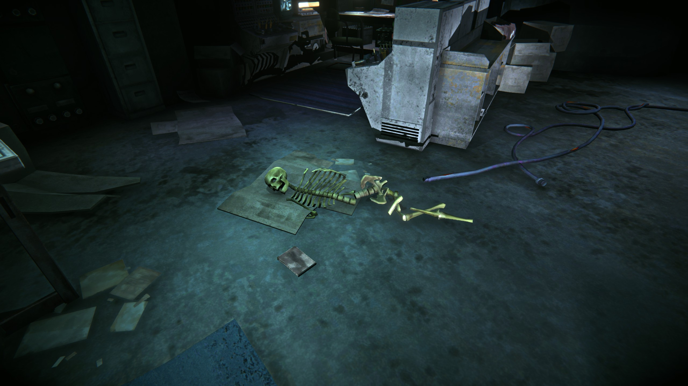

# The Security Chief's Remains

**The Security Chief's Remains**

| Property | Details |
| --- | --- |
|  |  / *The\_Security\_Chief's\_Remains\_icon.png* |
| Release | [5 December 2023](./The%20Long%20Dark%20%E2%80%94%20Changelog.md#2.25) |
| Wintermute | No |
| **Properties** |  |
| Item type | [Collectibles](./Collectibles.md)\|- |
| Stackable | No |
| Examine | Human bones, weathered by time and memory. |
| **Values** |  |
| Weight | 0 kg (0 lbs) |
| **Advanced data** |  |
| Item key | GAMEPLAY\_Tale2\_SecurityChiefBones |

**Spoiler Warning:****This page may contain spoilers from the [story](./Wintermute.md) of The Long Dark.**

**The Security Chief's Remains** is a [Collectibles](./Collectibles.md) found near the end of the [Buried Echoes](./Buried%20Echoes.md). They are the remains of [The Security Chief](./The%20Security%20Chief.md), Lena Vertasky, found in the Core of the [Langston Mine](./Langston%20Mine.md) next to [Rüdiger's Machine](./R%C3%BCdiger%27s%20Machine.md). They must be buried in the snow near [Enduring Waterfall](./Enduring%20Waterfall.md).

## Trivia

The skull is the same model rarely found around [Bear](./Bear.md) caves, along with other human/animal bones. The same skull model is found in other locations:

- [Boss's Settlement](./Boss%27s%20Settlement.md) near the lockbox containing [A Page From A Journal](./A%20Page%20From%20A%20Journal.md).
- a [Fishing Hut](./Fishing%20Hut.md) between [Jackrabbit Island](./Jackrabbit%20Island.md) and [Misanthrope's Homestead](./Misanthrope%27s%20Homestead.md) in [Coastal Highway](./Coastal%20Highway.md) and the fishing hut a [Crystal Lake](./Crystal%20Lake.md) in the [4 Days of Night Event](./4%20Days%20of%20Night%20Event.md) and [Escape the Darkwalker](./Escape%20the%20Darkwalker.md) Challenge.

*The Chief's Remains before they are picked up.*

## Update history

- UPDATE **5 December 2023 ([Update](./The%20Long%20Dark%20%E2%80%94%20Changelog.md#2.25)):**
  - Added to game.

**Lua execution error in Module:Navbox function navbox**

[ru:Останки начальника охраны](ru:%D0%9E%D1%81%D1%82%D0%B0%D0%BD%D0%BA%D0%B8_%D0%BD%D0%B0%D1%87%D0%B0%D0%BB%D1%8C%D0%BD%D0%B8%D0%BA%D0%B0_%D0%BE%D1%85%D1%80%D0%B0%D0%BD%D1%8B)
