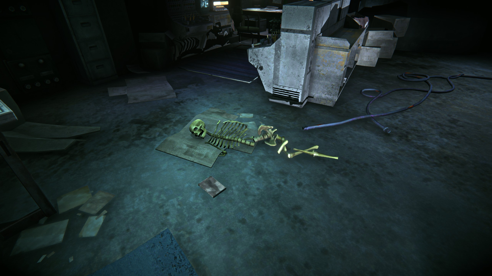

# The Security Chief

**Source:** [Fandom](https://thelongdark.fandom.com/wiki/The_Security_Chief)

**Contents**

- [Overview](#overview)
- [Signal Void](#signal-void)
- [Buried Echoes](#buried-echoes)
- [Last Horizon](#last-horizon)
- [Belongings](#belongings)
- [Clothing](#clothing)
- [Collectibles](#collectibles)
- [Gallery](#gallery)
- [Trivia](#trivia)

**Lena Vertasky**

[Security Chief's ID Badge icon](../assets/Security_Chief%27s_ID_Badge_icon.png)

**Release:** 2.03

**Date:** 5 December 2022

**Mission:** [Signal Void](./Signal%20Void.md) [Buried Echoes](./Buried%20Echoes.md) [Last Horizon](./Last%20Horizon.md)

**Biographical Information**

**Age:** Unknown

**Status:** Deceased

**Place of death:** [Langston Mine](./Langston%20Mine.md)

**Cause of death:** Mental degradation after exposure to The Machine

**Occupation:** Security Chief

**Physical Information**

**Sex:** Female

**Game Information**

**Equipment:** [Security Chief's Rifle Holster](./Security%20Chief%27s%20Rifle%20Holster.md) [Security Chief's ID Badge](./Security%20Chief%27s%20ID%20Badge.md)

**Voiced by:** Devon Busswood

**Spoiler Warning:****This page may contain spoilers from the [story](./Wintermute.md) of The Long Dark.**

> “__He’ll want the research. It shows some bizarre benefits, even if it’s come at a price. Rüdiger found what he was looking for.  
 He can keep it.__”
>
> — [The Security Chief](./The%20Security%20Chief.md)

**The Security Chief** (real name **Lena Vertasky**) is a major character in the [Tales from the Far Territory](./Tales%20from%20the%20Far%20Territory.md) storyline.

<!-- #Overview -->
​

<!-- #overview -->
## Overview

[Tales](./Tales.md) in [Survival Mode](./Survival%20Mode.md).

<!-- #last_horizon -->
​

<!-- #Last_Horizon -->
​

<!-- #Last_horizon -->
​

<!-- #last-horizon -->
## Last Horizon

Her keycard is found in a hidden room in [Bunker Omega](./Bunker%20Omega.md), likely left by the Foreman. [Foreman's Polaroid 4](./Foreman%27s%20Polaroid%204.md) also has her in a photo.

<!-- #Clothing -->
​

<!-- #clothing -->
### Clothing

-  [Security Chief's Rifle Holster](./Security%20Chief%27s%20Rifle%20Holster.md)

<!-- #Collectibles -->
​

<!-- #collectibles -->
### Collectibles

-  [Security Chief's Log 6](./Security%20Chief%27s%20Log%206.md)
-  [Security Chief's Log 14](./Security%20Chief%27s%20Log%2014.md)
-  [Security Chief's Log 23](./Security%20Chief%27s%20Log%2023.md)
-  [Security Chief's Log 29](./Security%20Chief%27s%20Log%2029.md)

<!-- #Gallery -->
​

<!-- #gallery -->
## Gallery

