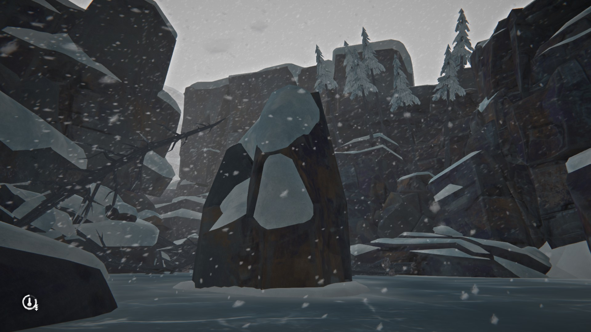
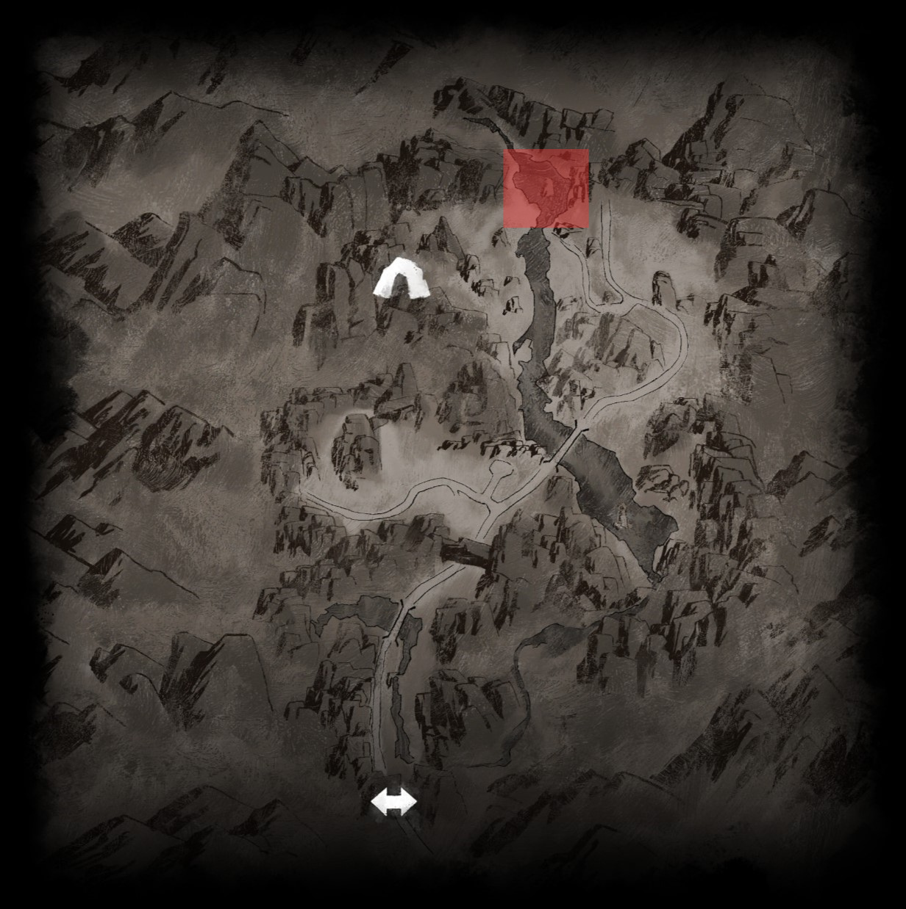

# The Toe

**The Toe**

| Property | Details |
| --- | --- |
|  |  / *Thetoe.jpg* |
| **Location** |  |
|  |  / *The\_Toe\_Location.png* |
| Region | [Keeper's Pass South](./Keeper%27s%20Pass%20South.md)\|- |
| Type | Landmark\|- |
