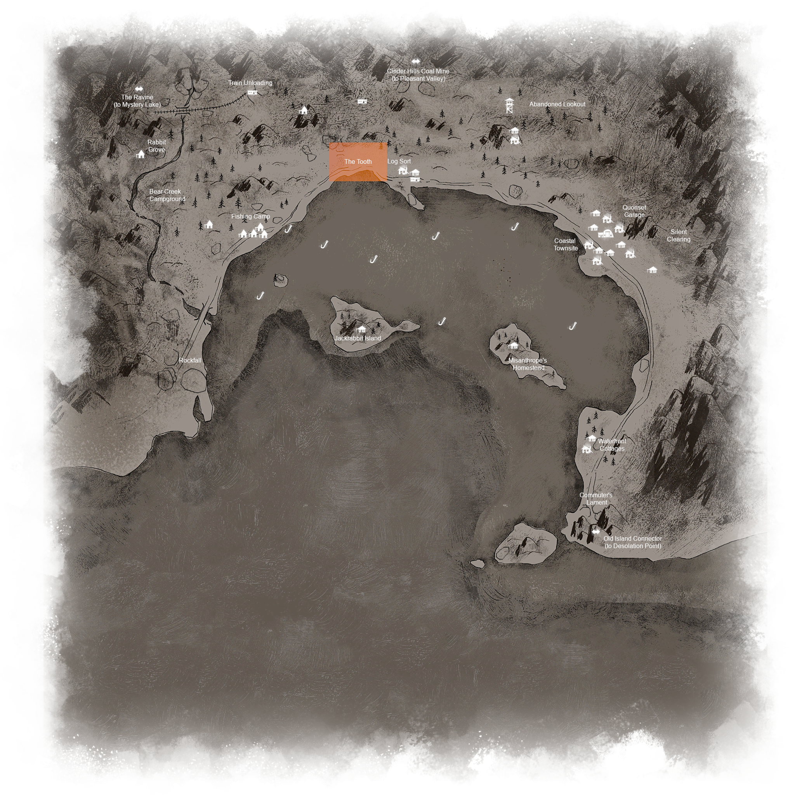
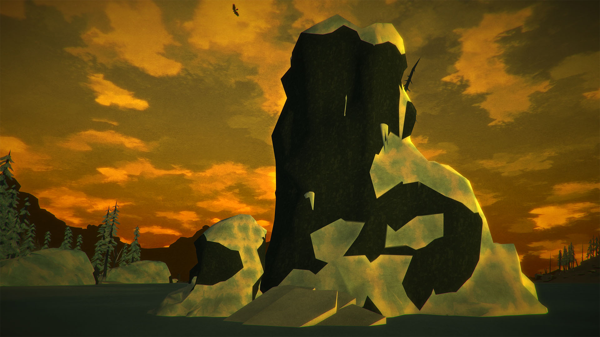
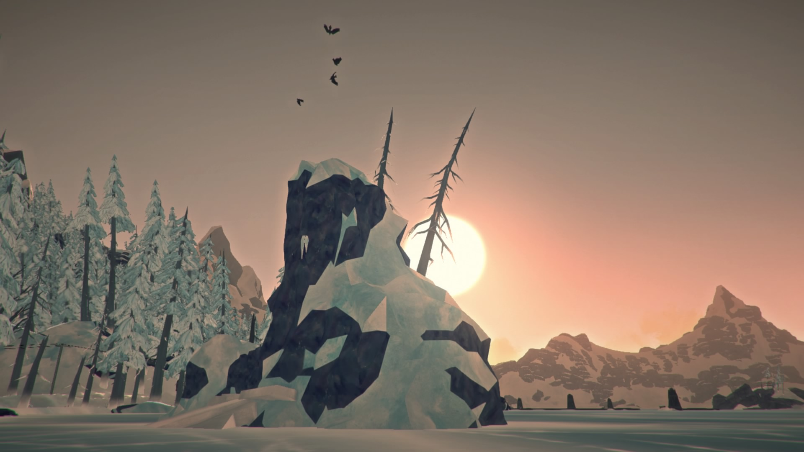

# The Tooth

**Categories:** Landmarks, Locations in Coastal Highway, Outdoor locations · **Source:** [Fandom](https://thelongdark.fandom.com/wiki/The_Tooth)

**The Tooth**

\[\[File: /  / _CH\_Tooth\_2.jpg_

250px\]\]

**Location**

_The\_Tooth\_map.png_

**Location:** West of [Log Sort](./Log%20Sort.md)

**General**

**Type:** Landmark

## Overview

The Tooth is located close to the region's coast, just west of [Log Sort](./Log%20Sort.md).

A [frozen corpse](./Frozen%20Corpse.md) can usually be found half-crushed under the rock.

## Gallery

_The Tooth as it appeared in 2015._

_CH\_Tooth\_1.jpg_

_CH\_Tooth\_3.jpg_
