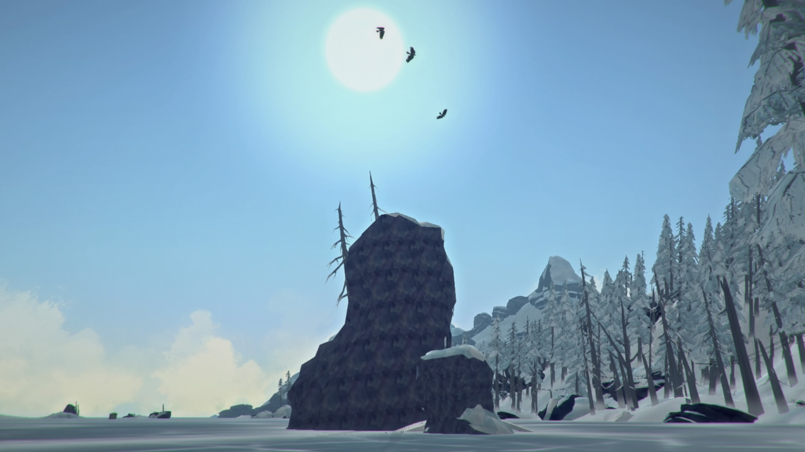

# The Tooth

**Categories:** Landmarks, Locations in Coastal Highway, Outdoor locations · **Source:** [Fandom](https://thelongdark.fandom.com/wiki/The_Tooth)

**The Tooth**

\[\[File:

250px\]\]

**Location**

Location

West of [Log Sort](./Log%20Sort.md)

**General**

Type

Landmark|-

## Overview

The Tooth is located close to the region's coast, just west of [Log Sort](./Log%20Sort.md).

A [frozen corpse](./Frozen%20Corpse.md) can usually be found half-crushed under the rock.

## Gallery

