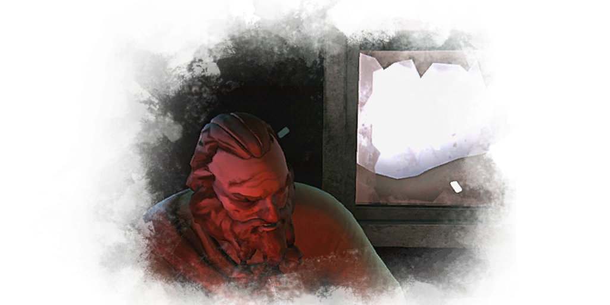

# The Wounded Trapper/Transcript

**Categories:** Episode 2 · **Source:** [Fandom](https://thelongdark.fandom.com/wiki/The_Wounded_Trapper%2FTranscript)

**Contents**

- [Transcript](#transcript)
- [Enter the abandoned Dam](#enter-the-abandoned-dam)
- [Find medical supplies for the old trapper. Find the radio parts the trapper needs.](#find-medical-supplies-for-the-old-trapper-find-the-radio-parts-the-trapper-needs)
- [Get the medical supplies back to the old trapper before he dies.](#get-the-medical-supplies-back-to-the-old-trapper-before-he-dies)
- [The Legend of the Spence family](#the-legend-of-the-spence-family)

**The Wounded Trapper/Transcript**

_Missions\_story\_ep2\_The\_Wounded\_Trapper.png_

**Episode:** [Episode 2](./Episode%202%20-%20Luminance%20Fugue.md)

**Previous:** [Paradise Lost/Transcript](./Paradise%20Lost%20%E2%80%94%20Transcript.md)

**Current:** The Wounded Trapper/Transcript

**Next:** [The Best Defense/Transcript](./The%20Best%20Defense%20%E2%80%94%20Transcript.md)

**Region:** [Mystery Lake](./Mystery%20Lake%20%28disambiguation%29.md)

**Characters:** [Will Mackenzie](./Will%20Mackenzie.md) / [Jeremiah](./Jeremiah.md) / [Old Bear](./Old%20Bear.md)

This is the mission transcript for mission 1 [The Wounded Trapper](./The%20Wounded%20Trapper.md) of [Episode 2: Luminance Fugue](./Episode%202%20-%20Luminance%20Fugue.md).

## Transcript

_A cutscene begins with [Will Mackenzie](./Will%20Mackenzie.md) in front of the Wood Stove of the [Trapper's Homestead](./Trapper%27s%20Homestead.md), warming his hands and body repeatedly for a good moment. His attention regarding the stove is broken when he hears a grunt come from the [man he rescued](./Jeremiah.md)._

Jeremiah: "Bear...damn it...not again...not the lights..."

_Mackenzie walks over the man, struggling in his sleep._

Mackenzie: "Hey."

_Mackenzie puts his right hand on the man's chest, who jerks in pain._

Jeremiah: "AHHH! Bear!"

_The wounded man springs to life, swatting it away as he jumps out of bed in terror screaming. He pushes Mackenzie to the floorboards as he awakens from his nightmare, looking around confused and in pain from his injuries._

Mackenzie: "Easy! Take it easy."

_The man frantically looks around, and slowly begins to calm down, looking at his rescuer while clutching his chest._

Jeremiah: "Who...are you?"

Mackenzie: "Name's Mackenzie. I'm the one who saved you from the bear."

Jeremiah: "You kill it?"

Mackenzie: "I don't think so...but I hit it. Maybe scared it away."

_The wounded man looks down and chuckles._

Jeremiah: "HA! Not the way you shoot."

Mackenzie: "Glad your memory's coming back."

Jeremiah: "Shit...he got me good this time."

_The man looks over his chest and chuckles at the damage the [Old Bear](./Old%20Bear.md) has done to him._

Mackenzie: "This time?"

Jeremiah: "Yeah. Me and the Old Bear go back a ways. There's...There's unfinished business between us."

Mackenzie: "I bandaged you up but you're in bad shape. Is there anywhere to get medical help?"

Jeremiah: "Wha...You mean like a hospital? Out here? Nah. Nothing like that."

_Mackenzie looks over and points at the radio on the Work Bench. The Trapper's [Hunting Rifle](./Hunting%20Rifle.md) lays on the bench in front of it._

Mackenzie: "I see you have a radio. Can we call for help?"

Jeremiah: "No...Radio's been dead for the past few days. I can't raise any of the usual channels. Not sure why."

Mackenzie: "Well, you'll need stronger meds to avoid infection, and for the pain."

Jeremiah: "You some kind of doctor?"

Mackenzie: "No. But, I've been around doctors enough to know you'll be in trouble soon, unless you get some better help than I can give you."

Jeremiah: "Yeah...Right. Well...Closest help is probably in Milton, back the way you came."

Mackenzie: "Err...there's nobody left to help you there. The town's pretty much deserted. There was a fire...and..."

Jeremiah: "Damn. Next town is days away. I'm wrecked, but if you leave now you might be able to..."

Mackenzie: "You won't last days like this. Must be another way."

Jeremiah: "There's...someone who might help. But...we can only reach them by radio."

_Mackenzie looks over at the radio again._

Mackenzie: "So we're back to where we started. There's gotta be somewhere nearby that might have medical supplies, or another radio we can use?"

Jeremiah: "You might find some comms gear, or parts, in the old Carter Dam. It's...probably ancient stuff though. Place's been abandoned for years. Used to have a first aid room. Might still be some old meds there too. Something strong enough to maybe numb this pain."

Mackenzie: "Hang in there, I'll be back as soon as I can."

_Mackenzie begins walking off, before the Trapper stops him and he turns around._

Jeremiah: "Wait...wait. The Old Bear. He's still out there. He'll be wanting to finish the job."

Mackenzie: "Ok..."

Jeremiah: "Here...Take my rifle. You won't kill him but you might...scare him off again."

Mackenzie: "Right."

Jeremiah: "Watch out....Dam....unstable."

Mackenzie: "Wai...what? What do you mean unstable?"

_The Trapper begins to wince in pain, before lying sideways on his pillow and fainting from the pain. Mackenzie gently shakes his arm to see if he will wake up._

Mackenzie: "Damn it. He's passed out."

_Mackenzie looks away, as he begins his journey, and the cutscene ends._

CHAPTER ONE

THE WOUNDED TRAPPER.

## Enter the abandoned Dam

_Mackenzie takes the Trapper's Hunting Rifle, which is in less than ideal condition, and any other supplies in the cabin. As he reaches the door, a map showing the layout of the region catches his eye. Mackenzie makes note of the route to the Dam and leaves the cabin._

Mackenzie: "That trapper's my key to getting out of here. He'd better not die on me."

_If the player attempts to enter [The Ravine](./The%20Ravine.md) by the Carter Staging Area, [Forlorn Muskeg](./Forlorn%20Muskeg.md) by the [Rail Tunnel](./Rail%20Tunnel.md), or re-enter [Mountain Town](./Mountain%20Town.md) by Trapper's Cabin, Mackenzie will say:_

Mackenzie: "That's not the right way."

_Otherwise, Mackenzie wastes no time making his way to the Dam, walking over the hills and then taking the tracks to reach his destination._

Mackenzie: "Carter Dam...hmm. This place has seen better days."

_Mackenzie approaches the gate, only to find it locked."_

Mackenzie: "Locked up tight. Must be a key or something around here..."

_Mackenzie sees two trailers nearby, and enters on. The [Carter Hydro Staging Area Gate Key](./Carter%20Hydro%20Staging%20Area%20Gate%20Key.md) is found on a table with a [Breyerhouse Crew Winter Warning](./Breyerhouse%20Crew%20Winter%20Warning.md), and the pilot returns to unlock the gate. He opens the gate and walks inside, only to hear a roar behind him. The pilot turns around to see the Old Bear, with 2 arrows in his back, slowly walking up to him, before it stands up on two legs and roars._

Mackenzie: "Holy shit!!!"

_The Old Bear charges, and Mackenzie scrambles to close the gate._

Mackenzie: "AHH!!!"

_The Old Bear collides with the gate as it closes, pushing Mackenzie to the ground. He looks up to see the bear staring at him, as it roars and the screen fades to black. The player is given control again after some time has passed, with the bear presumably having walked off._

Mackenzie: "Unfinished business with the bear, he said."

_Mackenzie then walks up to the front doors of the Carter Hydro Dam and steps inside._

## Find medical supplies for the old trapper. Find the radio parts the trapper needs.

Mackenzie: "Hello? Anyone here? This place looks like it's been empty for awhile."

_Mackenzie ducks under some girders as he leaves the main lobby._

Mackenzie: "Seems like the quakes did some damage here. Must be what the old guy meant about "unstable"."

_He spots a heavy door ahead of him with the words "CONTROL ROOM" on it and tries to open it. The handle does not budge, and he looks at the nearby Keypad to his right. He presses some buttons, but they do nothing._

Mackenzie: "Looks like this thing isn't opening unless I can get the power working again. But that's a problem for later. I have to get those radio parts."

- Note, if the player gets the [Radio Parts](./Radio%20Parts.md) first and then interacts with the Keypad, Mackenzie will omit the last two lines.

_Mackenzie enters a nearby room with an elevator, but the "Call Elevator" buttons do not work either. He turns around and sees a stairwell downstairs, but it is blocked by a locked gate. He turns around and finds a bathroom with a Frozen Corpse inside, and a Flare Gun kit._

Mackenzie: "What the..."

_Mackenzie reluctantly frisks the body, and finds an [Admin Office Key](./Admin%20Office%20Key.md), as well as a [Forest Talker Dam Note](./Forest%20Talker%20Dam%20Note.md). Mackenzie finds another stairwell near the bathroom, and heads upstairs to an office space, and spots a [Medical Locker](./Medical%20Locker.md) under a sign labeled "AIDS STATION"._

Mackenzie: "Aid Station. That sounds like what the trapper needs."

_He finds it locked, and walks to the nearby office and unlocks it with the Admin Office Key. He finds the [Aid Station Medical Locker Key](./Aid%20Station%20Medical%20Locker%20Key.md) and [Elevator Maintenance Note](./Elevator%20Maintenance%20Note.md), and takes both. He_ _leaves the office, and spots a Work Bench with a radio and several parts._

Mackenzie: "Must be something we can use to fix the shortwave."

_He picks up some radio parts, then returns to unlock the Medical Locker, finding [Carter Hydro Medical Supplies](./Carter%20Hydro%20Medical%20Supplies.md) inside._

Mackenzie: "Industrial-strength antibiotics and... \*very\* strong painkillers. Dangerous...you could get hooked on this stuff. Let's hope we don't need it."

## Get the medical supplies back to the old trapper before he dies.

_With medical supplies in tow, Mackenzie leaves the dam and returns to the Staging Area._

Mackenzie: "I'd better check in on that old Trapper."

_He and makes his way back to the Trapper's Cabin as a blizzard rages on, and eventually reaches the front door. Mackenzie walks up to the old trapper, and injects his right arm with a syringe filled with antibiotics. This causes the trapper to instantly wake up, as he grabs his sides._

Jeremiah: "Ah...shit. That smarts."

Mackenzie: "Take it easy. You're pretty banged up and probably a bit delirious too. I just gave you a shot of some heavy antibiotics. Might feel funny for a while. But it'll help, and you're gonna need some time to recover."

Jeremiah: "Time? We don't have time. We need to get a message out. It's important."

Mackenzie: "Message? You mean...to your friend, asking for medical help?"

Jeremiah: "Nevermind that. Help me up so I can look at the radio. See if the parts you brought back are any good."

_Mackenzie grabs the trapper's arm as the screen fades to black. When it returns, Mackenzie is by the Wood Stove again. He peers over his right shoulder, seeing the trapper fixing the radio at the Work Bench._

Mackenzie: "That's a military shortwave, isn't it?"

Jeremiah: "Maybe."

Mackenzie: "I know a bit about radios. That's not any surplus I've ever seen..."

_The trapper moves back and swears._

Jeremiah: "Damn it! Well...the parts look fine, so whatever's wrong with the radio goes deeper than that."

Mackenzie: "What could it be?"

Jeremiah: "Something to do with the power. Fuses? Transformers maybe. We have bigger problems to deal with first. That bear's out there. Hunting us. He's a smart old bastard. He'll keep us from getting out, getting supplies, finding help. Eventually...he'll either get us, or starve us out."

_The trapper clutches his chest in pain and clenches the Work Bench._

Jeremiah: "Ugh...I gotta lay down. Help me back to the bed."

_Mackenzie gets up and reaches for Jeremiah, as the screen fades to black again. It fades in with Jeremiah on the bed, holding his chest, staring at Mackenzie. Dialogue options then appear for the player._

**Blue Options**

- BEAR

Mackenzie: "What's this unfinished business between you and the bear?"

Jeremiah: "Ah...me and the Old Bear. Every time we meet, we make a little trade."

Mackenzie: "And what do you trade?"

Jeremiah: "Each other's blood, mostly."

Mackenzie: "Sounds like a losing proposition."

Jeremiah: "Oh, I'm sure it will be. For one of us."

- woman

Mackenzie: "The main reason I'm out here is...I'm looking for someone."

Jeremiah: "Bah...won't find too many people out here. That's kind of the whole point."

Mackenzie: "This is someone...important to me. A woman. She may have passed through her a few days ago. She might have been injured."

Jeremiah: "What makes you think she came through here?"

Mackenzie: "She passed through the tunnel leaving Milton, but then...I'm not sure."

Jeremiah: "Well...the roads from Milton don't lead this way. Wherever she's heading, you'll have to cross the mountains to find her. Not an easy path, even for the most experienced outdoorsman."

Mackenzie: "I'll do whatever it takes."

Jeremiah: "You won't get far with that bear on the prowl. What we need is to get my radio up and running, so we can find out what the hell is going on. Maybe someone out there has seen your friend."

- PERSERVERANCE MILLS

Mackenzie: "The woman I'm looking for...she might be on her way to a place called [Perseverance Mills](./Perseverance%20Mills.md). You know it?"

Jeremiah: "Shit-nothing town, north part of the island?"

Mackenzie: "Sounds about right."

Jeremiah: "Yeah...I know it."

Mackenzie: "We were on our way there, my passenger and I, when we crashed. I need to find a way to get there, or...contact her. See if she's alright."

Jeremiah: "You sure she's alive?"

Mackenzie: "Yeah...I'm sure."

Jeremiah: "Well, normally I'd make calls on the old shortwave. Whole area's been damn quiet since those lights in the sky. Even the wildlife's been acting strange. But I might have an idea..."

- IDEA?

Mackenzie: "You said you had an idea? What do you have in mind?"

Jeremiah: "Well...it's a long shot. But I may know how we can find out about your friend."

Mackenzie: "I'm listening."

Jeremiah: "This shortwave. I can use it to keep an ear open for what's going on."

Mackenzie: "So how do we get the radio working?"

Jeremiah: "No reason I can see why it shouldn't be working."

Mackenzie: "Well...what about...more parts? Or...another radio?"

Jeremiah: "We might find another radio. But I think I have a better idea. Problem is...its no use with the Old Bear out there. Your path to a working radio - - and our survival - - is through that bear. We have to find a way to deal with him first."

**White Options**

- DAM

Mackenzie: "The dam was pretty busted up, like you said."

Jeremiah: "Yeah...the place was cracked open by the quake years ago, and never recovered. It was already half-dead at that time."

Mackenzie: "Meaning?"

Jeremiah: "Dam dates back to the 60s. Industrialist from the mainland wanted to use it to power a mining town he was planning to build. But, bottom fell out of the price of coal and he had to abandon those plans. Some fool tried to get it running again in the 80s but then the Forest Talkers got involved and that was the end of it. Pretty sure the quakes finished the job once and for all."

- FOREST TALKERS

Mackenzie: "So...who are the "forest talkers"?"

Jeremiah: "Eco-terrorists. Activists, some call them. Depends on who you talk to I guess."

Mackenzie: "Why are they out here?"

Jeremiah: "Well...they've been active for years. They come and go. Mostly here to throw a wrench in the works for a variety of resource projects -- mining and forestry mainly. They want Great Bear to remain a "pristine wilderness"."

Mackenzie: "You don't sound like you agree."

Jeremiah: "Oh! I have no a love for industry. But this is the way of the world. You have something they want -- they take it. Nothing much you can do to stop it."

Mackenzie: "Well, judging by what I saw in the Dam, I'd say the Forest Talkers are still active."

Jeremiah: "Well, that's good news for you. Keep your eyes open for supply caches they might have left behind.

- SURROUNDINGS

Mackenzie: "Can you tell me anything about where we are?"

Jeremiah: "Well...this whole area takes its name from Mystery Lake, nearby. It's a kind of wilderness preserve, though you wouldn't know it from the logging trucks. Not much around there apart from some lake cabins that'd be locked up for the season. You've already seen the Dam. Railroad passes through the area. Trains come through once in a while. Fewer every year. The whole area's mostly dead, most of the year.

Mackenzie: "You sound like you like it that way."

_Jeremiah winces through the pain and smiles._

Jeremiah: "I sure do."

Mackenzie: "So, no other people living out here?"

Jeremiah: "You gotta understand. The Collapse destroyed Great Bear. There's nothing here to stay for. You meet anyone out here, chances are they're hiding from something. Or someone."

Mackenzie: "And you? Why are you here?"

Jeremiah: "I have my reasons."

- STRANGE

Mackenzie: "What do you mean - - the wildlife's acting strange?"

Jeremiah: "You live out here long enough, you get a sense for the patterns in nature. Right now, the patterns are broken. Critters aren't behaving the way they should. It's like they're spooked, or something. No...Not spooked. But...changed, somehow. Best way I can say it is - - things don't feel right.

## The Legend of the Spence family

_The final conversation option is a blue dialogue option, which ends the chapter after it finishes._

- I AM READY

Mackenzie: "Ok...so we have to ''deal" with the bear. But you're half-dead and rifle shots don't seem to do much, so..."

Jeremiah: "That's because...the Old Bear's...he's special. I've been hunting and trapping for years, and I've shot a lot of bears, but I've never encountered anything quite like him. Special bear like that needs special magic to bring him down."

Mackenzie: "Uhh...magic?"

Jeremiah: "Don't worry...I'm not delirious. I don't mean literal magic."

_Mackenzie grabs some firewood off the floor and turns to face Jeremiah._

Jeremiah: "But we need the old knowledge. The old ways."

Mackenzie: "What do you have in mind?"

_Mackenzie turns to the Wood Stove and opens the fire cover, then tosses the firewood inside and sits back down in his seat._

Jeremiah: "There's an old story. Local legend maybe...about one of the original settlers of this place. Spence. The story goes something like this."

_Mackenzie turns and gazes into the Wood Stove's fire, as animated figures appear in the fire as Jeremiah continues to explain the old story._

_The fire forms 3 figures; a man, a woman, and a child. The fire changes to show a bear attacking the man and woman from before, then changing to show the woman in bed. A corpse is shown, then a Spence in a fur coat. The next shot is Spence holding a rifle, then a group of armed men aiming their rifles. The next scene is of Spence's wife in bed, then of Spence holding the Bear Spear._

Jeremiah: "Spence shows up and sets his claim shanty, family in tow. For generations, the family had been traders with the Hudson's Bay Company. Old "voyageur" stock, they say. Hard people. Survivors."

"One day a bear shows up and menaces the homestead. Spence takes a shot at the bear but it doesn't seem to do anything. Bear wanders off, but Spence's wife...she takes a turn. Slips into fever. For days. Delirious. She screams about the bear. Local doctor can't do a thing for her. Neither can the priest."

"Week later, hired hand goes missing. They find him. Just a body. Ravaged. Spence fears for his wife and kids. He's convinced that evil bear spirit is trying to kill them. Revenge for...some slight in the past maybe? Something in the family history. Spence gets some men together for a hunting party. They go out into the muskeg and track something big, for days. Eventually corner it. It's a big sonofabitch. Biggest bear they'd ever seen. Mankiller."

"Story goes, they emptied their rifles into the bear and it just walks away. Like it's made of stone. They call it the "demon bear" after that. Wife's dying now. Spence believes the bear's evil spirit is killing her...eating her soul. He can't get anyone to join him on another hunting party. They know rifles don't work. So he forges a spear - - like a boar spear, but bigger. From some Hudson's Bay trapper's wisdom, apparently."

"He goes out, into the muskeg. Disappears for days. Then one morning, the wife's fever breaks, but nothing from Spence. Some men go out looking for him. They find him, half dead. Blood all over him. Body torn almost in two. The bear's work. The last thing he says is, "spear stole the bear's soul. My wife is free now." And then he's gone."

_Mackenzie looks away from the fire and back to Jeremiah again._

Mackenzie: "So...did he kill the bear?"

Jeremiah: "Nobody knows. Never found a carcass. They buried Spence, took the bear spear and hung it over the mantlepiece at Spence homestead. Never saw that bear, or any other, again. Years later, after the Spence family faded into obscurity, wealthy land baron bought the spear to hang in his hunting lodge. Just so he could tell that story, I imagine."

Mackenzie: "So, do you...believe it? The story of the demon bear? And the spear stealing its soul?"

Jeremiah: "Wha? No! Of course not. I might spend all my time alone in the wilderness, but I'm not that crazy. But the old stories sometimes have truths hidden in them. Spence might have been superstitious but he had the right idea. Ten inches of cold hard steel might do what a bullet can't. I'm convinced -- a spear's the way to kill that bear. And you need to get Spence's bear-killing spear if we're going to survive the winter. The old hunting lodge is still there. A couple days journey South. Follow the tracks the other way, through the Muskeg, and you'll find it. If the spear's there...get it. It might be our best hope."

Mackenzie: "And the radio?"

Jeremiah: "You deal with the bear and let me worry about the radio."

_Jeremiah begins coughing and clutching his chest._

Jeremiah: "Now...let me rest. Good luck out there. Watch out for our "demon"."

Mackenzie: "Right."

_Mackenzie gets up and the chapter ends._
