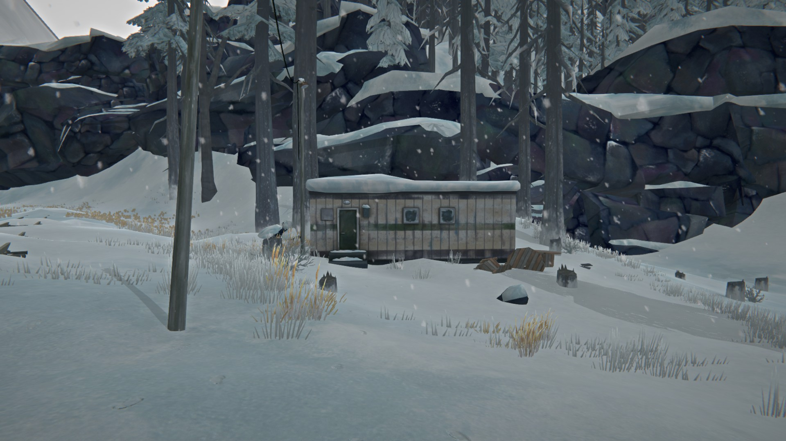
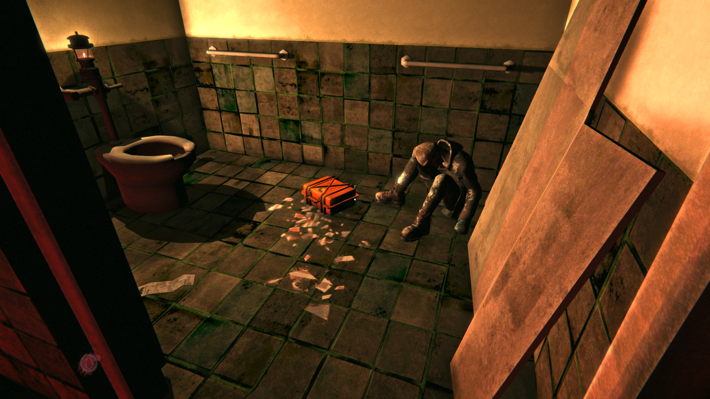
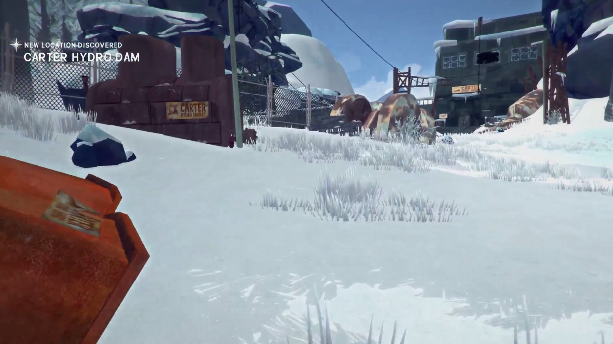

# The Wounded Trapper

**Source:** [Fandom](https://thelongdark.fandom.com/wiki/The_Wounded_Trapper)

**The Wounded Trapper**

| Property | Details |
| --- | --- |
|  | [Missions story ep2 The Wounded Trapper](../assets/Missions_story_ep2_The_Wounded_Trapper.png) |
| Episode |  |
| **Missions** |  |
| Previous | [Paradise Lost](./Paradise%20Lost.md) |
| Current | The Wounded Trapper |
| Next | [The Best Defense](./The%20Best%20Defense.md) |
| Region | [Mystery Lake](./Mystery%20Lake%20%28disambiguation%29.md) |
| Characters | [Will Mackenzie](./Will%20Mackenzie.md) / [Jeremiah](./Jeremiah.md) / [Old Bear](./Old%20Bear.md) |

**Template:spoiler**

> “**Mackenzie rescues an Old Trapper, whose knowledge of Great Bear Island, as well his shortwave radio, might be the key to finding Astrid.**”
>
> — In-game description

**The Wounded Trapper** is the first mission in [Episode 2](./Episode%202%20-%20Luminance%20Fugue.md). In this mission, [Mackenzie](./Will%20Mackenzie.md) must help find medical supplies and radio parts for [Jeremiah](./Jeremiah.md) following his encounter with the [Old Bear](./Old%20Bear.md).

## Objectives

- Enter the [abandoned dam](./Carter%20Hydro%20Dam.md).
- Find medical supplies for the old trapper.
- Find the radio parts the trapper needs.
- Get the medical supplies back to the old trapper before he dies.

## Walkthrough

| Mission details | Mission details |
| --- | --- |
| Start location | [Trapper's Homestead](./Trapper%27s%20Homestead.md) |
| Significant locations | [Carter Hydro Dam](./Carter%20Hydro%20Dam.md) |

The mission starts with a cutscene in which Jeremiah and Mackenzie discuss the need to find medical supplies and radio parts.

_The trailer containing the key to the staging area_ Follow the map to the [Carter Hydro Dam](./Carter%20Hydro%20Dam.md) on the other side of [Mystery Lake](./Mystery%20Lake%20%28region%29.md). The gate to the staging area will be locked. The key is found on the desk in a nearby trailer. On a shelf in the same trailer is the Medicinal Plants of Great Bear skill book, if it had not been picked up in Episode 1. When unlocking the gate, a cutscene will begin in which the [Old Bear](./Old%20Bear.md) tries to attack Mackenzie, but Mackenzie closes the gate to stop its charge. Mackenzie is thrown to the ground and knocked unconscious. The player will be freezing when he comes to.

_The corpse with the office key and distress pistol_ Enter the Carter Hydro Dam. In the bathroom on the first floor is a [corpse](./Frozen%20Corpse.md) with a key to the admin office and a [Forest Talker](./Forest%20Talkers.md) note. An emergency case with a [Distress Pistol](./Distress%20Pistol.md) lies on the floor.

Go up the stairs to the second floor. On a desk near the elevator are some radio parts the player will need to pick up. Open the door to the admin office. On the desk is the key to the medical supply locker. The medical supply locker is a red locker against the wall in the second floor office space. Opening the locker will yield a medical supply kit.

On a desk in the office space is a note to find a supply cache in [Alan's Cave](./Alan%27s%20Cave.md).

Return to Jeremiah. The mission ends with a cutscene in which Jeremiah attempts to fix the shortwave radio in his cabin using the radio parts Mackenzie brought back from the dam, while telling the story of the [Bear Spear](./Bear%20Spear.md).

## Gallery

_The dam bathroom, including a corpse with the [Admin Office Key](./Admin%20Office%20Key.md) and the [Distress Pistol](./Distress%20Pistol.md) case_
