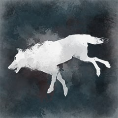

# There Will Be Blood

<table class="infobox">
<caption>There Will Be Blood</caption>
<colgroup>
<col style="width: 50%" />
<col style="width: 50%" />
</colgroup>
<tbody>
<tr>
<td colspan="2"><figure>

<figcaption>There_Will_Be_Blood_icon.png</figcaption>
</figure></td>
</tr>
<tr>
<td>
Description
</td>
<td>
Defeat your first Timberwolf pack.
</td>
</tr>
</tbody>
</table>

**There Will Be Blood** is a <a href="./Wintermute.md" class="wikilink" title="Wintermute">Wintermute</a> <a href="./The%20Long%20Dark%20%E2%80%94%20Achievements.md" class="wikilink" title="achievement">achievement</a> in <a href="./Episode%203%20-%20Crossroads%20Elegy.md" class="wikilink" title="Episode 3: Crossroads Elegy">Episode 3: Crossroads Elegy</a> of *<a href="./The%20Long%20Dark.md" class="wikilink" title="The Long Dark">The Long Dark</a>*.

## Guide

This achievement is earned after defeating your first <a href="./Timberwolf.md" class="wikilink" title="Timberwolf">Timberwolf</a> pack. Simply cause the pack Morale to fully deplete, either by scaring away or fully killing off most or all of the wolf pack, and the achievement is unlocked. This achievement can be earned as early as <a href="./Fallen%20Star.md" class="wikilink" title="Fallen Star">Fallen Star</a>, after leaving the <a href="./Community%20Hall.md" class="wikilink" title="Community Hall">Community Hall</a> in <a href="./Thomson%27s%20Crossing.md" class="wikilink" title="Thomson&#39;s Crossing">Thomson's Crossing</a>.

## Game History

- UPDATE **22 October 2019 (<a href="./The%20Long%20Dark%20%E2%80%94%20Changelog.md#1.60" class="wikilink" title="Update">Update</a>):**
  - Added to game.

**Lua execution error in Module:Navbox function navbox**

