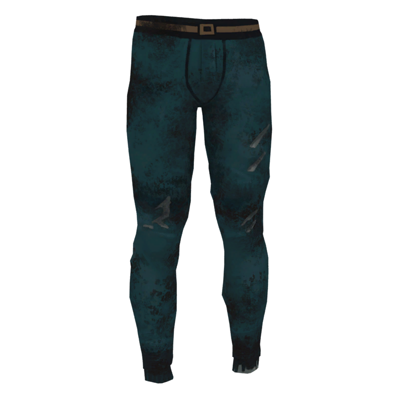

# Thermal Underwear

**Categories:** Clothing, Pages with update history · **Source:** [Fandom](https://thelongdark.fandom.com/wiki/Thermal_Underwear)

**Thermal Underwear**

| Property | Details |
| --- | --- |
|  | [Thermal Underwear icon](../assets/Thermal_Underwear_icon.png) |
| **General** |  |
| Item Type | Clothing |
| Wintermute | No |
| Clothing Slot | Inner legs |
| **Statistics** |  |
| Weight | [Weight icon](../assets/Weight_icon.png)0.25 kg(0.55 lbs) |
| Warmth bonus | [Temp icon](../assets/Temp_icon.png)1.0 °C(1.8 °F) |
| Windproof bonus | [Windproofness icon](../assets/Windproofness_icon.png)0.0 °C(0 °F) |
| Waterproof bonus | [Waterproofness icon](../assets/Waterproofness_icon.png)20% |
| Protection | [Protection icon](../assets/Protection_icon.png)0% |
| Mobility | [Mobility icon](../assets/Mobility_icon.png)0% |
| Harvest | 1 × [Cloth](./Cloth.md) / 20 minutes |
| Repair | 1 × [Cloth](./Cloth.md) / 30 minutes / 40% condition |

> “**Stretchy cotton underwear designed to fit under regular pants.**”
>
> — In-game description

**Thermal Underwear** is a type of [clothing](./Clothing.md) in _The Long Dark_.

## Overview

Light and a relatively common starting item, they offer a small warmth bonus and are inferior to the [Wool Longjohns](./Wool%20Longjohns.md) (the only other Inner Legs clothing).

Thermal Underwear are the only available Inner Legs clothing in Interloper mode.

## Gallery

## Update history

- UPDATE **19 December 2016 ([Update](./The%20Long%20Dark%20%E2%80%94%20Early%20Access%20Changelog.md#0.386)):**
  - Renamed from _Cotton Long Underwear_ to _Thermal Underwear_
