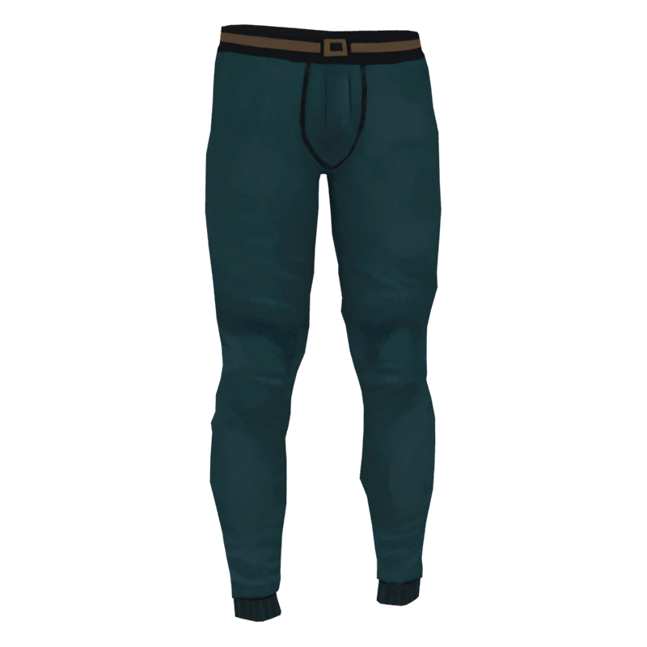

# Thermal Underwear

**Thermal Underwear**

| Property | Details |
| --- | --- |
|  |  / *Thermal\_Underwear\_icon.png* |
| **General** |  |
| Item Type | Clothing\|- |
| Clothing Slot | Inner legs |
| **Statistics** |  |
| Weight | 0.25 kg(0.55 lbs) |
| Warmth bonus | 1.0 °C(1.8 °F) |
| Windproof bonus | 0.0 °C(0 °F) |
| Waterproof bonus | 20% |
| Protection | 0% |
| Mobility | 0% |
| Harvest | 1 × [Cloth](./Cloth.md) / 20 minutes |
| Repair | 1 × [Cloth](./Cloth.md) / 30 minutes / 40% condition |

> “**Stretchy cotton underwear designed to fit under regular pants.**”
>
> — In-game description

**Thermal Underwear** is a type of [clothing](./Clothing.md) in *The Long Dark*.

## Overview

Light and a relatively common starting item, they offer a small warmth bonus and are inferior to the [Wool Longjohns](./Wool%20Longjohns.md) (the only other Inner Legs clothing).

Thermal Underwear are the only available Inner Legs clothing in Interloper mode.

## Gallery

| Column 1 | Column 2 | Column 3 |
| --- | --- | --- |
|  / *Old model.* |  / *Clothing model icon* |  / *Clothing model icon damaged* |

## Update history

- UPDATE **19 December 2016 ([Update](./The%20Long%20Dark%20%E2%80%94%20Early%20Access%20Changelog.md#0.386)):**
  - Renamed from *Cotton Long Underwear* to *Thermal Underwear*

**Lua execution error in Module:Navbox function navbox** [ru:Термобелье](ru:%D0%A2%D0%B5%D1%80%D0%BC%D0%BE%D0%B1%D0%B5%D0%BB%D1%8C%D0%B5)
