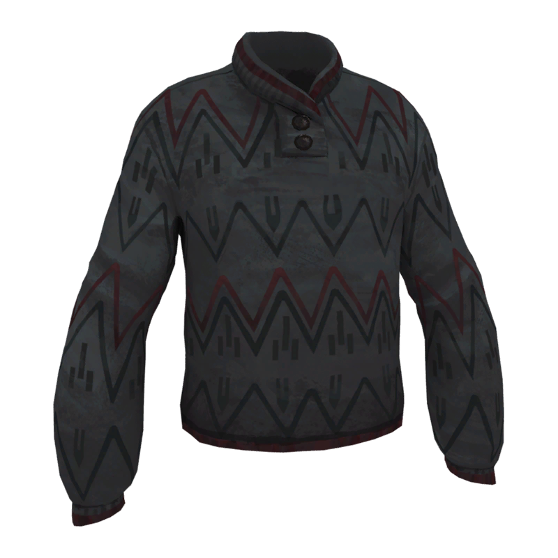
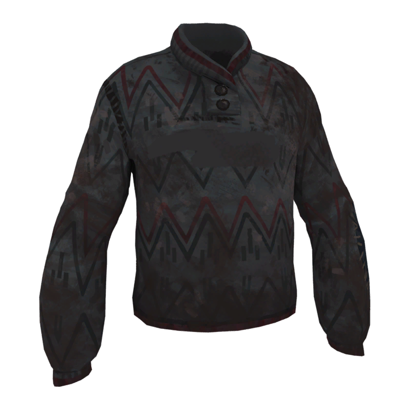

# Thick Wool Sweater

**Thick Wool Sweater**

| Property | Details |
| --- | --- |
|  |  / *Thick\_Wool\_Sweater\_icon.png* |
| **General** |  |
| Item Type | Clothing\|- |
| Clothing Slot | Inner torso |
| **Statistics** |  |
| Weight | 0.50 kg(1.1 lbs) |
| Warmth bonus | 1.5 °C(2.7 °F) |
| Windproof bonus | 1.0 °C(1.8 °F) |
| Waterproof bonus | 30% |
| Protection | 3% |
| Mobility | -1% |
| Harvest | 1 × [Cloth](./Cloth.md) / 45 minutes |
| Repair | 1 × [Cloth](./Cloth.md) / 60 minutes / 30% condition |

> “**Thick wool sweater. Will keep your core warm, even when wet.**”
>
> — In-game description

The **Thick Wool Sweater** is a type of [clothing](./Clothing.md) in *[The Long Dark](./The%20Long%20Dark.md)*.

## Overview

One of the warmest shirts in the game, the **Thick Wool Sweater** is also relatively light and offers some wind protection and water resistance if worn as an outer layer. The thickness of the sweater offers a small amount of defense against physical damage but also restricts mobility somewhat.

## Gallery

| Column 1 | Column 2 | Column 3 |
| --- | --- | --- |
|  / *Clothing model icon* |  / *Clothing model icon damaged* |  / *Old model.* |

## Update history

- UPDATE **19 December 2016 ([Update](./The%20Long%20Dark%20%E2%80%94%20Early%20Access%20Changelog.md#0.386)):**
  - Renamed from *Heavy Wool Sweater* to *Thick Wool Sweater*

**Lua execution error in Module:Navbox function navbox** [ru:Толстый шерстяной свитер](ru:%D0%A2%D0%BE%D0%BB%D1%81%D1%82%D1%8B%D0%B9_%D1%88%D0%B5%D1%80%D1%81%D1%82%D1%8F%D0%BD%D0%BE%D0%B9_%D1%81%D0%B2%D0%B8%D1%82%D0%B5%D1%80)
