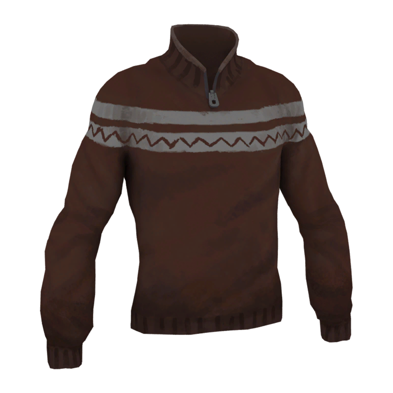
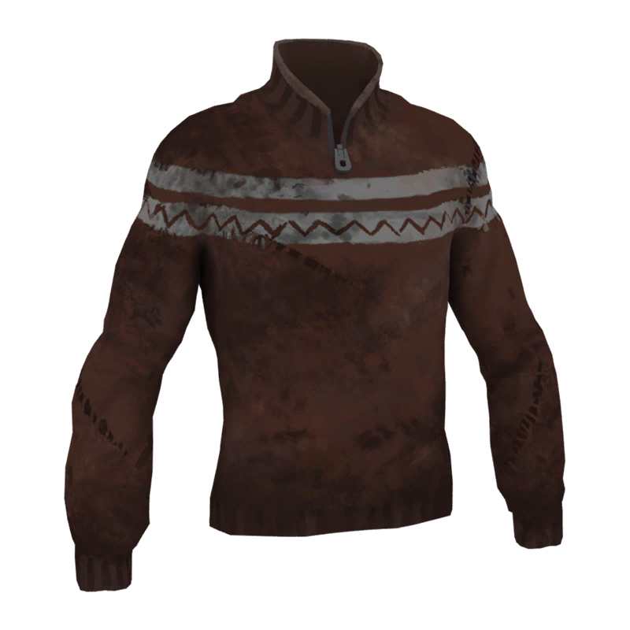

# Thin Wool Sweater

**Categories:** Clothing, Story items · **Source:** [Fandom](https://thelongdark.fandom.com/wiki/Thin_Wool_Sweater)

**Thin Wool Sweater**

_Thin\_Wool\_Sweater\_icon.png_

**General**

**Item Type:** Clothing\|-

**Statistics**

**Weight:** 0.25 kg(0.55 lbs)

**Warmth bonus:** 1.0 °C(1.8 °F)

**Windproof bonus:** 0.5 °C(0.9 °F)

**Waterproof bonus:** 20%

**Protection:** 2%

**Mobility:** 0%

**Harvest:** 1 × [Cloth](./Cloth.md) / 30 minutes

**Repair:** 1 × [Cloth](./Cloth.md) / 60 minutes / 40% condition

> “**Thin-knit wool sweater. Mostly for looks, but provides some warmth and being knit from wool remains warm when wet.**”
>
> — In-game description

**Thin Wool Sweater** is a type of [clothing](./Clothing.md) item in _[The Long Dark](./The%20Long%20Dark.md)_.

## Overview

Light and warm mid-tier sweater, which spawns uncommonly in most regions. The Thin Wool Sweater has similar stats to the [Hockey Jersey](./Hockey%20Jersey.md): being 0.05 kg lighter, but 2.5 °C less Windproof, 5% more Waterproof, and 1% less Protective (which are all irrelevant if any item is worn the 'Outer Torso' slot), but the Thin Wool Sweater [decays](./Decay.md) condition twice as fast as Hockey Jersey.

It is one of the best Inner Torso clothing which can spawn on [Interloper](./Interloper.md) mode, along with the Hockey Jersey.

## Gallery

_Clothing model icon_

_Clothing model icon damaged_

_Old model._
