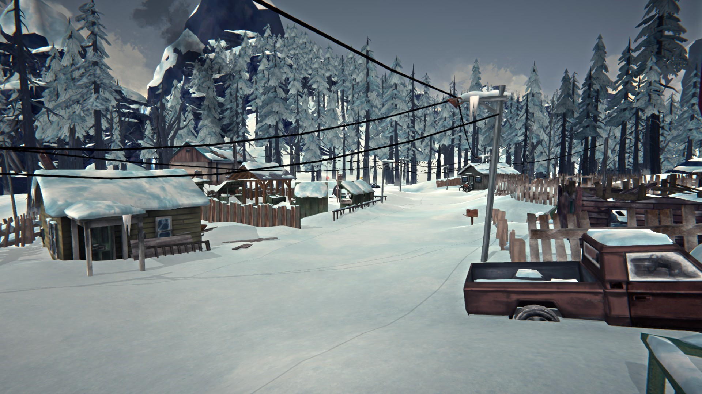

# Thomson's Crossing

**Categories:** Indoor locations, Locations, Locations in Pleasant Valley, Residential locations, Settlements · **Source:** [Fandom](https://thelongdark.fandom.com/wiki/Thomson's_Crossing)

**Thomson's Crossing**

_The main road in Thomson's Crossing_

**Location**

_Thomson's\_Crossing\_Location.png_

**Region:** [Pleasant Valley](./Pleasant%20Valley.md)

**Description:** A small town with several houses

**General**

**Type:** Residential

_bed\_icon.png_

Has a bed
