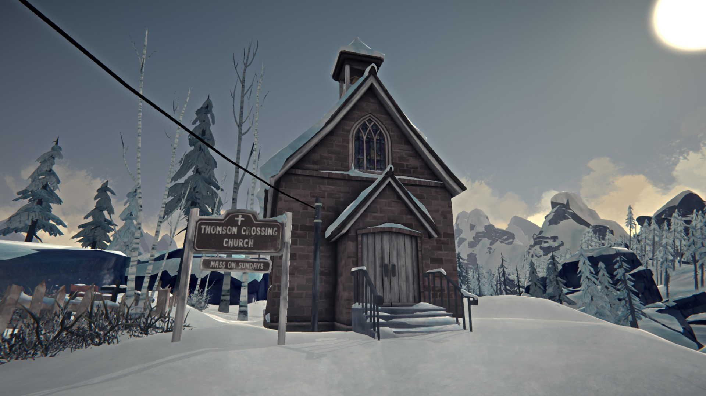
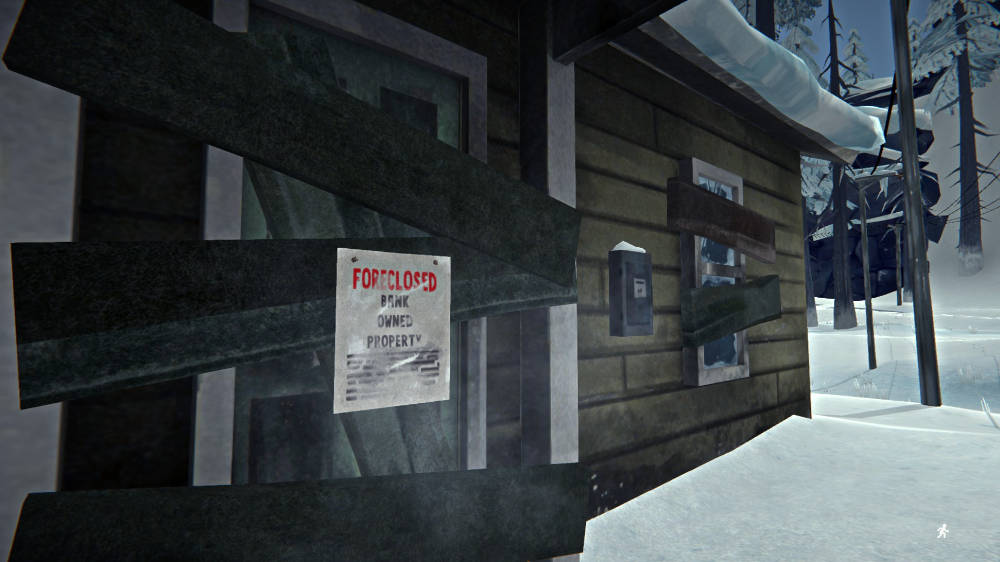

# Thomson's Crossing

**Thomson's Crossing**

| Property | Details |
| --- | --- |
|  |  / *The main road in Thomson's Crossing* |
| **Location** |  |
|  |  / *Thomson's\_Crossing\_Location.png* |
| Region | [Pleasant Valley](./Pleasant%20Valley.md)\|- |
| Description | A small town with several houses |
| **General** |  |
| Type | Residential\|- |
|  / *bed\_icon.png* | Has a bed |
|  | Has an interior\|} **Thomson's Crossing**, formerly known as **Rural Crossroads**, is a small settlement in [Pleasant Valley](./Pleasant%20Valley.md). / ## Overview / Thomson's Crossing is an old mining settlement that consists: / - The [Community Hall](./Community%20Hall.md) / - [Pleasant Valley Church](./Pleasant%20Valley%20Church.md) / - A small collection of [Crossroads Houses](./Crossroads%20House.md) (up to 4, some are collapsed. one is across the bridge) / - A small [Rural Store](./Rural%20Store.md) / - A truss bridge on both sides of the settlement / [Upper Falls](./Upper%20Falls.md) can be found to the east and [Cinder Hills Coal Mine](./Cinder%20Hills%20Coal%20Mine.md) to the north-north-east. / Ample supplies can be scavenged from the houses and the only nearby wildlife is deer and rabbits, making the area generally safe from hostile wildlife and serve as suitable [safehouses](./Safehouse.md) for the player. The [Rural Store](./Rural%20Store.md) contains a decent supply of [food and drinks](./Food%20And%20Drink.md). / [Cat tail](./Cat%20Tail.md) plants and [reishi mushrooms](./Reishi%20Mushroom.md) can be found along the river bank to the west. / This area plays a key role in many quests in Episode 3 of Story mode, and it can be an important rest stop/source of food and other must-haves in Survival mode. / **Template:quote2** / ## Trivia / - Thomson's Crossing's church is a Catholic or Episcopal church where [Father Thomas](./Father%20Thomas.md) resides as the parochial vicar. / - This church is one of three on [Great Bear Island](./Great%20Bear%20Island.md); the other two being the Catholic [St. Christopher's Church](./St.%20Christopher%27s%20Church.md) of [Milton](./Milton.md) and the [Stone Church](./Stone%20Church.md) of [Desolation Point](./Desolation%20Point.md), an unknown denomination. / - It is suggested that Thomson's Crossing was the largest remaining settlement on Great Bear Island prior to [The First Flare](./First%20Flare.md), because Milton's church was closed due to the towns declining population (as detailed in [Buffer Memories](./Buffer%20Memories.md) and Notes), and the Desolation Point's church seems derelict for years if not decades. / - Thomson's Crossing may be named after a man called [Ryan Thompson](./Characters.md#Mentioned_Characters), who is buried at the local cemetery. His grave is the oldest (of which the headstone is still readable), and is the only one that lies in a fenced area. The inscription reads "beloved father". / ## Gallery / \| Column 1 \| Column 2 \| Column 3 \| Column 4 \| / \| --- \| --- \| --- \| --- \| / \|  / *The Community Hall (Episode3)* \|  / *The Community Hall (Survival)* \|  / *The Community Hall* \|  / *The Rural Store* \| / \|  / *The Rural Store* \|  / *The church* \|  / *The church* \|  / *SS-PV-TC\_(3).jpg* \| / \|  / *SS-PV-TC\_(2).jpg* \|  / *SS-PV-TC\_(5).jpg* \|  / *A foreclosed house* \|  \| / **Lua execution error in Module:Navbox function navbox** |
|  / *The Community Hall (Episode3)* |  / *The Community Hall (Survival)* /  / *The Community Hall* /  / *The Rural Store* |
|  / *The Rural Store* |  / *The church* /  / *The church* /  / *SS-PV-TC\_(3).jpg* |
|  / *SS-PV-TC\_(2).jpg* |  / *SS-PV-TC\_(5).jpg* /  / *A foreclosed house* |
