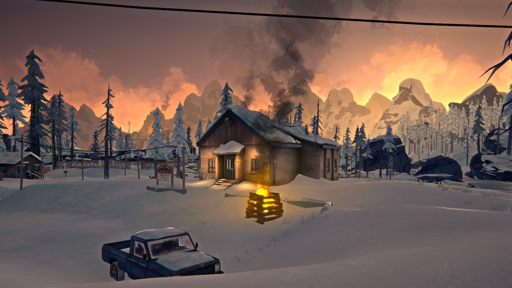
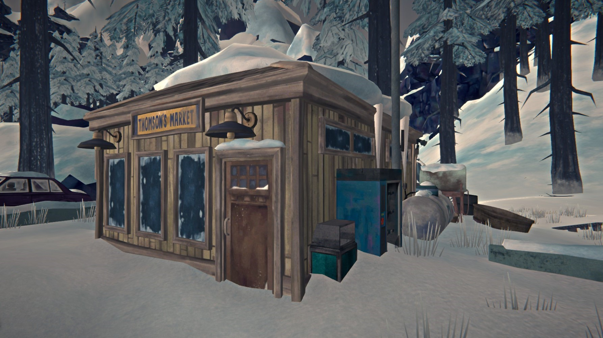

# Thomson's Crossing

**Categories:** Indoor locations, Locations, Locations in Pleasant Valley, Residential locations, Settlements · **Source:** [Fandom](https://thelongdark.fandom.com/wiki/Thomson's_Crossing)

**Thomson's Crossing**

| Property | Details |
| --- | --- |
|  |  / _The main road in Thomson's Crossing_ |
| **Location** |  |
|  |  / _Thomson's\_Crossing\_Location.png_ |
| Region | [Pleasant Valley](./Pleasant%20Valley.md)\|- |
| Description | A small town with several houses |
| **General** |  |
| Type | Residential\|- |
|  / _bed\_icon.png_ | Has a bed |

|  / _The Community Hall (Episode3)_ |  / _The Community Hall (Survival)_ /  / _The Community Hall_ /  / _The Rural Store_ |
|  / _The Rural Store_ |  / _The church_ /  / _The church_ /  / _SS-PV-TC\_(3).jpg_ |
|  / _SS-PV-TC\_(2).jpg_ |  / _SS-PV-TC\_(5).jpg_ /  / _A foreclosed house_ |
