# Timberwolf Mountain

**Categories:** Regions · **Source:** [Fandom](https://thelongdark.fandom.com/wiki/Timberwolf_Mountain)

**Contents**

- [Entrances](#entrances)
- [Overview](#overview)
- [Strategy](#strategy)
- [Locations](#locations)
- [Maps](#maps)
- [Gallery](#gallery)
- [Game history](#game-history)
- [Trivia](#trivia)
- [References](#references)

**Timberwolf Mountain**

| Property | Details |
| --- | --- |
|  |  / _Timberwolf\_Mountain\_title\_card.png_ |
| **Location on [Great Bear Island](./Great%20Bear%20Island.md)** |  |
|  | 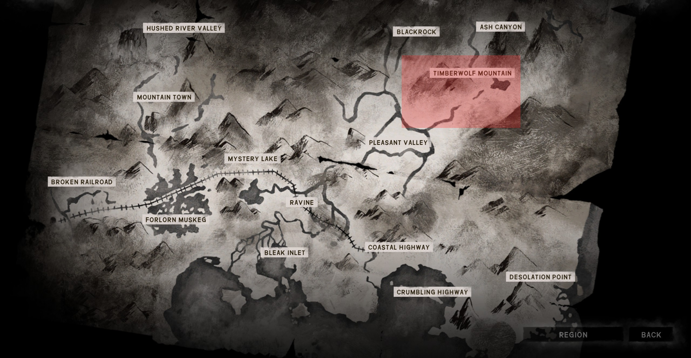 / _Timberwolf\_Mountain\_Location.png_ |
|  | 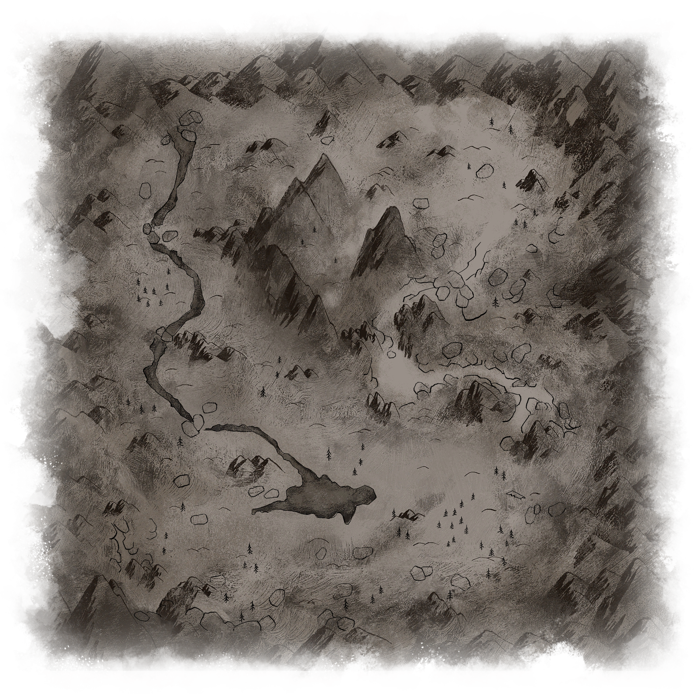 / _timberwolf\_mountain\_map.png_ |
| **Details** |  |
| Description | A harsh mountainous region with scarce resources and many [Rope Climbing](./Rope%20Climbing.md) spots. |
| Connecting Regions | [Pleasant Valley](./Pleasant%20Valley.md), [Ash Canyon](./Ash%20Canyon.md), [Blackrock](./Blackrock.md) |
| Difficulty | Advanced |
| Interloper Region Spawn | Yes |
| Locations | 25 |
| Hazards and Survivability | The region is known for temperatures below -20 °C, frequent blizzards and scarce resources. Much of the region is divided up by [Rope Climbing](./Rope%20Climbing.md) areas, making navigation tricky. |
| Date Added | Dec 2015 |

> “__For advanced players. An isolated alpine region with very few shelters or resources. A true test of wilderness survival skills.__”
>
> — - In game description

**Timberwolf Mountain** is the 5th [Region](./Region.md) to be introduced in _[The Long Dark](./The%20Long%20Dark.md)_. It's commonly considered one of the most difficult regions to survive in due to frigid temperatures (sub -20C / -4F almost every day) and frequent blizzards (usually at least three per week). These conditions limit the time a player can safely travel outside with anything less than top-quality clothing, and the lack of warm indoor shelters means maintaining [campfires](./Campfire.md) is critical.

## Entrances

Timberwolf Mountain connects to three other regions, via four distinct entrances:

- The most commonly used entrance is a path near the [Landing Gear](./Landing%20Gear.md), which connects to [Pleasant Valley](./Pleasant%20Valley.md) at a [rope climb](./Rope%20Climbing.md) near [Prepper's Abandoned Cache](./Prepper%27s%20Abandoned%20Cache.md).
- Another option is the large, exporable cave, located a [rope climb](./Rope%20Climbing.md) down the river from [Eric's Falls](./Eric%27s%20Falls.md). It connects to [Blackrock](./Blackrock.md) not far from [Foreman's Clearcut](./Foreman%27s%20Clearcut.md).
- A cave near [Deer Clearing](./Deer%20Clearing.md) leads to [Pillar's Footrest](./Pillar%27s%20Footrest.md) in [Ash Canyon](./Ash%20Canyon.md).
- A cave at the end of [Echo Ravine](./Echo%20Ravine.md) also leads to [Ash Canyon](./Ash%20Canyon.md), at a ledge overlooking [Bitter Marsh](./Bitter%20Marsh.md).

## Overview

Timberwolf Mountain is described as pure wilderness with a mountainous expanse almost entirely lacking in man-made shelters. It has steep cliffs and ravines that require [Rope Climbing](./Rope%20Climbing.md) to navigate to several locations.[¹](#fn1)

Timberwolf Mountain connects to [Pleasant Valley](./Pleasant%20Valley.md) via a [rope climb](./Rope%20Climbing.md) and treacherously cold mountain pass in the southwest corner of the region, [Ash Canyon](./Ash%20Canyon.md) via the eastern end of [Echo Ravine](./Echo%20Ravine.md) or via a cave in [Deer Clearing](./Deer%20Clearing.md), and [Blackrock](./Blackrock.md) via a cave system to the northwest of [Andre's Peak](./Andre%27s%20Peak.md).

Another defining feature is the large jet that crashed on the summit of the mountain. Wreckage from the plane is littered across the region; this includes both wings (one south of [Echo Peak West](./Echo%20Peak%20West.md), another on the [Summit](./Summit.md)); the tail section perched precariously on the edge of the summit; two wheels from the landing gear (one near the region entrance from Pleasant Valley, another also on the summit); and two engines (one at the western end of Echo Ravine, the other near Andre's Peak), as well as half the fuselage found near the top of the mountain.

Additionally, there are [Cargo Containers](./Cargo%20Container.md) from the plane scattered across the region, mostly near pieces of the wreckage, and with a huge cache in the tail end at the summit. When opened with a [Hacksaw](./Hacksaw.md), these containers can be looted for large amounts of items in a specific category (e.g., canned foods, medicines, or a class of clothing).

### Strategy

Timberwolf Mountain hosts extreme environmental conditions, requiring careful preparation to ensure survival during any expedition. Wolves and bears constantly patrol the main areas of the map and there are few safe shelters, with little loot inside of those that exist. Due to the limited resources and abundant wildlife, hunting and defending yourself are necessary to survive for an extended period of time.

A few hundred meters from the end of the pathway to Pleasant Valley is [Crystal Lake](./Crystal%20Lake.md) and the [Mountaineer's Hut](./Mountaineer%27s%20Hut.md), the only man-made structure on the mountain. With one of the few beds on the map, a fireplace, door, and the only workbench, it will likely be the primary safehouse within the region. It also is next to an ice fishing hut on Crystal Lake that can be used to cure [Cabin Fever](./Cabin%20Fever.md), and every region connection can be reached within several hours in-game from the Mountaineer's Hut. Another worthwhile shelter is the deep cave in the northeast near [Deer Clearing](./Deer%20Clearing.md), since it is next to multiple deer spawns and is close enough to a bear patrol area for easy hunting; however, it does not have much utility beyond being a good shelter during a hunting trip.

The path to the [Summit](./Summit.md) is fairly linear, and the tail end of the plane on the summit contains a huge cache of high-tier supplies. End-game manufactured clothing, multiple MRE's, either a [Distress Pistol](./Distress%20Pistol.md) or a corpse with a bag next to it likely to contain [Crampons](./Crampons.md), multiple cured pelts, and multiple tools/weapons can be found in the tail section.

## Locations

There are many accessible locations within the Timberwolf Mountain region, including:

| Column 1 | Column 2 |
| --- | --- |
| - [Andre's Peak](./Andre%27s%20Peak.md) / - [Cave 2](./Cave%20%28Timberwolf%20Mountain%20location%202%29.md) (2 entrances) / - [Cave 1](./Cave%20%28Timberwolf%20Mountain%20location%201%29.md) (2 entrances) / - [Chasm Cave](./Chasm%20Cave.md) / - [Crystal Lake](./Crystal%20Lake.md) / - [Deer Clearing](./Deer%20Clearing.md) / - [Echo Peak East](./Echo%20Peak%20East.md) / - [Echo Peak West](./Echo%20Peak%20West.md) / - [Echo Ravine](./Echo%20Ravine.md) / - [Engine (East)](./Engine%20%28East%29.md) (East of mountain) / - [Engine (West)](./Engine%20%28West%29.md) (West of mountain) / - [Eric's Falls](./Eric%27s%20Falls.md) / - [Forest Cave (Timberwolf Mountain location)](./Forest%20Cave%20%28Timberwolf%20Mountain%20location%29.md) | - [Landing Gear](./Landing%20Gear.md) (Near entrance to Pleasant Valley) / - [Mountaineer's Hut](./Mountaineer%27s%20Hut.md) / - [Secluded Shelf](./Secluded%20Shelf.md) / - [Summit](./Summit.md) / - [Tail Section](./Tail%20Section.md) / - To Ash Canyon (Transition to [Ash Canyon](./Ash%20Canyon.md)) / - To Cave System (Transition Cave to [Ash Canyon](./Ash%20Canyon.md)) / - To Cave System (Transition Cave to [Blackrock](./Blackrock.md)) / - To Pleasant Valley (Transition to [Pleasant Valley](./Pleasant%20Valley.md)) / - [Waterfall Cave](./Waterfall%20Cave.md) / - [Wing](./Wing.md) (Plane wing near Forest Cave) / - [Wing (Summit)](./Wing%20%28Summit%29.md) (Plane wing at [Summit](./Summit.md)) |

1 [Prepper Cache](./Prepper%20Cache.md) can be found north of the [Echo Ravine](./Echo%20Ravine.md).

Additionally, a second Landing Gear can be found at the Summit, but this is not considered a location. The cockpit of the crashed plane and the third Landing Gear are also nowhere to be found on or around the mountain.

## Maps

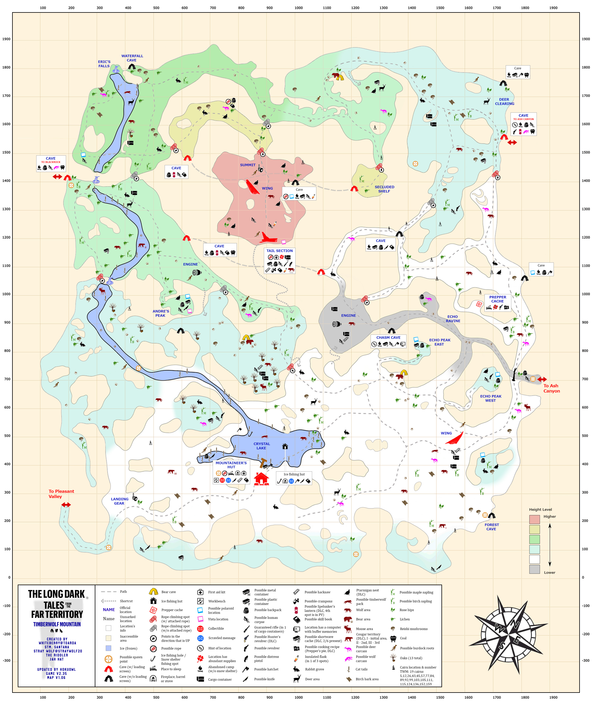

_Timberwolf Mountain map v2.35_

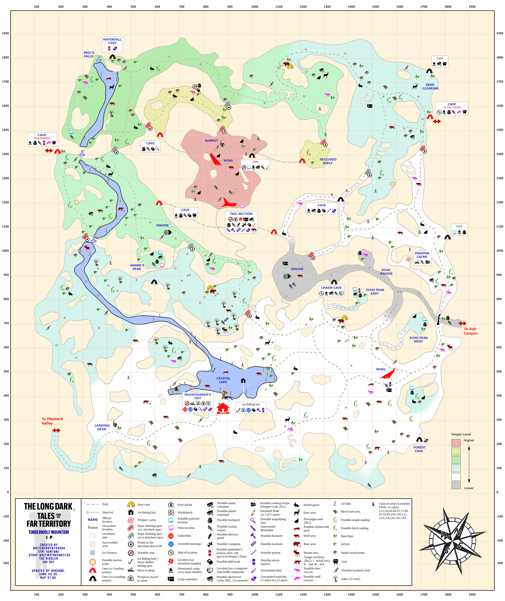

_Timberwolf Mountain map v2.35 (Interloper-Misery)_

_Updated map that includes the entrance for Blackrock Region (v1.98)_

_Timberwolf\_mountain\_titlecard\_new.png_

## Gallery

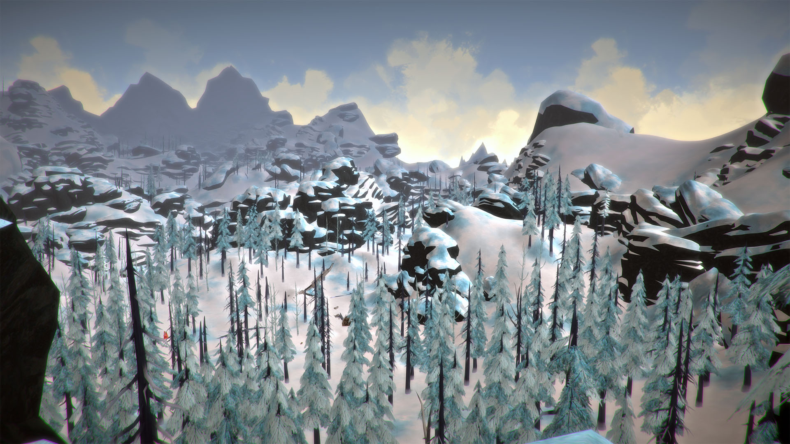

_A landscape view of the region._

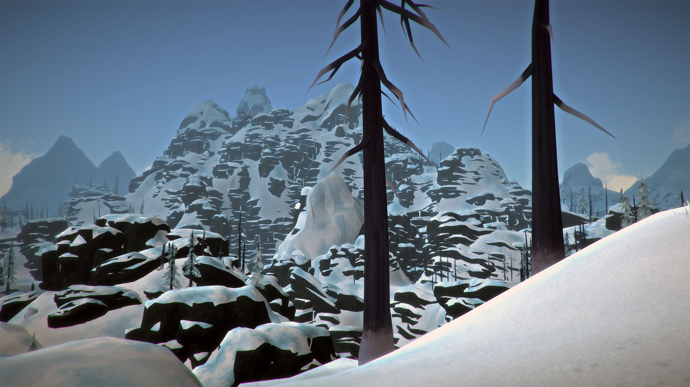

_Timberwolf\_Mountain\_landscape\_02.jpg_

_Cave\_(Timberwolf\_Mountain\_location\_1)\_exterior.jpg_

_Cave\_(Timberwolf\_Mountain\_location\_2).jpg_

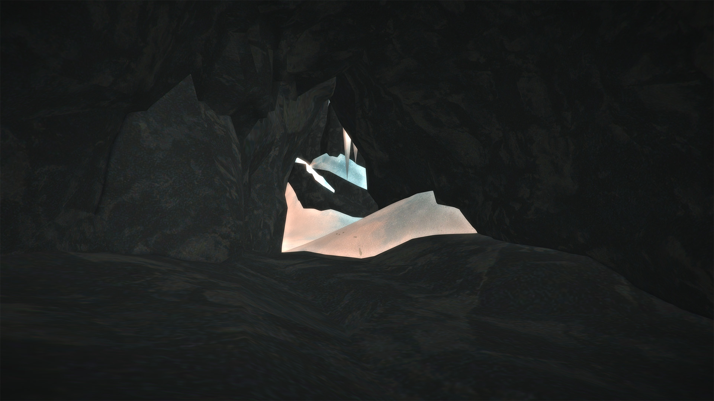

_Chasm\_Cave\_interior.jpg_

_Echo\_Peak\_West.jpg_

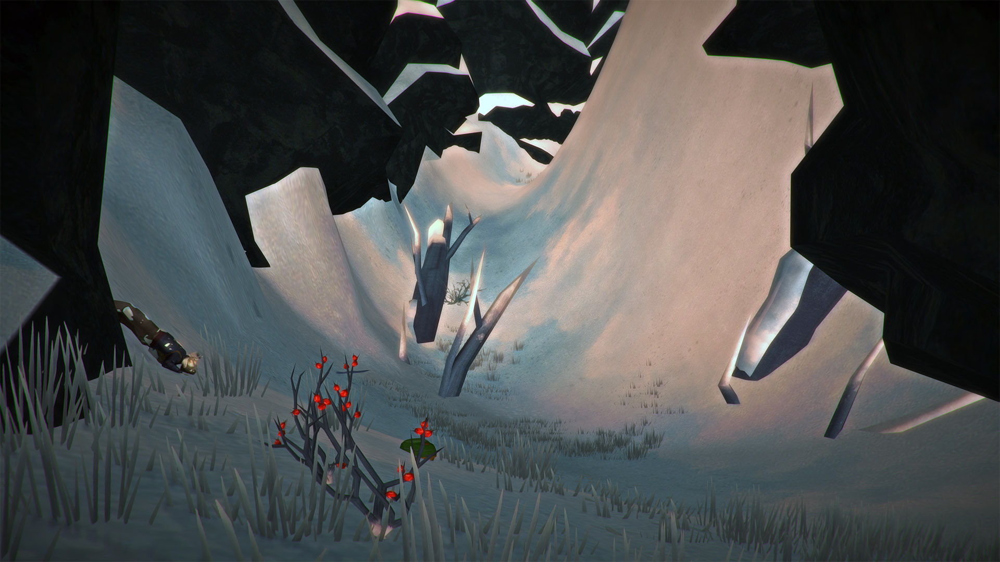

_Echo\_Ravine.jpg_

_Engine\_-\_Timberwolf\_Mountain\_location.jpg_

_Forest\_Cave\_-\_entrance\_(Timberwolf\_Mountain\_location).jpg_

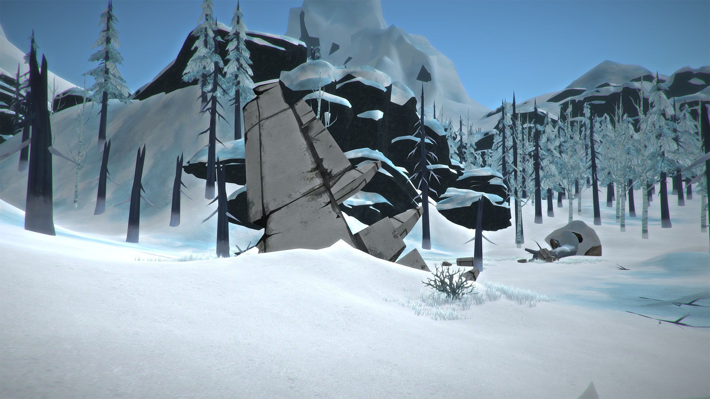

_Wing\_-\_Timberwolf\_Mountain\_location.jpg_

\[Missing image: Mountaineer\_Cabin.png\]

_Mountaineer's Hut_

_Mountaineer's Hut fishing cabin, Crystal Lake_

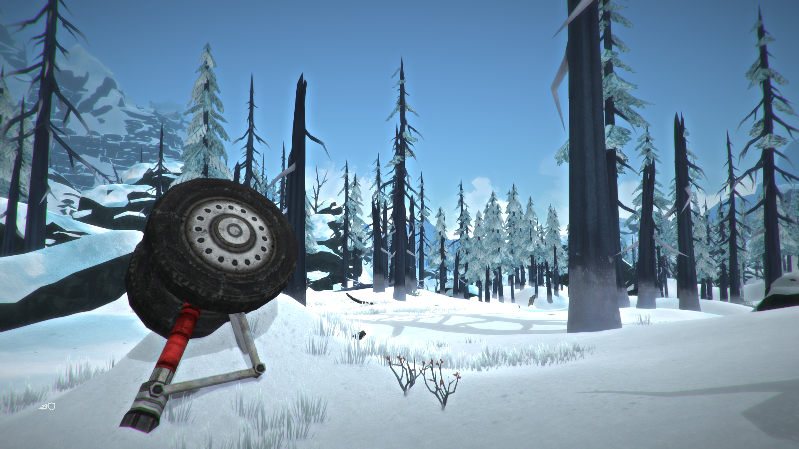

_Landing Gear_

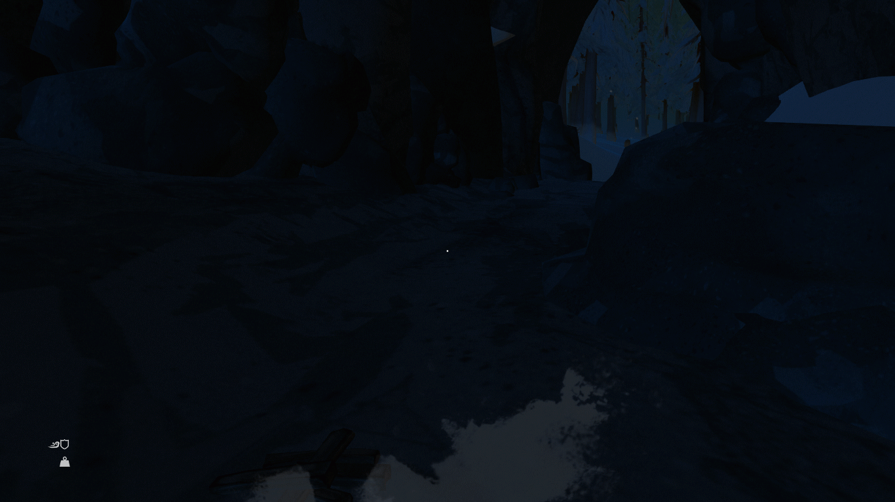

_Forest Cave on Timberwolf Mountain_

## Game history

Timberwolf Mountain was introduced on 16 December 2015 in [version 0.298](./The%20Long%20Dark%20%E2%80%94%20Changelog.md#0.298).

## Trivia

- Despite the name, [Timberwolves](./Timberwolf.md) were ironically absent from Timberwolf Mountain until December 2024.
  - Now, a pack may spawn near the [Wing](./Wing.md) and [Crystal Lake](./Crystal%20Lake.md).

## References

&lt;div class="references-small" ;"&gt;

[es:Montaña de lobos](es:Monta%C3%B1a_de_lobos) [ru:Волчья гора](ru:%D0%92%D0%BE%D0%BB%D1%87%D1%8C%D1%8F_%D0%B3%D0%BE%D1%80%D0%B0) [fr:Mont Timberwolf](fr:Mont_Timberwolf) [de:Wolfsberg](de:Wolfsberg)

## Notes

---

1. Hinterland Games, 2015, _The Long Dark — December Update (v.298), “Timberwolf Mountain”_, viewed 16 December 2015 &lt;[http://hinterlandgames.com/the-long-dark-sandbox-update-to-tm/](http://hinterlandgames.com/the-long-dark-sandbox-update-to-tm/)&gt;[↩︎](#fnref1)
