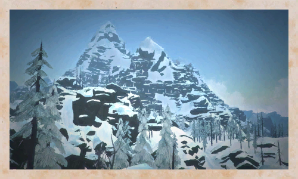
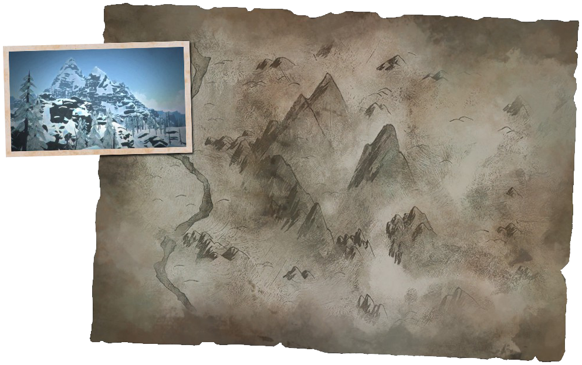
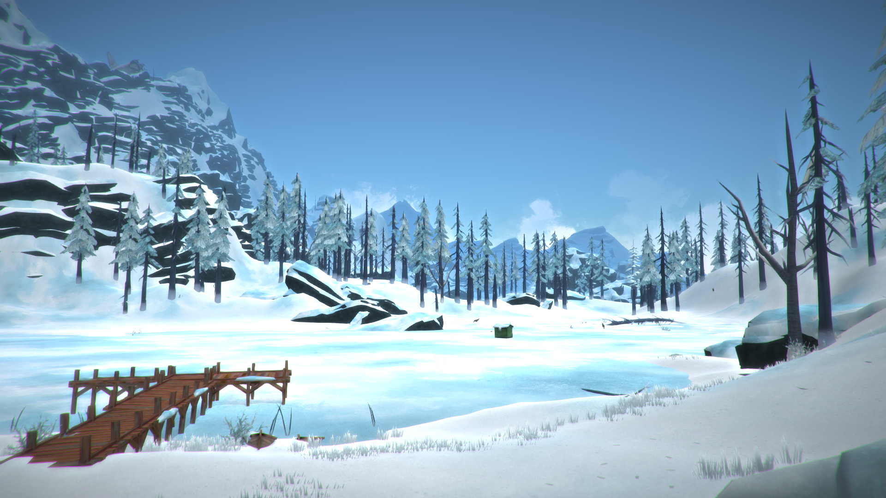

# Timberwolf Mountain

**Contents**

- [Entrances](#Entrances)
- [Overview](#Overview)
- [Strategy](#Strategy)
- [Locations](#Locations)
- [Maps](#Maps)
- [Gallery](#Gallery)
- [Game history](#Game_history)
- [Trivia](#Trivia)
- [References](#References)

<table class="infobox">
<caption>Timberwolf Mountain</caption>
<colgroup>
<col style="width: 50%" />
<col style="width: 50%" />
</colgroup>
<tbody>
<tr>
<td colspan="2"><figure>

<figcaption>Timberwolf_Mountain_title_card.png</figcaption>
</figure></td>
</tr>
<tr>
<td colspan="2" class="section">
<strong>Location on <a href="./Great%20Bear%20Island.md" class="wikilink" title="Great Bear Island">Great Bear Island</a></strong>
</td>
</tr>
<tr>
<td colspan="2"><figure>
[Missing image: Timberwolf_Mountain_Location.png]
<figcaption>Timberwolf_Mountain_Location.png</figcaption>
</figure></td>
</tr>
<tr>
<td colspan="2"><figure>
[Missing image: timberwolf_mountain_map.png]
<figcaption>timberwolf_mountain_map.png</figcaption>
</figure></td>
</tr>
<tr>
<td colspan="2" class="section">
<strong>Details</strong>
</td>
</tr>
<tr>
<td>
Description
</td>
<td>
A harsh mountainous region with scarce resources and many <a href="./Rope%20Climbing.md" class="wikilink" title="Rope Climbing">Rope Climbing</a> spots.
</td>
</tr>
<tr>
<td>
Connecting Regions
</td>
<td>
<a href="./Pleasant%20Valley.md" class="wikilink" title="Pleasant Valley">Pleasant Valley</a>, <a href="./Ash%20Canyon.md" class="wikilink" title="Ash Canyon">Ash Canyon</a>, <a href="./Blackrock.md" class="wikilink" title="Blackrock">Blackrock</a>
</td>
</tr>
<tr>
<td>
Difficulty
</td>
<td>
Advanced
</td>
</tr>
<tr>
<td>
Interloper Region Spawn
</td>
<td>
Yes
</td>
</tr>
<tr>
<td>
Locations
</td>
<td>
25
</td>
</tr>
<tr>
<td>
Hazards and Survivability
</td>
<td>
The region is known for temperatures below -20 °C, frequent blizzards and scarce resources. Much of the region is divided up by <a href="./Rope%20Climbing.md" class="wikilink" title="Rope Climbing">Rope Climbing</a> areas, making navigation tricky.
</td>
</tr>
<tr>
<td>
Date Added
</td>
<td>
Dec 2015
</td>
</tr>
</tbody>
</table>

<table>
<colgroup>
<col style="width: 33%" />
<col style="width: 33%" />
<col style="width: 33%" />
</colgroup>
<tbody>
<tr>
<td style="vertical-align: top; font-size: 3em; color: #5d5980; padding-right: 10px">
“
</td>
<td>
For advanced players. An isolated alpine region with very few shelters or resources. A true test of wilderness survival skills.

&#10;

- In game description

</td>
<td style="vertical-align: bottom; font-size: 3em; color: #5d5980; padding-left: 10px">
”
</td>
</tr>
</tbody>
</table>

**Timberwolf Mountain** is the 5th <a href="./Region.md" class="wikilink" title="Region">Region</a> to be introduced in *<a href="./The%20Long%20Dark.md" class="wikilink" title="The Long Dark">The Long Dark</a>*. It's commonly considered one of the most difficult regions to survive in due to frigid temperatures (sub -20C / -4F almost every day) and frequent blizzards (usually at least three per week). These conditions limit the time a player can safely travel outside with anything less than top-quality clothing, and the lack of warm indoor shelters means maintaining <a href="./Campfire.md" class="wikilink" title="campfire">campfires</a> is critical.

## Entrances

Timberwolf Mountain connects to three other regions, via four distinct entrances:

- The most commonly used entrance is a path near the <a href="./Landing%20Gear.md" class="wikilink" title="Landing Gear">Landing Gear</a>, which connects to <a href="./Pleasant%20Valley.md" class="wikilink" title="Pleasant Valley">Pleasant Valley</a> at a <a href="./Rope%20Climbing.md" class="wikilink" title="rope climb">rope climb</a> near <a href="./Prepper%27s%20Abandoned%20Cache.md" class="wikilink" title="Prepper&#39;s Abandoned Cache">Prepper's Abandoned Cache</a>.
- Another option is the large, exporable cave, located a <a href="./Rope%20Climbing.md" class="wikilink" title="rope climb">rope climb</a> down the river from <a href="./Eric%27s%20Falls.md" class="wikilink" title="Eric&#39;s Falls">Eric's Falls</a>. It connects to <a href="./Blackrock.md" class="wikilink" title="Blackrock">Blackrock</a> not far from <a href="./Foreman%27s%20Clearcut.md" class="wikilink" title="Foreman&#39;s Clearcut">Foreman's Clearcut</a>.
- A cave near <a href="./Deer%20Clearing.md" class="wikilink" title="Deer Clearing">Deer Clearing</a> leads to <a href="./Pillar%27s%20Footrest.md" class="wikilink" title="Pillar&#39;s Footrest">Pillar's Footrest</a> in <a href="./Ash%20Canyon.md" class="wikilink" title="Ash Canyon">Ash Canyon</a>.
- A cave at the end of <a href="./Echo%20Ravine.md" class="wikilink" title="Echo Ravine">Echo Ravine</a> also leads to <a href="./Ash%20Canyon.md" class="wikilink" title="Ash Canyon">Ash Canyon</a>, at a ledge overlooking <a href="./Bitter%20Marsh.md" class="wikilink" title="Bitter Marsh">Bitter Marsh</a>.

## Overview

Timberwolf Mountain is described as pure wilderness with a mountainous expanse almost entirely lacking in man-made shelters. It has steep cliffs and ravines that require <a href="./Rope%20Climbing.md" class="wikilink" title="Rope Climbing">Rope Climbing</a> to navigate to several locations.[^1]

Timberwolf Mountain connects to <a href="./Pleasant%20Valley.md" class="wikilink" title="Pleasant Valley">Pleasant Valley</a> via a <a href="./Rope%20Climbing.md" class="wikilink" title="rope climb">rope climb</a> and treacherously cold mountain pass in the southwest corner of the region, <a href="./Ash%20Canyon.md" class="wikilink" title="Ash Canyon">Ash Canyon</a> via the eastern end of <a href="./Echo%20Ravine.md" class="wikilink" title="Echo Ravine">Echo Ravine</a> or via a cave in <a href="./Deer%20Clearing.md" class="wikilink" title="Deer Clearing">Deer Clearing</a>, and <a href="./Blackrock.md" class="wikilink" title="Blackrock">Blackrock</a> via a cave system to the northwest of <a href="./Andre%27s%20Peak.md" class="wikilink" title="Andre&#39;s Peak">Andre's Peak</a>.

Another defining feature is the large jet that crashed on the summit of the mountain. Wreckage from the plane is littered across the region; this includes both wings (one south of <a href="./Echo%20Peak%20West.md" class="wikilink" title="Echo Peak West">Echo Peak West</a>, another on the <a href="./Summit.md" class="wikilink" title="Summit">Summit</a>); the tail section perched precariously on the edge of the summit; two wheels from the landing gear (one near the region entrance from Pleasant Valley, another also on the summit); and two engines (one at the western end of Echo Ravine, the other near Andre's Peak), as well as half the fuselage found near the top of the mountain.

Additionally, there are <a href="./Cargo%20Container.md" class="wikilink" title="Cargo Container">Cargo Containers</a> from the plane scattered across the region, mostly near pieces of the wreckage, and with a huge cache in the tail end at the summit. When opened with a <a href="./Hacksaw.md" class="wikilink" title="Hacksaw">Hacksaw</a>, these containers can be looted for large amounts of items in a specific category (e.g., canned foods, medicines, or a class of clothing).

### Strategy

Timberwolf Mountain hosts extreme environmental conditions, requiring careful preparation to ensure survival during any expedition. Wolves and bears constantly patrol the main areas of the map and there are few safe shelters, with little loot inside of those that exist. Due to the limited resources and abundant wildlife, hunting and defending yourself are necessary to survive for an extended period of time.

A few hundred meters from the end of the pathway to Pleasant Valley is <a href="./Crystal%20Lake.md" class="wikilink" title="Crystal Lake">Crystal Lake</a> and the <a href="./Mountaineer%27s%20Hut.md" class="wikilink" title="Mountaineer&#39;s Hut">Mountaineer's Hut</a>, the only man-made structure on the mountain. With one of the few beds on the map, a fireplace, door, and the only workbench, it will likely be the primary safehouse within the region. It also is next to an ice fishing hut on Crystal Lake that can be used to cure <a href="./Cabin%20Fever.md" class="wikilink" title="Cabin Fever">Cabin Fever</a>, and every region connection can be reached within several hours in-game from the Mountaineer's Hut. Another worthwhile shelter is the deep cave in the northeast near <a href="./Deer%20Clearing.md" class="wikilink" title="Deer Clearing">Deer Clearing</a>, since it is next to multiple deer spawns and is close enough to a bear patrol area for easy hunting; however, it does not have much utility beyond being a good shelter during a hunting trip.

The path to the <a href="./Summit.md" class="wikilink" title="Summit">Summit</a> is fairly linear, and the tail end of the plane on the summit contains a huge cache of high-tier supplies. End-game manufactured clothing, multiple MRE's, either a <a href="./Distress%20Pistol.md" class="wikilink" title="Distress Pistol">Distress Pistol</a> or a corpse with a bag next to it likely to contain <a href="./Crampons.md" class="wikilink" title="Crampons">Crampons</a>, multiple cured pelts, and multiple tools/weapons can be found in the tail section.

## Locations

There are many accessible locations within the Timberwolf Mountain region, including:

<table>
<colgroup>
<col style="width: 50%" />
<col style="width: 50%" />
</colgroup>
<tbody>
<tr>
<td><ul>
<li><a href="./Andre%27s%20Peak.md" class="wikilink" title="Andre&#39;s Peak">Andre's Peak</a></li>
<li><a href="./Cave%20%28Timberwolf%20Mountain%20location%202%29.md" class="wikilink" title="Cave 2">Cave 2</a> (2 entrances)</li>
<li><a href="./Cave%20%28Timberwolf%20Mountain%20location%201%29.md" class="wikilink" title="Cave 1">Cave 1</a> (2 entrances)</li>
<li><a href="./Chasm%20Cave.md" class="wikilink" title="Chasm Cave">Chasm Cave</a></li>
<li><a href="./Crystal%20Lake.md" class="wikilink" title="Crystal Lake">Crystal Lake</a></li>
<li><a href="./Deer%20Clearing.md" class="wikilink" title="Deer Clearing">Deer Clearing</a></li>
<li><a href="./Echo%20Peak%20East.md" class="wikilink" title="Echo Peak East">Echo Peak East</a></li>
<li><a href="./Echo%20Peak%20West.md" class="wikilink" title="Echo Peak West">Echo Peak West</a></li>
<li><a href="./Echo%20Ravine.md" class="wikilink" title="Echo Ravine">Echo Ravine</a></li>
<li><a href="./Engine%20%28East%29.md" class="wikilink" title="Engine (East)">Engine (East)</a> (East of mountain)</li>
<li><a href="./Engine%20%28West%29.md" class="wikilink" title="Engine (West)">Engine (West)</a> (West of mountain)</li>
<li><a href="./Eric%27s%20Falls.md" class="wikilink" title="Eric&#39;s Falls">Eric's Falls</a></li>
<li><a href="./Forest%20Cave%20%28Timberwolf%20Mountain%20location%29.md" class="wikilink" title="Forest Cave (Timberwolf Mountain location)">Forest Cave (Timberwolf Mountain location)</a></li>
</ul></td>
<td data-valign="top" style="width: 50%"><ul>
<li><a href="./Landing%20Gear.md" class="wikilink" title="Landing Gear">Landing Gear</a> (Near entrance to Pleasant Valley)</li>
<li><a href="./Mountaineer%27s%20Hut.md" class="wikilink" title="Mountaineer&#39;s Hut">Mountaineer's Hut</a></li>
<li><a href="./Secluded%20Shelf.md" class="wikilink" title="Secluded Shelf">Secluded Shelf</a></li>
<li><a href="./Summit.md" class="wikilink" title="Summit">Summit</a></li>
<li><a href="./Tail%20Section.md" class="wikilink" title="Tail Section">Tail Section</a></li>
<li>To Ash Canyon (Transition to <a href="./Ash%20Canyon.md" class="wikilink" title="Ash Canyon">Ash Canyon</a>)</li>
<li>To Cave System (Transition Cave to <a href="./Ash%20Canyon.md" class="wikilink" title="Ash Canyon">Ash Canyon</a>)</li>
<li>To Cave System (Transition Cave to <a href="./Blackrock.md" class="wikilink" title="Blackrock">Blackrock</a>)</li>
<li>To Pleasant Valley (Transition to <a href="./Pleasant%20Valley.md" class="wikilink" title="Pleasant Valley">Pleasant Valley</a>)</li>
<li><a href="./Waterfall%20Cave.md" class="wikilink" title="Waterfall Cave">Waterfall Cave</a></li>
<li><a href="./Wing.md" class="wikilink" title="Wing">Wing</a> (Plane wing near Forest Cave)</li>
<li><a href="./Wing%20%28Summit%29.md" class="wikilink" title="Wing (Summit)">Wing (Summit)</a> (Plane wing at <a href="./Summit.md" class="wikilink" title="Summit">Summit</a>)</li>
</ul></td>
</tr>
</tbody>
</table>

1 <a href="./Prepper%20Cache.md" class="wikilink" title="Prepper Cache">Prepper Cache</a> can be found north of the <a href="./Echo%20Ravine.md" class="wikilink" title="Echo Ravine">Echo Ravine</a>.

Additionally, a second Landing Gear can be found at the Summit, but this is not considered a location. The cockpit of the crashed plane and the third Landing Gear are also nowhere to be found on or around the mountain.

## Maps

<table class="gallery">
<colgroup>
<col style="width: 25%" />
<col style="width: 25%" />
<col style="width: 25%" />
<col style="width: 25%" />
</colgroup>
<tbody>
<tr>
<td><figure>
[Missing image: 3255435617_preview_TWM_default.jpg]
<figcaption>Timberwolf Mountain map v2.35</figcaption>
</figure></td>
<td><figure>
[Missing image: 3255435617_preview_TWM_loper.jpg]
<figcaption>Timberwolf Mountain map v2.35 (Interloper-Misery)</figcaption>
</figure></td>
<td><figure>
[Missing image: Timberwolf_Mountain_map.png]
<figcaption>Updated map that includes the entrance for Blackrock Region (v1.98)</figcaption>
</figure></td>
<td><figure>

<figcaption>Timberwolf_mountain_titlecard_new.png</figcaption>
</figure></td>
</tr>
</tbody>
</table>

## Gallery

<table class="gallery">
<colgroup>
<col style="width: 25%" />
<col style="width: 25%" />
<col style="width: 25%" />
<col style="width: 25%" />
</colgroup>
<tbody>
<tr>
<td><figure>
[Missing image: Timberwolf_Mountain_landscape_01.jpg]
<figcaption>A landscape view of the region.</figcaption>
</figure></td>
<td><figure>
[Missing image: Timberwolf_Mountain_landscape_02.jpg]
<figcaption>Timberwolf_Mountain_landscape_02.jpg</figcaption>
</figure></td>
<td><figure>
[Missing image: Cave_(Timberwolf_Mountain_location_1)_exterior.jpg]
<figcaption>Cave_(Timberwolf_Mountain_location_1)_exterior.jpg</figcaption>
</figure></td>
<td><figure>
[Missing image: Cave_(Timberwolf_Mountain_location_2).jpg]
<figcaption>Cave_(Timberwolf_Mountain_location_2).jpg</figcaption>
</figure></td>
</tr>
<tr>
<td><figure>
[Missing image: Chasm_Cave_interior.jpg]
<figcaption>Chasm_Cave_interior.jpg</figcaption>
</figure></td>
<td><figure>
[Missing image: Echo_Peak_West.jpg]
<figcaption>Echo_Peak_West.jpg</figcaption>
</figure></td>
<td><figure>
[Missing image: Echo_Ravine.jpg]
<figcaption>Echo_Ravine.jpg</figcaption>
</figure></td>
<td><figure>
[Missing image: Engine_-_Timberwolf_Mountain_location.jpg]
<figcaption>Engine_-_Timberwolf_Mountain_location.jpg</figcaption>
</figure></td>
</tr>
<tr>
<td><figure>
[Missing image: Forest_Cave_-_entrance_(Timberwolf_Mountain_location).jpg]
<figcaption>Forest_Cave_-_entrance_(Timberwolf_Mountain_location).jpg</figcaption>
</figure></td>
<td><figure>
[Missing image: Wing_-_Timberwolf_Mountain_location.jpg]
<figcaption>Wing_-_Timberwolf_Mountain_location.jpg</figcaption>
</figure></td>
<td><figure>
[Missing image: Mountaineer_Cabin.png]
<figcaption>Mountaineer's Hut</figcaption>
</figure></td>
<td><figure>

<figcaption>Mountaineer's Hut fishing cabin, Crystal Lake</figcaption>
</figure></td>
</tr>
<tr>
<td><figure>

<figcaption>Landing Gear</figcaption>
</figure></td>
<td><figure>

<figcaption>Forest Cave on Timberwolf Mountain</figcaption>
</figure></td>
<td></td>
<td></td>
</tr>
</tbody>
</table>

## Game history

Timberwolf Mountain was introduced on 16 December 2015 in <a href="./The%20Long%20Dark%20%E2%80%94%20Changelog.md#0.298" class="wikilink" title="version 0.298">version 0.298</a>.

## Trivia

- Despite the name, <a href="./Timberwolf.md" class="wikilink" title="Timberwolves">Timberwolves</a> were ironically absent from Timberwolf Mountain until December 2024.
  - Now, a pack may spawn near the <a href="./Wing.md" class="wikilink" title="Wing">Wing</a> and <a href="./Crystal%20Lake.md" class="wikilink" title="Crystal Lake">Crystal Lake</a>.

## References

\

**Lua execution error in Module:Navbox function navboxLua execution error in Module:Navbox function navbox**

<a href="es:Monta%C3%B1a_de_lobos" class="wikilink" title="es:Montaña de lobos">es:Montaña de lobos</a> <a href="ru:%D0%92%D0%BE%D0%BB%D1%87%D1%8C%D1%8F_%D0%B3%D0%BE%D1%80%D0%B0" class="wikilink" title="ru:Волчья гора">ru:Волчья гора</a> <a href="fr:Mont_Timberwolf" class="wikilink" title="fr:Mont Timberwolf">fr:Mont Timberwolf</a> <a href="de:Wolfsberg" class="wikilink" title="de:Wolfsberg">de:Wolfsberg</a>

## Notes

[^1]: Hinterland Games, 2015, *The Long Dark — December Update (v.298), “Timberwolf Mountain”*, viewed 16 December 2015 \<<http://hinterlandgames.com/the-long-dark-sandbox-update-to-tm/>\>
