# Timberwolf

**Categories:** Pages with update history, Wildlife · **Source:** [Fandom](https://thelongdark.fandom.com/wiki/Timberwolf)

**Contents**

- [Overview](#overview)
- [Drops](#drops)
- [Behavior](#behavior)
- [Morale](#morale)
- [Lowering Morale](#lowering-morale)
- [Lone Wolves after Pack dissolvement](#lone-wolves-after-pack-dissolvement)
- [Aurora Timberwolf](#aurora-timberwolf)
- [Evasion Strategies](#evasion-strategies)
- [Fight Strategies](#fight-strategies)
- [Locations](#locations)
- [Trivia](#trivia)
- [Gallery](#gallery)
- [Update history](#update-history)

**Timberwolf**

[Timberwolf](../assets/Timberwolf.png)

**Basic Information**

**Release:** [22 October 2019](./The%20Long%20Dark%20%E2%80%94%20Changelog%20%E2%80%94%20Archive%202.md#1.60)

**Role:** Predator

**Physical Information**

**Color:** Grey/White

**Size:** Medium

**Eyes:** Orange

**Timberwolves** are hostile wildlife in _[The Long Dark](./The%20Long%20Dark.md)_. They are the tougher and more intelligent counterpart to the common [Wolf](./Wolf.md); unlike regular wolves, Timberwolves always hunt in packs and are more persistent and aggressive.

## Overview

Timberwolves have silver-gray coats and are larger than their black Wolf cousins, and roam in packs of 2-8. Being highly territorial, most regions that Timberwolves inhabit will be free of normal black wolves in open areas, with many containing [ravaged wolf carcasses](./Wolf%20Carcass.md) near the region entrances as early warnings for the player. 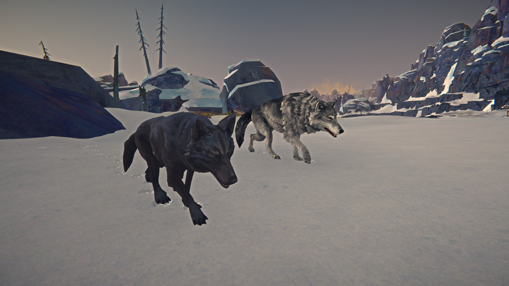_A slightly smaller Wolf compared to a Timberwolf_ Each pack has a varying degree of morale at the start of every confrontation, with the total amount dependent on the initial size of the pack. Timberwolves will not give up attacking the player until enough of the pack is killed, the player escapes to a safety, 1 pack member is left alive, or morale is fully depleted. Escaping indoors will cause unique audio cues to play, with the Timberwolves growling and clawing at the door in an attempt to get inside, at least until enough time passes for the pack to lose interest in the player.

## Drops

A [Timberwolf Carcass](./Timberwolf%20Carcass.md) may be harvested for 4.00-7.00 kg of [raw meat](./Wolf%20Meat%20%28Raw%29.md), 1 [Fresh Wolf Pelt](./Fresh%20Wolf%20Pelt.md) and 2 guts.

Despite having a different colored coat, ordinary black Wolf Hides are produced from the Carcass and can be cured to craft a [Wolfskin Coat](./Wolfskin%20Coat.md), [Wolfskin Pants](./Wolfskin%20Pants.md), or [Wolfskin Hat](./Wolfskin%20Hat.md).

|  | Item | Quantity | Rarity |
| --- | --- | --- | --- |
| [Wolf Meat (Raw) icon](../assets/Wolf_Meat_%28Raw%29_icon.png) | [Wolf Meat (Raw)](./Wolf%20Meat%20%28Raw%29.md)* | 4 - 7 | Always[¹](#fn1) |
| [Wolf Quarter icon](../assets/Wolf_Quarter_icon.png) | [Wolf Quarter](./Wolf%20Quarter.md) | 1 - 2 | Always[²](#fn2) |
| [Fresh Wolf Pelt icon](../assets/Fresh_Wolf_Pelt_icon.png) | [Fresh Wolf Pelt](./Fresh%20Wolf%20Pelt.md) | 1 | Always |
| [Fresh Gut icon](../assets/Fresh_Gut_icon.png) | [Fresh Gut](./Fresh%20Gut.md) | 2 | Always |

*Note: Wolf Meat has a [Risk of Intestinal Parasites](./Risk%20of%20Intestinal%20Parasites.md) on higher difficulties.

Animal Fat is produced automatically when harvesting raw meat. It cannot be harvested separately and does not appear when Harvesting a Carcass.

|  | Item | Quantity | Rarity |
| --- | --- | --- | --- |
| [Animal Fat icon](../assets/Animal_Fat_icon.png) | [Animal Fat](./Animal%20Fat.md) | 0.10 per kg of meat | Always |

## Behavior

> “**Nothing good about that sound...**”
>
> — Astrid upon hearing a Timberwolf howl in [Episode 3](./Episode%203%20-%20Crossroads%20Elegy.md)

Unlike common Wolves, Timberwolves do not 'stalk' the player, instead howling upon detection and attacking as a pack. Timberwolves will attempt to encircle the player and take turns diving in for attacks, either as a Struggle or as a "drive-by" hit and run attacks whereby they damage the player and briefly retreat. In [Wintermute](./Episode%203%20-%20Crossroads%20Elegy.md), Timberwolves will also attack rescued [survivors](./Crash%20Survivor.md) lying on the ground.

- Timberwolves are drawn to [Scent](./Scent.md) of meat, [Baiting](./Scent.md#Baiting%2FDecoys) decoys, or [Blood Loss](./Blood%20Loss.md).
- Timberwolves will individually hunt [Rabbits](./Rabbit.md), [Ptarmigan](./Ptarmigan.md), and [Deer](./Deer.md), but flee from [Bears](./Bear.md) and [Moose](./Moose.md). A pack will initiate a hunt if they detect the player even when feeding on slain prey.
- Lone Timberwolves (when the rest of its pack has been killed) always flee from the player.
- Only one Timberwolf will attack the player a time. Aiming a weapon at a hostile Timberwolf which is not currently attacking may cause it to briefly pause.
- Timberwolves prefer bite and run tactics on the player, often taking turns to bite a survivor. It is possible for a single Timberwolf to initiate a [Struggle](./Struggle.md) if the player stands still or turns away from a Timberwolf.
- Like other [Wildlife](./Wildlife.md), Timberwolves flee from nearby gunshots and bullet/arrows/stone impacts if they have not detected the player.
- Timberwolves will not give up a hunt if the player enters a [Vehicle](./Vehicle.md) or building interior until half a day of not reaching the player passes or the player saves and loads the game. Fleeing into buildings may create a unique audio file to play of Timberwolves growling and attempting to scratch the door down.
- Like Wolves, Timberwolves may be frightened by a worn [Wolfskin Coat](./Wolfskin%20Coat.md), [Bearskin Coat](./Bearskin%20Coat.md), or [Bear Skin Bedroll](./Bear%20Skin%20Bedroll.md), but only before the pack howls/engages a hunt. A single wolf may flee, but if other Timberwolves are nearby and detect the player, they may not be frightened and a hunt may begin.

### Morale

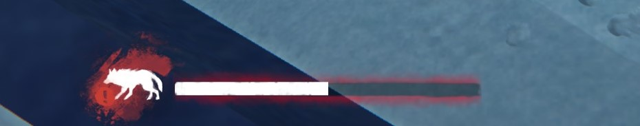

> “**Timberwolf packs have Morale, indicated by a red meter. Timberwolf Morale can be broken by shooting or throwing things at them. Packs with broken Morale will flee, but may return once they recover.**”
>
> — [Episode 3](./Episode%203%20-%20Crossroads%20Elegy.md) Description

When a Timberwolf detects the player, they will howl and alert other pack mates, followed by the morale bar appearing. It is possible to turn off the indicator in the options for a more immersive but difficult experience. If a separate Timberwolf pack comes into contact with the player, there is a chance that both packs will begin attacking the player together (with separate unseen Morale bars).

Timberwolves will continue to attack the player until the following conditions are met:

- Until the morale of their pack is fully depleted
- If most of the pack is killed
- If the player moves far enough from the pack's home territory
- Passing time in a safe indoor location (such as a vehicle or outdoor, indoor space) will cause packs to give up, but this may take upwards of 12 hours.
- The player transitions to an interior/another region (this will just despawn the whole pack along with all other wildlife)

[Marine Flares](./Marine%20Flare.md) are effective at stopping a charging Timberwolf, although normal Flares/Torches are not. Both types of flare are effective at deterring Timberwolves just outside their lunge distance. Once a pack's morale is depleted, surviving members flee and will not attack again until their morale regenerates (~1 hour in-game). A single lit Marine Flare can be used to fully deplete a pack's morale by repeatedly throwing it at the ground between the player and a Timberwolf, and then retrieving the flare.

[Campfires](./Campfire.md) have limited deterrence value against Timberwolf hunts, as they will not attack through them, but instead encircle it and 'hold ground' around the player. Torches pulled from a lit campfire may be thrown at Timberwolves to deplete their morale.

Injured Timberwolves do not participate in attacks (though it takes a few seconds for them to realize they are injured), and they flee from the player even if the pack has high morale. If every Timberwolf in the pack is injured, then the player is safe from attack, though the morale bar will only disappear once enough of the Timberwolves have bled to death.

### Lowering Morale

Morale can be lowered by shooting or throwing objects at the Timberwolves.

- [Hunting Rifle](./Hunting%20Rifle.md), [Survival Bow](./Survival%20Bow.md), [Revolver](./Revolver.md), and [Distress Pistol](./Distress%20Pistol.md) shots that land on a Timberwolf inflict large Morale loss
  - A near miss shot lowers morale far less, but nonetheless scares the pack
- Throwing objects at Timberwolves (Lit [Torch](./Torch.md), [Flare](./Flare.md), Marine Flare, [Stone](./Stone.md)) slightly lowers Morale
- Killing a pack member causes devastating morale loss to the pack

- [Noisemaker](./Noisemaker.md) explosions cause moderate Morale loss if the explosion does not damage/kill a pack member. Killing/damaging a pack mate with a Noisemaker causes large Morale loss due to the fear of the explosion as well as damage to the pack mate.
- Flashlight high beams will cause Aurora Timberwolves to stop their attack as well as cause morale damage, rendering flashlights a safe and inexpensive way to stay safe from Timberwolves during an Aurora.

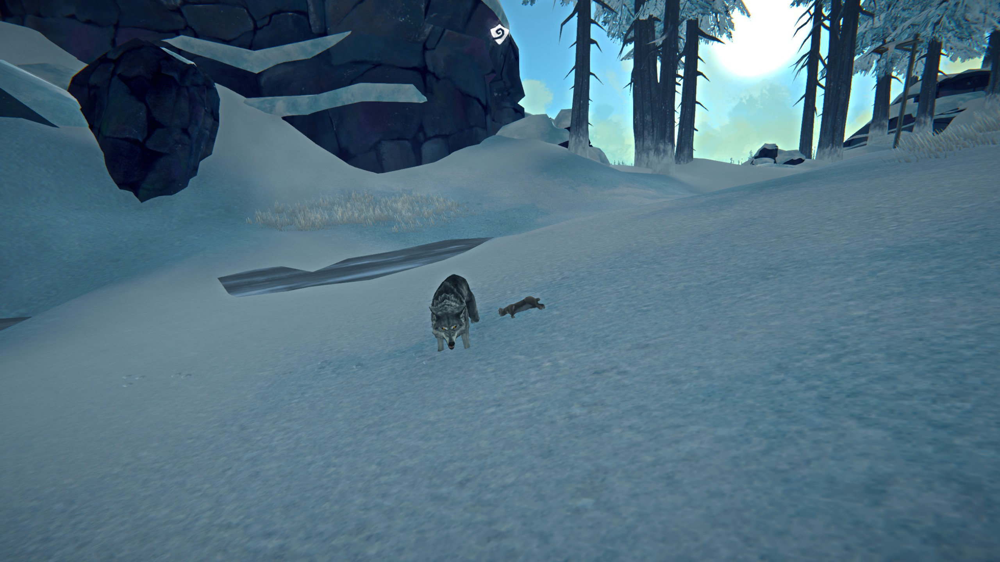

### Lone Wolves after Pack dissolvement

If a Timberwolf pack is thoroughly culled, individual surviving Timberwolves from that pack will flee to a safe distance any time they detect the player. In this state, they will continue to individually hunt [Rabbits](./Rabbit.md), [Ptarmigan](./Ptarmigan.md), and [Deer](./Deer.md) as normal. If they successfully hunt a prey animal and the player approaches them, rather than running away they instead will defend kills like normal Wolves. In this state, they can be scared off by aimed weapons. Unlike regular Wolves defending kills, a lone Timberwolf will always run away when defending a kill if the player gets too close, rather than initiate a Struggle.

Lone Timberwolves will not join another Timberwolf pack should they come across one, and remain treated as individuals.

### Aurora Timberwolf

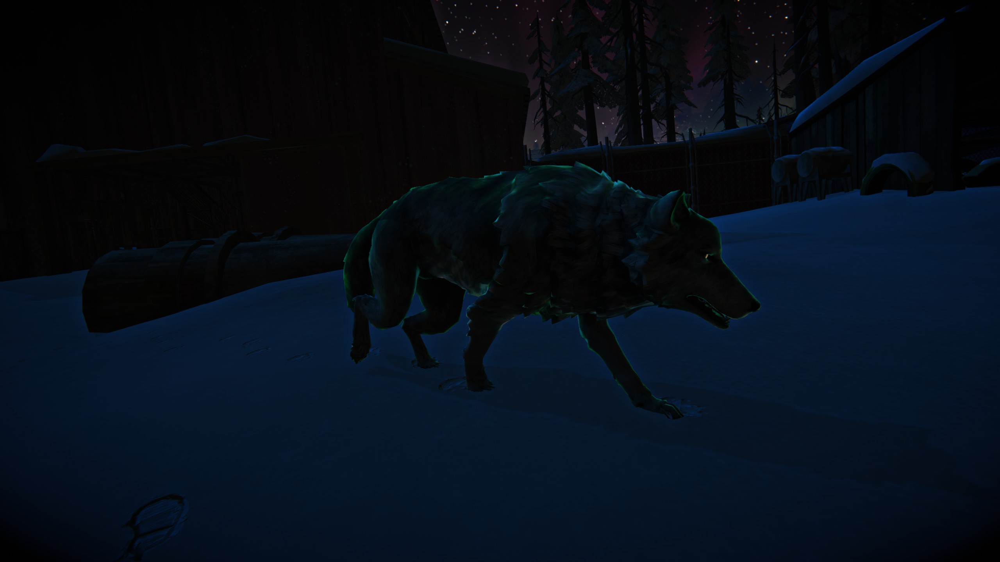_An Aurora Timberwolf_ During an [Aurora](./Aurora.md), Timberwolves will turn green and become far more aggressive. They take more damage to kill, no longer fear fire, and their pack Morale is much harder to deplete. They do however fear the [Flashlight](./Flashlight.md) and street lights. Great care should be taken when traveling during an Aurora, as Timberwolf packs are more persistent and aggressive when it comes to chasing the player down.

- Aurora Timberwolves do not fear [Flares](./Flare.md) or lit [Torches](./Torch.md) (throwing these at them will still damage their Morale). Aurora Timberwolves also no longer fear Marine Flares.
- Morale tends to be twice as long as normal or at maximum when they attack the player even with a small pack size.
- They fear active street lights, and will stand and growl at the player if they pass near the boundary of one. After enough time, they will run away in fear if they cannot reach the player, but will eventually return to attack the player if their Morale is not broken.
- They fear [Flashlight](./Flashlight.md) high beams and will temporarily stop a charge as long as they are on. Flashlight's high beams are also effective at reducing pack morale, as per patch notes from June 2020.
- They will stay away from lit [Campfires](./Campfire.md), but will still stay close by and stalk to the player.

## Evasion Strategies

Timberwolves are competent in fights which makes detecting, avoiding, or escaping them preferable to combat.

- Lit Torches, Flares and especially Marine Flares are effective deterrents. A charging Timberwolf will stop and growl/hold ground a short distance away. Approaching a Wolf/Timberwolf holding ground will likely result in an attack, as will staying still for more than a few moments, keeping moving is critical for effective deterrence.
- Marine Flares are effective at frightening Timberwolf packs by igniting and repeatedly throwing/retrieving it.
- Noisemakers are effective at frightening Timberwolves and Aurora Timberwolves.
- Timberwolves are territorial; simply avoiding their areas is effective. The edges of regions are usually safe. Timberwolves avoid [Bear](./Bear.md) and [Moose](./Moose.md) territory.
- Timberwolves must see the player to alert their pack, so crouching or hiding behind terrain is effective, though [Scent](./Scent.md) or noise can attract them. If un-alerted, Timberwolves can be lured by thrown stones or waiting until they move away.
- Upon detection, Timberwolves take several seconds to howl before beginning their assault. This provides a short window of opportunity to sprint to safety, start a fire, or ready a weapon.
- It is possible to outrun a pack, especially with a lit Flare/Marine Flare, as packs are optimized to fight stationary or slow players. Leaving their territory (entering the territory of a different pack or a bear/moose) will cause them to disengage.
- Timberwolves run at the same speed as a player sprints. Being overburdened, carrying a Mobility penalty (from worn clothing), steep terrain, or headwinds can allow Timberwolves to catch up while sprinting, but for the most part the player is safe from attack until sprint runs out.
- Passing time inside will cause a pack to disengage. This does not work in pseudo-indoor areas like Pensive Lookout, but quitting and reloading the game (such as after sleeping) will reset the pack: though they may immediately re-agro if they are very close.
- When entering an indoors area which is outside of the packs territory (example: being chased to the [Foreman's Clearcut](./Foreman%27s%20Clearcut.md) trailer from [Cook's Farm](./Cook%27s%20Farm.md)) listen carefully and if the sound of barking is not heard, you can exit the door immediately after entering, the pack having returned to their territory.
- During an Aurora the flashlight, streetlights, and vehicle headlights are effective against aurora Timberwolves.

## Fight Strategies

Timberwolves can be fought with the right tools or tactics.

- Assassination from stealth is often the best strategy for destroying a pack. This generally requires a Rifle, or a Bow with Archery 5, as they will detect a non-crouching player. Timberwolves generally do not react to their pack mates being killed allowing the entire pack to be eliminated from stealth.
- Thrown [marine flares](./Marine%20Flare.md) are very effective at depleting a pack's morale; even one can be enough to deter the pack by throwing and retrieving it.
- Terrain such as cliffs, ledges, boulders, or fallen trees are useful as chokepoints or for protecting from attacks entirely.
- Standing next to a campfire provides considerable protection from attack, in addition to this, one can pull Torches from the campfire to continuously throw at Timberwolves to deplete the pack morale.
- [Snow shelters](./Snow%20Shelter.md) can provide protection from attack, but may require leaving the shelter to continue a fight. Field of view is also limited, so the direction of a shelter is crucial since timberwolves can gather behind the snow shelter (in blind spots).
- The [Distress Pistol](./Distress%20Pistol.md) is effective at depleting morale, but its cumbersome reload and relative quietness, opens the survivor up to the other wolves. A well placed shot can deplete up to 1/4 of a pack's morale.
- As with other predators, it is possible to sneak up close to Timberwolves while crouched and redirect them with thrown stones or by picking up/dropping smelly items. This allows them to be hunted more effectively without starting an attack. A mastered [Survival Bow](./Survival%20Bow.md) (level 5 skill) is well suited for this method.

## Locations

Timberwolves are most abundant in the following regions:

- [Blackrock](./Blackrock.md)
- [Bleak Inlet](./Bleak%20Inlet.md)
- [Sundered Pass](./Sundered%20Pass.md)
- [Pleasant Valley](./Pleasant%20Valley.md) (Wintermute [Episode 3: Crossroads Elegy](./Episode%203%20-%20Crossroads%20Elegy.md) only)

Following the Wildlife Refresh ([December 2024](./Tales%20from%20the%20Far%20Territory.md)) Timberwolves have a chance to sometimes spawn in the following six regions:

- [Ash Canyon](./Ash%20Canyon.md)
  - On the [Bitter Marsh](./Bitter%20Marsh.md) ice, near the fishing hut.
- [Broken Railroad](./Broken%20Railroad.md)
  - On the plateau with the [Hunting Lodge](./Hunting%20Lodge.md).
- [Coastal Highway](./Coastal%20Highway.md)
  - On the ice near [Coastal Townsite](./Coastal%20Townsite.md).
  - On the ice between [Misanthrope's Homestead](./Misanthrope%27s%20Homestead.md) and the [Waterfront Cottages](./Waterfront%20Cottages.md).
  - On the ice between [Fishing Camp](./Fishing%20Camp.md) and [Log Sort](./Log%20Sort.md).
- [Hushed River Valley](./Hushed%20River%20Valley.md)
  - Along the [Hushed River](./Hushed%20River.md) by [Twin Sisters Falls](./Twin%20Sisters%20Falls.md).
- [Pleasant Valley](./Pleasant%20Valley.md)
  - In the fields around the [Farmstead](./Pleasant%20Valley%20Farmstead.md).
  - in the large field between the [Farmstead](./Pleasant%20Valley%20Farmstead.md) and the [Outbuildings](./Pleasant%20Valley%20Outbuildings.md).
  - In the field between the [Outbuildings](./Pleasant%20Valley%20Outbuildings.md) and [Thomson's Crossing](./Thomson%27s%20Crossing.md).
  - At [Skeeter's Ridge](./Skeeter%27s%20Ridge.md).

- [Timberwolf Mountain](./Timberwolf%20Mountain.md)
  - Around the [Wing](./Wing.md).
  - On the ice at [Crystal Lake](./Crystal%20Lake.md), next to the [Mountaineer's Hut](./Mountaineer%27s%20Hut.md).
  - Eric's Falls.

## Trivia

- Timberwolves are based on [Eastern Wolves](https://en.wikipedia.org/wiki/Eastern_wolf), or the Algonquin Timber Wolf (**_Canis lycaon**''), and are a Canine subspecies of the regular [Wolf](./Wolf.md) (**_Canis lupus**'').
- Timberwolves will spawn during blizzards in both story and survival mode.
- Timberwolves would ironically be absent from the titular [Timberwolf Mountain](./Timberwolf%20Mountain.md) when it was released in [version 0.212](./The%20Long%20Dark%20%E2%80%94%20Early%20Access%20Changelog.md#0.212).
  - Timberwolves were added in [Episode 3: Crossroads Elegy](./Episode%203%20-%20Crossroads%20Elegy.md) (V1.60) in Wintermute, then to Survival Mode with the Errant Pilgrim update (V1.64).
  - Timberwolves would finally have a chance to appear in the Timberwolf Mountain region with the Global Wildlife Refresh in the Part 6 Tales from the Far Territory update (V2.33).
- "The Timberwolf" is a track that originally played during timberwolf encounters in Wintermute Episode 3, later removed in an update. The track is still available to listen to on composer Cris Velasco's website.[³](#fn3)

## Gallery

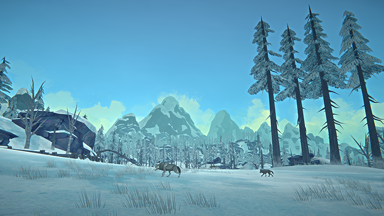

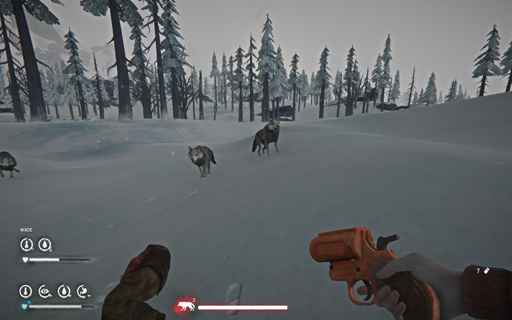

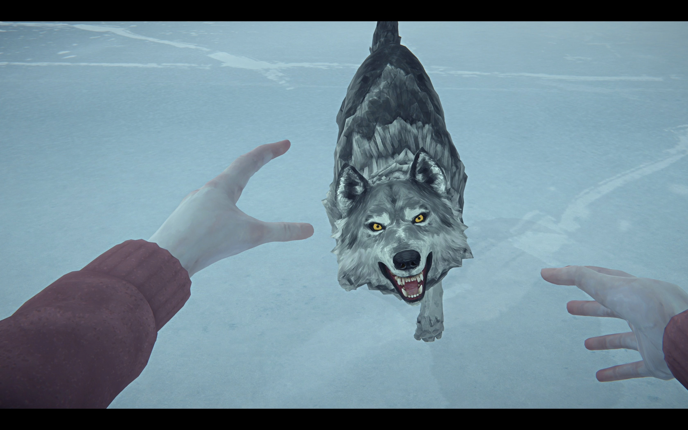

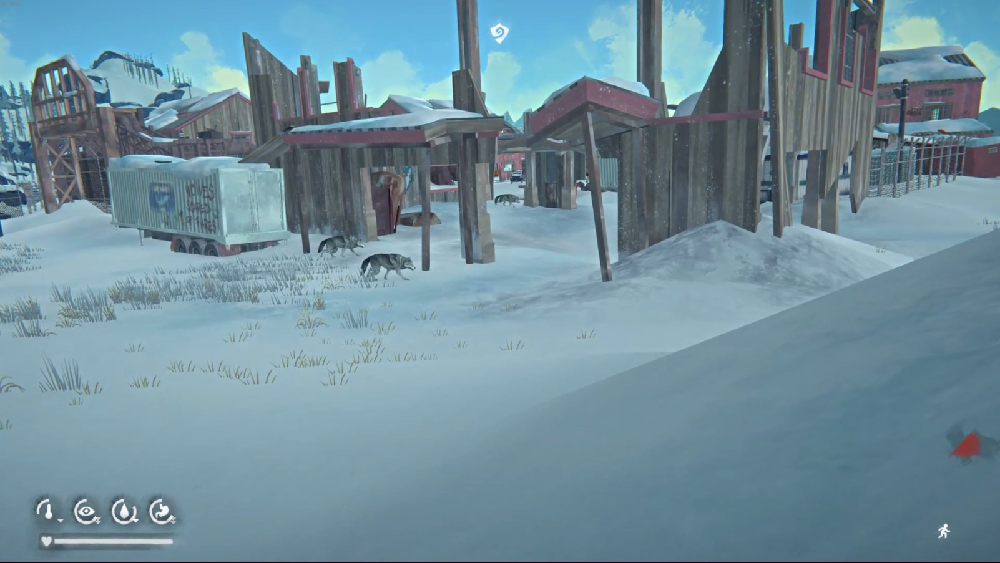

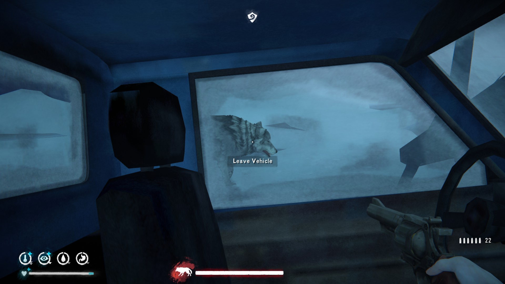

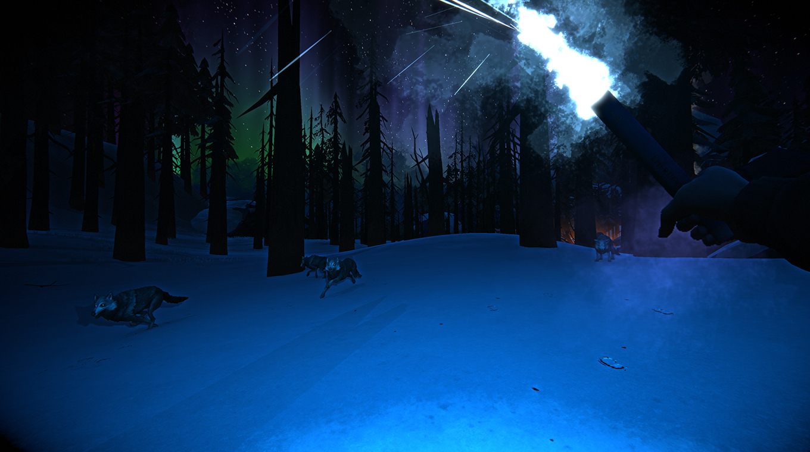

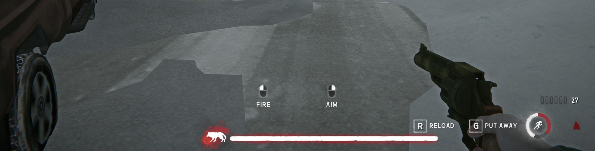

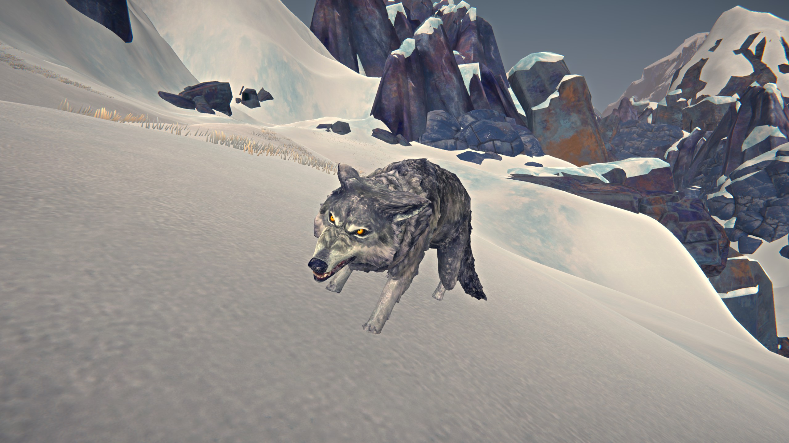

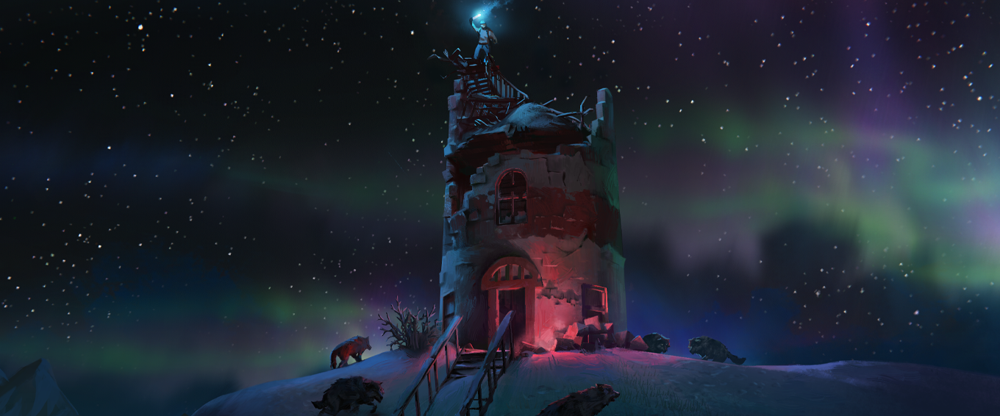

_Concept art of Timberwolves at the [Fallen Lighthouse](./Fallen%20Lighthouse.md)._

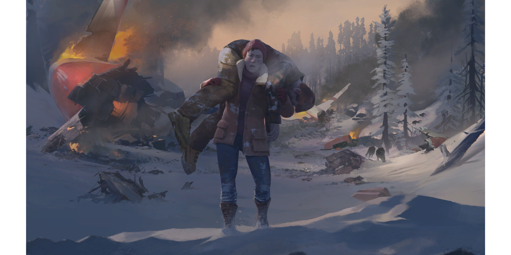

## Update history

- UPDATE **27 June 2020 ([Update](./The%20Long%20Dark%20%E2%80%94%20Changelog%20%E2%80%94%20Archive%202.md#1.79)):**
  - [Gameplay] Fixed an issue that prevented Timberwolves Pack Morale from being drained when using the Flashlight’s high beam.
  - [WINTERMUTE] Timberwolves will now react to the Flashlight when appearing in WINTERMUTE.

- HOTFIX **20 January 2020 ([Update](./The%20Long%20Dark%20%E2%80%94%20Changelog%20%E2%80%94%20Archive%202.md#1.71)):**
  - [EP3] Players can no longer skip the Timberwolf Tutorial, by placing a survivor at the same time the tutorial triggers.
  - [AI] Fixed an issue that allowed Timberwolves to become hostile, regardless of game mode settings.
  - [AI] Fixed issue that prevented Timberwolves from attacking the Player, if they have entered and exited a vehicle.
  - [AI] Timberwolves will now only pick valid locations to wander to, preventing them from becoming stuck.

- HOTFIX **18 December 2019 ([Update](./The%20Long%20Dark%20%E2%80%94%20Changelog%20%E2%80%94%20Archive%202.md#1.69)):**
  - [AI] Timberwolves will no longer freeze in place if they try to attack a target they can’t pathfind to.
  - [Animation] Pass on Timberwolves to fix numerous animation pops and hitches.
  - [Audio] When joining a pack, Timberwolf howls are no longer cut off or repeated.

- HOTFIX **14 December 2019 ([Update](./The%20Long%20Dark%20%E2%80%94%20Changelog%20%E2%80%94%20Archive%202.md#1.66)):**
  - [WINTERMUTE] Timberwolf carcasses no longer disappear if the Player saves, then reloads.
  - [Survival] Timberwolves will now hunt prey, as intended.
  - [AI] Added additional line of sight check to Timberwolves, to prevent attacks through walls and out of reach locations.
  - [AI] Timberwolves will now break-off their attack if a Marine Flare is lit, before the struggle occurs.
  - [AI] Timberwolves can no longer flee to excessive distances.

- UPDATE **10 December 2019 ([Update](./The%20Long%20Dark%20%E2%80%94%20Changelog%20%E2%80%94%20Archive%202.md#1.64)):**
  - [WINTERMUTE] Male survivor vocalization no longer plays when Astrid is attacked by Timberwolves.
  - [WINTERMUTE] Timberwolves now react properly to Marine Flares.

- HOTFIX **1 November 2019 ([Update](./The%20Long%20Dark%20%E2%80%94%20Changelog%20%E2%80%94%20Archive%202.md#1.62)):**
  - Fixed issue that caused players to be forced out of aim when attacked by a Timberwolf.
  - Adjusted the distance which Timberwolves will hold ground when the player is holding a lit Marine Flare.
  - Fixed Timberwolves howling more than intended.
  - Fixed Timberwolf corpses resetting after transitioning indoors.

- HOTFIX **29 October 2019 ([Update](./The%20Long%20Dark%20%E2%80%94%20Changelog%20%E2%80%94%20Archive%202.md#1.61)):**
  - Fixed Timber Wolves Morale bar resetting if they fled during the Tutorial.
  - Fixed issue preventing Timber Wolves from transitioning to and from Aurora state.

- UPDATE **22 October 2019 ([Update](./The%20Long%20Dark%20%E2%80%94%20Changelog%20%E2%80%94%20Archive%202.md#1.60)):**
  - Added to game

== References ==  **Template:wildlife**

## Notes

---

1. If carcass is harvested[↩︎](#fnref1)
2. If carcass is quartered.[↩︎](#fnref2)
3. [Cris Velasco official website](https://crisvelasco.com)[↩︎](#fnref3)
