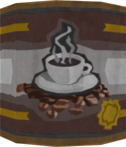

# Tin of Coffee

**Contents**

- [Obtaining](#Obtaining)
- [Products](#Products)
- [Update history](#Update_history)
- [Gallery](#Gallery)

  
*For the consumable item, see <a href="./Cup%20of%20Coffee.md" class="wikilink" title="Cup of Coffee">Cup of Coffee</a>.*

<table class="infobox">
<caption>Tin of Coffee</caption>
<colgroup>
<col style="width: 50%" />
<col style="width: 50%" />
</colgroup>
<tbody>
<tr>
<td colspan="2"><figure>

<figcaption>Tin_of_Coffee_icon.png</figcaption>
</figure></td>
</tr>
<tr>
<td>
Release
</td>
<td>
<a href="./The%20Long%20Dark%20%E2%80%94%20Changelog.md#0.181" class="wikilink" title="17 December 2014">17 December 2014</a>
</td>
</tr>
<tr>
<td>
Wintermute
</td>
<td>
No
</td>
</tr>
<tr>
<td>
Renewable
</td>
<td>
Yes (<a href="./Trader.md" class="wikilink" title="Trader">Trader</a> only)
</td>
</tr>
<tr>
<td colspan="2" class="section">
<strong>Properties</strong>
</td>
</tr>
<tr>
<td>
Item type
</td>
<td>
<a href="./Food%20And%20Drink.md" class="wikilink" title="Food And Drink">Food And Drink</a>|-
</td>
</tr>
<tr>
<td>
Stackable
</td>
<td>
Yes
</td>
</tr>
<tr>
<td>
Examine
</td>
<td>
A tin of ground coffee. Who knows how long it's been sitting here? A drink that can take the edge off fatigue, and warm your insides on a cold night.
</td>
</tr>
<tr>
<td colspan="2" class="section">
<strong>Values</strong>
</td>
</tr>
<tr>
<td>
Weight
</td>
<td>
0.01 kg (0.02 lbs)
</td>
</tr>
<tr>
<td colspan="2" class="section">
<strong>Decay Rate</strong>
</td>
</tr>
<tr>
<td>
Inside
</td>
<td>
0.100% per day
</td>
</tr>
<tr>
<td>
Outside
</td>
<td>
0.100% per day
</td>
</tr>
<tr>
<td colspan="2" class="section">
<strong>Actions</strong>
</td>
</tr>
<tr>
<td>
Backpack
</td>
<td>
Drop
</td>
</tr>
<tr>
<td>
On ground
</td>
<td>
Take It, Leave It
</td>
</tr>
<tr>
<td colspan="2" class="section">
<strong>Advanced data</strong>
</td>
</tr>
<tr>
<td>
Item key
</td>
<td>
GAMEPLAY_CoffeeTin
</td>
</tr>
</tbody>
</table>

A **Tin of Coffee** is a <a href="./Food%20And%20Drink.md" class="wikilink" title="drink">drink</a> which can be brewed into a <a href="./Cup%20of%20Coffee.md" class="wikilink" title="Cup of Coffee">Cup of Coffee</a> at a <a href="./Fire.md" class="wikilink" title="Fire">Fire</a> with <a href="./Water%20%28Potable%29.md" class="wikilink" title="potable water">potable water</a>. Consuming the cup of coffee will restore 10% of the survivor's <a href="./Fatigue.md" class="wikilink" title="Fatigue">Fatigue</a>, add some hydration and 100 calories, and provide the <a href="./Fatigue%20Reduced.md" class="wikilink" title="Fatigue Reduced">Fatigue Reduced</a> benefit, making this item very useful when exploring regions with lots of <a href="./Rope%20Climbing.md" class="wikilink" title="Rope Climbing">Rope Climbing</a> or when trying to <a href="./Escape%20the%20Darkwalker.md" class="wikilink" title="Escape the Darkwalker">Escape the Darkwalker</a>.

Survivors cannot directly consume a Tin of Coffee.

## Obtaining

Tins of Coffee can be found in all difficulty levels, though they may be difficult to find in Interloper. There are several (up to 10) tins in the <a href="./Cargo%20Container.md" class="wikilink" title="Cargo Container">Cargo Containers</a> around <a href="./Timberwolf%20Mountain.md" class="wikilink" title="Timberwolf Mountain">Timberwolf Mountain</a>, specifically in the <a href="./Echo%20Ravine.md" class="wikilink" title="Echo Ravine">Echo Ravine</a> and at the <a href="./Summit.md" class="wikilink" title="Summit">Summit</a>. Aside from that, Tins of Coffee are most commonly found in kitchens of houses, where they may spawn on countertops or in the cabinets. <a href="./File%20Cabinet.md" class="wikilink" title="Filing Cabinets">Filing Cabinets</a> are also a relatively reliable source of coffee. Coffee may also occasionally be found in <a href="./Metal%20Container.md" class="wikilink" title="Metal Containers">Metal Containers</a>, which can be found in cabins and trailers.

If finding coffee happens to be a priority, good locations to start searching include:

- <a href="./Thomson%27s%20Crossing.md" class="wikilink" title="Thomson&#39;s Crossing">Thomson's Crossing</a>, <a href="./Pleasant%20Valley%20Farmstead.md" class="wikilink" title="Pleasant Valley Farmstead">Pleasant Valley Farmstead</a>, and <a href="./Signal%20Hill.md" class="wikilink" title="Signal Hill">Signal Hill</a> in <a href="./Pleasant%20Valley.md" class="wikilink" title="Pleasant Valley">Pleasant Valley</a>,
- <a href="./Coastal%20Townsite.md" class="wikilink" title="Coastal Townsite">Coastal Townsite</a> in <a href="./Coastal%20Highway.md" class="wikilink" title="Coastal Highway">Coastal Highway</a>, and
- the many houses of <a href="./Milton.md" class="wikilink" title="Milton">Milton</a>.

Each of these locations will usually yield at least one or two tins, even on harder difficulties.

Coffee is a renewable resource since the introduction of the <a href="./Trader.md" class="wikilink" title="Trader">Trader</a>.

## Products

## Update history

- UPDATE **17 December 2014 (<a href="./The%20Long%20Dark%20%E2%80%94%20Early%20Access%20Changelog.md#0.181" class="wikilink" title="Update">Update</a>):**
  - Added to game.

==Trivia==

- The tin is branded as *Big Moose Kicks Coffee*.
- The back of the tin lists "Ingredients: Coffee Beans" and "Product of Canada."

## Gallery

<table class="gallery">
<colgroup>
<col style="width: 50%" />
<col style="width: 50%" />
</colgroup>
<tbody>
<tr>
<td><figure>

<figcaption>Pre-Alpha model (Historic)</figcaption>
</figure></td>
<td><figure>
[Missing image: Moose_Mug_Coffee_Real.webp]
<figcaption>The real world Coffee Tin Cup released by Hinterland</figcaption>
</figure></td>
</tr>
</tbody>
</table>

**Lua execution error in Module:Navbox function navbox** <a href="ru:%D0%91%D0%B0%D0%BD%D0%BA%D0%B0_%D0%BA%D0%BE%D1%84%D0%B5" class="wikilink" title="ru:Банка кофе">ru:Банка кофе</a>

