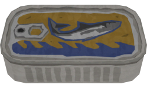

# Tin of Sardines

**Categories:** Food And Drink, Pages with update history · **Source:** [Fandom](https://thelongdark.fandom.com/wiki/Tin_of_Sardines)

**Contents**

- [Overview](#overview)
- [Trivia](#trivia)
- [Gallery](#gallery)
- [Update history](#update-history)

**Tin of Sardines**

[Tin of Sardines icon](../assets/Tin_of_Sardines_icon.png)

**Release:** [22 September 2014](./The%20Long%20Dark%20%E2%80%94%20Changelog.md#0.117)

**Wintermute:** No

**Renewable:** Yes ([Beachcombing](./Beachcombing.md))

**Properties**

**Item type:** [Food And Drink](./Food%20And%20Drink.md)

**Stackable:** No

**Examine:** Little fish in a can.

**Values**

**Calories:** 300 kcal

**Hydration:** 5%

**[Vitamin C](./Scurvy.md):** Minor (3%)

**Weight:** 0.10 kg (0.22 lbs)

**Decay Rate**

**Inside:** 0.067% per day

**Outside:** 0.333% per day

**Advanced data**

**Item key:** GAMEPLAY\_TinofSardines

**Tin of Sardines** is a packaged [food](./Food%20And%20Drink.md) item in [_The Long Dark_](./The%20Long%20Dark.md).

## Overview

Consuming a Tin of Sardines provides up to 300 calories of [energy](./Hunger.md) and 5% [hydration](./Thirst.md), and weighs a mere 0.10kg. They can be found commonly in all regions, usually inside cabinets, houses, stores and [Vehicles](./Vehicle.md) and especially in [Bleak Inlet](./Bleak%20Inlet.md) inside the [Last Resort Cannery](./Last%20Resort%20Cannery.md). Tin of Sardines are a modestly energy-dense food item. However, they have a high chance of [Food Poisoning](./Food%20Poisoning.md) if consumed below 50% of the item's Condition, increased further below 30% condition, though not as high a chance as low condition cooked meat.

Unlike other canned goods, thanks to their pull-tab Tin of Sardines can opened without a [Can Opener](./Can%20Opener.md), however consuming them yields no [Recycled Can](./Recycled%20Can.md).

The Last Resort Cannery in Bleak Inlet has a substantial stock of Tins of Sardines in various states of decay. Their abundance in crates suggests outbound shipping slowed or stopped before the production line halted.

Tin of Sardines can cause Food Poisoning, elevated at low item condition, and [decays](./Decay.md) more slowly when indoors.

## Trivia

- Tin of Sardines are packaged as a product called "_Last Resort"_, a product of the titular "Last Resort Cannery" in Bleak Inlet.
- The bottom of the tin list "Ingredients: Sardines, Water, Salt." and "Made in Canada"
- The Examine text is likely a reference to the Stan Rogers song 'Tiny Fish for Japan'

## Gallery

## Update history

- UPDATE **22 September 2014 ([Update](./The%20Long%20Dark%20%E2%80%94%20Early%20Access%20Changelog.md#0.117)):**
  - Added to game.
