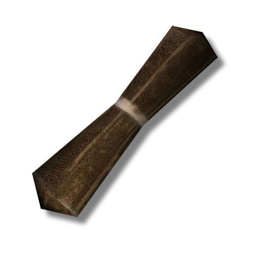
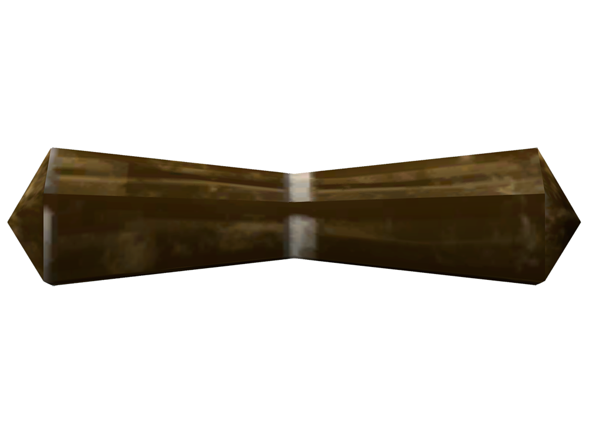

# Tinder Plug

**Categories:** Fire Starting · **Source:** [Fandom](https://thelongdark.fandom.com/wiki/Tinder_Plug)

**Contents**

- [Overview](#overview)
- [Fire Starting info](#fire-starting-info)
- [Crafting](#crafting)
- [Stick](#stick)
- [Newsprint](#newsprint)
- [Newspaper Roll](#newspaper-roll)
- [Stack of Papers](#stack-of-papers)
- [Gallery](#gallery)

**Tinder Plug**

| Property | Details |
| --- | --- |
|  |  / _Tinder\_Plug\_icon.png_ |
| **General** |  |
| Item Type | Fire Starting\|- |
| Firestarting Slot | Tinder |
| **Statistics** |  |
| Weight | 0.05 kg(0.11 lbs) |

> “__A small plug or bundle of flammable material (paper, wool, cloth, dry bark or needles, etc.) required to start a fire.__”
>
> — In-game description

A **Tinder Plug** is a material item used as Tinder.

## Overview

Tinder plugs fill the role of tinder, which is used for [Fire Starting](./Fire%20Starting.md). Tinder plugs are the lightest tinder, tied with the [Cat Tail Head](./Cat%20Tail%20Head.md), [Birch Bark](./Birch%20Bark.md), and [Cash](./Cash.md), and weighs only 0.05 kg per unit. Like all other types of tinder, it does not increase the chance to successfully light a fire.

Tinder or Tinder plugs are required until Fire Starting Level 3, at which point they become optional and generally only used to get rid of the item.

Tinder plugs can be found inside containers, crafted from most forms of tinder, or harvested from a [Cardboard Box](./Cardboard%20Box.md). At least one is also given along with firewood when chopping a fir or cedar limb with a [Hatchet](./Hatchet.md) or [Hacksaw.](./Hacksaw.md)

## Fire Starting info

**Tinder Plug**

| Property | Details |
| --- | --- |
| Type | Tinder |
| **Statistics** |  |
| Start Chance |  0% |

## Crafting

Tinder plugs can be crafted or harvested from some fire starting items, such as [Newsprint](./Newsprint.md), [Newsprint Roll](./Newsprint%20Roll.md), and [Sticks](./Stick.md). Harvesting these items provides additional tinder at the same weight, conserving inventory space. The most efficient example is the Newsprint Roll, which yields 4 tinder plugs.

### Stick

**Tinder Plug**

| Property | Details |
| --- | --- |
|  | - |
|  | - |
|  | 5 minutes |
| **Requirements** |  |
| Facility | \[\[File:Anywhere icon.png |
| **Materials** |  |
| **Template:iconlink plain** |  |
| Item | [Stick](./Stick.md) |
| Quantity | 1 |

### Newsprint

**Tinder Plug**

| Property | Details |
| --- | --- |
|  | - |
|  | - |
|  | 10 minutes |
| **Requirements** |  |
| Facility | \[\[File:Anywhere icon.png |
| **Materials** |  |
| **Template:iconlink plain** |  |
| Item | [Newsprint](./Newsprint.md) |
| Quantity | 1 |

### Newspaper Roll

**Tinder Plug**

| Property | Details |
| --- | --- |
|  | - |
|  | - |
|  | 10 minutes |
| **Requirements** |  |
| Facility | \[\[File:Anywhere icon.png |
| **Materials** |  |
| **Template:iconlink plain** |  |
| Item | [Newsprint Roll](./Newsprint%20Roll.md) |
| Quantity | 1 |

### Stack of Papers

**Tinder Plug**

| Property | Details |
| --- | --- |
|  | - |
|  | - |
|  | 10 minutes |
| **Requirements** |  |
| Facility | \[\[File:Anywhere icon.png |
| **Materials** |  |
| **Template:iconlink plain** |  |
| Item | [Stack of Papers](./Stack%20of%20Papers.md) |
| Quantity | 1 |

## Gallery

_old model_
