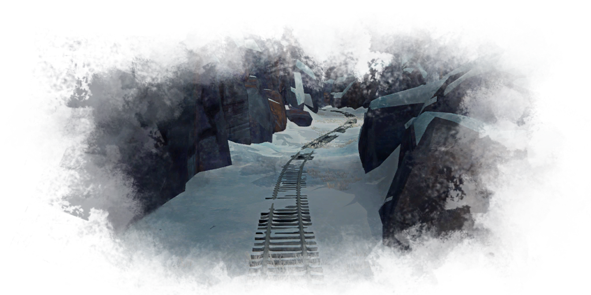

# To SAR And Back

<table class="infobox">
<caption>To SAR And Back</caption>
<colgroup>
<col style="width: 50%" />
<col style="width: 50%" />
</colgroup>
<tbody>
<tr>
<td colspan="2"><figure>

<figcaption>Missions_story_ep5_ToSARandBack.png</figcaption>
</figure></td>
</tr>
<tr>
<td>
Episode
</td>
<td></td>
</tr>
<tr>
<td colspan="2" class="section">
<strong>Missions</strong>
</td>
</tr>
<tr>
<td>
Previous
</td>
<td>
<a href="./High%20Energy.md" class="wikilink" title="High Energy">High Energy</a>
</td>
</tr>
<tr>
<td>
Current
</td>
<td>
To SAR And Back
</td>
</tr>
<tr>
<td>
Next
</td>
<td>
<a href="./Conflagration.md" class="wikilink" title="Conflagration">Conflagration</a>
</td>
</tr>
<tr>
<td>
Region
</td>
<td>
<a href="./Railway.md" class="wikilink" title="Railway">Railway</a>
</td>
</tr>
<tr>
<td>
Characters
</td>
<td>
<a href="./Astrid%20Greenwood.md" class="wikilink" title="Astrid Greenwood">Astrid Greenwood</a> 
<a href="./Mathis.md" class="wikilink" title="Mathis">Mathis</a> 
<a href="./Jane%20Yang.md" class="wikilink" title="Jane Yang">Jane Yang</a> 
<a href="./Donner.md" class="wikilink" title="Donner">Donner</a> 
<a href="./Heller.md" class="wikilink" title="Heller">Heller</a> 
<a href="./Vachon.md" class="wikilink" title="Vachon">Vachon</a> 
<a href="./Jeremiah.md" class="wikilink" title="Jeremiah">Jeremiah</a> 
<a href="./Molly.md" class="wikilink" title="Molly">Molly</a>
</td>
</tr>
</tbody>
</table>

|  |  |  |
|----|----|----|
| “ | Save Donner to save the townsfolk. | ” |

**To SAR And Back** is the only mission of Part Three: Do No Harm in <a href="./Episode%205%20-%20The%20Light%20At%20The%20End%20Of%20All%20Things.md" class="wikilink" title="Episode 5: The Light At The End Of All Things">Episode 5: The Light At The End Of All Things</a> of the <a href="./Wintermute.md" class="wikilink" title="Wintermute">Wintermute</a> story of <a href="./The%20Long%20Dark.md" class="wikilink" title="The Long Dark"><em>The Long Dark</em></a>.

## Objectives

- Retrieve the Trauma Kit
- Get the Steam Engine Running.
  - Find the Throttle Lever.
  - Find Coal \[0/15\].
  - Light the Steam Engine's Firebox.
  - Get the Firebox to temperature.
- Return to Mathis with Trauma Kit.

## Walkthrough

After the cutscene and talk about the locomotive, climb the locomotive and examine it's dashboard. You need to find the throttle lever.

Walk towards the Train Maintenance Shed (Astrid will look that way and comment on it). The door on the first floor, both the front and side ones, are locked. Looking above, you may notice a hole in the roof leading to the catwalk.

Go past maintenance shed, heading north. On your left, there will be an easy to miss climbing area with a Frozen Corpse in front of it. The corpse will provide you with two <a href="./Marine%20Flare.md" class="wikilink" title="Marine Flares">Marine Flares</a>, a regular <a href="./Flare.md" class="wikilink" title="Flare">Flare</a>, and a <a href="./Windbreaker.md" class="wikilink" title="Windbreaker">Windbreaker</a>. Climb the climbing area, and follow the path. Go over the log and climb onto the maintenance shed roof. There is an aforementioned hole on the roof through which you can descend onto the catwalk. You can loot a corpse up here and a metal container for some Ketchup Chips, another Marine Flare, and a pair of Wool Mittens. You can also find another Marine Flare by the collapsed stairs, aswell as a backpack and a Jerry Can. After looting, follow the catwalk to the unlocked door, heading inside.

The handle is at the lower floor in the workshop room on the display wall. You can find a Flare Pistol aswell as a few rounds in the room to your immediate right. Take it and go back to the locomotive. Enter it, put the lever back and the light up the locomotive's firebox. Now, you can drive it. You need the temperature in the firebox to reach at least 170 C° (or 225 F°) for it to go to full speed (red on the speedometer). You will need that speed to break through obstacles, such as fences, snowbanks, and fallen logs. Before you leave the shed, make sure to brew some coffee or ensure you have some form of stimulant on you, as Astrid is unable to sleep during this mission.

The next phase is traveling to SAR. You will need to fight the wolves on your way down, though they cannot attack you while inside the Steam Engine, You must also gather coal to keep the firebox hot, and to keep the engine moving. You can find coal scattered occasionaly on the side of the line, but at most stops you can find at least one or two coal bins.

- First, you will arrive at Railyard 1. Adjust the switches for the right-most track and keep going.
- Second, you will encounter a siding next to the Collapsed Tunnel, ramming the flatbed and switching the tracks back to the main track is all you need to do.
- Third, you will encounter the Rail Junction. First, ram the Truck on the line and adjust the switch to follow the main track. After, switch the line again to avoid going down the dead end siding.

When you finally reach the final station, the train will eventually lock in it's location, focring you to go to the right (eastwards) along side the trail road to reach the SAR Station. The trauma medical equipment is inside the helicopter next to the SAR building itself.

Return to the Steam Locomotive and use the wye to turn the locomotive in the opposite direction. On your way back, you will return to the Rail Juction and be forced into following the second line.

You will encounter two stops along the way, in the form of Railyard 2 and the Derelict Siding. By this point, the <a href="./Aurora.md" class="wikilink" title="Aurora">Aurora</a> will active, resulting in the wolves becoming more agressive and less fearful of the train's whistle.

- For Railyard 2, simply adjust the switches to follow the main line.
- For the Derelict Siding, simply adjust the switch to avoid heading down the dead end.

Once you return to the maintenance shed, return to Heller and end the mission.

## Trivia

**Lua execution error in Module:Navbox function navbox**

