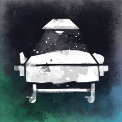

# To The Bone

**To The Bone**

| Property | Details |
| --- | --- |
|  |  / *To\_The\_Bone\_icon.png* |
| Description | Complete the autopsy of a missing Perseverance Mills townsperson. |

**To The Bone** is a hidden [achievement](./The%20Long%20Dark%20%E2%80%94%20Achievements.md) in *[Wintermute](./Wintermute.md)* [Episode 5: The Light At The End Of All Things](./Episode%205%20-%20The%20Light%20At%20The%20End%20Of%20All%20Things.md) of *[The Long Dark](./The%20Long%20Dark.md)*.

## Guide

This is an unmissable hidden achievement granted after completing the main story mission [To Those Who Are Missing](./To%20Those%20Who%20Are%20Missing.md). After [Astrid Greenwood](./Astrid%20Greenwood.md) performs an autopsy on one of the deceased patients in a cutscene, the achievement unlocks.

## Game History

\* UPDATE **31 March 2026 ([Update](./The%20Long%20Dark%20%E2%80%94%20Changelog.md#2.52)):**

- 
  - Added to game.

**Lua execution error in Module:Navbox function navbox**
