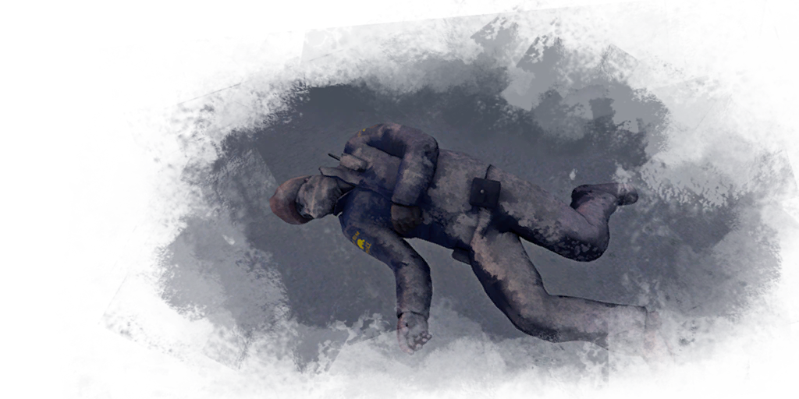

# To Those Who Are Missing

<table class="infobox">
<caption>To Those Who Are Missing</caption>
<colgroup>
<col style="width: 50%" />
<col style="width: 50%" />
</colgroup>
<tbody>
<tr>
<td colspan="2"><figure>

<figcaption>Missions_story_ep5_ToThoseWhoAreMissing.png</figcaption>
</figure></td>
</tr>
<tr>
<td>
Episode
</td>
<td></td>
</tr>
<tr>
<td colspan="2" class="section">
<strong>Missions</strong>
</td>
</tr>
<tr>
<td>
Previous
</td>
<td>
<a href="./Perseverance.md" class="wikilink" title="Perseverance">Perseverance</a>
</td>
</tr>
<tr>
<td>
Current
</td>
<td>
To Those Who Are Missing
</td>
</tr>
<tr>
<td>
Next
</td>
<td>
<a href="./A%20Cry%20For%20Help.md" class="wikilink" title="A Cry For Help">A Cry For Help</a>
</td>
</tr>
<tr>
<td>
Region
</td>
<td>
<a href="./Perseverance%20Mills.md" class="wikilink" title="Perseverance Mills">Perseverance Mills</a> <a href="./Perseverance%20Wilds.md" class="wikilink" title="Perseverance Wilds">Perseverance Wilds</a>
</td>
</tr>
<tr>
<td>
Characters
</td>
<td>
<a href="./Astrid%20Greenwood.md" class="wikilink" title="Astrid Greenwood">Astrid Greenwood</a> 
<a href="./Jane%20Yang.md" class="wikilink" title="Jane Yang">Jane Yang</a>
</td>
</tr>
</tbody>
</table>

|  |  |  |
|----|----|----|
| “ | Find the Constable along the river in Perseverance Wilds. | ” |

**To Those Who Are Missing** is the second mission of Part One: Perseverance in <a href="./Episode%205%20-%20The%20Light%20At%20The%20End%20Of%20All%20Things.md" class="wikilink" title="Episode 5: The Light At The End Of All Things">Episode 5: The Light At The End Of All Things</a> of the <a href="./Wintermute.md" class="wikilink" title="Wintermute">Wintermute</a> story of <a href="./The%20Long%20Dark.md" class="wikilink" title="The Long Dark"><em>The Long Dark</em></a>.

## Objectives

- Search the Wilds.
  - Find the Constable along the river in Perseverance Wilds
  - Find a missing Patient in Perseverance Wilds
  - Find a missing Person in Perseverance Wilds

## Walkthrough

## Trivia

**Lua execution error in Module:Navbox function navbox**

